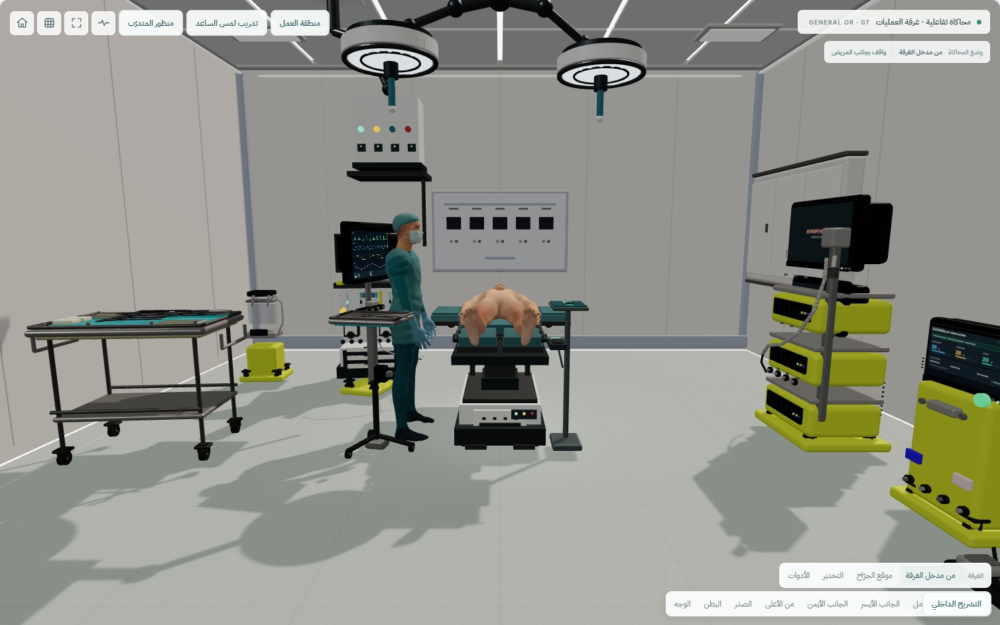

# نبض · منصة التدريب السريري

يضم هذا المستودع جزأين من مشروع نبض:

| الجزء | الرابط المباشر | الوصف |
|---|---|---|
| **منصة نبض** | https://khamees06.github.io/nabd/ | الموقع الرئيسي للمنصة، وفيه غرفة الطوارئ التدريبية |
| **محاكي غرفة العمليات ثلاثي الأبعاد** (نموذج أولي) | https://khamees06.github.io/nabd/or-simulator/ | غرفة عمليات افتراضية فيها مريض وطبيب مشرف، ويتدرّب فيها المتدرّب بيديه. الصور والفكرة في مجلد [`or-simulator`](or-simulator/README.md) |

