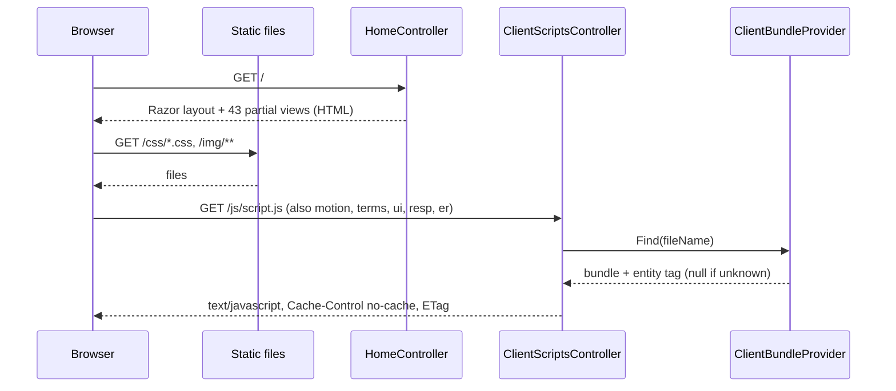
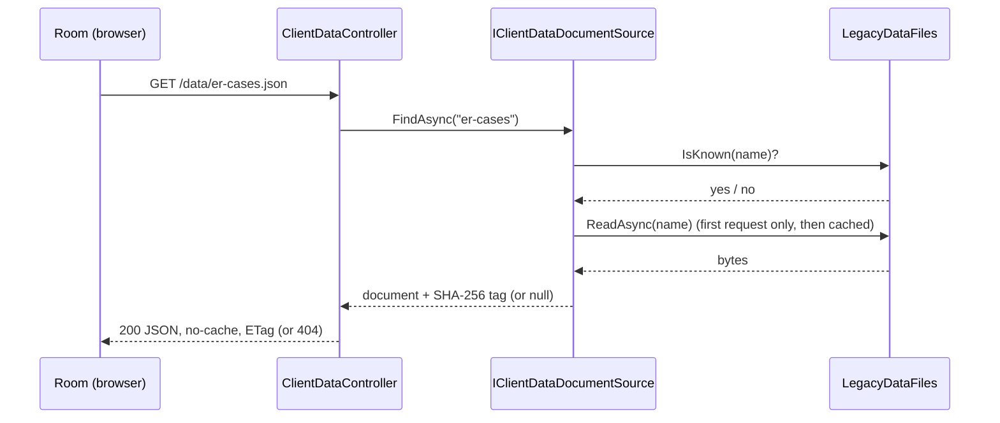
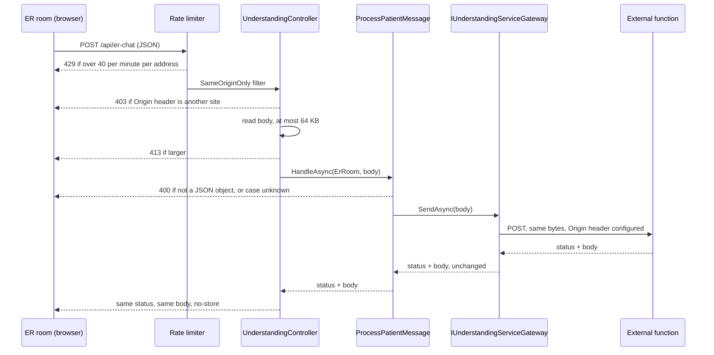
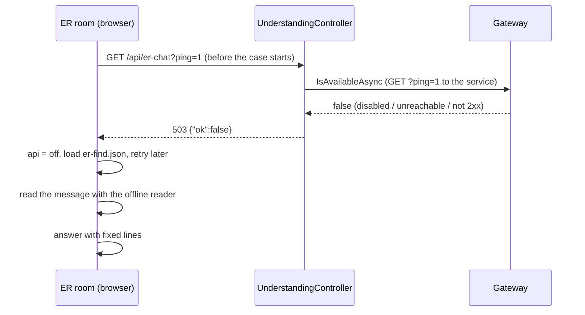
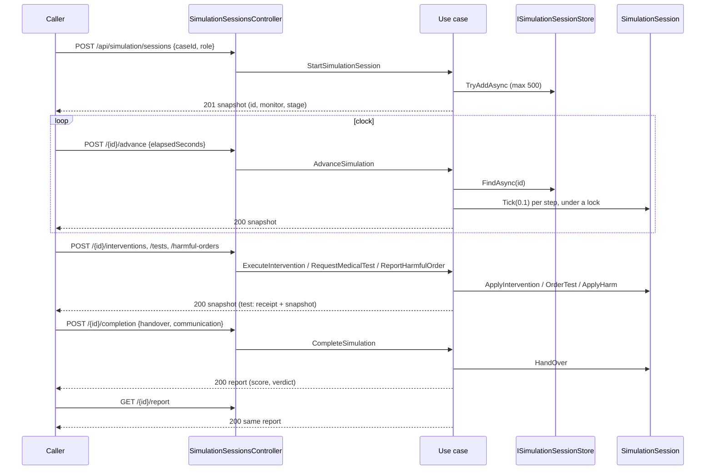

# Workflows

This document describes how Nabd («نَبْض الأردن») is used and how a request travels through the application.
It has three parts: what a user can do today, what the server does for each kind of request, and what a
developer does to change or check the system.

Read these first if you have not seen the project: [../README.md](../README.md) and
[architecture.md](architecture.md).

Four facts apply to every section below.

- The clinical content of the cases was written for training and **has not been reviewed by a physician**. The
  system does not diagnose or treat real patients.
- The room in the browser still runs the **legacy client**. The server-side model (`Nabd.Domain`) and the use
  cases (`Nabd.Application`) exist and are tested, but **the room does not call them yet**
  ([decision 0007](decisions/0007-server-session-api-off-by-default.md)).
- The real understanding services were **never called** in this phase. The relay is tested against fakes only
  ([decision 0006](decisions/0006-understanding-services-through-a-gateway.md)).
- There is **no authentication** and no database. Accounts are demo data in the browser
  ([decision 0008](decisions/0008-no-database-and-no-authentication-in-this-phase.md)).

## User journeys that work today

Source of the step lists: [legacy-audit/34-feature-reachability.md](legacy-audit/34-feature-reachability.md),
section "User journeys that work today", and the ER parts of the audit. That audit checked the legacy page in a
headless browser; the steps were not re-run against the new host in this phase except through the state
comparison described in [testing-strategy.md](testing-strategy.md) (landing, sign-in, register, home for three
roles, academic portal, profile, a refused navigation to the coach, ER briefing in both roles).

Where the logic runs: in every journey below, the **browser client** (the six script bundles). The server only
sends the page, the bundles, the data documents and, for typed messages in the ER room, relays to the
understanding service.

### 1. Visitor on the landing page

| Step | What happens |
|---|---|
| 1 | The page loads on the landing view. Header anchors: about, problem, solution, sections, audience |
| 2 | A request for any protected view shows the landing view and opens the sign-in page with a notice |
| 3 | "Try an ER case" signs in the demo account `med_student` and opens the ER briefing |

Logic: browser (`script.js`). Some landing sections are hidden by stylesheet rules (audit part 34, "Matrix").

### 2. Sign-in with a demo account, and registration

| Step | What happens |
|---|---|
| 1 | Sign-in page, three demo buttons (ids used today: `rana`, `med_student`, `doctor`) |
| 2 | A placement record is written for students, so the level quiz does not interrupt |
| 3 | Registration step 1: name, email, password (8 or more characters), role card (nursing, medicine, supervisor) |
| 4 | Registration step 2: year, section code, university. Submit |
| 5 | The account is created in `localStorage`; the user lands on home with a toast about the role |
| 6 | Sign-out, then sign-in with a wrong password shows an error; the right password opens home |

Sign-in accepts only non-demo accounts stored on the same device. Demo sessions are not restored after a reload
(code reading only). The role is chosen by the user and nothing verifies it. The password is stored as a salted
digest next to the account in `localStorage`. This is not a security boundary.

Logic: browser only. No request leaves the browser.

### 3. The ER room as a doctor, from the briefing to the report

| Step | What happens |
|---|---|
| 1 | Enter the ER room from home. The briefing sheet shows a doctor/nurse switch (allowed only before the first turn) |
| 2 | "Start session". The clock starts; the monitor and the chat feed are shown |
| 3 | The trainee types in the input and sends. The companion, the patient and the nurse answer |
| 4 | Treatments and tests are ordered by typing; results arrive after simulated time |
| 5 | The "end" button opens the hand-over sheet: diagnosis text, disposition, one SBAR text. Its confirm button is disabled until the sheet is filled |
| 6 | The report shows the score, the sub-scores, the risk timeline, what went well, what must change, the investigation log and a summary |
| 7 | A history entry (`er_<case id>`) and averages are saved in the account. Buttons: home, same case again, next case |
| 8 | The last report can be reopened through the debrief view until the next case starts |

Logic: browser (the `er.js` bundle). With the service on, a
typed message goes to `/api/er-chat` (flow 3 below). With the service off, the room reads the message itself
(flow 4). The case in progress lives only in page memory and is lost on reload.

### 4. The ER room as a nurse

| Step | What happens |
|---|---|
| 1 | `rana` (nursing track) enters the ER room. The role is nurse by track; the briefing names the nursing supervisor |
| 2 | Start, then send a message. The reply comes from the service, or from fixed lines when offline |
| 3 | The "end" button opens a four-field SBAR sheet (S, B, A, R). There is no diagnosis or disposition |
| 4 | The report and the history entry `er_<case id>_n` are written |

Verified in the page to step 3. Step 4 was **not verified** in the page (audit part 34). The nurse-role score is
not ported to the server; it is computed in the browser.

### 5. The professor's academic portal

| Step | What happens |
|---|---|
| 1 | Home shows the professor section: invite code, report count, tab shortcuts |
| 2 | The university view shows five tabs: courses and sections, assign cases, student reports, student progress, academic advisor |
| 3 | Assign: choose one of the six ER cases and one of three sections, optional due date and note, save. Stored in `nabd_v2_assignments` |
| 4 | Reports: cohort filter, CSV export, "show answers". Advisor: status and note, saved in `nabd_v2_advisor` |
| 5 | A student of that section sees the assignment on home; its button opens the ER room on that case |

Verified in the page: opening the portal, assigning, and the student opening the assignment. Not clicked: the
reports export and the advisor save. Anyone can sign in as the professor; assignments and grades exist in one
browser only.

### 6. The student's profile

| Step | What happens |
|---|---|
| 1 | Open the profile from the account menu or the sidebar |
| 2 | Tabs: dashboard (students only), strengths, history, training record and print, settings |
| 3 | The dashboard button "retake" reopens the level quiz; another button jumps to the history |

Print and settings were not verified in the page. Logic: browser. Data: the account in `localStorage`.

### Features that exist in the code but are hidden

The specialty simulation, the nursing cases, "observe an expert", the coach and the respiratory room are closed
in the legacy interface by view lists and stylesheet rules (`REMOVED_VIEWS`, `scope.css`). They are not user
journeys today. The table of what hides each one is in part 34, "Dormant features".

## System flows

All paths below are in `src/Nabd.Web/Program.cs` and the controllers named. In the pipeline order of
`Program.cs`: exception handler, security headers, static files, rate limiter, controllers.

### Flow 1. Loading the page

`GET /` returns the page. The browser then asks for the stylesheets, the images and six script bundles.



- `HomeController.Index` (`GET /`) renders `Views/Home/Index.cshtml` inside `_Layout.cshtml`. The response is not
  cacheable.
- `AccountController.Login` / `Register` (`GET /login`, `GET /register`, since V6.4) render the same page with the
  sign-in screen open on its form and their own title (decision 0012). In the browser, `landing.js` keeps the
  address in step with the screen: opening it from a button shows `/login` or `/register`, closing it (or signing
  in) returns to the address it came from, and Back closes it.
- Stylesheets and images are plain static files (`app.UseStaticFiles()`) from `wwwroot/css` and `wwwroot/img`.
- The layout lists six scripts with `defer`, in this order: `script.js`, `motion.js`, `terms.js`, `ui.js`,
  `resp.js`, `er.js`.
- `ClientScriptsController.Get` (`GET /js/{fileName}`) asks `ClientBundleProvider.Find`. The provider reads
  `ClientScripts/bundles.json`, joins the fragments of each bundle by plain concatenation (optional `open` and
  `close` pieces around them, line endings normalised to LF) and computes a SHA-256 entity tag. An unknown name
  gives 404. Source fragments cannot be requested.
- `Revalidated` sends `Cache-Control: no-cache` with the tag, so the browser revalidates every time.
- The head of the page also links a font stylesheet on a third-party host (Google Fonts). The audit lists the
  page start depending on that host as a known weakness (architecture.md, "Security posture").

### Flow 2. A room loading its data

The rooms fetch their data with relative URLs (`data/er-cases.json`, `data/er-act.json`, `data/er-find.json`; the
respiratory room builds `data/` + a file name). The ER room fetches `er-cases` when it opens and the two small
offline models (`er-act`, `er-find`) for flow 4.



- `ClientDataController.Get` (`GET /data/{name}.json`) calls `IClientDataDocumentSource.FindAsync`. The
  implementation `FileClientDataDocumentSource` first asks `LegacyDataFiles.IsKnown`. Eight names are known:
  `er-cases`, `er-act`, `er-find`, `er-lang`, `resp-ar`, `resp-clinical`, `resp-model`, `resp-patients`. Any other
  name returns 404 without touching the disk.
- `LegacyDataFiles.ReadAsync` is the only code that opens the files, from `LegacyData/Files` or from
  `LegacyData:RootPath`. The bytes are served unchanged, and cached in memory per name with a hash tag.
- The data files are not public static files. Note that `er-cases.json` still reaches the browser, so a trainee
  can read diagnoses and expected steps in it (architecture.md, "What is honest to say about data exposure").
- `er-lang.json` is served too, but no client fragment fetches it. Whether any other consumer needs it is not
  determined here; the audit says the external function reads its own copy (legacy-audit/30-data-files.md).

### Flow 3. A turn in the ER room with the understanding service on

The service is on when `UnderstandingServices:ErRoom:Enabled` is true (the default outside Development), an
endpoint is configured and it uses HTTPS or is a loopback address.



Order of the checks, from `Program.cs`, `UnderstandingController` and `ProcessPatientMessage`:

1. The rate limiter (`app.UseRateLimiter()`) runs before the controller. Policy `understanding`: fixed window of
   one minute, 40 requests per caller address, no queue (`RateLimits:UnderstandingPerMinute`). Over the limit: 429.
2. `[SameOriginOnly]`: if an `Origin` header is present and is not this host, the answer is 403 `{"error":"origin"}`.
   No header (a same-site GET, a server caller) passes. This is not authentication.
3. The controller reads the body in 8 KB chunks. More than 64 KB (by `Content-Length` or while reading): 413.
4. `ProcessPatientMessage` parses the body. Not JSON, or not an object: 400 `{"error":"bad request"}`. For the ER
   room, the `case` property must name a case that `IClinicalCaseRepository` knows; otherwise 400 `{"error":"case"}`.
5. `HttpUnderstandingServiceGateway.SendAsync` posts the bytes to the configured endpoint with an `Origin` header
   (the configured one, or the endpoint's own origin), a timeout (default 20 s, limited to 1 to 60 s) and a cap of
   256 KB on the answer. Disabled, not configured, not HTTPS, unreachable, slow or oversized: the answer is 503.
6. Status and body return **unchanged**, with `Cache-Control: no-store`. A status of 400 or more is logged as a
   warning (service name and status only, not the body).

What the room does with the answer (client fragment `er/100-server-client.js`, contract in
[legacy-audit/31-api-er-chat.md](legacy-audit/31-api-er-chat.md)):

| Answer | What the room does |
|---|---|
| 200 with a JSON body | Marks the service "on", resets its failure counter, uses the fields it needs (`read`, `to`, `reply`, `held`, `voiceFailed`, `unplaced`). If the room had announced the outage, it says once that the connection is back |
| 403, 404, 405, 429 or 503 | Goes offline at once (flow 4) |
| Any other status (400, 413, 500, 502) or a network error or a timeout | Counts one failure; at the third consecutive failure it goes offline. This one turn gets no service answer and the room uses its own reading |
| 200 with a body that is not JSON | Counts one failure, like a network error (the parse fails inside the same `try`) |

The room never reads the error text; it reads only the status. Client time limits: 15 s for a turn, 9 s for a
spoken line, 12 s for the handover grade. The reading rules, routing rules, prompts and model key live in the
external function, which is outside this repository.

Status of the proof: tested against a fake transport only (`Web/UnderstandingEndpointTests`,
`Infrastructure/HttpUnderstandingServiceGatewayTests`). No request reached the real function.

### Flow 4. The same room offline

Offline means: the service is off in settings, unreachable, answering with a "go offline" status, or the caller
is over the rate limit.



- When the room opens, it sends `GET /api/er-chat?ping=1&_=<time>` with a 4.5 s limit. `UnderstandingController.ErPing`
  answers 200 `{"ok":true}` or 503 `{"ok":false}`. A request without the `ping` parameter gets 405. No model is
  called by a ping. The ping is subject to the same rate limit and the same-origin filter.
- In Development the ER service is off, so the ping answers 503 and the room starts offline. This is the normal
  local state.
- On a failed ping the client sets the service to "off", retries later (audit part 31 says after 15 s) and loads
  the small finding model `data/er-find.json`. `data/er-act.json` is loaded when the room opens.
- Once offline, the room shows one system line saying the service is not available and that the room runs in a
  simplified mode and may not understand every sentence. It keeps knocking once a minute: a retry is allowed
  60 s after the last failure and is then limited to 4 s. A page opened from `file:` stays offline.
- Offline, the browser reads the message itself: the act model (`readAct`), the finding model (`readFinding`),
  the dose and order readers (`localRead`) and fixed Arabic lines for the patient, the companion, the nurse and
  the supervisor (fragments `110` to `220` of the ER bundle). The companion's unprompted line is skipped when
  the service is off.
- Quality of the offline mode: an earlier user test of the legacy room, recorded outside this repository, found
  it weaker than the online mode. The numbers are not in the sources read for this document; not determined.
- A fixed 40-message conversation in each case, offline and with a stub service, is pinned by the conversation
  golden master ([testing-strategy.md](testing-strategy.md)).

### Flow 5. A server-side session through the API

**The browser room does not use this path.** The API answers 404 unless `Simulation:ServerSessionsApi:Enabled`
is true. It is true in Development and in tests, and false otherwise. It exists to prove the server-side model,
and it is the path the next phase would move the room onto.

All routes sit under `/api/simulation/sessions`, with `[SameOriginOnly]` and the `simulation` rate limit (240 per
minute per address). Every action first checks the switch (`Guarded()`), then calls one use case.

| Call | Route | Use case | Domain member reached |
|---|---|---|---|
| Start | `POST /api/simulation/sessions` | `StartSimulationSession` | `SimulationSession.Start` (case from `IClinicalCaseRepository`, catalog, role) |
| Let time pass | `POST /{id}/advance` | `AdvanceSimulation` | `SimulationSession.Tick(0.1)` repeated |
| Intervention | `POST /{id}/interventions` | `ExecuteIntervention` | `Case.CareFor`, `ApplyIntervention` |
| Harmful order | `POST /{id}/harmful-orders` | `ReportHarmfulOrder` | `ApplyHarm` |
| Test | `POST /{id}/tests` | `RequestMedicalTest` | `OrderTest` |
| Complete | `POST /{id}/completion` | `CompleteSimulation` | `RecordHistory`, `RecordExamination`, `HandOver`, then `SessionReport.Of` (uses `SessionScorer`) |
| Report | `GET /{id}/report` | `GenerateSessionReport` | `SessionReport.Of` |



Details checked in `SimulationUseCases.cs`:

- **Start**: needs a case id (empty gives 400); an unknown case gives 404; a full store gives 503. The id is a
  GUID, sent in "N" format (32 hex characters).
- **Advance**: `ElapsedSeconds` must be between 0 and 120 (otherwise 400). The use case takes
  `round(elapsed / 0.1)` steps of 0.1 s and stops when the session is over.
- **Intervention**: the session must be open (409 if ended); the action must exist in the catalog (400); the
  amount cannot be negative. The dose text is cut to 60 characters. The reason grade is fixed to "good" here.
- **Harmful order**: the harm profile is supplied by the caller ("as the client judged it"). This input is
  transitional, because order safety is still in the legacy client (decision 0007).
- **Test**: the test id must exist and the reason grade must be `good`, `weak` or `ungraded`. The answer carries
  the test id, the minute it was ordered and the snapshot. It does not carry the indication of the test.
- **Complete**: only the doctor role is scored on the server (a nurse session gets 400). The destination must be
  one of `icu`, `hdu`, `cath`, `ward`, `home`. A second completion gives 409. While the patient is alive a
  handover is required. After an arrest, any handover sent is ignored. The handover is taken as already graded
  (transitional).
- **Report**: 409 until the session is completed.

What a response contains: the monitor, the cuff reading, the stage, and what was done. What it does **not**
contain: the patient's risk number, the indication of a test, and the scoring rules before the report. A test
asserts the absence of these fields (`Web/SimulationSessionsApiTests`).

Limits: sessions live in memory (`InMemorySimulationSessionStore`), at most 500 and dropped after 120 idle
minutes; they do not survive a restart. A session id is the only protection, because there is no authentication.

## The clock of a session

Time in a session is simulated. One real second is one simulated second (`Pace = 1`); the unit used in the
model is the simulated minute.

### The legacy clock (browser)

`er/050-risk-tick.js` runs `tick(now)` once per animation frame while the case is open:

1. `dt = clamp((now - last) / 1000, 0, 2)` seconds. A slow frame never moves time by more than 2 s.
2. `step = dt * PACE / 60` minutes. The simulated minute counter and the risk advance by `rate * step`; the
   risk is clamped between the floor (20) and 100.
3. The risk is logged every 0.25 minute. The monitor is painted every 0.12 minute.
4. Delayed jobs that are due run (`E.jobs`).
5. `stageCheck()` follows the risk. In the nurse role `nurseTick()` also runs.

Typed orders and answers arrive between frames, at one of two points of a tick (the golden-master traces record
both points).

### The domain clock (server)

`SimulationSession.Tick(elapsedSeconds)` does the same work in three named parts, so that an input can be placed
exactly between them as the legacy code allowed. It returns at once if the session is over.

| Part | Method | What it does |
|---|---|---|
| 1 | `BeginTick` | Caps the step at 2 s. Moves the minute counter and the risk (clamped between 20 and 100). Logs the risk every 0.25 minute. Refreshes the monitor every 0.12 minute (which may take a cuff reading). Runs the delayed effects that are due |
| 2 | `ReassessStage` | The stage follows the risk. A worsening stage is announced at once. An improvement is announced only after the patient had reached the urgent stage or worse |
| 3 | `EndTick` | At a risk of 100 the patient arrests and the session closes |

The risk rate is net: the case's own rate, minus the slowing of treatments that have started, with a hold in
some cases (until the cause is treated, the rate cannot fall below zero while the risk is at or below the hold
level, so supportive care holds the patient but does not turn the case round).

### The cuff cycle

The blood pressure is not continuous. `Cuff` holds the last reading.

| Rule | Value |
|---|---|
| First reading | Taken when the session starts |
| Normal cycle | Due every 2 minutes (`CuffEveryMinutes`) |
| Cycle once the stage is urgent or worse | Due every 1 minute (`CuffWhenSickMinutes`) |
| Taken at once, outside the cycle | When the stage worsens to urgent or worse; when a worsening stage's cue names measured signs; when the stage improves from urgent or worse; when a repeat pressure is ordered; after a harm takes effect; after adrenaline takes effect in anaphylaxis; once a treatment that moves the vital signs has had time to work (its ramp plus 0.1 minute; treatments given close together share one reading; none is taken if the patient is critical or the risk has risen by more than 2 since the order) |
| When the cycle is checked | Only at the monitor refresh (every 0.12 minute), so a reading can be up to that late |

### Delayed effects

Effects that happen later are queued with `After(minutes, action)` and run in part 1 of the first tick at or after
their time.

| Effect | Delay | Result |
|---|---|---|
| Harmful order takes effect | 0.3 minute | The risk rises by the harm's value (default 12, or 18 for an allergic reaction unless the profile says otherwise); an anaphylaxis may start |
| Adrenaline given during anaphylaxis | 0.15 minute | The risk falls by 18; a cuff reading is taken |
| Shock delivered during ventricular tachycardia | 0.1 minute | The risk is set to the critical level minus 5, the stage to urgent, the rhythm is restored |
| Treatment onset | Case data (`OnsetMinutes`) | The risk slowing of that treatment starts to count |
| Vital-sign effect of a treatment | Starts 0.03 minute after the order and ramps over the treatment's ramp time (default 0.2 minute) | The monitor values move |

All of these are pinned bit for bit by the golden masters for the doctor role and the nurse role dynamics
(`GoldenMasters/ErClinicalTraceTests`).

## Developer workflows

Prerequisites and configuration: [setup.md](setup.md). Strategy and results: [testing-strategy.md](testing-strategy.md).
All commands run from the repository root.

### Build, test and run

1. `dotnet restore Nabd.sln`
2. `dotnet build Nabd.sln` (warnings are errors; public members need XML documentation).
3. `dotnet test Nabd.sln` (164 tests at the time of writing, about ten seconds; no Node.js, browser or network).
4. `dotnet run --project src/Nabd.Web`, then open <http://localhost:5054>. `GET /healthz` answers `ok`.

### Record and check the golden masters

Recording needs Node.js. The committed traces mean `dotnet test` does not.

1. Check that the traces on disk still match the legacy script:
   `node tests/legacy-baseline/record-er-clinical.js --check`
2. Record the clinical traces again (writes `tests/Nabd.Tests/GoldenMasters/ErClinical/*.json`):
   `node tests/legacy-baseline/record-er-clinical.js`
3. Record or compare the conversation golden master:
   `node tests/legacy-baseline/golden-conversation.js record` and `node tests/legacy-baseline/golden-conversation.js compare`
4. Compare against the `er.js` that the application serves (application running on port 5199):
   ```
   curl -s http://127.0.0.1:5199/js/er.js -o served-er.js
   NB_ER_JS=served-er.js node tests/legacy-baseline/golden-conversation.js compare
   NB_ER_JS=served-er.js node tests/legacy-baseline/record-er-clinical.js --check
   ```
5. Run `dotnet test Nabd.sln`. `ErClinicalTraceTests` replays the traces against the C# model.

Changing a clinical rule on purpose: re-record the traces from a legacy script carrying the same change, or
record the accepted difference in the test, with review by someone who can judge the clinical effect. Never
weaken a baseline test to make a change pass (testing-strategy.md, "Rules for changing things").

### Compare the two hosts in a browser

A manual check. It needs Chrome and two running hosts.

1. Check out the `main` branch in a separate folder and serve it:
   `node tools/legacy/serve-static.mjs <that checkout> 5180`
2. Start the application with Development settings:
   `ASPNETCORE_ENVIRONMENT=Development dotnet run --project src/Nabd.Web --no-launch-profile --urls http://127.0.0.1:5199`
   (bash syntax; without the variable the understanding services are switched on)
3. Run `node tools/legacy/compare-hosts.mjs`.
4. Read the result per state and viewport: live DOM, screenshot bytes, page errors. In this phase's run the DOM
   was identical in 22 of 22 pairs; two screenshots of signed-in home views differed with identical DOM, and such
   views differ about as often when the legacy site is compared with itself.

### Register an intentional difference in `seams.json`

Any change to a file under `ClientScripts/`, `Views/` or `wwwroot/css` changes what the browser receives and
makes the baseline tests fail until it is registered.

1. Make the change and run `dotnet test Nabd.sln`. `Baseline/LegacySiteBaselineTests` names the file that differs.
2. Open `tests/Nabd.Tests/LegacyBaseline/seams.json`. Each entry has `file`, `count`, `legacy` (the legacy text),
   `current` (the new text) and `reason`.
3. Add an entry (or change `count`) so that undoing the registered differences gives the legacy text again.
4. Write the reason in plain words. The file has 18 entries today.
5. Run `dotnet test Nabd.sln` again. It must pass without changing the legacy baseline itself
   (`tests/Nabd.Tests/LegacyBaseline/site/` and `legacy-manifest.json` are never edited).

### Add a use case

Follows [architecture.md](architecture.md) and decision 0001. The steps below are derived from the existing use
cases and the architecture tests; they were not run as a procedure in this phase.

1. If the use case needs the outside world, add a port (an interface) under `src/Nabd.Application/Abstractions/`
   and implement it in `src/Nabd.Infrastructure/`.
2. Add one `sealed` class with one `HandleAsync` method in `src/Nabd.Application/` (for example under
   `Simulation/`). It loads through a port, asks the domain to do the work and returns a `Result<T>`. No clinical
   rule belongs in it.
3. Put any new clinical rule in `src/Nabd.Domain/`, never in the use case. A rule change fails the golden masters
   (see above).
4. Register the use case with the application's service registration (`AddApplication`, called from `Program.cs`).
5. Add a controller action that calls it. A controller takes use cases and application ports, never an
   infrastructure type. The session API maps failure kinds to status codes in `ToResponse`.
6. Add tests: a use case test in `tests/Nabd.Tests/Application/`, an endpoint test in `tests/Nabd.Tests/Web/`.
   `Architecture/LayeringTests` checks the dependency direction, that use cases are sealed and that controllers
   take no infrastructure types.
7. Run `dotnet build Nabd.sln` and `dotnet test Nabd.sln`.

## Failure handling

Failures never show a stack trace to the browser. `app.UseExceptionHandler()` with `AddProblemDetails()` turns an
unexpected exception into a short problem document; details go to the log.

| What fails | What the user sees | Where it is handled |
|---|---|---|
| The understanding service is unreachable, slow, disabled or not configured | The relay answers 503. The ER room announces once that the connection is not available, then runs offline with its own reader and fixed lines. It tries again about once a minute | `HttpUnderstandingServiceGateway` (maps every transport failure to 503); client `goOff()` in `er/100-server-client.js` |
| The caller is over the rate limit (more than 40 requests a minute to the room endpoints) | 429. The room goes offline at once, for about a minute | Rate limiter registered in `RateLimitPolicies.AddNabdRateLimits`; client status list (403, 404, 405, 429, 503) |
| The room's availability check (`GET /api/er-chat?ping=1`) fails | The room starts offline | `UnderstandingController.ErPing` (503 `{"ok":false}`); client `ping()` |
| A request from another site | 403 `{"error":"origin"}`. The room treats 403 as "go offline". A normal visitor of this site does not see this | `SameOriginOnlyAttribute` |
| Unknown case in a room request | 400 `{"error":"case"}`. The room counts one failure; three in a row put it offline | `ProcessPatientMessage` |
| Body is not a JSON object | 400 `{"error":"bad request"}`. Same client handling | `ProcessPatientMessage` |
| Oversized request (over 64 KB) | 413 `{"error":"too large"}`. Same client handling as other non-listed statuses. The browser room does not send such a body in normal use | `UnderstandingController.ReadBodyAsync`, `ProcessPatientMessage` |
| Unknown script name or data name | 404. The page or the room that asked fails to load that item | `ClientScriptsController`, `ClientDataController` |
| A data file is missing on disk | An exception in the data source, answered as a 500 problem document. Whether the room shows anything useful is not determined | `LegacyDataFiles.ReadAsync`, exception handler |
| Session API switched off | 404 for every route | `SimulationSessionsController.Guarded` |
| Unknown or malformed session id (session API) | 404 problem document "Unknown session." A session dropped after 120 idle minutes reads the same | `SessionStoreExtensions.FindSessionAsync`, `InMemorySimulationSessionStore.FindAsync` |
| Unknown case when starting a session | 404 problem document "Unknown case." | `StartSimulationSession` |
| Session already ended (intervention, harmful order or test) | 409 problem document "The session has ended." | `ExecuteIntervention`, `ReportHarmfulOrder`, `RequestMedicalTest` |
| Completing twice, or reading a report before completion | 409 problem document | `CompleteSimulation`, `GenerateSessionReport` |
| Invalid values (negative amount, elapsed time outside 0 to 120 s, unknown action, test, destination or reason grade) | 400 problem document | The use case that owns the input |
| Malformed JSON body on a session route | 400, with no stack trace in the body | `[ApiController]` binding; test `Wrong_requests_get_a_problem_document_and_never_a_stack_trace` |
| Session store full (500 sessions) | 503 problem document "Too many sessions are running." | `StartSimulationSession`, `InMemorySimulationSessionStore.TryAddAsync` |
| Session API over its rate limit (240 a minute) | 429. No browser client uses this API | Rate limiter |
| An unhandled exception | A short problem document (status 500) with no stack trace; the details are logged. A test of this exact case was not found in the files read for this document: not determined | `Program.cs` (`UseExceptionHandler`) |
| Respiratory room service (`/api/resp-chat`) | Same relay, same statuses, with its own settings. The room is closed in the legacy interface, so no user reaches it today | `UnderstandingController.RespChat` |

Browser-side failures (storage blocked, a malformed saved account, a case lost on reload) are handled by the
legacy client and are listed in the audit, not here. The case in progress is lost on reload.
