

# نبض · محاكي غرفة العمليات ثلاثي الأبعاد

**نموذج أولي تفاعلي يعمل في المتصفح لتدريب طلاب الطب والتمريض داخل غرفة عمليات افتراضية.**

▶️ **جرّب المحاكي مباشرة:** https://khamees06.github.io/nabd/or-simulator/
(متصفح كمبيوتر حديث مثل Chrome أو Edge، ولا يحتاج أي تثبيت)

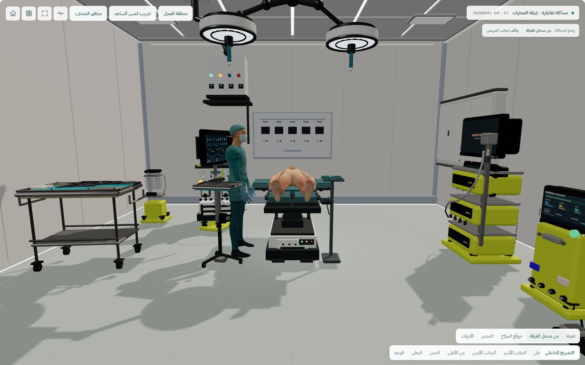

---

## الفكرة

المتدرّب حاضر داخل غرفة عمليات حقيقية المظهر، أمامه مريض افتراضي على طاولة العمليات، وبجانبه طبيب مشرف وممرضة. يتعلّم بالملاحظة والسؤال واتخاذ القرار، ويؤدي الحركات بيديه داخل المشهد. لا لوحة أزرار ضخمة ولا أجواء ألعاب.

- **المتدرّب يتصرّف بيديه:** يلمس المريض، ويمسك يده أو ساقه ويحرّكها ضمن حدود المفاصل الطبيعية، ويمسك الأدوات ويوجّهها.
- **المشرف يقود ولا يقوم بكل شيء:** يوجّه ويشرح ويسأل. وعند الحاجة يتدخّل بيده، فيسند ذراع المريض أو يتولّى الموقف في الطوارئ.
- **الممرضة تساعد:** تستلم الطلبات وتناول الأدوات المناسبة للمرحلة.
- **الحالة تتحكّم بالغرفة:** حالة المريض والأدوات المتاحة والخطوة التالية كلها مرتبطة بسيناريو واحد.
- **الحالة الأولى المخطَّط لها:** التهاب الزائدة الدودية.

---

## ماذا يعمل اليوم

| الجزء | الوصف |
|---|---|
| **غرفة العمليات** | طاولة عمليات، وإضاءة جراحية تتبع منطقة العمل، وجهاز تخدير، وبرج منظار بشاشات، ومراقب للعلامات الحيوية، وعربات أدوات |
| **المريض الافتراضي** | جسم بشري كامل بهيكل عظمي من 163 مفصلاً. تتحرك الأطراف بمفاصل مقيّدة تشريحياً، وتنثني أصابع اليدين |
| **يدا المتدرّب** | إمساك الرسغ ورفع الساعد، ورفع الساق من الكاحل أو الركبة، ولمس البطن والضغط عليه، مع منظور من عيني المتدرّب |
| **الأدوات** | ملقط المنظار، ومنظار تدريبي، ومقص جراحي، وماسك إبرة. المنظار يدخل من منفذ في البطن، وتظهر صورته الحية على الشاشة |
| **التشريح الداخلي** | أطلس من 35 عضواً وبنية، منها الزائدة الدودية والأعور، مع إمكانية عزل أي عضو |
| **المشرف** | طبيب بجسم كامل وملابس عمليات، يسند ذراع المريض ويناول الأدوات |
| **التدريب** | تمرين من خمس خطوات: قراءة الشاشة، ثم الإمساك، ثم التوجيه، ثم الإرجاع، ثم تحريك الرسغ |

---

## صور من المحاكي

| | |
|---|---|
| 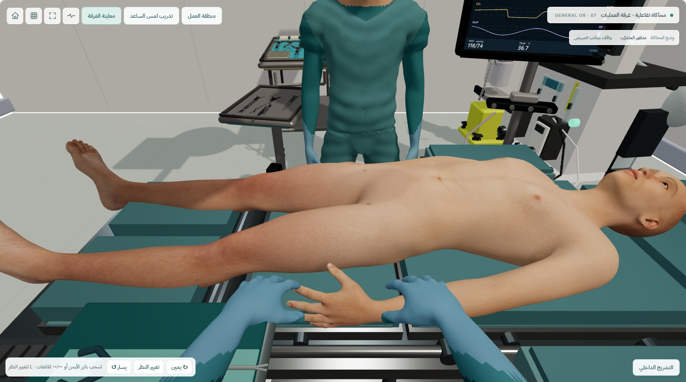 **منظور المتدرّب بجانب المريض** | 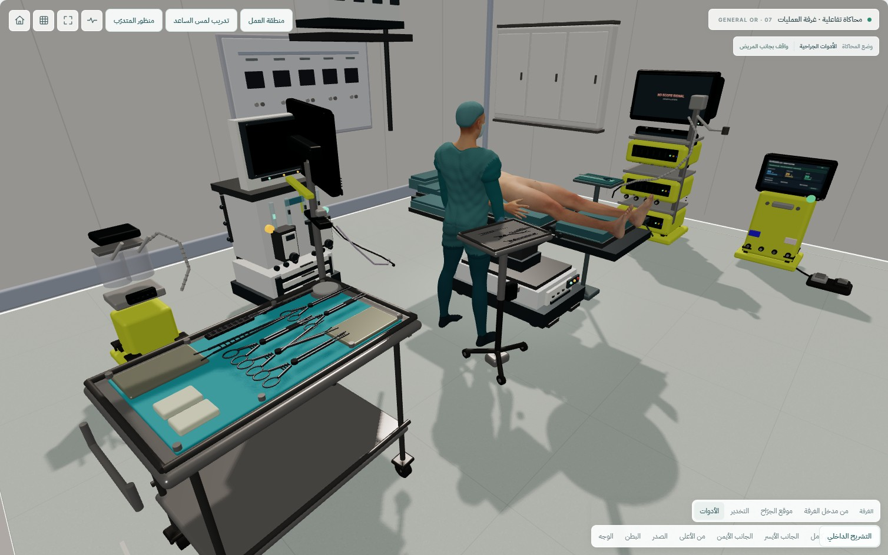 **عربة الأدوات والطبيب المشرف** |
| 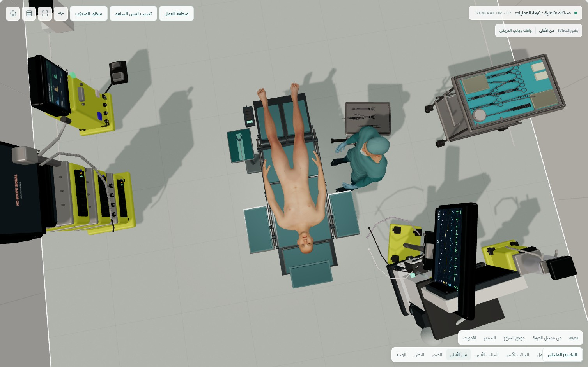 **الغرفة من الأعلى** | 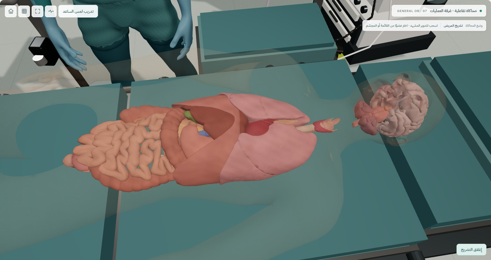 **التشريح الداخلي داخل جسم المريض** |
| 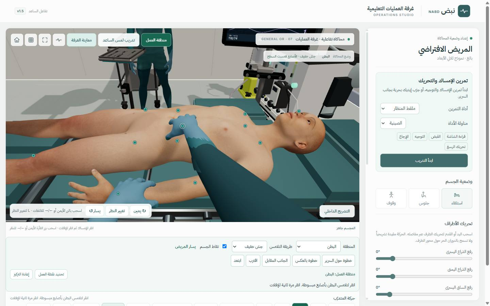 **لمس البطن بأصابع مبسوطة** | 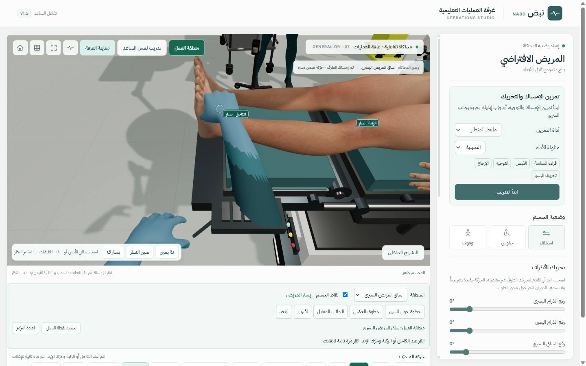 **إمساك الكاحل ورفع الساق** |
| 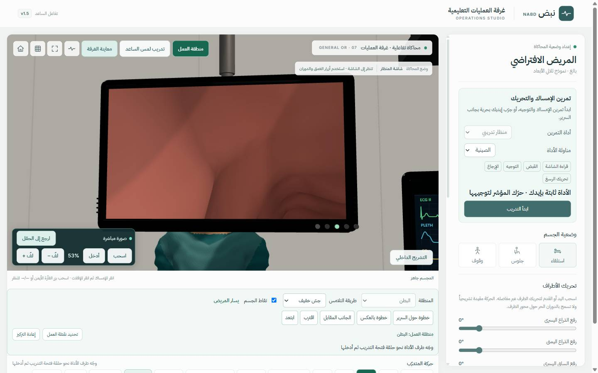 **صورة المنظار الحية على الشاشة** | 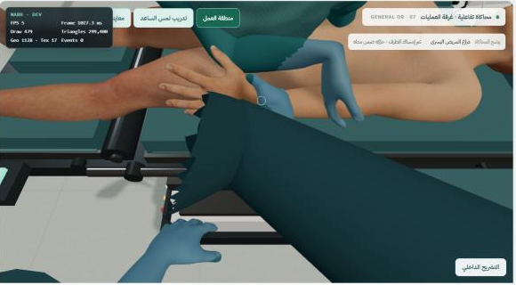 **المشرف يسند ساعد المريض** |
| 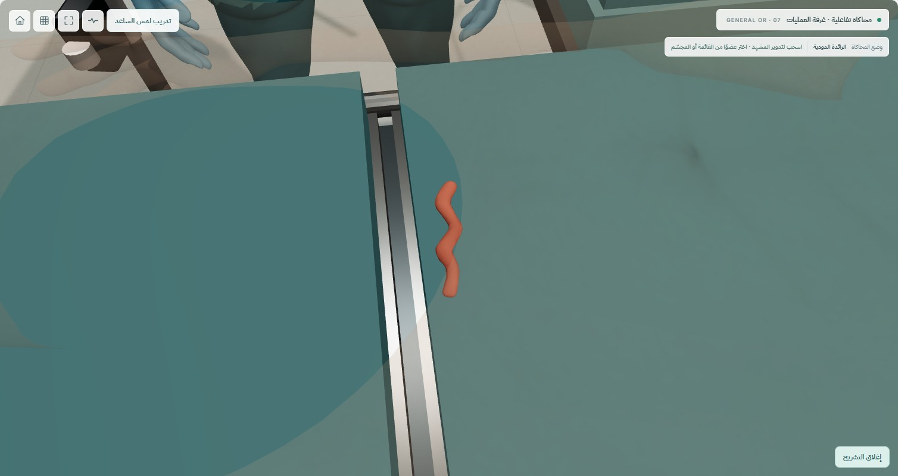 **الزائدة الدودية معزولة في الأطلس** | 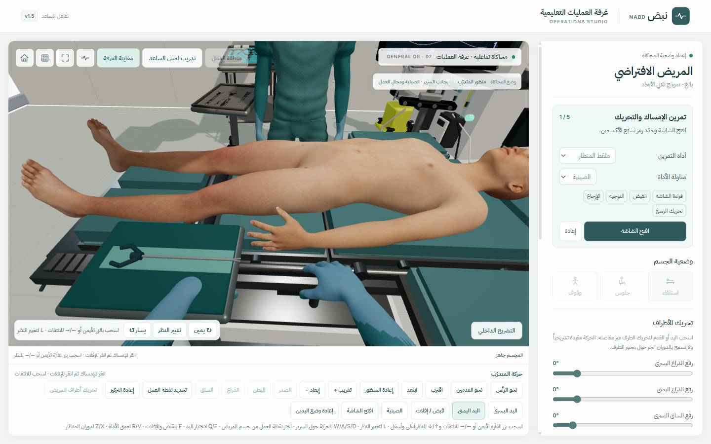 **بداية تمرين التدريب** |

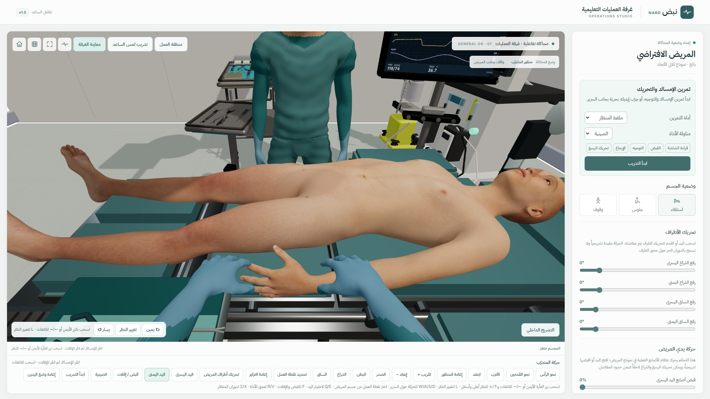

---

## الخطوات القادمة

الخطة الكاملة موجودة في [`docs/improvement-plan`](docs/improvement-plan/README.md) (12 مرحلة مرتّبة حسب الاعتمادية). أهم المحطات:

1. **جسم كامل للمتدرّب:** الكاميرا عند عينيه، والذراعان متصلتان بالكتفين بدل اليدين وحدهما.
2. **لمس من أي مكان في الجسم:** يمسك المتدرّب المريض من أي موضع ويحرّكه بواقعية، من غير أن تغوص اليد في الجسم أو في السرير. هذه المرحلة قيد التطوير.
3. **ممرضة:** بالجسم نفسه بعد التعديل، وبملابس ولون مختلفين.
4. **لوحة محادثة جانبية صغيرة:** للتواصل مع الطبيب والممرضة، يشغّلها نموذج نبض اللغوي، إلى جانب التواصل بالأفعال.
5. **سيناريو التهاب الزائدة الدودية الكامل:** من تقديم الحالة واجتماع الفريق إلى الإجراء والتقييم الختامي ([السيناريو](docs/improvement-plan/11_FULL_SESSION_SCENARIO.md)).
6. **غرفة وأجهزة أكثر واقعية:** وشاشة المنظار قريبة من الجرّاح.

> **ملاحظة مهمة:** هذا نموذج أولي للعرض والتطوير. المحتوى السريري فيه توضيحي، وسيُراجَع ويُعتمد من أطباء معتمدين قبل استخدامه في التدريب الفعلي.

---

## طريقة التحكم

| الحركة | التحكم |
|---|---|
| الإمساك والإفلات | نقرة للإمساك، ونقرة ثانية للإفلات (أو المفتاح F) |
| النظر حولك | السحب بالزر الأيمن، أو الأسهم ←/→ |
| الحركة حول السرير | W / A / S / D |
| اختيار اليد | Q لليسرى، وE لليمنى |
| عمق المنظار ودورانه | R / V للعمق، وZ / X للدوران |

---

## تقنياً

- **التقنيات:** Three.js (r180) يعمل مباشرة في المتصفح، ومحرك Rapier لفحص التصادم في تمرين الساعد. لا يحتاج خادماً خاصاً.
- **التشغيل محلياً:** `npm run serve` ثم افتح `http://127.0.0.1:4173`. التفاصيل في [README-TECHNICAL.md](README-TECHNICAL.md).
- **مصدر هذه النسخة:** لقطة من مستودع التطوير (الفرع `p1-interaction`، الالتزام `0a87bd7`). سجلات الاختبار الداخلية غير منشورة هنا.
- **التراخيص والمصادر:** Three.js بترخيص MIT، وRapier بترخيص Apache-2.0، وأطلس التشريح من BodyParts3D (DBCLS) بترخيص CC BY 4.0، والخطوط بترخيص SIL OFL 1.1. النص الكامل في قسم التراخيص داخل [`index.html`](index.html) وفي [README-TECHNICAL.md](README-TECHNICAL.md).

---

**English summary.** Nabd OR Simulator is a browser-based 3D operating-room prototype for training medical and nursing students. It runs on Three.js r180 and needs no install. It includes:
- a posable virtual patient with anatomically limited joints;
- first-person trainee hands that grip, lift and touch;
- four laparoscopic instruments with a live scope feed;
- a 35-structure internal anatomy atlas that includes the appendix;
- a full-body supervising doctor;
- a five-step practice drill.

The roadmap adds a full-body trainee, grab-anywhere contact, a nurse, a side chat with the supervising doctor and nurse, and a complete appendicitis case. Clinical content is illustrative until certified doctors review and approve it. Live demo: https://khamees06.github.io/nabd/or-simulator/
