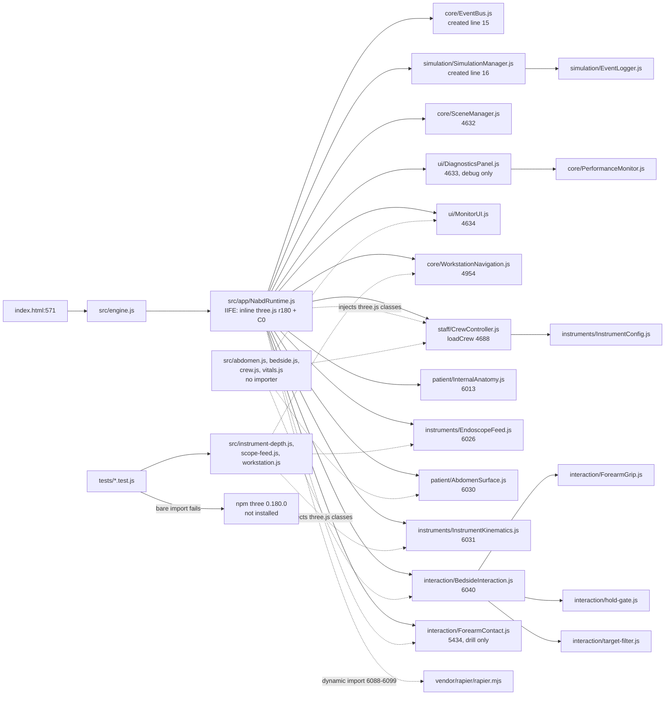
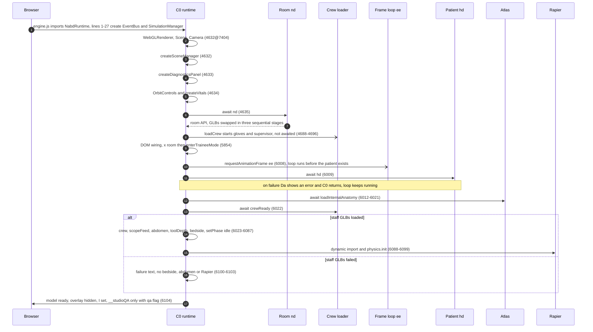
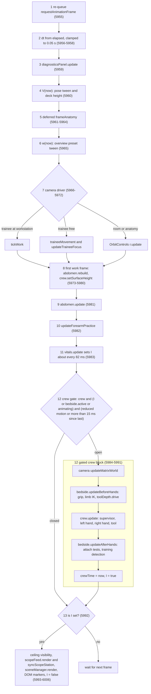
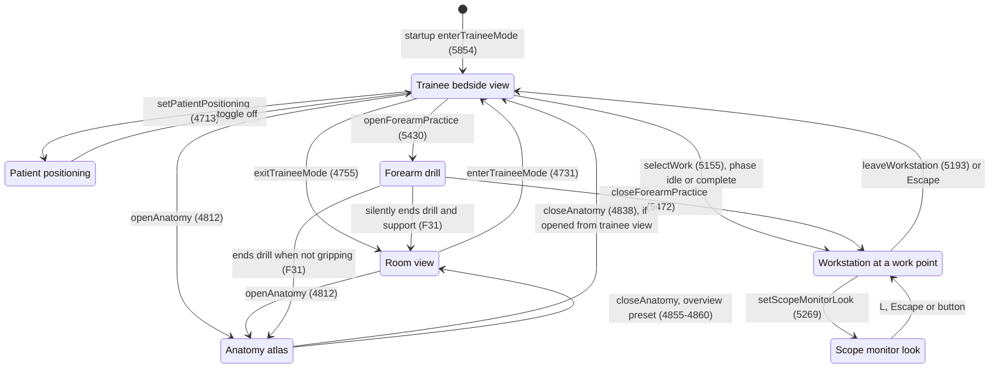

# 01 — Project Understanding: Nabd Clinical Simulator v1.5

**Purpose.** This document explains what the Nabd v1.5 repository actually is, how it starts and runs, and how its major systems connect. It describes the current system without judging it against the owner's brief ([03](03_REQUIREMENTS_GAP_ANALYSIS.md)) or proposing work ([07](07_PRIORITIZED_IMPROVEMENT_ROADMAP.md)). Findings use the IDs F01–F35 defined in [02](02_CURRENT_STATE_AUDIT.md). Facts carry a status label; recommendations appear only in section 9 and are marked as such.

**Status labels used:** VERIFIED (executed and observed in the audit lead's browser run, cited as R1–R21 or build checks B1–B5), TEST-VERIFIED (covered by a named repository test that passed), SOURCE-INSPECTED, PARTIALLY VERIFIED, PLANNED, UNKNOWN; plus DATA-DERIVED (audit analysis) for numbers computed by audit scripts, which are never TEST-VERIFIED. Results of the T1 run of 14 November 2026 are cited as "T1 run"; BLOCKED marks a check that could not run in that environment.

**Status after T1 (14 November 2026).** This document describes the v1.5 tree as audited on 13 November 2026. Its account of the code still holds: T1 changed two lines of application code, the F19 fix in `src/staff/CrewController.js:232-233` (commit `006881f`, line numbers unchanged). What T1 changed is the evidence: the folder is under git (F05), all 21 test cases pass (F03), the Vite build works (F04), the scissors and needle holder render their blades (F19), and a Playwright smoke suite on `window.__studioQA` (F32) has exercised flows that were unexercised or UNKNOWN below, among them drill steps 2–5 (§6.11), scope insertion and the live feed (§6.10), WASD walking (§6.2, U14) and valid frame rates (§6.15, F33). The section-level statuses below are left as audited; the current state is in [02](02_CURRENT_STATE_AUDIT.md) §4 (status note), [evidence/baseline-p0/RESULTS.md](evidence/baseline-p0/RESULTS.md), [phase-reports/P0-unknowns.md](phase-reports/P0-unknowns.md) and [phase-reports/P0-completion.md](phase-reports/P0-completion.md).

**Related documents:** [README](README.md) · [02 Current State Audit](02_CURRENT_STATE_AUDIT.md) · [03 Gap Analysis](03_REQUIREMENTS_GAP_ANALYSIS.md) · [05 Hand, Contact and Movement Options](05_HAND_CONTACT_AND_MOVEMENT_OPTIONS.md) · [07 Roadmap](07_PRIORITIZED_IMPROVEMENT_ROADMAP.md) · [08 Decisions and Open Questions](08_TECHNICAL_DECISIONS_AND_OPEN_QUESTIONS.md) · [Repository Evidence Index](REPOSITORY_EVIDENCE_INDEX.md)

All `NabdRuntime.js` references mean `src/app/NabdRuntime.js`. Minified lines that mix vendor and app code are cited as `line@byte` (0-based byte offset within the line).

---

## 1. What Nabd v1.5 is

Nabd v1.5 "Forearm Contact" (`package.json` version 1.5.0) is a browser-only 3D clinical training prototype with an Arabic right-to-left interface (`index.html:2`). It renders a procedurally built operating room, upgraded by four trimesh-generated equipment GLBs whose origin is not stated in the repository (F30), with a rigged virtual patient lying supine on the table, one full-body rigged supervising clinician, and a trainee represented by the camera plus two gloved forearm meshes (VERIFIED R4, [evidence/01-default-bedside-view.jpg](evidence/01-default-bedside-view.jpg)). According to the source, the learner can walk around the bed, choose work points on the patient, grip and lift limbs, press or pinch a patch of the abdomen, pick up one of four procedural instruments, steer a grasper or scope around one abdominal port with a live endoscope feed, open an internal atlas of 35 BodyParts3D structures, and run one generic five-step "grasp and move" drill (SOURCE-INSPECTED). Of these, the browser run exercised the bedside view, the forearm grip and lift, the atlas and step 1 of the drill (VERIFIED R4, R9, R14, R15). Abdominal press and pinch, scope insertion and drill steps 2–5 were not exercised. The v1.5 addition is the forearm contact drill. In the source, Rapier 0.21.0 shape queries sweep six glove probes against capsules fitted to the patient's left arm and against the mattress (SOURCE-INSPECTED; F15). A "مساندة المشرف" mode keeps the lifted forearm raised after release (VERIFIED R7–R11). Whether the probes reliably stay out of the arm was not measured: collision reliability is UNKNOWN. There is no nurse, no dialogue, no scenario data file, no evaluation and no appendicitis case (SOURCE-INSPECTED; F13, F21, F22, F24). Everything runs from one composition file, `NabdRuntime.js` (6,160 lines, 748 KB), that inlines three.js r180 (F01).

### 1.1 Version lineage (from repository documents)

The folder is not a git repository (F05), so this lineage is what the documents claim; it cannot be checked against history (UNKNOWN). *Since T1 (14 November 2026) it is one, but its history starts at the baseline commit `acdab52` (tag `v1.5-baseline`), so the lineage before v1.5 still cannot be checked.*

| Version | What the documents say it added | Source |
|---|---|---|
| v0.16 | Externalised GLB assets; split HTML, CSS and bundled engine; patient finger articulation; trainee hands made visible | `docs/v0.16-change-log.md`, `docs/patient-hand-rig.md`, `docs/architecture-decision.md` |
| v0.20/v0.21 | Patient, room, staff, glove and equipment assets (named as the v0.22 baseline) | `docs/Nabd-v0.22-Implementation-Report.md:5` |
| v0.22 | Free work-point selection, separate look/walk/manipulate channels, general surface touch, remote-centre scope kinematics and screen feed | `docs/Nabd-v0.22-Implementation-Report.md`, `docs/Nabd-v0.22-Review-Board.md`, `docs/v0.22-interaction-notes.md` |
| v1.0 Foundation | Domain modules with compatibility re-exports; EventBus, EventLogger, SimulationManager; SceneManager; `?debug=1` overlay; asset manifest; `scripts/serve.mjs` | `docs/Nabd-v1.0-*.md` (4 files), `README.md` |
| v1.1 | Scope station. The heading "محطة المنظار v1.1" is empty; the walkthrough follows under the next heading, "تجربة محطة المنظار" | `README.md:22-30` |
| v1.2 | Internal anatomy atlas; stated as the source project of v1.5 | `README.md:9` |
| v1.4 | Bone model and fracture drill; stated as **not merged** (no such code found) | `README.md:9` |
| v1.5 | Forearm contact drill with Rapier 0.21.0 | `README.md:3-10` |

**What is preserved.** v1.0 states that it kept the r180 runtime as composition root, the assets, HTML controls, CSS identity, camera views, positioning, training stages and scope feed (`docs/Nabd-v1.0-Change-Log.md`, "Preserved"). The code agrees except for one claim: the "appendectomy/laparoscopic and neck scenario entry points" (`docs/Nabd-v1.0-Change-Log.md:21`) do not exist in code (F21, F35). The plan keeps this preservation-first stance (decisions DN1, DN6 in [08](08_TECHNICAL_DECISIONS_AND_OPEN_QUESTIONS.md)).

### 1.2 Inputs used

- The repository itself, read-only (source of truth).
- The owner's `Nabd_Experience_and_Workflow_Brief.md` (product requirement) and the owner's task instructions.
- The audit lead's browser run (R1–R21) and build checks (B1–B5), with screenshots in [evidence/](evidence/).
- **Missing input:** the orientation document `Nabd_v1.5_Repository_Review.md` named by the owner does not exist anywhere on disk. Nothing in this plan relies on it.

---

## 2. How it runs

### 2.1 Run routes

| Route | Command and mechanism | Needs | Status |
|---|---|---|---|
| Dependency-free server | `npm run serve` → `node scripts/serve.mjs` (127.0.0.1:4173, `HOST`/`PORT` env); `start-dev.bat` on Windows | Node.js only, no install | VERIFIED B5 (run with `PORT=4190`); all runtime checks R1–R21 used it |
| Vite dev/build | `npm ci`, then `npm run dev` / `npm run build`; `vite.config.mjs` copies `assets/` and `vendor/rapier/` on `writeBundle` | `node_modules` (absent; installed by `npm ci` in T1) | Not run (B3); never documented as run; works or not: UNKNOWN (F04). *T1 run: builds in about 1.0 s and empties `dist/`, deleting the standalone preview (U17); built app smoke-tested under `vite preview` before the F19 fix (not yet after it)* |
| Standalone preview | `npm run preview:standalone` → `scripts/build-preview.mjs` → `dist/Nabd-Clinical-Simulator-v1.5-Preview.html`, embedding 9 GLBs and Rapier as base64 | Node.js only | VERIFIED B4: 34.70 MiB, renders over http with zero console messages (`dist/` deleted afterwards); `file://` UNKNOWN. *T1 run: rebuilt after the Vite build; works over `file://` in Chrome, Edge and WebKit on Windows (U11)* |
| Tests | `npm test` → `node --test` | Node.js; `three` package for one file | VERIFIED B1: 13 files / 21 cases; 20 reported results, 19 pass, 1 fail (F03). *T1 run: 21 of 21 pass after `npm ci` (TEST-VERIFIED); browser smoke suite added as `npm run smoke` (Playwright 1.64.1, `tests/browser/`)* |
| Syntax | `node --check` on all JS/MJS | Node.js | VERIFIED B2 (pass) |

In served mode `index.html` contains no embedded asset blocks, so every asset is fetched from `assets/`; all 21 ES modules, 9 GLBs and `vendor/rapier/rapier.mjs` returned HTTP 200 (VERIFIED R3, F34).

### 2.2 Entry chain and file structure

`index.html:571` loads `<script type="module" src="./src/engine.js">`. `src/engine.js:7` only imports `./app/NabdRuntime.js`. That file is laid out as follows (SOURCE-INSPECTED):

| Lines (`line@byte`) | Content |
|---|---|
| 1–13 | 13 static relative imports of domain modules |
| 15–27 | Module scope: `createEventBus()`, `new SimulationManager({eventBus})`, frozen `window.NabdSimulation` |
| 29 → 3860@71275 | IIFE opens; minified three.js r180 core, `WebGLRenderer` alias `va` (3860@18771), OrbitControls `Ea` (@50770), RoundedBoxGeometry `Ta` (@69824) |
| 3860@71276 → 4583 | App code starts (`var Hi=`): shared materials, helpers `jn`/`vt`/`ll`, table constants `Un`/`Cr`, room builder `async function nd` (3860@72918), `loadEmbeddedAsset` (4523), GLB swaps (4546–4581) |
| 4585@0 → @44086 | BufferGeometryUtils and GLTFLoader `Ra` (@995) |
| 4585@44087 → 4632 | Patient rig: presets `Pr`, routes `S0`, `async function hd` (4585@45443), finger curl, IK helpers `T0`/`A0`/`pd`, limb manipulator `md` (4632@2317) |
| 4632@7404 → 6154 | `async function C0()`: initialisation, DOM wiring, trainee camera, work regions, forearm drill, scenario, input, frame loop `ee` (5954–6007) |
| 6154 | `C0().catch(...)`: records `interaction_error` and shows the error overlay |
| 6155–6159 | three.js licence comment (line 6160 is empty) |

The app never imports the npm `three` package. Domain modules receive three.js classes by injection, for example `loadCrew({ T: { Vector3: L, ... } })` (4688–4689) and `createForearmContact({ ..., Vector3: L, Quaternion: tt })` (5434–5436). `package.json` pins `three@0.180.0`, but only `tests/forearm-contact.test.js:3` uses it (SOURCE-INSPECTED).

**Rapier.** Inside the crew-loaded branch, 6088–6099 imports either a base64 `#forearm-physics` block (standalone preview) or `./vendor/rapier/rapier.mjs` via `await import(/* @vite-ignore */ source)`, calls `physics.init()` and enables `#forearm-practice`. The button starts disabled. If the import fails, it stays disabled, gets an error title and the error is logged; nothing else is affected. Only stateless `castShape`/`contactShape` queries are used; no World or bodies exist (SOURCE-INSPECTED).

**Loading overlay.** `#loading-state` covers the viewport until 6104 (`La.hidden=!0`), after the Rapier import settles, so the 3D view waits for a 4.3 MB module that only the forearm drill needs (SOURCE-INSPECTED; timing UNKNOWN).

---

## 3. Repository map

| Path | Responsibility | Connected to the running app? |
|---|---|---|
| `index.html` | Page shell, 90 static controls (F25), licence comment (310–557), module script (571) | Yes |
| `src/engine.js` | Entry; imports the runtime | Yes |
| `src/app/NabdRuntime.js` | Composition root: inline three.js, room, patient rig, cameras, input, scenario, frame loop | Yes |
| `src/core/EventBus.js` | Synchronous pub/sub | Yes; only subscriber is DiagnosticsPanel under `?debug=1` |
| `src/core/SceneManager.js` | `render()`/`resize()` wrapper | Yes (render 6002, resize 5854); `getInfo`/`dispose` never called |
| `src/core/PerformanceMonitor.js` | FPS and renderer counters | Only inside DiagnosticsPanel (`?debug=1`) |
| `src/core/WorkstationNavigation.js` | Bed-perimeter work walk | Yes (4954) |
| `src/patient/AbdomenSurface.js` | Whole-skin height field; abdominal press/pinch deformation | Yes (6030), only if staff GLBs load |
| `src/patient/InternalAnatomy.js` | 35-structure atlas, transparency, scope layer | Yes (6013) |
| `src/staff/CrewController.js` | Gloves, supervisor, instruments, contact probes | Yes (4688, 6022) |
| `src/interaction/BedsideInteraction.js` | Pointer/keyboard gestures, pick, grip, release | Yes (6040) |
| `src/interaction/ForearmContact.js` | Rapier capsule/mattress queries | Forearm drill only (5434) |
| `src/interaction/ForearmGrip.js` | Wrist-frame forearm grip | Forearm drill only (`BedsideInteraction.js:284`); no test |
| `src/interaction/hold-gate.js`, `target-filter.js` | Look-pause flag; privacy-surface filter | Yes, via BedsideInteraction |
| `src/instruments/InstrumentConfig.js` | Metadata for 4 instruments | Yes, via CrewController (5 fields used) |
| `src/instruments/InstrumentKinematics.js` | Remote-centre port steering, depth, roll | Yes (6031) |
| `src/instruments/EndoscopeFeed.js` | 960×540 scope render target | Yes (6026) |
| `src/simulation/SimulationManager.js`, `EventLogger.js` | Session/stage state; in-memory event log | Yes (15–16) |
| `src/ui/MonitorUI.js` | Vital-signs canvas and dialog | Yes (4634) |
| `src/ui/DiagnosticsPanel.js` | Developer overlay | `?debug=1` only (4633) |
| `src/styles.css` | Layout, palette, embedded IBM Plex Sans Arabic and Inter | Yes |
| `src/abdomen.js`, `bedside.js`, `crew.js`, `vitals.js` | 4 of the 7 two-line v1.0 compatibility re-export shims in `src/` | **No importer** (dead) |
| `src/instrument-depth.js`, `scope-feed.js`, `workstation.js` | The other 3 of the 7 shims | Imported only by tests (`instrument-depth.test.js`, `scope-feed.test.js`, `workstation.test.js`); the app imports the domain modules directly (`NabdRuntime.js:1-13`). `src/engine.js` is the entry point, not a shim |
| `assets/` | 9 GLBs (≈22.1 MB), provenance notes, `asset-manifest.json` | GLBs yes; manifest and notes not read at runtime |
| `vendor/rapier/` | `rapier.mjs` (wasm inlined; version 0.21.0 per `README.md:10`), Apache-2.0 `LICENSE` | Yes (dynamic import) |
| `vendor/three/`, `vendor/fonts/` | Licence texts (font files are stubs, F30) | No |
| `scripts/` | `serve.mjs`, `build-preview.mjs`, `generate-asset-manifest.mjs`, `build-internal-atlas.py` (Blender + external data) | Tooling |
| `tests/` | 13 files, 21 cases, all with fakes (F02) | Tooling |
| `docs/` | v0.16–v1.0 reports; `improvement-plan/` (this plan) | Documentation |

---

## 4. Architecture diagrams

### 4.1 Module graph

Solid arrows are static imports. Dashed arrows from `NabdRuntime.js` are runtime creation, injection or dynamic import. Dashed arrows from the two shim boxes are re-exports in the 7 compatibility shims, which the running app never loads (SOURCE-INSPECTED). For readability, the graph shows only the tests' shim imports and the bare `three` import; the other tests import domain modules directly (see [Repository Evidence Index](REPOSITORY_EVIDENCE_INDEX.md) §5).

### 4.2 Startup sequence

### 4.3 Frame loop `ee(now)` (`NabdRuntime.js:5954-6007`)

Consequences (SOURCE-INSPECTED): the vitals repaint keeps rendering and crew updates at roughly 12 Hz even when idle (F23). The exception is `prefers-reduced-motion`, where the monitor paints once and stops (`MonitorUI.js:132`). Other consequences: instrument steering, limb IK and training detection run only inside the throttled crew block; a live scope adds a second scene render (F20).

**Outside the loop** (SOURCE-INSPECTED): `md` limb-drag IK in pointer handlers (4632@2317); pose sliders and patient finger curl (DOM handlers); `runPatientHandDemo` with its own rAF chain (5872–5891); depth and roll adjustments (wheel 5806, keys 5834–5837, buttons); the anatomy pick (4875–4893); all `SimulationManager` calls (never ticked). No `setTimeout`/`setInterval` exists in app code or modules.

---

## 5. Interaction modes and how they switch

| Mode | Entry (code) | Camera driver | Pointer owner | Status |
|---|---|---|---|---|
| Trainee bedside view (default) | `enterTraineeMode` (4731), called at startup (5854) | `applyTraineeRotation`, `traineeMovement` (free walk clamped to x 0.65–1.36) | BedsideInteraction (`isEnabled`, 6062) | VERIFIED R1/R4; WASD movement UNKNOWN (R19) |
| Room view | `#toggle-trainee-mode` → `exitTraineeMode` (4755) | OrbitControls `r` + 11 presets `x()`/`w()` (5854) | OrbitControls, `md` handles | VERIFIED R13 ([evidence/06-room-overview.jpg](evidence/06-room-overview.jpg)) |
| Patient positioning | "تحريك أطراف المريض" → `setPatientPositioning` (4713) | Trainee camera | `md` joint handles (capture phase) | SOURCE-INSPECTED |
| Workstation / work point | Region buttons or focus pick → `selectWork` (5155); refused unless `phase` is idle or complete (5156) | `tickWork` + `createWorkWalk` (4954) | BedsideInteraction station branch (touch, press, pinch, limb grip) | SOURCE-INSPECTED (not exercised except via the drill) |
| Forearm drill | `#forearm-practice` → `openForearmPractice` (5430) → `selectWork('leftArm')` | As workstation | BedsideInteraction forearm branch + `ForearmContact` | VERIFIED R7–R11 ([evidence/02-forearm-drill-grip.jpg](evidence/02-forearm-drill-grip.jpg)) |
| Scope station / monitor look | Abdomen work + scope selected (`scopeStationReady`, 5265) → `setScopeMonitorLook(true)` (5269) | Camera turned to a field display | Canvas input paused; depth/roll by buttons and keys | SOURCE-INSPECTED (not exercised) |
| Anatomy atlas | `#anatomy-toggle` → `openAnatomy` (4812): needs idle/complete and no grip, forces supine, exits trainee mode (4821) | OrbitControls + `frameAnatomy` (4771) | Organ pick, mouse only (4876) | VERIFIED R14 ([evidence/08-internal-anatomy-atlas.jpg](evidence/08-internal-anatomy-atlas.jpg)) |
| Tray / supervisor hand-off | `#training-source` = tray or staff; `startScenario` (5712); `resetTool` (5531) | Trainee camera | BedsideInteraction `tool` kind | Selects VERIFIED R17; supervisor hand-off not exercised |

**F31, silent teardown.** Every overview preset and the anatomy view are reached through `exitTraineeMode`, which calls `leaveWorkstation` (4757 → 5193). That closes the forearm drill (5195 → `closeForearmPractice` 5472 → `resetForearmPractice`, which calls `crew.setForearmSupport(null)` at 5468) and parks a placed tool (5198). `enterTraineeMode` also calls `leaveWorkstation` (4734), so Escape at a workstation (5845-5848) and "إعادة وضع اليدين" (5952) end the drill the same way. Escape is an explicit exit; the room-view and anatomy toggles are not. No message tells the learner (SOURCE-INSPECTED). This is why [evidence/07-left-side-preset-supervisor.jpg](evidence/07-left-side-preset-supervisor.jpg) shows the supervisor idle: support had already ended when it was taken (R12, corrected).

---

## 6. Major systems

**6.1 Operating room.** `nd` (3860@72918 → 4583) builds a 7.16 × 7.98 m room procedurally, then swaps in four trimesh GLBs in three awaited stages (4546–4581), keeping procedural fallbacks. The two lamp "spots" are `DirectionalLight`s inside a group hidden once the light GLB loads (4033, 4563), so there is no task lighting by default (F26). The table GLB does not match the code's deck constants (F27); room GLBs lack normals and UVs and several devices use lime casing `#ebf641` (F28). Status: room renders VERIFIED R13; visual quality UNKNOWN.

**6.2 Cameras and navigation.** One main camera `t` (created 4632) is driven by the trainee controls (4707–4947), the work walk (`WorkstationNavigation.js`, `tickWork` 5227), OrbitControls with 11 presets, `frameAnatomy`, or `setScopeMonitorLook`. The endoscope has its own camera and scene (`EndoscopeFeed.js:24-25`). Status: `createWorkWalk` basics TEST-VERIFIED (`workstation.test.js`); camera modes SOURCE-INSPECTED; WASD UNKNOWN (R19).

**6.3 Patient rig, IK and poses.** `hd` (4585@45443) loads `patient.glb` (≈109k triangles, 163 joints, standing A-pose, no clips or morphs), makes it supine by rotating the whole group, and exposes 4 limb chains, 6 pose presets in `Pr` (supine, sitting and standing are user-selectable; rise, turn and lean are transition keyframes routed by `S0`) and finger curl. The `index.html` licence comment says the base mesh and rig are Innerscene's "Male base mesh, rigged A-pose", adapted from MakeHuman, CC0 1.0 (`index.html:537-538`). This is the repository's own claim; it was not independently verified (F14, F30). Limbs move by analytic two-bone IK (`T0`/`A0`, 4632) with swing and bend limits and a mattress/floor check, via `md` handles, sliders or bedside grips (`createLimbDrag`, 5395). The skeleton is byte-identical to `supervisor.glb` (F14). Status: patient and forearm lift VERIFIED R4, R9 ([evidence/03-forearm-lift-stretched-sleeve.png](evidence/03-forearm-lift-stretched-sleeve.png)); IK limits SOURCE-INSPECTED.

**6.4 Abdomen surface.** `createAbdomenSurface` (`AbdomenSurface.js`, created at 6030) rasterises the whole skin into a 6 mm max-Y height field on workstation entry (`rebuild`, lines 24–57) and displaces vertices for press and pinch only inside x ±0.153, z −0.244…−0.066 (line 16). The height field also feeds work targets, landmarks and the glove lift. Status: SOURCE-INSPECTED; no test; not exercised at runtime.

**6.5 Internal anatomy atlas.** `loadInternalAnatomy` (`InternalAnatomy.js:17-82`, called at 6013) attaches 35 BodyParts3D structures (CC BY 4.0) to the patient group, not to bones (line 55), makes the skin 18 % opaque, supports system/organ isolation, and clones a digestion/urinary/vessel layer for the scope. Status: VERIFIED R14 (35 structures, attribution line, cecum/appendix/mesoappendix listed); appendix itself PARTIALLY VERIFIED (F29).

**6.6 Trainee hands.** `buildHand` (`CrewController.js:21-85`) adds two glove GLBs (hand to below the elbow) to the scene, re-placed from `camera.localToWorld` each crew update (`updateHand`, 362–435). There is no body, shoulder or arm IK (F06). In workstation modes `updateSleeve` (437–453) stretches one cylinder to a virtual shoulder (F07). Left/right mapping is fixed (line 87; F08), orientation conventions differ by path (F09) and fingers follow one curl scalar (F10). Status: VERIFIED R4, R10, R21; orientation effects UNKNOWN.

**6.7 Supervisor.** `supervisor.glb` is a clothed full body on the patient's skeleton, placed at (−0.79, 0, 0.06) and always visible (`CrewController.js:88-94`). It is posed procedurally each crew update: arm aim, finger curl, a rigid whole-body tilt from the feet, and teleports between three positions (457–486; F11). "مساندة المشرف" runs a right-arm two-bone IK (`reachSupport`, 143–175) plus a flag that pauses forearm settling (F12). Status: VERIFIED R4, R11 ([evidence/04-supervisor-support-hand.png](evidence/04-supervisor-support-hand.png), [evidence/05-after-release-forearm-supported.jpg](evidence/05-after-release-forearm-supported.jpg)).

**6.8 Bedside interaction.** `createBedside` (`BedsideInteraction.js`, created at 6040) owns one `gesture` and one `pointer` (13–15). `pick()` (39–102) chooses tool, wrist, forearm, touch, press, pinch, surface or look; a first click grips, a second click releases, and attach times out after 3.2 s. Two-hand use is impossible by construction (F18). Status: reach gating and grip VERIFIED R8, R9; only the hold-gate flag and privacy filter are TEST-VERIFIED (`hold-gate.test.js`, `target-filter.test.js`, mocks).

**6.9 Contact and Rapier.** `createForearmContact` (`ForearmContact.js`) fits capsules to the patient's left upper arm and forearm plus a mattress cuboid, and sweeps, resolves and measures six ball probes at glove bone origins (`CrewController.js:80`, 411–423), in the forearm drill only (F15). The forearm capsule sits ≈1 cm inside the skin (F16, DATA-DERIVED). Elsewhere, contact is raycast targeting, pad proximity and a top-down height-field lift, with two normal-space errors (F17). Status: drill entry, grip, lift and support VERIFIED R7–R11. `tests/forearm-contact.test.js` cannot load (F03), so collision is not TEST-VERIFIED. Its assertions were reproduced only by an audit harness (DATA-DERIVED (audit analysis)). Collision reliability and visible penetration are UNKNOWN.

**6.10 Instruments and scope feed.** Four procedural instruments share one `tool` group (`CrewController.js:185-251`); scissors and needle-holder blades get NaN geometry (232–233; F19). For the scissors this is VERIFIED R20 ([evidence/10-scissors-without-blades.jpg](evidence/10-scissors-without-blades.jpg)). The needle holder shares the code path but was not selected at runtime (SOURCE-INSPECTED). Instruments are kinematic at a fixed palm offset (F20). `createInstrumentDepth` steers about one abdominal port; `createScopeFeed` renders the atlas layer to four screens. Status: config values, port target maths and feed texture swapping TEST-VERIFIED with mocks (`instrument-config.test.js`, `instrument-depth.test.js`, `scope-feed.test.js`); scope insertion not exercised.

**6.11 Training drill.** One session `'clinical-skills-practice'` (5714) with five steps: monitor, pickup, aim, deposit, wrist. Step text and UI locks are inline in `setPhase` (5665–5697), and detection is in `interactionEvent` (5537–5663). The workstation, forearm drill, scope and atlas are free practice outside it (F21). The result line always reads 5/5 (5695; F24). Status: start and step 1 VERIFIED R15 ([evidence/09-training-step-1-of-5.jpg](evidence/09-training-step-1-of-5.jpg)); steps 2–5 not exercised. Any clinical meaning: CLINICAL REVIEW REQUIRED.

**6.12 Vitals.** `createVitals` (`MonitorUI.js:112-159`) paints a canvas from `dataAt(seconds)` (36–45): fixed demo values with small sine variation, labelled "DEMO SIGNALS", with no setter and no link to the scenario (F23). Static device screens show conflicting values (4099–4108). Status: SOURCE-INSPECTED; every displayed value is CLINICAL REVIEW REQUIRED and none is asserted here.

**6.13 UI.** `index.html` has 90 static controls: 76 buttons, 8 inputs and 6 selects (SOURCE-INSPECTED). Static analysis puts 47 of them as visible by default in trainee mode. At runtime the lead measured 39 visible buttons (76 in DOM), 8 visible form controls and 0 textareas at 1440×900 (VERIFIED R5). Authoring tools sit beside the drill, and status strings are partly colloquial (F25). The palette is muted teal and grey with embedded IBM Plex Sans Arabic and Inter (`src/styles.css`).

**6.14 Events.** `SimulationManager` mirrors the stage, `EventLogger` keeps up to 10,000 whitelisted events in memory, and `EventBus` publishes `'simulation:event'`. Call sites record only while a session exists, so drill actions before "ابدأ التدريب" leave no trace (VERIFIED R16), and reset wipes the log (5952 → 5700; F24). Status: logger and manager TEST-VERIFIED (`event-logger.test.js`, `simulation-manager.test.js`); runtime wiring SOURCE-INSPECTED.

**6.15 Diagnostics.** `?debug=1` shows FPS, frame interval, draw calls, triangles, geometries/textures and event count (`DiagnosticsPanel.js`). Renderer counters per view were captured (VERIFIED R6; F33). FPS reflects rAF ticks, not renders, and was invalid in the hidden pane. The heap value is computed but never shown (F35). `PerformanceMonitor` is TEST-VERIFIED (`performance-monitor.test.js`).

**6.16 `?qa` automation API.** With `?qa`, `window.__studioQA` (6104–6154) exposes targets, asset status, a full simulation-state snapshot (forearm overlap/stops/support gap, instrument angles, mode, phase, camera, vitals), scope pixel readback, joints and `setPose`. No test or harness uses it (F32). Status: SOURCE-INSPECTED.

---

## 7. Data ownership and coupling

Almost all application state lives in the `C0` closure and is shared by direct reference (F01). Modules own only their internal state and see runtime state through callbacks.

| State | Where it lives | Main writers | Main readers |
|---|---|---|---|
| Render/crew flag `I` | `C0` closure (declared on minified line 5854) | 38 write sites: camera, pose, anatomy, work, forearm, vitals (5983), crew block | Crew gate (5984), render block (5992) |
| Mode flags (`traineeMode`, `patientPositioning`, `workFocused`, `workReady`, `scopeMonitorLook`, `anatomyActive`, ...) | 4666–4676 | Mode functions in section 5 | `isEnabled` (6062), `workSpec` (5029), `viewportInputPaused`, many runtime functions |
| Training state `phase`, `motion`, `activeHand` | 4686, 5370 | `setPhase`, `interactionEvent`, `chooseHand` (5241) | `canPickTool` (6064), `allowWrist` (6065), `getSide` (6042) |
| Patient rig `g`, current/target pose `f`/`b`, deck height `m`, pose tween `E` | Declared on minified 5854 (@~1150); pose functions on 5916 | `G()`, `V()` | Limb floor `$()`, Rapier mattress height `() => m` (5436), ~10 behaviours gated by `E` |
| Session and event log | Module scope (15–16) | `setPhase` → `setStage` (5667), `record` calls | `window.NabdSimulation`, DiagnosticsPanel |
| Hands, supervisor, tool mode | `CrewController` closure | `crew.update`, setters | BedsideInteraction, InstrumentKinematics, EndoscopeFeed |
| Gesture | `BedsideInteraction` closure | Pointer and key handlers | Crew drive API |
| Room object `o` | Returned by `nd` (4582) | Runtime moves `o.mayo`, toggles grid, ceiling and field displays | Render block, scope station |
| Vital values | `MonitorUI` closure, a function of time | None (no setter) | Canvas, `?qa` |

Coupling risks (SOURCE-INSPECTED):
- **One flag, two meanings.** `I` means both "redraw" and "simulate hands" and has 38 writers (F01).
- **Late-bound nullable services.** `crew`, `bedside`, `abdomen`, `toolDepth`, `scopeFeed`, `internalAnatomy` and `forearmPractice` start null; some call sites rely on ordering instead of `?.`.
- **Failure coupling.** A patient load failure aborts `C0` (6009); a staff GLB failure leaves no bedside interaction, abdomen surface, instrument kinematics or Rapier (6100–6103).
- **No lifecycle end.** No teardown, `dispose` or `webglcontextrestored` path exists.

---

## 8. Glossary

| Term | Meaning in this repository |
|---|---|
| Composition root | `C0()` in `NabdRuntime.js`, which creates and wires every service |
| `line@byte` | Citation inside a minified line, with a 0-based byte offset |
| `I` | Render-invalidation flag that also opens the crew-update gate |
| Crew / crew block | `CrewController` (gloves, supervisor, tool) and its throttled per-frame update (5984–5991) |
| Gesture | The single active BedsideInteraction action (tool, wrist, touch, press, pinch, surface, look) |
| Workstation / work point | Bedside mode focused on a region or picked skin point, with the perimeter work walk |
| Forearm drill | v1.5 mode "تدريب لمس الساعد": left wrist grip with Rapier contact |
| Support / settling | "مساندة المشرف" supervisor IK plus a flag; settling is the kinematic return of a released forearm |
| Probe / capsule / shape query | Glove bone-origin balls; patient-arm Rapier capsules; stateless `castShape`/`contactShape` calls |
| Pad | Glove fingertip vertices used for proximity attach tests |
| Height field | `AbdomenSurface` 6 mm max-Y grid of the supine skin |
| Port / remote centre | The abdominal work point the grasper or scope pivots about |
| Scope station | Field displays and monitor-look mode for the live scope feed |
| Atlas / scope layer | 35-structure BodyParts3D GLB and its clone for the endoscope scene |
| Session / phase | `SimulationManager` session and the five-step drill stage from `setPhase` |
| `?debug=1` / `?qa` | URL flags for the diagnostics overlay and the `window.__studioQA` API |

---

## 9. Key takeaways for planning (RECOMMENDATION: planning implications)

- **Extend the runtime, do not rewrite it.** Everything converges on one closure with a shared flag (F01), and the working scene, assets and drill are worth keeping. New features need explicit seams: an always-on event stream, a frame-update registry and service interfaces (P2), within DN1.
- **Build a safety net first.** The folder has no version control (F05), no successful Vite build is on record (F04; `docs/Nabd-v1.0-Foundation-Report.md:37`, B3), the only v1.5 test cannot load (F03), and nothing tests the runtime (F02). A ready automation surface already exists (F32). Together these make P0 the first step (T1 in [10](10_NEXT_IMPLEMENTATION_TASK.md)). *Status after the T1 run (14 November 2026): built on branch `t1-baseline-f19` — git baseline `acdab52` (tag `v1.5-baseline`), 21 of 21 tests, a working Vite build, and a Playwright smoke suite with visual and performance baselines in Chrome, Edge and WebKit on Windows (Firefox BLOCKED). T1 is not yet complete (7 of 11 criteria MET, 4 PARTIALLY MET; [phase-reports/P0-completion.md](phase-reports/P0-completion.md)) and awaits owner checkpoint 1.*
- **Trainee embodiment is the most visible gap.** The trainee is a camera with floating forearms, the stretched sleeve is a verified defect (F06, F07), and hand orientation conventions are inconsistent (F08–F10). The shared 163-joint rig (F14) is the main reuse lever for full bodies (P3); on 2026-11-14 the owner decided to reuse the existing body in-house for every person (D1, option A+, [08](08_TECHNICAL_DECISIONS_AND_OPEN_QUESTIONS.md)).
- **Contact is narrow but well structured.** The Rapier shape-query pattern (F15) can be generalised to the whole patient (DN3, P5) once proxy fit (F16) and normal spaces (F17) are corrected.
- **People and dialogue need scenario state underneath.** The supervisor is a posed body without behaviour (F11, F12), there is no nurse (F13) and no communication (F22). Data-driven scenario state (P6) must precede the communication panel (P9), and the staff bodies and behaviour (P3, P8) must exist before staff speak or hand over items ([07](07_PRIORITIZED_IMPROVEMENT_ROADMAP.md) §1.1).
- **Training content is a single inline drill.** Vitals are unlinked demo values and there is no evaluation (F21, F23, F24). The appendicitis case (P10) depends on P6 and on the D7 review pipeline (decided 2026-11-14: the owner's admin model with specialist models; at least one qualified human clinical sign-off RECOMMENDED). The full session script is in [11](11_FULL_SESSION_SCENARIO.md).
- **Mode switches and UI density work against the brief.** Authoring controls beside the drill (F25) belong in the trainee/developer UI split in P2. Silent teardown on view changes (F31) needs at least a visible notice; [07](07_PRIORITIZED_IMPROVEMENT_ROADMAP.md) places it in P2 (AC-P2-5 in [09](09_ACCEPTANCE_AND_VALIDATION_PLAN.md)).
- **Two known defects have small fixes.** The scissors NaN geometry is VERIFIED (R20); the needle holder shares the same code path (F19, SOURCE-INSPECTED). The lamp lighting is a source-inspected defect whose visual effect is UNKNOWN (F26). Both belong in P1, each with a regression check. *Status after T1 (14 November 2026): the T1 baseline run VERIFIED the needle-holder defect (4 NaN errors, like the scissors), and the F19 fix (commit `006881f`) removed both: smoke S5 shows 0 console errors for all four tools in Chrome, Edge and WebKit on Windows ([evidence/11](evidence/11-scissors-with-blades-after-f19-fix.jpg)). F26 is unchanged.*
