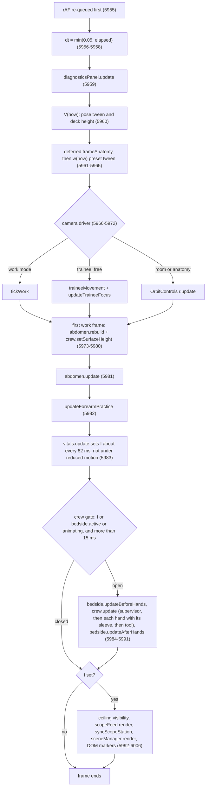
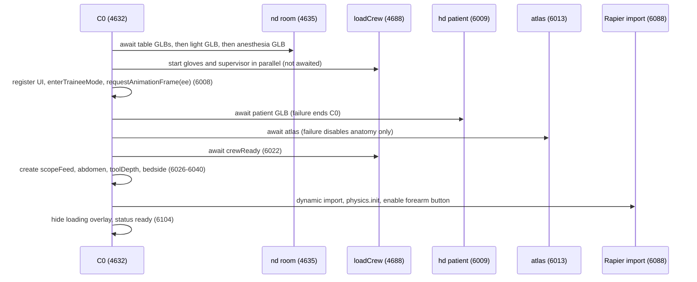
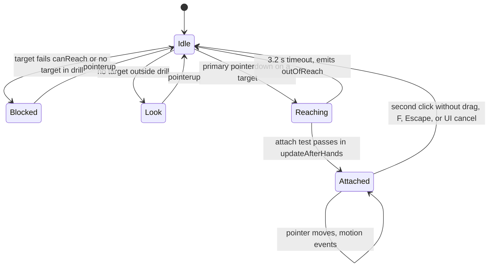

# 02 — Current State Audit

**Purpose.** This document records what the Nabd Clinical Simulator v1.5 repository actually contains and does. It lists every check the audit performed and its exact outcome. For each important system it records where the system lives, what calls it, what it calls, what data it owns, how it is updated each frame, whether it is connected to the running application, which tests cover it, and what remains unverified. It owns the canonical findings register (F01–F35). The gap analysis ([03](03_REQUIREMENTS_GAP_ANALYSIS.md)), the options ([05](05_HAND_CONTACT_AND_MOVEMENT_OPTIONS.md)) and the roadmap ([07](07_PRIORITIZED_IMPROVEMENT_ROADMAP.md)) cite these findings by ID. This document states facts. Recommendations appear only where they are labelled, and they are kept to pointers into the roadmap.

**Status labels used:** VERIFIED (executed and observed in the audit's browser session or build run, cited R1–R21 / B1–B5) · TEST-VERIFIED (covered by a repository test that passed; the test is named) · SOURCE-INSPECTED · PARTIALLY VERIFIED · PLANNED · UNKNOWN · DATA-DERIVED (audit analysis: computed from asset or geometry data by read-only scripts; never a test result) · CLINICAL REVIEW REQUIRED. Results of the T1 run of 14 November 2026 are cited as "T1 run" (VERIFIED or TEST-VERIFIED there); BLOCKED marks a check that could not run in that environment.

**Status after T1 (14 November 2026).** This audit describes the v1.5 tree as found on 13 November 2026 and stays the record of what was found. T1 has since changed the state of F03, F04, F05, F19, F33 and F34; each change is appended to the register row and summarised under the register (§4), and the items of §6 that T1 settled are listed under that table. Full detail: [phase-reports/P0-completion.md](phase-reports/P0-completion.md), [evidence/baseline-p0/RESULTS.md](evidence/baseline-p0/RESULTS.md) and [phase-reports/P0-unknowns.md](phase-reports/P0-unknowns.md).

**Related documents:** [README](README.md) · [01 Project understanding](01_PROJECT_UNDERSTANDING.md) · [03 Gap analysis](03_REQUIREMENTS_GAP_ANALYSIS.md) · [05 Hand, contact and movement options](05_HAND_CONTACT_AND_MOVEMENT_OPTIONS.md) · [07 Roadmap](07_PRIORITIZED_IMPROVEMENT_ROADMAP.md) · [08 Decisions and open questions](08_TECHNICAL_DECISIONS_AND_OPEN_QUESTIONS.md) · [09 Acceptance and validation](09_ACCEPTANCE_AND_VALIDATION_PLAN.md) · [10 Next implementation task](10_NEXT_IMPLEMENTATION_TASK.md) · [Repository evidence index](REPOSITORY_EVIDENCE_INDEX.md)

---

## 1. Method, evidence levels, environment and limits

### 1.1 Sources of evidence

| Source | What it contributes | How it is cited |
|---|---|---|
| The repository at `C:\Users\ss\Nabd-Clinical-Simulator-v1.5-Forearm-Contact`, read-only | Source code, assets, tests, scripts and docs. This is the source of truth. | `path:line`, or `path:line@byte` for minified lines |
| The audit's own browser session (13 November 2026) | Runtime observations R1–R21 and screenshots in `evidence/` | VERIFIED (R#) |
| Build and test commands run by the audit | B1–B5 | VERIFIED (B#) |
| Eight read-only source analyses plus one cross-check | System-level source reading. The cross-check re-verified planning-critical claims and corrected several misreadings (among them the instrument-steering call path, the byte locations of minified aliases and the status-string call-site counts), including one runtime interpretation (R12). | SOURCE-INSPECTED |
| Read-only audit scripts over GLB JSON/BIN data | Skeleton identity, capsule-to-skin distances, bounding boxes, pad counts | DATA-DERIVED (audit analysis) |

The orientation document `Nabd_v1.5_Repository_Review.md` named in the owner's request **does not exist anywhere on disk**. No claim in this document depends on it. The repository was treated as the only source of truth.

### 1.2 Runtime environment of the browser session

| Item | Value |
|---|---|
| Server | `node scripts/serve.mjs` with `PORT=4190` (the project's own dependency-free server; default is `127.0.0.1:4173`, `scripts/serve.mjs:7-8`) |
| URLs | `http://localhost:4190/` and `http://localhost:4190/?debug=1` |
| Browser | Chromium 152.0.7977.167 (the Electron built-in browser of the Claude desktop app) on Windows 11 Pro |
| GPU / API | ANGLE (Intel Iris Xe Graphics, Direct3D11); WebGL2 available |
| Viewport | Emulated 1440×900 CSS px (main canvas 1317×773 device px; vitals canvas 960×540) |
| Node | v26.13.1 (for B1–B5) |

### 1.3 Limits that apply to every runtime claim

1. **Frame rate is not measured.** The browser pane was hidden for most of the session, so `requestAnimationFrame` was throttled. FPS readings of 1–47 and one frame-time sample of 20.8 ms are **not valid**. Renderer counters (draw calls, triangles, geometries, textures) are valid, because they describe scene content, not timing.
2. **One configuration only.** The session covers one browser, one GPU and one viewport, with mouse and keyboard. No touch device, Firefox or Safari was used.
3. **No version control.** The folder is not a git repository (`git rev-parse` reports `fatal: not a git repository`). No history can confirm any documentation claim, and no diff against an earlier version is possible.
4. **Dependencies were not installed.** There is no `node_modules`. Installing was out of scope, so the Vite build and the one test that imports the `three` package could not run.
5. **Hidden-pane side effects.** Interactions that integrate per frame while a key is held, such as WASD walking (R19), may not reflect real behaviour.

*Status after T1 (14 November 2026):* limits 3 and 4 no longer hold (git baseline `acdab52`, tag `v1.5-baseline`; `npm ci` done). Limits 1, 2 and 5 were lifted for the T1 run only: frame rate was measured in a visible, focused headed Chrome window; the smoke suite ran in installed Chrome 157 and Edge 157 and in Playwright WebKit 27.2 (WebKit on Windows, not Safari), with touch emulated in Chrome (U2); Firefox is BLOCKED in that environment (U3); WASD works in a visible window (U14). It is still one machine and one GPU (Intel Iris Xe).

### 1.4 Citation conventions and minified aliases

`src/app/NabdRuntime.js` is 6,160 lines and 748 KB. From line 29 to the end of line 6154 it is one IIFE that contains an inline, minified three.js r180 followed by the application code. Some lines are very long, so they are cited as `line@byte`.

| Alias | Meaning | Location |
|---|---|---|
| `va` | three.js `WebGLRenderer` | 3860@18771 |
| `Ea` / `Ta` | `OrbitControls` / `RoundedBoxGeometry` | 3860@50770 / 3860@69824 |
| — | First application code (`var Hi=`) | 3860@71276 |
| `nd` | Room builder | 3860@72918 → 4583 |
| `Ra` | `GLTFLoader` | 4585@995 |
| `hd` | Patient loader and rig | 4585@45443 → 4632 |
| `T0`, `A0`, `md` | Limb IK solve, IK with environment check, limb-drag manipulator | 4632@475, @2019, @2317 |
| `C0` | Main initialisation (`async function C0()`) | 4632@7404 |
| `ee` | Frame loop | 5954-6007 |
| `s`, `e`, `t`, `r`, `o`, `g` | Renderer, scene, main camera, OrbitControls, room API, patient rig API | inside `C0` |
| `I` | Render-and-simulate invalidation flag (38 write sites) | declared at 5854 |

---

## 2. Checks actually performed

### 2.1 Node test suite (B1)

Command: `node --test` (Node v26.13.1), run from the project root with no `node_modules`.

**Outcome:** 13 test files declare 21 test cases. `node --test` reports **20 results: 19 pass, 1 fails.** The failure is file-level: `tests/forearm-contact.test.js` cannot import the bare package `'three'` (`ERR_MODULE_NOT_FOUND`, line 3), so its 2 cases never run. (The browser-session notes said "20 test files"; the correct reading is 20 reported results across 13 files.)

| File | Cases | What it asserts | Result | What it does *not* cover |
|---|---:|---|---|---|
| `tests/asset-manifest.test.js` | 1 | Every entry in `assets/asset-manifest.json` matches its file's byte size and SHA-256; totals match; `assetCount >= 8` | Pass | Unlisted new files; `vendor/rapier`; licences |
| `tests/event-logger.test.js` | 3 | Unique IDs and ISO timestamps; unknown events rejected; `maxEvents` trimming; returned snapshots are immutable | Pass ×3 | Runtime call sites |
| `tests/forearm-contact.test.js` | 2 | Sweeps stop a probe crossing the forearm or mattress (fractions in range, `stops === 2`); overlap is resolved along the surface normal | **Fails at import** (0 cases ran) | — |
| `tests/hold-gate.test.js` | 1 | `pause()` / `resume()` flip a `paused` flag | Pass | When `BedsideInteraction` pauses or resumes (the test title overstates this) |
| `tests/instrument-config.test.js` | 2 | Exactly four instrument ids; lengths .231/.10/.113/.272; `supportsDepth` flags; grip offset `[0,0,-0.086]` | Pass ×2 | Whether `CrewController` uses `config.length` (it does not for two tools, F19) |
| `tests/instrument-depth.test.js` | 2 | Scope must align to the port before insertion; tip target stays on the port line after insertion; roll does not move the tip | Pass ×2 | Hand and tool following the target (crew is mocked) |
| `tests/module-graph.test.js` | 1 | Every relative static import in `src/` resolves to a file | Pass | Named exports, dynamic `import()` (Rapier), bare specifiers |
| `tests/performance-monitor.test.js` | 1 | FPS and frame-ms arithmetic; counters pass through; heap null without a memory API | Pass | `DiagnosticsPanel` DOM |
| `tests/scene-manager.test.js` | 1 | `render`/`resize`/`dispose` on a fake renderer | Pass | Runtime bypasses (§3.2) |
| `tests/scope-feed.test.js` | 1 | No-signal ↔ render-target texture swap; camera follows the tip; previous render target restored; port-depth gating | Pass | `setAnatomy`, atlas path, cost |
| `tests/simulation-manager.test.js` | 3 | Session start clears the log and records lifecycle; idempotent stage and completion; reset detaches later events | Pass ×3 | `EventBus.once/off/clear/listenerCount`; runtime wiring |
| `tests/target-filter.test.js` | 2 | Privacy filtering per intersected face (multi-material) and for single-material surfaces | Pass ×2 | The real asset and its call sites |
| `tests/workstation.test.js` | 1 | The perimeter walk reaches all four sides without changing the work point | Pass | Approach offset, corner clearing, snapping |

**What the passing tests prove.** The 19 passing cases are TEST-VERIFIED **only for what they assert**. They use fakes or mocks, except that `asset-manifest.test.js` hashes the real asset files and `module-graph.test.js` reads the real source text to resolve import paths; neither executes application code. None loads `NabdRuntime.js`, WebGL, the DOM, a GLB or the application's bundled copy of three.js. No passing test touches a v1.1–v1.5 feature (scope station UI, internal atlas, forearm drill, `ForearmGrip`, Rapier).

**Compatibility shims (a file existing is not a file running).** Three test files import their module through a two-line "Backward-compatible export" re-export shim rather than the domain module: `workstation.test.js` → `src/workstation.js`, `scope-feed.test.js` → `src/scope-feed.js`, `instrument-depth.test.js` → `src/instrument-depth.js`. Four more shims exist with no importer at all (`src/abdomen.js`, `src/bedside.js`, `src/crew.js`, `src/vitals.js`). The running application imports the domain modules directly (`NabdRuntime.js:1-13`), and none of the seven shims is among the 21 modules loaded at runtime (R3). SOURCE-INSPECTED.

**The forearm-contact test.** It imports npm `three` (pinned 0.180.0 in `package.json`, not installed), while the application injects its own inline classes into `createForearmContact` (`NabdRuntime.js:5434-5436`). A failure to load therefore says nothing about the running application. An audit re-run of its two assertions with a minimal Vector3/Quaternion shim reproduced every expected value (side sweep 0.335, down sweep 0.593, `stops` 2, overlap 0.010 → 0). That result is DATA-DERIVED (audit analysis), **not** TEST-VERIFIED.

*Status after T1 (14 November 2026):* after `npm ci`, `npm test` reports 21 tests, 21 pass, 0 fail, so both `tests/forearm-contact.test.js` cases are now TEST-VERIFIED (T1 run); the result is the same after the F19 fix and with the browser test files present (they are not collected by `node --test`). F03 is resolved.

### 2.2 Syntax check (B2)

`node --check` on every `.js` and `.mjs` file in `src/`, `scripts/` and `tests/`: **PASS**. No syntax errors. This proves parseability only.

### 2.3 Vite build (B3)

`npm run build`: **NOT RUN**. Vite is not installed (no `node_modules`). The repository's own docs record that this build also never ran in the v1.0 environment (`docs/Nabd-v1.0-Foundation-Report.md:37`). Whether `vite.config.mjs` produces a working build is UNKNOWN.

*Status after T1 (14 November 2026):* `npm run build` succeeds in about 1.0 s (VERIFIED, T1 run): one bundle `assets/index-B9Tyn-f5.js` of 763.67 kB (gzip 213.51 kB) with Vite's ">500 kB chunk" warning, `index.html` 36.81 kB, CSS 210.98 kB, and copies of `assets/` and `vendor/rapier/`. It empties `dist/`, deleting the standalone preview (U17). Before the F19 fix, the built app passed the smoke flows under `vite preview` in Chrome and Edge, and in WebKit on Windows except the S2 R8 check, with R20 reproduced as the known failing check ([evidence/baseline-p0/RESULTS.md](evidence/baseline-p0/RESULTS.md) §2); the post-fix smoke run used `serve.mjs` only.

### 2.4 Standalone preview build (B4)

`npm run preview:standalone` (= `node scripts/build-preview.mjs`, no dependencies): **PASS**.
- It produced `dist/Nabd-Clinical-Simulator-v1.5-Preview.html` (34.70 MiB).
- The file embeds 9 GLBs (patient, internal atlas, table base and top, light pendant, anesthesia workstation, two gloves, supervisor) and Rapier as `forearm-physics` (`scripts/build-preview.mjs:73-90`).
- Served over HTTP and opened in the browser, it rendered the bedside scene, exposed `window.NabdSimulation`, showed the status "المجسم جاهز" and produced zero console messages.
- Opening it over `file://` was **not** tested. `dist/` was deleted afterwards so the project stayed unchanged.

*Status after T1 (14 November 2026):* the preview was rebuilt after the Vite build (34.70 MiB; the post-fix build deleted it again) and works over `file://` in headed Chrome, headless Edge and WebKit on Windows (ready 2.5–3.2 s, 0 console errors, no request beyond the file; U11, VERIFIED, T1 run). Firefox is BLOCKED; Safari on macOS is UNKNOWN.

### 2.5 Development server (B5)

`node scripts/serve.mjs` with `PORT=4190`: **PASS**. It served the application for every runtime check below.

### 2.6 Runtime checks R1–R21

| # | Check | Observed outcome | Status | Evidence |
|---|---|---|---|---|
| R1 | Boot | Loading text "جاري تجهيز المريض الافتراضي..." then a rendered WebGL room | VERIFIED | [01](evidence/01-default-bedside-view.jpg) |
| R2 | Console | No errors or warnings during the whole session (before scissors were selected, see R20) | VERIFIED | — |
| R3 | Network | All 21 ES modules, 8 room/staff/patient GLBs, `anatomy/internal-atlas.glb` and `vendor/rapier/rapier.mjs` returned HTTP 200. GLB textures arrive as `blob:` URLs. | VERIFIED | — |
| R4 | Default bedside view | Patient supine on the table. A full-body supervisor in teal scrubs beyond the table. The trainee is only two gloved hands and forearm sleeves entering from the bottom edge: no upper arm, shoulder or body. | VERIFIED | [01](evidence/01-default-bedside-view.jpg) |
| R5 | UI density at 1440×900 | 39 visible buttons (76 in the DOM), 8 visible form controls (selects and ranges), 0 `<textarea>`. No free-text input or chat panel. Side panel about 25 % of the width, plus 3 rows of controls under the 3D view and a keyboard-help line. | VERIFIED | [01](evidence/01-default-bedside-view.jpg), [09](evidence/09-training-step-1-of-5.jpg) |
| R6 | `?debug=1` overlay | Panel shows FPS, Frame, Draw, Triangles, Geo/Tex and Events. Counters are in §2.7. | VERIFIED (counters); FPS invalid | — |
| R7 | Forearm drill entry | `#forearm-practice` "تدريب لمس الساعد" moves the view to the patient's **left** arm. A wrist marker ring appears. The drill panel shows region select, five walk buttons, "اطلب مساندة المشرف" and "إعادة وضع الساعد". | VERIFIED | [02](evidence/02-forearm-drill-grip.jpg) |
| R8 | Reach gating | The first wrist click gave "خارج مدى الإيد · غيّر وقفتك أو اقترب". After "اقترب" the same click gripped. | VERIFIED | — |
| R9 | Grip and lift | Status "تم إمساك الطرف · حرّكه ضمن مداه". Moving the pointer up lifted the left forearm and hand clearly off the arm board. | VERIFIED | [02](evidence/02-forearm-drill-grip.jpg), [03](evidence/03-forearm-lift-stretched-sleeve.png) |
| R10 | Hand–arm continuity while gripping | **Defect.** The active glove's sleeve renders as a very large, elongated dark-teal volume from the bottom of the view to the patient's wrist, with a jagged open edge. It partly hides the gripping glove. The idle glove stays at rest. | VERIFIED (defect) | [03](evidence/03-forearm-lift-stretched-sleeve.png) |
| R11 | Supervisor support | "اطلب مساندة المشرف" → status "المشرف مسنّد الساعد" and a button "إنهاء المساندة". A gloved hand with a teal sleeve holds the forearm from above. After the trainee releases ("تم الإفلات"), the forearm stays raised and the trainee hands return to rest. In source, that status label appears only while the supervisor's pad bone is within 0.020 m of the support point (`NabdRuntime.js:5513-5514`), so the gap was met at least once in this one stance (trainee at +X). | VERIFIED | [04](evidence/04-supervisor-support-hand.png), [05](evidence/05-after-release-forearm-supported.jpg) |
| R12 | Supervisor body after leaving the drill | **Corrected by source cross-check.** The original note read screenshot 07 as "supervisor upright with arms hanging while support is active". The "الجانب الأيسر" preset is reachable only from room view. Entering room view runs `exitTraineeMode` → `leaveWorkstation` → `closeForearmPractice` → `crew.setForearmSupport(null)` (`NabdRuntime.js:4755-4757`, `5193-5195`, `5468`, `5472`). Support had therefore already ended, and the supervisor was back in its idle pose. The support hand in 04/05 **is** the supervisor's own right arm (`reachSupport`, `src/staff/CrewController.js:143-175`, called at `481-485`). | SOURCE-INSPECTED (corrects the original runtime note; screenshot 07 is consistent with the correction) | [07](evidence/07-left-side-preset-supervisor.jpg) |
| R13 | Room overview | Two ceiling surgical lights on pendant arms; anesthesia workstation with monitor; a **yellow** endoscopy tower with two screens; instrument trolleys and back table; a wall control panel; one full-body supervisor. **No nurse. No trainee body.** | VERIFIED | [06](evidence/06-room-overview.jpg) |
| R14 | Internal anatomy | "35 بنية معروضة"; attribution "BodyParts3D · DBCLS · CC BY 4.0"; system groups all, neural, thorax, digestion, urinary, glands, vessels; organ list includes cecum, appendix and mesoappendix. Selecting the appendix moved the camera to the bowel region, but the appendix was not clearly distinguishable in the screenshot. | VERIFIED; appendix PARTIALLY VERIFIED | [08](evidence/08-internal-anatomy-atlas.jpg) |
| R15 | Training session | "ابدأ التدريب" started `scenario: "clinical-skills-practice"`, `source: "tray"`, stage `monitor`, step "1 / 5" with "افتح الشاشة وحدد رمز تشبع الأكسجين". Step chips: قراءة الشاشة، القبض، التوجيه، الإرجاع، تحريك الرسغ. A laparoscopic grasper appeared near the patient. Events: `simulation_started`, `camera_changed` ×2, `simulation_stage_changed`. | VERIFIED | [09](evidence/09-training-step-1-of-5.jpg) |
| R16 | Logging outside a session | The forearm grip, support and release done **before** a session produced no events (`getEvents()` = `[]`), and the stage was `idle`. | VERIFIED | — |
| R17 | Instrument source and tool selects | `#training-source` offers tray and staff. `#training-tool` offers grasper, scope, scissors and needle holder. The supervisor handover itself was not exercised. | VERIFIED (controls only) | — |
| R18 | Hand selection | `#trainee-reach-left/right` toggle `aria-pressed`. No visible change of the rest pose when switching. Q/E keys not exercised. | PARTIALLY VERIFIED | — |
| R19 | WASD walk | 40 taps of "d" produced no visible movement. Movement integrates per frame while a key is held, and the pane was throttled. In source, walking is also disabled while a workstation is focused, while positioning the patient or while a bedside gesture is active (`step` guard, `NabdRuntime.js:4931-4932`; `traineeMovement` 4939-4940); the session notes do not record which mode was active. | UNKNOWN (not a confirmed defect) | — |
| R20 | Scissors geometry | After a fresh load, choosing scissors produced 4 console errors `THREE.BufferGeometry.computeBoundingSphere(): Computed radius is NaN ... CylinderGeometry` once the tool rendered. The tray view shows finger rings and short shanks only, **no blades**. The needle holder was not checked separately (same code path). | VERIFIED (defect, scissors) | [10](evidence/10-scissors-without-blades.jpg) |
| R21 | Trainee forearm outside the workstation | In the tray view the idle left glove's forearm reads as a long, thick blue forearm entering from the screen corner (glove + cuff + sleeve stub; no body). | VERIFIED | [10](evidence/10-scissors-without-blades.jpg) |

### 2.7 Renderer counters (R6; valid, independent of the throttled frame rate)

| View | Draw calls | Triangles | Geometries / textures |
|---|---:|---:|---|
| Default bedside view | 1,167–1,206 | 378,534–387,848 | 1,126–1,381 / 17 |
| Forearm drill | 479–503 | 299,400–303,548 | — |
| Room overview | 1,520 | 462,240 | — |
| Internal anatomy | 542 | 464,067 | — |

### 2.8 Not exercised at runtime

These were not exercised: training steps 2–5; scope insertion and the tower feed; abdomen press and pinch; general surface touch outside the drill; patient poses (sitting, standing) and limb sliders; patient finger curl; supervisor instrument handover; two-hand use; opposite-side work (left/right identity after changing sides); touch devices; Firefox and Safari; sustained FPS in a visible window; the standalone preview over `file://`; and the Vite build. §6 states how each would be settled.

---

## 3. Per-system audit

Each block uses the same nine fields. "Crew block" means the gated section of the frame loop at `NabdRuntime.js:5984-5991`. It runs only when `crew && (I || bedside?.active || now < animateCrewUntil)` and more than 15 ms have passed since the last run (or always under reduced motion).

### 3.1 Runtime lifecycle and frame loop

| Field | Detail |
|---|---|
| Where it lives | `src/engine.js:7` imports `src/app/NabdRuntime.js` (6,160 lines / 748 KB). Lines 1-13: 13 static imports of domain modules. Lines 15-27: `nabdEventBus`, `nabdSimulation`, frozen `window.NabdSimulation`. `C0` at 4632@7404; frame loop `ee` at 5954-6007, started at 6008; `C0().catch(...)` at the end of 6154. |
| What calls it | `index.html:571` (`<script type="module" src="./src/engine.js">`). |
| What it calls | `nd` (4635), `loadCrew` (started 4688-4696, awaited 6022), `hd` (6009), `loadInternalAnatomy` (6013), service factories inside `if (crewResult.loaded)` (6023-6087), the Rapier dynamic import (6088-6099). three.js classes are **injected** into modules (for example `loadCrew({T:{Vector3:L,...}})`); no module imports `three`. |
| Data it owns | The scene graph, renderer `s`, camera `t`, OrbitControls `r`, the flag `I` (38 write sites), mode flags (`traineeMode`, `patientPositioning`, `workFocused`, `workReady`, `anatomyActive`, `scopeMonitorLook` and others, 4666-4676), `phase` and `activeHand` (4686), `motion` (5370), and late-bound nullable services (`crew`, `bedside`, `abdomen`, `toolDepth`, `scopeFeed`, `internalAnatomy`, `forearmPractice`). There is no teardown path (no `cancelAnimationFrame`, `dispose`, `pagehide` or `webglcontextrestored`). |
| Per-frame updates (order) | See the diagram below. `I` means both "redraw" and "simulate hands". `vitals.update` sets it about every 82 ms, so the loop never idles (except under `prefers-reduced-motion`, where the monitor paints once and then returns false, `src/ui/MonitorUI.js:132`). Outside the loop: `md` drag IK and sliders (DOM handlers), the patient-hand demo (own rAF, 5872-5891), depth and roll adjustments (events). `SimulationManager` is never ticked. No `setTimeout` or `setInterval` exists in application code. |
| Connected to the running app? | Yes. VERIFIED R1–R3. |
| Tests covering it | None import `NabdRuntime.js`. `module-graph.test.js` only checks that relative imports resolve. |
| Remains unverified | Real frame rate and idle render rate; whether the >15 ms crew throttle causes visible hand jitter on high-refresh displays; behaviour after `webglcontextlost` (the overlay is shown and never cleared); behaviour when staff or patient assets fail to load; loading-overlay timing on slow networks. |
| Status label | VERIFIED (boot and loading, R1–R3); SOURCE-INSPECTED (order and coupling). |

### 3.2 SceneManager, EventBus, PerformanceMonitor, DiagnosticsPanel

| Field | Detail |
|---|---|
| Where it lives | `src/core/SceneManager.js:2-22`; `src/core/EventBus.js:2-40`; `src/core/PerformanceMonitor.js:2-38`; `src/ui/DiagnosticsPanel.js:4-33`. |
| What calls it | SceneManager is created at the end of line 4632; `render()` is called only at 6002 and `resize` only from the ResizeObserver and mobile media listener (5854). EventBus is created at line 15 and given to `SimulationManager`. DiagnosticsPanel is created at 4633; its `update` runs every rAF tick (5959). |
| What it calls | `renderer.render` / `setSize`; PerformanceMonitor reads `renderer.info`. |
| Data it owns | The bus listener map; a 500 ms rolling FPS window; the overlay DOM. |
| Per-frame updates (order) | Diagnostics at step 3 (every rAF tick); `sceneManager.render` inside the render block. |
| Connected to the running app? | SceneManager: yes. EventBus: yes, but its **only subscriber** is DiagnosticsPanel, and only with `?debug=1` (`DiagnosticsPanel.js:14-15`); without it every `simulation:event` reaches zero listeners. PerformanceMonitor exists only inside an enabled panel. The overlay is VERIFIED (R6). |
| Tests covering it | `scene-manager.test.js`, `performance-monitor.test.js`, `simulation-manager.test.js` (EventBus `on`/`emit` only). All on fakes. |
| Remains unverified | The panel's FPS samples rAF ticks, not renders, and "Frame" is the interval between ticks, not render cost. `heapUsedMB` is computed but has no display field (`DiagnosticsPanel.js:10`). Bypasses of SceneManager: the scope off-screen render uses the raw renderer (`src/instruments/EndoscopeFeed.js:110-116`), as do `setPixelRatio`, `s.info` (5959) and `readRenderTargetPixels` in the `?qa` hook. `getInfo` and `dispose` are never called. |
| Status label | TEST-VERIFIED (module units only: `scene-manager.test.js`, `performance-monitor.test.js`; EventBus `on`/`emit` via `simulation-manager.test.js`; DiagnosticsPanel untested); VERIFIED (overlay, R6); SOURCE-INSPECTED (wiring). |

### 3.3 Room builder `nd()` and lighting

| Field | Detail |
|---|---|
| Where it lives | `async function nd(s,e,vitalTexture)` from 3860@72918 to 4583. Envelope 3868-3936; equipment 3965-4514; screen canvases `screenTexture` 4073-4163; `loadEmbeddedAsset` 4523-4544; GLB swaps for table (4546-4558), light pendant (4559-4566) and anesthesia unit (4567-4581); returned API at 4582. |
| What calls it | `C0` at 4635: `const o = await nd(e, !n.matches, vitals.texture)`. |
| What it calls | Mesh helpers `jn`, `vt`, `ll`, `Aa` (line 3860), `GLTFLoader` (`Ra`), `makeScreen`. |
| Data it owns | Room group; `assetStatus` (visible only through `?qa`); the API `{grid, ceilingFixtures, ceilingShell, pendants, setDeckHeight, assetStatus, vitalScreen, mayo, focusLightTarget, fieldDisplays, endoscopyScreens}`. Lights: HemisphereLight (4064), shadowed key DirectionalLight (4065-4069), fill (4070), and two lamp "spots" created as `li` = **DirectionalLight** (4033) inside `fixtures`. Table constants `Un = {halfWidth:.47, halfLength:1.06, high:.9, low:.58}` (3860). |
| Per-frame updates (order) | None, except that ceiling, light and pendant groups are hidden while the camera is at or above y 3.36 (5993-5995), and deck height through `V()`. The Mayo stand moves on workstation entry and exit only (5183, 5211). |
| Connected to the running app? | Yes. The four room GLBs load (VERIFIED R3); the room is visible (VERIFIED R13). A fallback to the procedural models is reported only through `?qa` (`getAssetStatus`) and a `console.warn` (4558, 4566, 4581); there is no user-visible notice. |
| Tests covering it | `asset-manifest.test.js` (file integrity only). Nothing covers `nd`, fallbacks, lights or placement. |
| Remains unverified | The effect of: no lamp light in the default path (F26); flat shading of GLBs without normals and UVs (F28); front-wall planes at z 4.8 facing outward (3880-3882); floor gaps against the floor top at y −0.025 (wheel sets 5.5–9.5 cm via `wheelSet` 4189-4198, GLB table base about 3.9 cm, supervisor feet about 2.6 cm; source arithmetic and DATA-DERIVED); the anesthesia GLB screen without UVs (4572-4577); the table GLB pad height versus the patient and collision constants (F27). The lime-yellow casing (`color:15464001` = `#ebf641`, 4164) is shared by the anesthesia unit, monitor, endoscopy tower and ESU; the tower appears yellow in R13. |
| Status label | VERIFIED (loading, R3; layout and yellow tower seen, R13); SOURCE-INSPECTED (lighting); DATA-DERIVED (geometry mismatches). |

### 3.4 Cameras, `WorkstationNavigation` and input

| Field | Detail |
|---|---|
| Where it lives | One main camera `t = new xt(52,1,.035,35)` (4632). Trainee camera functions 4707-4947 (`applyTraineeRotation`, `enterTraineeMode` 4731, `exitTraineeMode` 4755, `moveTo`, `traineeMovement`, `step`). Work walk: `createWorkWalk` (`src/core/WorkstationNavigation.js:2-52`, created at 4954 with `sideX 0.76`) and `positionAtWork`, `selectWork`, `leaveWorkstation` (5193), `changeWorkSide`, `tickWork` (5113-5239). Presets `S()`, `x()`, `w()` (minified 5854). Scope-monitor look 5269-5297. Wheel 5806-5818; keydown 5820-5851. |
| What calls it | Frame-loop step 7; DOM buttons; keyboard; `BedsideInteraction` `look` callback (6069-6075). |
| What it calls | OrbitControls, `bedside.pauseManipulation`, `crew.setWorkstation`, `crew.setSurfaceHeight`, `crew.setMonitorView`, `updateWorkFocusLighting` (5023-5028). |
| Data it owns | `traineeYaw/Pitch` (pitch clamped −1.28…0.42), `traineeKeys`, walk state (current, target, offset), field of view (assigned at 11 sites with three different clamps). |
| Per-frame updates (order) | Step 7: `tickWork(min(0.23, elapsed))` in work mode; otherwise `traineeMovement(dt)` (0.63 m/s, clamped to x 0.65…1.36, z −1.14…1.19, the patient's left side only) and `updateTraineeFocus`; `r.update()` in room and anatomy views. |
| Connected to the running app? | Yes. Drill walk buttons (VERIFIED R7, R8); room presets (VERIFIED R12, R13). WASD (R19) is UNKNOWN. |
| Tests covering it | `workstation.test.js` (perimeter walk). |
| Remains unverified | WASD and Q/E in a visible window; touch (trainee mode ignores non-primary pointers; work mode has no zoom); `exitTraineeMode` never restores the initial fov 52 (it leaves the current trainee fov: default 62, set at 4747 and 5214, or a zoomed value), and the room preset `x('room')` does not set fov, so overview presets inherit the trainee fov (visual effect UNKNOWN). Any switch to room view or anatomy silently ends the forearm drill, support and a placed tool (F31). |
| Status label | PARTIALLY VERIFIED (drill walk and reach, R7, R8; room presets, R12, R13; WASD UNKNOWN, R19); SOURCE-INSPECTED (rest). |

### 3.5 Patient rig (`hd`), poses and IK (`T0`, `A0`, `md`)

| Field | Detail |
|---|---|
| Where it lives | `hd` 4585@45443 → 4632; presets `Pr` (supine, rise, turn, sitting, lean, standing) and routes `S0` on 4585; finger curl `patientFingerFlexion` (4608) and `setHandCurl` (4615); IK `T0`, `A0`, environment check `pd`, manipulator `md` (4632); pose functions `G()`, `V()` and bed floor `$()` (5916); bedside grip `createLimbDrag` (5395-5428). Asset `assets/patient/patient.glb`. |
| What calls it | `C0` 6009 (`g = await hd(e, R0())`); pose buttons (`index.html:239-241`); limb sliders; `md` capture-phase pointer listeners; `BedsideInteraction` via `startLimb`; `updateForearmPractice`. |
| What it calls | `GLTFLoader`; bone quaternion writes; the deck height of the room API (`o.setDeckHeight`). |
| Data it owns | Group `VirtualPatient`; **four single-material SkinnedMeshes** (skin, privacy patch, brows, eyes; the loader splits primitives); one 163-joint skin; four limb chains; six preset frames; deck height `m`; `limbLimits`. The asset is a standing A-pose made supine by rotating the whole group (`pitch −π/2`, root at (0, 0.936, 0.025)). No clips or morph targets. |
| Per-frame updates (order) | `V(now)` at step 4 during pose tweens; bedside limb IK inside the crew block (`updateBeforeHands`) and in `updateForearmPractice` (step 10). `md` drags, sliders and finger curl run in DOM handlers. |
| Connected to the running app? | Yes. Supine patient visible (VERIFIED R1, R4); left forearm lifted by IK (VERIFIED R9). |
| Tests covering it | None. (`target-filter.test.js` covers only the privacy predicate.) |
| Remains unverified | Patient fit on the GLB table (F27); sitting and standing poses; the bedside leg pole (posterior, 5400) versus the `md` anterior pole; IK limits (arm swing 1.9 rad, bend 2.52 rad; leg 1.08 / 2.3 rad), whose anatomical plausibility is CLINICAL REVIEW REQUIRED; there is no limb-versus-torso collision. No breathing, facial or pain response exists. |
| Status label | VERIFIED (load and supine pose, R1, R4; left-arm lift, R9); SOURCE-INSPECTED (rest). |

### 3.6 `AbdomenSurface`

| Field | Detail |
|---|---|
| Where it lives | `src/patient/AbdomenSurface.js` (`createAbdomenSurface`): grid constants 13-16, `rebuild` 24-57, `height` 77-88, `contains` 90-94, `start` 96-126, `update` 142-164. |
| What calls it | Created at 6030 inside `if (crewResult.loaded)`. Frame loop 5973-5981; `BedsideInteraction.js` 148, 223-233, 256; runtime 5039, 5200, 5751; `InstrumentKinematics` height (6032); `CrewController` height-field lift (425-434). |
| What it calls | CPU skinning (`getVertexPosition`, `applyBoneTransform`), `Matrix3.invert`. |
| Data it owns | A max-Y height grid (175 × 386 cells at 6 mm) covering the **whole** supine body (x −0.52…0.53, z −1.24…1.08), despite the module name; a deformable patch limited to x ±0.153, z −0.244…−0.066 (line 16); press (−7 mm) and pinch (up to about 3.8 cm) profiles. |
| Per-frame updates (order) | `rebuild` once per workstation entry (step 8); `update(dt)` at step 9 writes only the patch vertices but flags the whole position and normal buffers of the largest skin primitive (about 70k vertices) for re-upload every frame while settling (`AbdomenSurface.js:151-162`). |
| Connected to the running app? | Yes, in the workstation only. Not exercised at runtime. |
| Tests covering it | None. |
| Remains unverified | Visual result of press and pinch; GPU upload cost; the atlas appendix footprint lies entirely outside the deformable patch (DATA-DERIVED), so the skin over it supports only generic touch, not press or pinch deformation. The deformation is a displacement profile, not tissue mechanics; whether any deformation behaviour is clinically meaningful is CLINICAL REVIEW REQUIRED. |
| Status label | SOURCE-INSPECTED. |

### 3.7 `InternalAnatomy`

| Field | Detail |
|---|---|
| Where it lives | `src/patient/InternalAnatomy.js`: `anatomyLabels` 1-12 (scope-layer system sets 14-15), `loadInternalAnatomy` 17-82, scope clone 29-36, `atlas.visible = false` 54, `patient.root.add(atlas)` 55. Asset `assets/anatomy/internal-atlas.glb` (35 meshes, about 187.6k triangles, vertex colours). |
| What calls it | `C0` 6013-6021; anatomy UI 4771-4893 (`openAnatomy` 4812 forces exit from trainee mode at 4821); `scopeFeed.setAnatomy` 6027. |
| What it calls | `GLTFLoader`; patient skin material clones (opacity 0.18, privacy clone hidden). |
| Data it owns | The atlas group and a scope-layer clone (digestion, urinary, vessels, adrenals, diaphragm). |
| Per-frame updates (order) | None in the study view. During a live scope render the layer matrix is copied from the atlas (`EndoscopeFeed.js:102-105`). |
| Connected to the running app? | Yes. VERIFIED R14 (35 structures, attribution, appendix in the organ list). The appendix was not clearly distinguishable: PARTIALLY VERIFIED. |
| Tests covering it | `asset-manifest.test.js` (integrity only). |
| Remains unverified | Anatomical accuracy: alignment is hand-tuned landmark fitting (`scripts/build-internal-atlas.py:17-43`), CLINICAL REVIEW REQUIRED; the atlas follows the patient group, not bones; the scope view of the atlas was not exercised. |
| Status label | VERIFIED (R14); PARTIALLY VERIFIED (appendix). |

### 3.8 Trainee hands (`CrewController`: `buildHand`, `updateHand`, `updateSleeve`, `poseFingers`)

| Field | Detail |
|---|---|
| Where it lives | `src/staff/CrewController.js` (`loadCrew`, 574 lines): `buildHand` 21-85 (sleeve cylinder 69-76, probes 80), `hands` 87, phalanx bones 39-43, `canReach` 279-281, `contactRotation` 293-304, `surfaceContact` 310-320, `driveSurface` 321-331, `shoulder` 356-360, `updateHand` 362-435 (`poseFingers` 386-391, `poseHand` 392-396, Rapier sweep/resolve 411-423, height-field lift 425-434), `updateSleeve` 437-453, `setVisible` 507-514, `followForearm` 546-554. Assets `assets/staff/glove-left.glb`, `glove-right.glb`. |
| What calls it | `crew.update` in the crew block (5987); `BedsideInteraction` drive calls; `InstrumentKinematics` through `aimInstrument` (264-274). |
| What it calls | Glove bones; `ForearmContact.sweep/resolve/measure` while `forearmContact` is set; `AbdomenSurface.height` through `setSurfaceHeight`. |
| Data it owns | Per hand: a root group added to the **scene** (not the camera, 23-26), `wristPoint`, `wristRotation`, `curl`, `drive`, finger-pad vertex entries (skin weight ≥ 0.28 on distal finger bones, every second vertex sampled: 1,381 flat / 670 pinch entries on the left glove, DATA-DERIVED), six probe bones, and one `CylinderGeometry(0.036, 0.057, 1, 18)` sleeve. Fixed mapping `{ left: buildHand(leftAsset, -1), right: buildHand(rightAsset, 1) }` (87); no negative scale anywhere. |
| Per-frame updates (order) | In `crew.update`, after the supervisor, for each hand in turn (left, then right): `updateHand`, visibility, then `updateSleeve`; the tool pose follows (`CrewController.js:488-504`). Rest targets come from `camera.localToWorld`; smoothing uses `alpha = 1 − exp(−dt·15)` in world space (rate 38 for a closed grip under forearm contact, 379). |
| Connected to the running app? | Yes. VERIFIED R4 (two gloves), R9 (grip), R10 (stretched sleeve, F07), R18 (hand buttons), R21 (forearm entering from the screen corner). |
| Tests covering it | None. |
| Remains unverified | Whether local-X phalanx rotation is the true flexion axis (F10); visible effect of the ≈180° orientation difference between `contactRotation` branches and the pinch flip at attach (F09); actual penetration with the −0.024 m anchor offset (405-406); world-space lag after camera teleports; Q/E keys. |
| Status label | VERIFIED (R4, R9, R10, R21); SOURCE-INSPECTED (orientation, fingers, contact). |

### 3.9 Supervisor (`orientArm`, `reachSupport`, `staffGrip`)

| Field | Detail |
|---|---|
| Where it lives | `src/staff/CrewController.js`: group "Rigged supervising clinician" at (−0.79, 0, 0.06), `rotation.y = π/2` (88-94); `orientArm` 117-135; `reachSupport` 143-175 (2-bone IK on `upperarm01.R → lowerarm01.R → wrist.R`, world-fixed pole); `staffGrip` 176-183; `offeringPoint` 344-346; `update` 457-486 (support placement 466-471, IK 481-485). Asset `assets/staff/supervisor.glb`. |
| What calls it | `crew.update` (crew block, first thing). Runtime: `setForearmSupport` (5468, 5511), `setWorkstation` (5181, 5202), `setMode` (5533, 5617, 5636). |
| What it calls | Bone writes on upper arm, lower arm and wrist of both sides and on 30 finger bones. |
| Data it owns | `offer` and `supportBlend` blends, `support` {point, side}, `supportGap`, tool `mode`. |
| Per-frame updates (order) | Each crew update: offer and support blends → body position (teleports: idle −0.79; workstation (−1.94, 0, 0.25); support x = side·0.55) → rigid whole-group tilt (`offer·0.24` or `0.42·supportBlend`, pivoting at floor level) → `orientArm` left and right → finger curl → `reachSupport` when supporting. No clavicle, spine, neck, head or eye motion. |
| Connected to the running app? | Yes, always visible (nothing sets it invisible; `?qa` `supervisorVisible` is always true, 6136). VERIFIED R4, R11, R13; R12 correction. |
| Tests covering it | None. |
| Remains unverified | Whether the rigid tilt intersects the bed or patient; overlap with the back table at the workstation position; support reach from stances other than the default +X; the instrument handover (not exercised, R17). |
| Status label | VERIFIED (presence, R4, R13; support hand, R11); SOURCE-INSPECTED (pose logic, R12 correction). |

### 3.10 `BedsideInteraction` state machine

| Field | Detail |
|---|---|
| Where it lives | `src/interaction/BedsideInteraction.js` (420 lines): state 10-19, `pick` 39-102, `begin` 104-130, `release` 137-153, `updateBeforeHands` (including `toolField` at 204-205 and touch re-raycast at 206-218), `updateAfterHands` 250-306, pointer handlers 308-390, `keyboardGrip` near 393-400. |
| What calls it | Created at 6040-6082 inside `if (crewResult.loaded)`; crew block; canvas pointer events; Escape (5847); `keyboardGrip` (5774-5778). |
| What it calls | Crew drive API; `createForearmGrip` (284); `createHoldGate` (120); `isPrivacySurfaceHit` (45, 81, 98, 209, 329); `startLimb` = `createLimbDrag`; `toolField` → `toolDepth.drive`; `onEvent` = `interactionEvent` (5537). |
| Data it owns | **One** `gesture`, **one** `pointer` (13-15), `hover`, a 3.2 s attach timeout. |
| Per-frame updates (order) | `updateBeforeHands` before `crew.update`; `updateAfterHands` (attach tests, `motion` events, training detection) after it; both inside the crew gate. |
| Connected to the running app? | Yes, in trainee mode. VERIFIED R8 (reach gating), R9 (grip), R11 (release with support). |
| Tests covering it | Only its helpers (`hold-gate.test.js`, `target-filter.test.js`). |
| Remains unverified | Pick priority, click-to-hold, timeouts and cancel paths, keyboard grip, touch, and all non-forearm gesture kinds at runtime. |
| Status label | VERIFIED (forearm path, R8, R9, R11); SOURCE-INSPECTED (other kinds). |

### 3.11 `ForearmGrip`

| Field | Detail |
|---|---|
| Where it lives | `src/interaction/ForearmGrip.js` (42 lines). |
| What calls it | `BedsideInteraction.js:284` at forearm attach. |
| What it calls | `limb.move()` = `createLimbDrag` tip role → `A0`/`T0`/`pd`/`w0`. |
| Data it owns | Contact point and normal in the wrist-bone frame; `start`, `right` and `scale` captured once at attach; offsets across ±0.085 m and lift −0.024…0.15 m; wrist speed ≤ 0.33 m/s. |
| Per-frame updates (order) | `update(dt)` inside `updateBeforeHands` unless paused by the hold gate. |
| Connected to the running app? | Drill only. VERIFIED R9. |
| Tests covering it | None. |
| Remains unverified | Mapping after a camera look or zoom (axes frozen at attach); the grip normal is a bind-pose normal (the forearm's bind direction differs from the supine pose by about 60°, DATA-DERIVED). |
| Status label | VERIFIED (R9); SOURCE-INSPECTED. |

### 3.12 `ForearmContact` and Rapier loading

| Field | Detail |
|---|---|
| Where it lives | `src/interaction/ForearmContact.js` (82 lines): shapes 14-18 (upper-arm capsule r 0.043, forearm capsule r 0.022, mattress cuboid 0.47 × 0.10 × 1.06 half-extents, six balls r 0.010–0.005), `refresh` 25-29, `sweep` 31-44, `resolve` 46-65, `measure` 67-75. Rapier 0.21.0 (Apache-2.0) in `vendor/rapier/rapier.mjs` with inlined wasm. Import at `NabdRuntime.js:6088-6099`; drill session `openForearmPractice` 5430-5437, `resetForearmPractice` (support off at 5468), `closeForearmPractice` 5472, `updateForearmPractice` 5492-5517. |
| What calls it | `createForearmContact` only at 5434; `sweep`/`resolve`/`measure` from `CrewController.updateHand` (411-423); `refresh` from `updateForearmPractice` and `updateBeforeHands`. |
| What it calls | Rapier `castShape` and `contactShape` only. **No World, rigid bodies, gravity or joints.** |
| Data it owns | Three obstacle shapes, six probe balls, `overlap`, `stops`. |
| Per-frame updates (order) | `refresh` at step 10; per hand with contact inside the crew block: sweep (one rollback fraction for the whole hand), up to 3 translation-only resolve passes, measure. Up to about 90 Rapier calls per collided hand per frame (SOURCE-INSPECTED arithmetic). |
| Connected to the running app? | Drill only, left arm only (`nearArm` is hard-wired to `leftArm`, 5371). Rapier HTTP 200 (R3); drill VERIFIED R7–R11. If staff assets fail, Rapier is never loaded (6100-6103). |
| Tests covering it | `forearm-contact.test.js` **fails at import**, so not TEST-VERIFIED. Audit shim reproduction is DATA-DERIVED. |
| Remains unverified | Collision reliability and visible penetration; capsule-to-skin mismatch (F16); smoothness of sliding; per-frame cost; stale `forearmContact` kept on a hand after an attached release (`BedsideInteraction.js:142-144`). |
| Status label | VERIFIED (drill runs and Rapier loads, R3, R7–R11); SOURCE-INSPECTED (contact logic); UNKNOWN (penetration and collision reliability). |

### 3.13 `hold-gate` and `target-filter`

| Field | Detail |
|---|---|
| Where it lives | `src/interaction/hold-gate.js` (9 lines); `src/interaction/target-filter.js` (`isPrivacySurfaceHit`, 3-12). |
| What calls it | `BedsideInteraction.js:120` (one gate per gesture); 45, 81, 98, 209, 329. The runtime duplicates the name check at 5036. |
| What it calls | Nothing. |
| Data it owns | A `paused` flag. |
| Per-frame updates (order) | None. |
| Connected to the running app? | Yes. Because the loader splits primitives, the runtime exercises the **single-material** branch, not the multi-material branch emphasised in the v0.22 docs. |
| Tests covering it | `hold-gate.test.js` (1), `target-filter.test.js` (2), on mock objects. |
| Remains unverified | When pause and resume are triggered; privacy behaviour on the real asset. |
| Status label | TEST-VERIFIED (logic: `hold-gate.test.js`, `target-filter.test.js`); SOURCE-INSPECTED (wiring). |

### 3.14 Instruments: `InstrumentConfig`, `InstrumentKinematics`, `EndoscopeFeed` and the crew tool group

| Field | Detail |
|---|---|
| Where it lives | `src/instruments/InstrumentConfig.js` (39 lines); `src/instruments/InstrumentKinematics.js` (`createInstrumentDepth` 3-153; `maxTravel 0.135`, `alignRadius 0.046`, `maxAngle 0.62` at 4-6); `src/instruments/EndoscopeFeed.js` (`createScopeFeed` 2-141; 960×540 target; scope camera fov 68). Tool group in `CrewController.js:185-251` (`ringInstrument` 215-230; **NaN bug at 232-233**), tool modes 253 and 344-354, pose 494-504. |
| What calls it | Config: `CrewController` 195-198, 241. Kinematics: created at 6031; driven by `toolField` (6048-6050) from `updateBeforeHands` (`BedsideInteraction.js:204-205`); `adjust`/`adjustRoll` from wheel (5806-5810), keys (5834-5837) and buttons. Scope feed: created at 6026-6028; rendered at 5996-5999. |
| What it calls | `crew.aimInstrument`, `crew.driveHand`; raw `renderer.render` into the render target. |
| Data it owns | Tool mode (`idle`, `tray`, `held`, `placed`, `offered`, `returning`, `returned`); travel, angles, alignment, port snapshot; render target and scope scene. |
| Per-frame updates (order) | Steering inside the crew block; scope render inside the render block before the main render. When live, this is a second render pass per frame: a separate scope scene (the atlas clone or, without the atlas, ellipsoid proxies, plus its own lights) drawn into the 960×540 target (`EndoscopeFeed.js:24-42`, `94-118`). |
| Connected to the running app? | Yes. Port and scope exist only in free practice (`selectWork` guard at 5156). VERIFIED R15 (grasper on the table), R17 (selects), R20 (scissors errors, no blades). |
| Tests covering it | `instrument-config.test.js` (2), `instrument-depth.test.js` (2), `scope-feed.test.js` (1). Config values, target arithmetic and the proxy path only; the crew is mocked. |
| Remains unverified | Scope insertion and tower feed at runtime; the needle holder (same code path as R20); whether the displayed shaft lags the target (`applyPose` ignores the reach result); instrument handover. Instruments have no colliders. |
| Status label | VERIFIED (R15, R17, R20); TEST-VERIFIED (units only: `instrument-config.test.js`, `instrument-depth.test.js`, `scope-feed.test.js`); SOURCE-INSPECTED. |

### 3.15 `MonitorUI` vitals

| Field | Detail |
|---|---|
| Where it lives | `src/ui/MonitorUI.js` (`createVitals` 112-159; `dataAt` 36-45; `update` 130-148; "DEMO SIGNALS" painted at 109). |
| What calls it | Created at 4634; texture passed into `nd` (4635) for the bedside monitor; `vitals.update(now, true, i.matches)` every frame (5983); `openMonitor` (5744-5748); quiz buttons (5795-5798, `index.html:558-568`). |
| What it calls | Canvas 2D painting. |
| Data it owns | A values object and a 960×540 canvas. The values are hard-coded demo constants in source, reported here only as code facts and not as clinical values: HR `74 + round(sin(t·0.28))`, SpO₂ 99, EtCO₂ `35 + round(sin(t·0.14))`, RR 14, BP "118/74", Temp "36.7" (`dataAt`, 36-45). The canvas is labelled "DEMO SIGNALS" (109). There is no setter (159). |
| Per-frame updates (order) | Step 11. Repaints at most every 82 ms and returns true → `I = true` → about 12 Hz scene renders and crew updates even when nothing moves. Under `prefers-reduced-motion` it paints once and then returns false (132). |
| Connected to the running app? | Yes. The monitor is visible in the room (VERIFIED R13); the monitor step starts (VERIFIED R15). |
| Tests covering it | None. |
| Remains unverified | The values are code constants, not linked to any scenario or action. Other device screens paint their own fixed numbers, independent of `MonitorUI`; for example the anesthesia canvas shows RR 12 and EtCO₂ 36 while `MonitorUI` shows RR 14 and EtCO₂ 34–36 (`NabdRuntime.js:4099-4108`). A separate "monitor" branch with further fixed numbers is unreachable because `screenTexture('monitor')` returns the live vitals texture first (4074; branch 4088-4098). Whether any of these numbers, or the differences between them, are clinically appropriate is CLINICAL REVIEW REQUIRED; no clinical values are proposed here. |
| Status label | SOURCE-INSPECTED (values and coupling); VERIFIED (presence, R13, R15). |

### 3.16 `SimulationManager`, `EventLogger` and the `setPhase` drill

| Field | Detail |
|---|---|
| Where it lives | `src/simulation/SimulationManager.js` (59 lines); `src/simulation/EventLogger.js` (78 lines; 13 event types at 1-15; `maxEvents 10000`; "No external transmission or persistence", 35). Runtime: `mark` 5519, `showFeedback` 5527, `interactionEvent` 5537-5663, `setPhase` 5665-5697, `clearScenario` 5699-5711, `startScenario` 5712-5720, `confirmOxygen` 5721-5734, `handleAction` 5735-5743. |
| What calls it | `#training-action` and the G key; bedside events through `interactionEvent`. |
| What it calls | `nabdSimulation.startSession/setStage/record/reset`; EventBus `emit`. |
| Data it owns | `phase`, `motion {checked, retries, wristLift}` (5370), and the in-memory log. |
| Per-frame updates (order) | None of its own. Detection runs from `updateAfterHands` events inside the crew block. |
| Connected to the running app? | Yes. VERIFIED R15 (session `clinical-skills-practice`, events) and R16 (no events before a session). |
| Tests covering it | `event-logger.test.js` (3), `simulation-manager.test.js` (3): units only. |
| Remains unverified | Steps 2–5 at runtime. From the source: the result line `${motion.checked.size} من 5` (5695) can only read 5; "إعادة وضع اليدين" calls `clearScenario()` (5952), which wipes the log (5700); forearm, scope and anatomy are free practice with no stages (5156, 4814). The drill's distance thresholds (0.052, 0.088, 0.10, 0.18, 0.045 m; 5614-5662) are code literals with no documented calibration or clinical source. `setPhase` passes the instrument source (`tray`/`staff`) as the stage's `scenario` field (5667), while the session's scenario id is `clinical-skills-practice` (5714). |
| Status label | VERIFIED (R15, R16); TEST-VERIFIED (units only: `event-logger.test.js`, `simulation-manager.test.js`); SOURCE-INSPECTED (completion logic). |

### 3.17 User interface (`index.html`, `src/styles.css`) and status strings

| Field | Detail |
|---|---|
| Where it lives | `index.html` (573 lines, `lang="ar" dir="rtl"`, 90 interactive controls = 76 `<button>`, 8 `<input>` (6 ranges, 2 checkboxes), 6 `<select>`, 0 `<textarea>`; licence comment 310-557, one script at 571); `src/styles.css` (643 lines, 215,805 bytes; 84.7 % is three base64 WOFF2 fonts: IBM Plex Sans Arabic 400 and 600–800, Inter 400–700); DOM wiring 4633-6154; `setTraineeStatus` (4707, 32 call sites); `showFeedback` (5527, 13 call sites); `instructionForWork` / `updateWorkLabels` (5113-5130). |
| What calls it | The runtime. |
| What it calls | — |
| Data it owns | DOM state; about 15 separate prompt surfaces. |
| Per-frame updates (order) | `drawWorkMarker` and `drawBodyPoints` in the render block (one `getBoundingClientRect` per point); `syncScopeStation`. |
| Connected to the running app? | Yes. VERIFIED R5: 39 visible buttons (76 in the DOM), 8 visible form controls, 0 textareas. Static analysis counts 47 controls visible by default in trainee mode. |
| Tests covering it | None. |
| Remains unverified | Screen-reader behaviour with several simultaneous live regions; the CSS sibling rule at 591-593 targets the wrong element; small screens and touch. Status strings mix Modern Standard Arabic with colloquial forms (for example "هسّا", "فلّت", "للتخت"; `NabdRuntime.js:5733`, `4715`, `5515`); the register decision is D3 in [08](08_TECHNICAL_DECISIONS_AND_OPEN_QUESTIONS.md). The palette is muted teal and grey, with no neon or glow rules. |
| Status label | VERIFIED (R5); SOURCE-INSPECTED. |

### 3.18 `?qa` automation API (`window.__studioQA`)

| Field | Detail |
|---|---|
| Where it lives | `NabdRuntime.js:6104-6154`, created only when the URL contains `?qa`. |
| What calls it | Nothing in the repository. No test or harness uses it. |
| What it calls | Runtime state readers; `s.readRenderTargetPixels` (synchronous) for `getScopePixels`; `G()` for `setPose`. |
| Data it owns | None. It exposes `getTargets`, `getAssetStatus`, `getSimulationState` (abdomen, forearm overlap/stops/supportGap, input, anatomy, scope, instrument angles and port, mode/phase, `supervisorVisible`, crew state, practice results, camera, vitals, deck, hand curl), `getScopePixels`, `getState`, `getCamera`, `workMoving`, `getJoints`, `setPose`. |
| Per-frame updates (order) | None. |
| Connected to the running app? | Only with `?qa`. Not exercised in the browser session (which used `?debug=1` and `window.NabdSimulation`). |
| Tests covering it | None. |
| Remains unverified | All of it. It is the natural base for the browser smoke protocol in T1 ([10](10_NEXT_IMPLEMENTATION_TASK.md)). |
| Status label | SOURCE-INSPECTED. |

### 3.19 Build and delivery scripts

| Field | Detail |
|---|---|
| Where it lives | `package.json` (version 1.5.0; scripts `dev`, `build`, `preview` via Vite, `test`, `serve`, `assets:manifest`, `preview:standalone`); `package-lock.json` (lockfile v3, 65 packages: three 0.180.0, vite 6.4.6); `vite.config.mjs` (copies `assets/` and `vendor/rapier/` on `writeBundle`); `scripts/serve.mjs`; `scripts/build-preview.mjs` (regex mini-bundler; output name at line 8; embeds at 73-90); `scripts/generate-asset-manifest.mjs`; `scripts/build-internal-atlas.py` (Blender plus raw BodyParts3D data that is not in the repository); `start-dev.bat`. |
| What calls it | Developers; npm scripts. |
| What it calls | Node built-ins; Vite (absent). |
| Data it owns | `assets/asset-manifest.json` (13 entries). |
| Per-frame updates (order) | n/a. |
| Connected to the running app? | `serve.mjs` and the standalone preview: yes (VERIFIED B4, B5). Vite: UNKNOWN (B3). |
| Tests covering it | `asset-manifest.test.js`. Nothing tests the scripts themselves. |
| Remains unverified | The Vite build; the preview over `file://`; whether `vite build` empties `dist/` and deletes the preview. The equipment GLBs, the human and glove GLBs and the atlas cannot be rebuilt from the repository. |
| Status label | VERIFIED (B4, B5); UNKNOWN (B3). |

### 3.20 Assets, provenance and licensing

| Field | Detail |
|---|---|
| Where it lives | `assets/` (9 GLBs, `asset-manifest.json`, `patient/ASSET-PROVENANCE.md`, `staff/ASSET-PROVENANCE.md`, `anatomy/PROVENANCE.md`, `anatomy/structure-sources.json`); `vendor/rapier/` (`rapier.mjs`, `LICENSE`); `vendor/three/LICENSE`; `vendor/fonts/*.txt`; fonts embedded as base64 WOFF2 in `src/styles.css`; the licence list in the HTML comment `index.html:310-557`. |
| What calls it | `assetBuffer` (`NabdRuntime.js:4636-4646`) returns embedded bytes (standalone preview) or the file path; GLTFLoader loads it in `nd` (4523-4581), `hd` (6009), `loadCrew` (`CrewController.js:7-9`) and `loadInternalAnatomy` (6013); Rapier is imported dynamically (6088-6095). |
| What it calls | — (data). |
| Data it owns | Geometry, skins, textures, provenance notes, SHA-256 manifest (13 entries, `vendor/` excluded). |
| Per-frame updates (order) | n/a. |
| Connected to the running app? | Yes: all 9 GLBs and Rapier return HTTP 200 (VERIFIED R3) and are embedded in the standalone preview (VERIFIED B4). The provenance and licence files are not displayed in the UI; only the BodyParts3D attribution appears, in anatomy mode (VERIFIED R14). |
| Tests covering it | `asset-manifest.test.js` (byte sizes and hashes of the 13 manifest entries). Nothing checks licences, provenance or `vendor/`. |
| Remains unverified | Licence adequacy of every item (decision D8); the origin of the 163-joint rig (the licence comment at `index.html:537` says the base mesh and rig were "adapted from MakeHuman"; not independently confirmed, U19); provenance of the four equipment GLBs; whether the BodyParts3D share-alike notices affect redistribution. |
| Status label | SOURCE-INSPECTED (provenance and licences); DATA-DERIVED (geometry and skeleton facts); TEST-VERIFIED (manifest integrity, `asset-manifest.test.js`); VERIFIED (loading, R3, B4). |

| Asset | Size | Content | Provenance note | Status |
|---|---:|---|---|---|
| `assets/patient/patient.glb` | 8.10 MB | ≈109k triangles; skin `PatientRig`, 163 joints; standing A-pose; no clips or morphs; privacy patch baked | CC0 claim, second-hand (`assets/patient/ASSET-PROVENANCE.md`) | SOURCE-INSPECTED |
| `assets/staff/supervisor.glb` | 7.91 MB | Same body re-dressed (scrubs, gown, cap, mask, gloves, trousers, footwear); skeleton byte-identical to the patient's; three textures duplicated (≈2.25 MB) | Derived from the patient base; clothing items partly undocumented | DATA-DERIVED (identity) |
| `assets/staff/glove-left.glb`, `glove-right.glb` | 0.63 MB each | Glove, cuff and sleeve stub; same joint names with different inverse-bind matrices and rest pose | Derived from the patient base | SOURCE-INSPECTED |
| Table base and top, light pendant, anesthesia workstation | 36–135 KB each | trimesh compositions of boxes, cylinders, spheres and tori; POSITION only (no normals or UVs) | **No provenance file and no generator script** | SOURCE-INSPECTED |
| `assets/anatomy/internal-atlas.glb` | 4.53 MB | 35 BodyParts3D structures with system metadata | CC BY 4.0 (`assets/anatomy/PROVENANCE.md`); share-alike notices on historical copies of some FMA sources | SOURCE-INSPECTED |
| `vendor/rapier/rapier.mjs` | 4.34 MB | Rapier 0.21.0 compat build with inlined wasm | Apache-2.0 (`vendor/rapier/LICENSE`; version 0.21.0 per `README.md:10`); **missing from the licence list in `index.html:311-315`**, and therefore also from the standalone preview, which embeds the Rapier code as `forearm-physics` (`scripts/build-preview.mjs:89-90`) but not its licence text; no manifest hash | SOURCE-INSPECTED |

Total GLB bytes: 22,127,104 (≈22.1 MB). The manifest hashes match the files (TEST-VERIFIED, `asset-manifest.test.js`), which proves integrity, not licence. `vendor/fonts/*.txt` are 5-line stubs that say the licence text is copied, but it is not. The 163-joint naming suggests a MakeHuman-style origin, and the licence comment at `index.html:537` says the base mesh and rig were "adapted from MakeHuman"; the origin is not independently confirmed (U19, decision D1).

---

## 4. Findings register (canonical)

Severity reflects the impact on the owner's intended experience (High = blocks a core requirement or the safe evolution of the code; Medium = degrades it or must be fixed along the way; Low = hygiene or an enabler). Gap IDs refer to [03](03_REQUIREMENTS_GAP_ANALYSIS.md).

| ID | Finding | Evidence | Status | Severity | Gaps |
|---|---|---|---|---|---|
| F01 | Monolithic composition root. `NabdRuntime.js` is 6,160 lines / 748 KB: one IIFE with inline minified three.js r180 and the application (app code from 3860@71276). About 25 closure variables are shared; the render-and-simulate flag `I` is set in 38 places; services are late-bound nullable references. | `src/app/NabdRuntime.js:29-6154`; 5854; 5984 | SOURCE-INSPECTED | High | G19, G23 |
| F02 | No tests for `NabdRuntime`, `CrewController`, `BedsideInteraction`, `AbdomenSurface`, `InternalAnatomy`, `MonitorUI` or `DiagnosticsPanel`. All tests use fakes or mocks (`asset-manifest.test.js` and `module-graph.test.js` only read real files); none runs the application's bundled three.js, WebGL, the DOM or a GLB. | `tests/*.js` imports | SOURCE-INSPECTED | High | G23, G08, G12 |
| F03 | Test results: 13 files / 21 cases; `node --test` reports 20 results, 19 pass; `tests/forearm-contact.test.js` fails at import (missing `'three'`). | `tests/forearm-contact.test.js:3`; B1 | VERIFIED (B1). **RESOLVED by T1:** after `npm ci`, 21 of 21 pass (TEST-VERIFIED, T1 run) | Medium | G23 |
| F04 | The Vite build cannot run (no `node_modules`); the standalone preview build works (34.70 MiB, renders without console errors). | `package.json`; `scripts/build-preview.mjs`; B3, B4 | VERIFIED (B4); UNKNOWN (B3). **RESOLVED by T1:** the Vite build works (VERIFIED, T1 run); it empties `dist/`, deleting the standalone preview (U17) | Medium | G23 |
| F05 | The project folder is not under version control. | `git rev-parse` fails; no `.git` | SOURCE-INSPECTED (repository inspection). **RESOLVED by T1:** git repository created; baseline commit `acdab52` tagged `v1.5-baseline`; no remote | High | G23 |
| F06 | The trainee is the camera plus two floating gloved forearms: no body, shoulder or elbow; no arm IK; wrist and forearm move as one rigid piece. | `src/staff/CrewController.js:21-87`, `356-371`, `392-396`; R4, R21 | VERIFIED (appearance, R4, R21); SOURCE-INSPECTED (no IK, rigid wrist) | High | G03, G06, G09 |
| F07 | In workstation modes a straight sleeve cylinder is stretched from the glove's sleeve rim to a virtual shoulder point beside the camera (`scale.y = length`). | `CrewController.js:437-453` (`updateSleeve`), `356-360`; R10 | VERIFIED (R10) | High | G03, G09 |
| F08 | Left/right asset mapping is fixed, with no mirroring. The active hand changes only via Q/E or the hand buttons and is fixed per gesture. | `CrewController.js:87`; `NabdRuntime.js:5241-5248`, `5831-5832`, `5947-5949`; `BedsideInteraction.js:105`, `120`; R18 | SOURCE-INSPECTED; R18 PARTIALLY VERIFIED | Medium | G08, G14 |
| F09 | Hand-orientation conventions are inconsistent: the `contactRotation` normal branch is ≈180° from the no-normal and forearm branches (an abdomen pinch switches branch at attach); the default `wristToTool` is world-fixed; roll is unlimited; cross-body reach is allowed; hands lag in world space after camera jumps. The visual effect is UNKNOWN. | `CrewController.js:238`, `279-304`, `321-331`; `BedsideInteraction.js:187`, `226`; `InstrumentKinematics.js:118-127` | SOURCE-INSPECTED | High | G08, G09, G13 |
| F10 | Trainee finger articulation: 15 phalanx bones driven by one curl scalar about local X; metacarpals and wrist are not driven; axis correctness is UNKNOWN. | `CrewController.js:39-43`, `381-391` | SOURCE-INSPECTED | High | G07, G10 |
| F11 | The supervisor is a full clothed body on the shared 163-joint rig, always visible, posed procedurally (arm aim, rigid whole-body tilt from the feet, finger curl) and teleported between positions. No gaze, speech or animation clips. | `CrewController.js:88-183`, `457-486`, `507-514`; R4, R11, R13 | VERIFIED (presence, R4, R11, R13); SOURCE-INSPECTED (pose) | High | G04, G06, G16 |
| F12 | "مساندة المشرف" support is the supervisor's right-arm 2-bone IK plus a logical flag that pauses settling. Nothing physically holds the forearm. | `CrewController.js:143-175`, `481-485`; `NabdRuntime.js:5441-5447`, `5497`, `5511-5514`; R11 | VERIFIED (R11); SOURCE-INSPECTED (mechanism) | Medium | G04, G10, G12 |
| F13 | No nurse or other staff exists; the only reference is a code comment ("scrub-nurse side"). | `NabdRuntime.js:4366`; `assets/staff/`; R13 | VERIFIED (absent, R13) | High | G05, G17 |
| F14 | `patient.glb` and `supervisor.glb` share a byte-identical 163-joint skeleton (MakeHuman-style bone naming; the licence comment at `index.html:537` says "adapted from MakeHuman", an origin still to confirm, U19). The glove GLBs are hand-and-forearm cuts of the same rig with different bind data. | GLB skins; `assets/staff/ASSET-PROVENANCE.md`; `index.html:537` | DATA-DERIVED (audit analysis); UNKNOWN (origin, until confirmed) | Medium | G03, G04, G05 |
| F15 | Forearm contact uses Rapier shape queries against 3 shapes (left upper-arm capsule, left forearm capsule, mattress cuboid) with 6 ball probes at glove bone origins; forearm drill only, left arm only. Module logic is reproduced only by an audit shim (not TEST-VERIFIED). | `src/interaction/ForearmContact.js:14-75`; `CrewController.js:80`, `411-423`; `NabdRuntime.js:5371`, `5430-5437`; R7–R11 | VERIFIED (drill runs, R7–R11); SOURCE-INSPECTED (contact logic); UNKNOWN (collision reliability) | High | G11, G12 |
| F16 | Capsule-to-skin mismatch: the forearm capsule sits ≈1 cm inside the skin (median; up to ≈3.2 cm); the upper-arm capsule protrudes up to ≈1.1 cm. The patient's hand has no collision shape. | `ForearmContact.js:14-15`; patient bind pose | DATA-DERIVED (audit analysis) | Medium | G12 |
| F17 | Outside the drill: raycast targeting on all non-privacy skin; pad-proximity attach gates (0.018/0.024/0.028 m); a top-down whole-body height-field lift (upward normals only, workstation only). Touch-follow uses an object-local, unskinned normal as a world normal; the forearm grip normal is bind-pose. | `BedsideInteraction.js:49-51`, `206-218`; `CrewController.js:310-320`, `425-434`; `AbdomenSurface.js:24-57` | SOURCE-INSPECTED | High | G11, G12, G13 |
| F18 | Two-hand simultaneous interaction is impossible by construction: one gesture, one pointer, one tool group. | `BedsideInteraction.js:13-15`, `309`, `334`, `395`; `CrewController.js:185`, `255` | SOURCE-INSPECTED | High | G14, G10 |
| F19 | Four procedural instruments share one tool group. Scissors and needle-holder blades get NaN geometry because `instruments.<key>.length` is `undefined` (the length is at `.config.length`). | `CrewController.js:194-199`, `232-233`; R20 | VERIFIED (R20, scissors); SOURCE-INSPECTED (needle holder). T1 baseline smoke: needle holder VERIFIED with the same 4 NaN errors. **FIXED in `006881f`**, VERIFIED by smoke S5 (0 console errors for all four tools) and the built-in browser ([evidence/11](evidence/11-scissors-with-blades-after-f19-fix.jpg)) | Medium | G15 |
| F20 | Instruments are kinematic: no physics, a fixed palm offset, teleport on release or return. Port and scope exist only in free practice. A live scope renders twice per frame: the main scene plus a separate scope scene (atlas clone) into a 960×540 target. | `CrewController.js:275-278`, `494-504`; `NabdRuntime.js:5156`, `5996-6002`; `EndoscopeFeed.js:94-118` | SOURCE-INSPECTED | Medium | G15, G10 |
| F21 | Only one scenario exists: the 5-step generic drill `clinical-skills-practice`, inline in `setPhase`. The appendectomy/neck scenario claim in `docs/Nabd-v1.0-Change-Log.md:21` is not backed by code. | `NabdRuntime.js:5665-5743`, `5714`; R15 | VERIFIED (R15); SOURCE-INSPECTED | High | G19, G21 |
| F22 | No communication: no doctor or nurse dialogue, chat, text input, audio or TTS, AI/LLM calls, and no network calls beyond loading the application's own modules and assets (no `fetch`, XHR, WebSocket, EventSource, `sendBeacon` or storage in the app code). The only decision UI is a fixed 3-button SpO₂ quiz. | grep of app lines 3861-6154 and `src/**`; `index.html:558-568`; R5 | SOURCE-INSPECTED; VERIFIED (no text input, R5) | High | G16, G17, G18 |
| F23 | Vitals are fixed demo values with small sine variation, not linked to anything. Static device screens paint their own fixed numbers that differ from them; clinical coherence of all these numbers is CLINICAL REVIEW REQUIRED. The repaint forces scene renders at ≈12 Hz (except under reduced motion). | `src/ui/MonitorUI.js:36-45`, `130-148`; `NabdRuntime.js:4088-4108`, `5983` | SOURCE-INSPECTED | High | G20, G23 |
| F24 | The event log is in memory only, recorded only during a session, and wiped by reset. There is no evaluation or debrief; the result line always reads 5/5. | `src/simulation/EventLogger.js:35-66`; `NabdRuntime.js:5695`, `5700`, `5952`; R16 | VERIFIED (R16); SOURCE-INSPECTED | High | G22, G19 |
| F25 | UI density: authoring and debug controls (poses, limb sliders, finger demo, joint handles, grid) sit beside the trainee drill. Status strings are partly colloquial (32 `setTraineeStatus` and 13 `showFeedback` call sites). | `index.html:44-307`; `NabdRuntime.js:4707`, `5527`; R5 | VERIFIED (R5); SOURCE-INSPECTED | Medium | G18, G01 |
| F26 | The surgical lamp "spots" are DirectionalLights inside a group that is hidden when the light GLB loads, so there is no task lighting by default. | `NabdRuntime.js:4018`, `4033-4037`, `4563`, `5023-5028` | SOURCE-INSPECTED (visual effect UNKNOWN) | Medium | G01 |
| F27 | Table GLB versus code mismatch: GLB pad tops at y≈0.953 and deck ±0.28–0.31 wide versus the code's deck at 0.900 and ±0.47 (used by the limb floor and the Rapier mattress). Patient/pad interpenetration is UNKNOWN. | `NabdRuntime.js:3860` (`Un`), `4546-4558`, `5916`; `ForearmContact.js:16`; table GLB bounds | DATA-DERIVED; SOURCE-INSPECTED | Medium | G01, G02, G12 |
| F28 | Room GLBs lack normals and UVs (flat shading); the front wall faces outward; device casing is lime-yellow `#ebf641`; equipment and the supervisor's feet sit about 2.6–9.5 cm above the floor surface (visibility UNKNOWN); the −X side is crowded. | GLB attributes; `NabdRuntime.js:3880-3882`, `4164`, `4189-4198`; R13 (yellow tower) | DATA-DERIVED; SOURCE-INSPECTED; yellow appearance of the tower VERIFIED (R13) | Medium | G01 |
| F29 | The internal atlas holds 35 BodyParts3D structures, including appendix, cecum and mesoappendix (CC BY 4.0). It is attached to the patient group, not bones; attribution is visible only in anatomy mode. | `src/patient/InternalAnatomy.js:1-12`, `55`; `index.html:97`, `114`; R14 | VERIFIED (R14); appendix PARTIALLY VERIFIED | Medium | G02, G21 |
| F30 | Licence and provenance gaps: Rapier Apache-2.0 is missing from the `index.html` licence list and from the standalone preview; font licence files are stubs; trimesh equipment GLBs lack provenance; BodyParts3D share-alike notes on some sources. | `index.html:311-315`; `scripts/build-preview.mjs:89-90`; `vendor/fonts/*.txt`; `assets/anatomy/PROVENANCE.md:10` | SOURCE-INSPECTED | Medium | G02, G23 |
| F31 | Switching to room view or anatomy silently ends the forearm drill, supervisor support and any placed tool. | `NabdRuntime.js:4755-4757`, `4821`, `5193-5198`, `5468`, `5472` | SOURCE-INSPECTED (consistent with the R12 correction) | Medium | G19, G11 |
| F32 | A ready automation surface exists: `window.__studioQA` with `?qa`. No test uses it. | `NabdRuntime.js:6104-6154` | SOURCE-INSPECTED | Low | G23 |
| F33 | Renderer load: 479–1,520 draw calls and 299k–464k triangles depending on the view. FPS on target hardware is UNKNOWN. | R6 | VERIFIED (counters); UNKNOWN (FPS). **T1 run:** first valid frame times on one machine (VERIFIED); budget not applied | Medium | G23 |
| F34 | Default flows load cleanly: all 21 modules, 9 GLBs (including the atlas) and Rapier return HTTP 200; no console errors except the NaN errors after selecting scissors. | R2, R3, R20 | VERIFIED (R2, R3, R20; one browser configuration). **T1 run:** reproduced in Chrome, Edge and WebKit on Windows; since the F19 fix the scissors errors are gone | Low | G23 |
| F35 | Repository documentation contradicts the code in several places (appendectomy scenario, "all rendering through SceneManager", heap display, "19/19 passed", preview filename, "8 GLB IDs", "camera-attached hands"). Detail in §5. | §5 | SOURCE-INSPECTED | Low | G21, G23 |

**Status after T1 (14 November 2026).** The rows above keep the audit text as the record of what was found; the appended clauses give the state after T1 (branch `t1-baseline-f19`, not merged). Detail:
- **F03 — RESOLVED.** `npm ci` installed `three` 0.180.0 and `vite` 6.4.6 without changing `package-lock.json`; `npm test` reports 21 tests, 21 pass, 0 fail, before and after the F19 fix (TEST-VERIFIED, T1 run).
- **F04 — RESOLVED.** `npm run build` succeeds in about 1.0 s with one 763.67 kB bundle (Vite's chunk-size warning) and copies `assets/` and `vendor/rapier/`. It empties `dist/` and so deletes the standalone preview (U17); the preview was rebuilt after it (34.70 MiB) and works over `file://` (U11), and the post-fix build deleted it again, so it has to be rebuilt after every Vite build. VERIFIED, T1 run (§2.3, §2.4).
- **F05 — RESOLVED.** Git repository created with `core.autocrlf=false`; baseline commit `acdab52` (untouched tree plus `docs/improvement-plan/`) tagged `v1.5-baseline`; T1 commits on `t1-baseline-f19`; `main` is the baseline; there is no remote, so nothing is pushed.
- **F19 — FIXED in `006881f`, VERIFIED.** `CrewController.js:232-233` now pass `instruments.scissors.config.length` and `instruments.needleHolder.config.length` (0.10 m and 0.113 m); line numbers are unchanged. Before the fix the baseline smoke run gave 4 NaN console errors each for the scissors and the needle holder in every browser (so the needle holder is now VERIFIED, not only SOURCE-INSPECTED). After it, smoke S5 gives 0 console errors for the grasper, scope, scissors and needle holder in Chrome, WebKit on Windows and Edge, and the built-in browser shows the blades with zero console errors ([evidence/11](evidence/11-scissors-with-blades-after-f19-fix.jpg); compare [evidence/10](evidence/10-scissors-without-blades.jpg)).
- **F33 — first valid numbers (VERIFIED, T1 run; one machine).** Headed Chrome 157 on the Intel Iris Xe, 144 Hz panel, 1440×900, 3 runs per view: idle 133–144 rAF FPS while the app renders about 12 frames per second (the vitals repaint, F23); active M7 median 7.0–13.9 ms and p95 14.0–27.8 ms, heaviest V3 room orbit at 69.5 FPS. Counters match R6 except V3 draw calls, 1,528 against 1,520 (cause UNKNOWN). Hover over the skin drops the loop to 41.7 FPS because each pointer move costs a 40–43 ms raycast (U7). The D9 reference machine and budget are not confirmed, so no threshold is applied ([evidence/baseline-p0/RESULTS.md](evidence/baseline-p0/RESULTS.md) §6).
- **F34 — reproduced and extended.** Zero requests outside the app origin, all modules, GLBs and Rapier HTTP 200, in Chrome, Edge and WebKit on Windows; after the F19 fix no flow in Chrome or Edge logs a console error. WebKit on Windows sometimes loses its WebGL context while booting (U3, U8), which the smoke suite absorbs with one retry.
- **New observations, not yet registered as findings** (recorded in [evidence/baseline-p0/RESULTS.md](evidence/baseline-p0/RESULTS.md) §4 and §7 and [phase-reports/P0-unknowns.md](phase-reports/P0-unknowns.md)): WebKit on Windows grips the wrist before «اقترب» (S2 R8 check fails); WebKit on Windows shows a blank 3D view after any canvas resize while the drawing buffer is correct (U21); an intermittent grip stall after «اقترب» in Chromium browsers (cause UNKNOWN); `#camera-overview` covered by `#anatomy-toggle` at 1440×900; the app has no `webglcontextlost` handling.

**Positive findings to preserve.** The register lists defects and limits, but several facts are assets for the plan: a working forearm drill with reach gating, grip, lift and supervisor support (R7–R11); a clean load path (F34); a shared skeleton that a trainee or nurse body could reuse (F14); an anatomy atlas that already contains the appendix region (F29); a structured event logger and session manager with passing unit tests; and the `?qa` state API (F32). The roadmap ([07](07_PRIORITIZED_IMPROVEMENT_ROADMAP.md)) builds on these rather than replacing them (DN1, DN3).

---

## 5. Repository documentation versus code (detail of F35)

| # | Document and line | Claim | What the code shows | Evidence |
|---|---|---|---|---|
| 1 | `docs/Nabd-v1.0-Change-Log.md:21` | "appendectomy/laparoscopic and neck scenario entry points" | The only scenario is `clinical-skills-practice`. "Appendix" exists only as an atlas label; "head" is a touch region. | `NabdRuntime.js:5714`; `InternalAnatomy.js:1-12`; R15 |
| 2 | `README.md:82` | "Scene rendering and resize calls pass through `SceneManager`" | The scope feed renders with the raw renderer; pixel ratio, `s.info` and QA pixel reads bypass it; `getInfo` and `dispose` are unused. | `EndoscopeFeed.js:110-116`; `NabdRuntime.js:5959` |
| 3 | `README.md:82` | "Browser heap usage is shown only where supported" | The panel has no heap field; `heapUsedMB` is computed but never displayed. | `src/ui/DiagnosticsPanel.js:10` |
| 4 | `docs/Nabd-v1.0-Foundation-Report.md:32`; `docs/Nabd-v1.0-Functionality-Audit.md:5` | "19/19 passed"; "19 unit/integrity tests passed" | 13 files / 21 cases; 20 reported results, 19 pass, 1 fails. | B1 |
| 5 | `docs/Nabd-v1.0-Foundation-Report.md:35` | "all 8 expected GLB asset IDs present" | The preview embeds 9 GLB IDs (adds `embedded-internal-atlas`) plus `forearm-physics`. | `scripts/build-preview.mjs:73-90` |
| 6 | `docs/Nabd-v1.0-Foundation-Report.md:78` | Output `dist/Nabd-Clinical-Simulator-v1.0-Preview.html` | The output is `…-v1.5-Preview.html`. | `scripts/build-preview.mjs:8`; B4 |
| 7 | `docs/v0.16-change-log.md:12`; `docs/architecture-decision.md:22-23` | "camera-attached trainee hands"; "fixes the camera-child rendering path for the trainee hands" under a "Current v0.16 scope" heading | Hand groups are added to the scene, not the camera, and re-placed from the camera matrix each crew update. The v0.16 scope heading is stale in the v1.5 tree. | `CrewController.js:23-26`, `364-371` |
| 8 | `docs/v0.16-change-log.md:17` | Supervisor placeholder "kept hidden" | The supervisor is loaded and always visible. | `CrewController.js:88-94`, `507-514`; R4 |
| 9 | `docs/Nabd-v1.0-Architecture.md:9-36` | Module tree | Omits `patient/InternalAnatomy.js`, `interaction/ForearmContact.js`, `interaction/ForearmGrip.js` and the Rapier dependency; also omits the seven top-level re-export shims in `src/` (§2.1). | `src/` listing |
| 10 | `README.md:165` | "beyond the tested Chromium configurations" | No tested configuration is documented; the Foundation Report says the WebGL test was not completed (`:38`). The audit's R-run is the first recorded browser run. | R1–R21 |
| 11 | `docs/v0.22-interaction-notes.md:28-30` | "Seven Node tests pass"; "embedded v0.21 model assets" | Stale (13 files; v1.5 assets). | B1 |
| 12 | `README.md:161` | Endoscope anatomy "remains illustrative training geometry" | Partly superseded: the scope now renders the BodyParts3D atlas when it loads (ellipsoid proxies are a fallback). Still not clinically validated. | `NabdRuntime.js:6027`; `EndoscopeFeed.js:72-81` |
| 13 | `README.md:22-24`, `33-38` | Empty "محطة المنظار v1.1" heading; "Baseline v0.22 / Release v1.0 Foundation" header inside the v1.5 README | Version labels out of date. | README |
| 14 | `vendor/fonts/*.txt` | "The license is copied from the upstream … text" | Each file is a 5-line stub without the licence text. | file contents |
| 15 | `index.html:311-315` | Third-party licence list | Omits Rapier, BodyParts3D, the staff assets and the equipment GLBs; it sits inside an HTML comment and is never shown. | F30 |
| 16 | `tests/asset-manifest.test.js:13` | `assetCount >= 8` | The manifest has 13 entries; the threshold is stale. | manifest |

Consistent claims (SOURCE-INSPECTED): Rapier 0.21.0 (`README.md:10`); 35 atlas structures; one active bedside grip at a time (`README.md:158`; matches F18); no rigid-body solver (`README.md:159`; Rapier is used for shape queries only); v1.5 does not include the v1.4 bone model or fracture drill (`README.md:9`). The rule that dialogue or AI layers must never drive per-frame physics or hand transforms is already stated in `docs/Nabd-v0.22-Review-Board.md:56` (DN2).

---

## 6. What remains unverified and the test that would settle each item

Canonical unknown IDs (U#) are assigned in [08](08_TECHNICAL_DECISIONS_AND_OPEN_QUESTIONS.md); acceptance thresholds are set in [09](09_ACCEPTANCE_AND_VALIDATION_PLAN.md). The "Settling test" column describes the test, not its result.

| # | Unverified item | Related findings | Settling test | Phase |
|---|---|---|---|---|
| 1 | Frame rate and frame time on target hardware | F33, F23 | In a visible window at fixed camera presets (bedside, forearm drill, room overview, anatomy), record 30 s of frame times with the browser performance profiler and `?debug=1`; repeat on the D9 hardware list. | P0 |
| 2 | Vite build works | F04 | After approval D6: `npm ci` from `package-lock.json`, `npm run build`, serve `dist/`, run the browser smoke protocol. | P0 |
| 3 | Forearm-contact test passes with npm `three` | F03, F15 | `npm ci`, then `npm test`: expect 21 cases, 21 pass. | P0 |
| 4 | Standalone preview over `file://` | F04 | Open the built HTML by double-click; check status "المجسم جاهز", zero console errors, and the forearm button enabled. | P0 |
| 5 | Needle holder renders without blades | F19 | Fresh load, select the needle holder, view the tray; record console errors and a screenshot. Repeat for all four tools after the fix (T1). | P1 |
| 6 | Visible effect of the `contactRotation` branch difference and the pinch flip | F09 | Node unit test with fake vectors that asserts one finger-direction convention for every `driveSurface` profile; plus a screenshot sequence at the attach moment of abdomen touch, press and pinch. | P1, P3 |
| 7 | Touch-follow normal space | F17 | Unit test of the follow branch with a skinned, rotated mesh: the normal used must equal the world-space skinned face normal; at runtime, log `normal.y` while sliding across the chest. | P1 |
| 8 | Finger flexion axis, including the thumb | F10 | Render each glove at curl 0, 0.5 and 1 from three fixed cameras; reviewer confirms palmar flexion for every digit; repeat for the patient's hand curl. | P3 |
| 9 | Hand penetration outside the drill | F17, F09 | During touch and press at sampled body points, compute the minimum signed distance between glove vertices and the skinned skin surface each frame; compare with the threshold set in 09. | P5 |
| 10 | Capsule fit and collision reliability in the drill | F15, F16 | Scripted grips at fixed wrist targets with `?qa` reading `forearm.overlap` and `stops`; plus the signed-distance measurement from item 9 against the visible forearm skin. | P5 |
| 11 | Patient back versus GLB table pads | F27 | In-browser `Box3` of the patient's back vertices versus the pad tops at deck height; side-view screenshot. | P1 |
| 12 | Active lights in the default path | F26 | `?qa` or console traversal counting visible lights; compare the GLB path with a forced fallback; screenshots of the work site. | P1 |
| 13 | Supervisor intersections and support reach from other stances | F11, F12 | From each work side, request support and read `forearm.supportGap` via `?qa`; bounding-box intersection test between the supervisor's skinned bounds and the bed, patient and back table. | P8 |
| 14 | Hand jitter and lag on high-refresh displays and after camera jumps | F09, F01 | Screen recording at 120 Hz in a visible window while walking, entering trainee mode and toggling scope-monitor look; frame-by-frame review. | P0, P3 |
| 15 | WASD walking | R19 | Visible window, free trainee view (no workstation focused, no active gesture, not positioning the patient): hold D for 2 s; compare `__studioQA.getCamera()` before and after. | P0 |
| 16 | Drill steps 2–5, supervisor handover, scope insertion and tower feed, abdomen press and pinch | F21, F20 | Scripted run with `?qa`: drive each step with synthetic pointer and key events, read stage and state through `getSimulationState()` and `window.NabdSimulation.getEvents()`, assert stage transitions and logged events, and capture `getScopePixels` while the scope is inserted. | P0 |
| 17 | Stale forearm contact after an attached release | F15 | Grip with the right hand, release while attached, switch to the left hand and grip again; read `forearm.overlap/stops` via `?qa`. | P1 |
| 18 | Behaviour after WebGL context loss | F01 | Use `WEBGL_lose_context` to lose and restore the context; record the overlay and whether rendering resumes. | P11 |
| 19 | Load time and overlay timing on slow networks | F01 | Throttled network profile; measure time to "المجسم جاهز" and to the forearm button becoming enabled. | P11 |
| 20 | Firefox, Safari and touch devices | F33 | Browser matrix from D9 running the same smoke protocol (D9 decided 2026-11-14: Chrome, Edge and Firefox on Windows plus Safari on macOS; phones and tablets are not targeted for now, U2). | P11 |
| 21 | Per-frame CPU cost of pad skinning, raycasts, Rapier calls and abdomen buffer uploads | F15, F17 | Performance profile during drill grip, touch slide and press in a visible window. | P5 |
| 22 | Appendix visibility in anatomy mode | F29 | Select the appendix with "عزل العضو" checked; screenshot. | P10 |
| 23 | Anatomical accuracy of atlas registration and patient joint limits | F29 | Review by a qualified anatomist or clinician: CLINICAL REVIEW REQUIRED (checkpoints in 09). | P10 |
| 24 | Licence adequacy (BodyParts3D share-alike, font subsets, equipment provenance) | F30 | Owner decision D8 with provenance records; not a technical test. | P1 |

*Status after T1 (14 November 2026; T1 run, verdicts in [08](08_TECHNICAL_DECISIONS_AND_OPEN_QUESTIONS.md) §3 and [phase-reports/P0-unknowns.md](phase-reports/P0-unknowns.md)):*
- **Settled:** 2 (Vite build works), 3 (21 of 21), 4 (`file://` works in Chrome, Edge and WebKit on Windows; U11), 5 (needle holder showed the same 4 NaN errors; fixed with the scissors in `006881f`), 14 (on the 144 Hz panel 45 % of camera-moving frames show not-yet-updated hands; U18), 15 (WASD works; R19 was a hidden-pane artefact; U14).
- **Partly settled:** 1 (valid numbers on one machine; budget not confirmed; U1); 6 (a pinch click turned the right glove 125.7° between two rendered frames; U6); 13 (support holds from all 40 walk stations, U9; the supervisor's sampled vertices pass through the patient and table during the support tilt and through the trolley at the workstation, a geometric upper bound, U16); 16 (drill steps 2–5, the supervisor's offer, scope insertion and the live feed now VERIFIED by smoke S4, S5 and S9; the hand-to-hand pickup and abdomen press and pinch attach still not exercised); 19 (local load only: cold 1.5–2.5 s, warm 1.2–1.5 s; slow networks untested); 20 (WebKit on Windows and emulated touch; Firefox BLOCKED; Safari on macOS UNKNOWN); 21 (hover raycast 40–43 ms per pointer move, U7; pad skinning, Rapier and press uploads not profiled); 22 (appendix selection and isolation VERIFIED by smoke S7; at the S9 pose the scope sees the training proxy, not the BodyParts3D appendix; U12).
- **Observed without a test:** 18 — WebKit on Windows lost its WebGL context during some boots, and the app has no `webglcontextlost` handling; the deliberate `WEBGL_lose_context` test was not run.
- **Unchanged:** 7–12, 17, 23, 24.

**Implications (RECOMMENDATION, detailed in [07](07_PRIORITIZED_IMPROVEMENT_ROADMAP.md) and [10](10_NEXT_IMPLEMENTATION_TASK.md)).** Items 1–5, 15 and 16 are settled most cheaply together in P0 and T1: version control, `npm ci`, all 21 cases green, a smoke protocol on `?qa`, visual and performance baselines in a visible window, and the F19 fix proven by zero NaN console errors for all four tools. Everything else depends on that baseline existing first.
