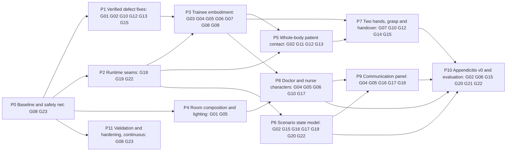
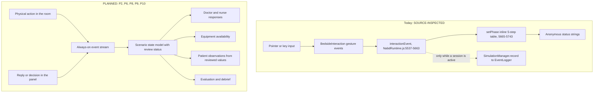

# 03 — Requirements Gap Analysis

**Purpose.** This document compares the current Nabd Clinical Simulator v1.5 with the owner's intended experience, one requirement at a time. The requirement source is the owner's `Nabd_Experience_and_Workflow_Brief.md` (cited as "brief §n"). The source of truth for the current state is the repository itself, the audit's own browser run (R1–R21) and build checks (B1–B5). For each of the 23 capability areas G01–G23 it states what exists, what the owner wants, the difference, the evidence, why the difference matters to a learner, what must be decided or built first, and which roadmap phase closes it. It closes with the brief's twelve success criteria (§11) checked against today's build, and a list of working systems that the plan must keep.

**Status labels used:** VERIFIED (R#/B#) · TEST-VERIFIED (test named) · SOURCE-INSPECTED · PARTIALLY VERIFIED · PLANNED · UNKNOWN · DATA-DERIVED (audit analysis) · CLINICAL REVIEW REQUIRED.

**Related documents:** [README](README.md) · [01](01_PROJECT_UNDERSTANDING.md) · [02](02_CURRENT_STATE_AUDIT.md) (findings F01–F35) · [04](04_EXPERIENCE_AND_WORKFLOW_DESIGN.md) · [05](05_HAND_CONTACT_AND_MOVEMENT_OPTIONS.md) · [06](06_APPENDICITIS_CASE_WORKFLOW.md) (clinical review items CR-nn) · [07](07_PRIORITIZED_IMPROVEMENT_ROADMAP.md) (phases P0–P11) · [08](08_TECHNICAL_DECISIONS_AND_OPEN_QUESTIONS.md) (DN1–DN6, D1–D10, unknowns) · [09](09_ACCEPTANCE_AND_VALIDATION_PLAN.md) (AC-P#-#, CRC-#) · [10](10_NEXT_IMPLEMENTATION_TASK.md) (T1) · [11](11_FULL_SESSION_SCENARIO.md) (full session scenario) · [REPOSITORY_EVIDENCE_INDEX](REPOSITORY_EVIDENCE_INDEX.md)

**Revision 2026-11-14.** The owner decided D1, D2, D3, D7 and D9. §1.5 records the decisions. The gaps whose prerequisites changed are updated in their "What must happen before it can be addressed" and "Roadmap phase" parts. No classification changed (§1.5 explains why). Smaller consistency edits: the legend (§1.2), the G05 summary row and the phase graph (§2, §2.1), the G03 difference paragraph, the G05 sub-finding note, and two rows of the preservation table (§5).

**Status after T1 (14 November 2026).** T1 ran on the branch `t1-baseline-f19`; results are cited as "T1 run", and BLOCKED marks a check that could not run there. It changed the evidence behind G23 and removed the G15 defect: git baseline `acdab52` tagged `v1.5-baseline` (F05), 21 of 21 tests pass (F03), the Vite build works (F04), the F19 fix (commit `006881f`) gives 0 console errors for all four tools in smoke S5, and the first valid frame-time numbers exist for one machine (F33). The gap text below stays as written on 13–14 November; appended *Status after T1* lines give the new state, and no classification changes (§1.5). Detail: [02](02_CURRENT_STATE_AUDIT.md) §4 status note and [phase-reports/P0-completion.md](phase-reports/P0-completion.md).

---

## 1. How to read this document

### 1.1 Sources and their limits

- **Requirement source.** The brief is a product and experience brief. It does not prescribe an implementation (brief, "Product boundaries"), so every "what must happen" item below is a recommendation and is labelled as such.
- **Orientation document.** The owner named `Nabd_v1.5_Repository_Review.md` as orientation material. It does not exist anywhere on disk. The repository was therefore treated as the only source of truth, and nothing in this document relies on that file.
- **Runtime evidence has one configuration.** The browser run used Chromium 152 (Electron built-in browser), Windows 11, Intel Iris Xe (ANGLE D3D11), WebGL2, at 1440x900. The pane was hidden for most of the session, so frame-rate figures were throttled and are **not valid**. Renderer counters (draw calls, triangles) are valid. Several flows were not exercised at runtime (training steps 2–5, scope insertion, abdomen press/pinch, general surface touch, supervisor tool handover, opposite-side work, touch devices, other browsers).
- **Reading R12 correctly.** Switching to room view or the anatomy view silently ends the forearm drill, the supervisor's support and any placed tool (F31; `src/app/NabdRuntime.js:4755-4757` `exitTraineeMode` → `leaveWorkstation` 5193 → `closeForearmPractice`). Screenshot `evidence/07-left-side-preset-supervisor.jpg` was taken **after** support had ended. The support hand in `evidence/04-supervisor-support-hand.png` is the supervisor's own right arm.

### 1.2 Classification legend

Each gap carries exactly one of these classifications.

| Classification | Meaning in this document |
|---|---|
| **Already exists and verified** | The capability as the brief describes it exists and was observed working. *Not used for any gap:* individual pieces are verified (for example the forearm grip, R9), but no brief requirement is met in full. |
| **Exists but needs improvement** | The capability exists in roughly the shape the brief asks for, with specific defects or omissions. |
| **Exists only partially** | Part of the capability exists; a substantial part the brief requires is missing. |
| **Exists in assets but is not integrated** | Usable assets exist in the repository but the running app does not use them for this purpose. *Not used as a whole-gap class;* it appears as a sub-finding in G03 (`assets/staff/supervisor.glb` full body), G05 (the same body, which D1 assigns to the nurse) and G21 (appendix, cecum and mesoappendix in the atlas). |
| **Does not exist** | Nothing in code or assets implements it. |
| **Cannot be determined yet** | Evidence is insufficient to classify. *Not used for any gap;* specific visual or performance questions inside gaps are marked UNKNOWN instead. |

### 1.3 Status labels

| Label | Meaning |
|---|---|
| **VERIFIED** | Executed and observed in the audit's browser run (R1–R21) or build run (B1–B5). |
| **TEST-VERIFIED** | Covered by a repository test that passed in this audit; the test file is named. Passing tests exercise isolated modules with fakes or mocks (only `tests/asset-manifest.test.js` and `tests/module-graph.test.js` read real files, to compare hashes and resolve import paths), and none loads the app's bundled three.js, so this label never implies anything about the running app. |
| **SOURCE-INSPECTED** | The code or the asset data was read; the behaviour was not executed. |
| **PARTIALLY VERIFIED** | Only part of the behaviour was observed. |
| **PLANNED** | Proposed work; it does not exist. |
| **UNKNOWN** | No reliable evidence; the text states what would settle it. |
| **DATA-DERIVED (audit analysis)** | Computed from asset geometry or constants by read-only scripts during the audit. Never a test result. |
| **CLINICAL REVIEW REQUIRED** | Clinical content that must be reviewed before use: through the D7 pipeline (the owner's admin model; §1.5), with at least one qualified human clinical sign-off RECOMMENDED before use with real trainees. Individual items are registered as CR-nn in [06](06_APPENDICITIS_CASE_WORKFLOW.md). |

### 1.4 Facts, recommendations and assumptions

In each gap, **What exists now** and **Evidence** are facts, each with a status label; a bullet under **What exists now** that carries no explicit label is SOURCE-INSPECTED. **The difference** is analysis. **What must happen before it can be addressed** and **Roadmap phase** are recommendations (PLANNED). Anything inferred rather than observed is marked **ASSUMPTION**. No visual quality, physical realism, collision reliability or clinical correctness is claimed from source reading. Unknown IDs (U#) and acceptance IDs (AC-P#-#) are owned by [08](08_TECHNICAL_DECISIONS_AND_OPEN_QUESTIONS.md) and [09](09_ACCEPTANCE_AND_VALIDATION_PLAN.md); this document describes unknowns in words and links to those registers instead of numbering them.

### 1.5 Owner decisions of 2026-11-14

On 2026-11-14 the owner answered five open decisions in a chat message written in Jordanian Arabic. The decision records belong to [08](08_TECHNICAL_DECISIONS_AND_OPEN_QUESTIONS.md). The owner also asked for the complete session scenario («نرسم السيناريو بالكامل», "let's design the full scenario"), which is [11](11_FULL_SESSION_SCENARIO.md). The English glosses are the plan's own.

| Decision | Recorded outcome | Gaps whose prerequisites changed |
|---|---|---|
| D1 Character assets | **DECIDED, option A+**, which supersedes the earlier recommendation of option B. Every person reuses the bodies already in the project, modified in-house: «بدنا نستورد نفس الجسم الموجود، نعدل عليه شوية أشياء» ("we want to bring in the same existing body and adjust a few things"). Trainee, supervising doctor and nurse are instances of the clothed `assets/staff/supervisor.glb`; the patient keeps `assets/patient/patient.glb`. Roles differ by clothing colour («ويكون الألوان اللي هم لابسينها مختلفة حسب الاختصاص», "the colours they wear differ by specialty"), by PPE according to the stage, and by small proportion changes through bone scaling. The trainee is a full body and the camera is its eyes: «المتدرب بدي إياه جسم يكون، مش إيدين بس. ويكون هو الكاميرا بأبعاد مناسبة فيزيائياً» ("the trainee must be a body, not only hands, and be the camera, at physically correct dimensions") | G03, G04, G05, G06, G09 |
| D2 Dialogue | **DECIDED.** The conversation partner is the owner's own model, which is being trained («رح يكون عبارة عن موديل», "it will be a model"). P9 builds an adapter contract around it. The P6 scenario state stays the single source of truth, model output is validated before it has any effect, and a deterministic "needs clarification" fallback covers an unavailable model or low confidence. Hosting, local or online, is TO CONFIRM | G16, G17, G18, G19 |
| D3 Register | **DECIDED.** A middle register: «لا عامية كثير ولا فصحى كثير، بالنص بيناتهم» ("not too colloquial and not too formal, in the middle between them") | G16, G17, G18 |
| D7 Clinical review | **DECIDED.** An admin model, with specialist models under it, reviews the case, evaluates the operation and fills in the remaining details: «هو اللي رح يقيم العملية، هو اللي رح يراجع الحالة» ("it is the one that will evaluate the operation and review the case"). Content carries one of three trainee-visible labels: "illustrative", "AI-reviewed (admin model) — not clinician-validated", "clinician-validated". At least one qualified human sign-off is RECOMMENDED before use with real trainees, external presentation or any claim of clinical accuracy (advisory; the owner decides) | G19, G20, G21, G22, and every "CLINICAL REVIEW REQUIRED (D7)" item |
| D9 Targets | **DECIDED.** Desktop and laptop browsers: «لازم يعمل على سفاري، لازم يعمل على كروم» ("it must work on Safari, it must work on Chrome"), with Edge and Firefox expected. The Claude desktop app's built-in browser is used for development previews. Unity is a separate, deferred project («حالياً انسى موضوع Unity», "for now, forget Unity") | G23, and every reference to a D9 budget |
| D6 Tooling | **PENDING.** Explained to the owner; not yet approved. *Since the owner's second message the same day: APPROVED (option A, including Playwright), and carried out in T1 ([08](08_TECHNICAL_DECISIONS_AND_OPEN_QUESTIONS.md) decision log)* | None (G12 and G23 still wait for it). *After T1: no longer waiting* |
| D4, D5, D8, D10 | **OPEN** at the time of this message. *Since the owner's second message the same day: D4 DELEGATED with consultation; D5, D8 (option A) and D10 DECIDED; D1, D2, D7 and D9 refined ([08](08_TECHNICAL_DECISIONS_AND_OPEN_QUESTIONS.md) decision log)* | None |

The same message adds three requirements, which [11](11_FULL_SESSION_SCENARIO.md) designs end to end:
- a chat panel on the side: «في عنا شات على الجانب التواصل يكون من خلالها» ("we have a chat on the side, through which communication happens");
- communication through actions: «التواصل يكون بأفعال» ("communication is through actions");
- physical intervention by the supervisor, as a normal event rather than a failure: «إذا في عنا تدخل من قبل المشرف، يمد إيده، يشيل إيد المريض، هو يتصرف إذا صار عنا حالة طارئة» ("if the supervisor intervenes, he reaches out, lifts the patient's hand, and acts if an emergency occurs").

**Reading D7 references.** "CLINICAL REVIEW REQUIRED (D7)" now means the D7 process. The admin model reviews the item, which then carries the label "AI-reviewed (admin model) — not clinician-validated"; only a signed human record makes it "clinician-validated" ([09](09_ACCEPTANCE_AND_VALIDATION_PLAN.md) §6). AI review can draft, cross-check and evaluate; it does not equal validation by a qualified clinician. This plan still proposes no clinical value, sequence or rule.

**Reading D9 references.** D9 now fixes the device class and the browsers. The numeric budget and the minimum machine are not decided, so the thresholds in [09](09_ACCEPTANCE_AND_VALIDATION_PLAN.md) §3 remain PROPOSED.

**Classifications are unchanged.** A classification describes the current build, which has not changed since the audit. The decisions change what must happen first and which phase closes a gap. G05 gains the same "in assets, not integrated" sub-finding as G03, because D1 assigns the existing supervisor body to the nurse. *After T1 (14 November 2026) the build has changed by one fix (F19); it removes a defect inside G15 without changing that gap's class, so every classification still stands.*

---

## 2. Summary of G01–G23

**Tally:** Exists but needs improvement 3 · Exists only partially 12 · Does not exist 8 · Already exists and verified 0 · Exists in assets but is not integrated 0 (as whole gaps) · Cannot be determined yet 0.

| ID | Area | Classification | Current reality (1 line) | Owner wants (1 line, brief §) | Key evidence | Roadmap phase(s) |
|---|---|---|---|---|---|---|
| G01 | OR layout and scene composition | Exists but needs improvement | Full procedural room plus 4 equipment GLBs; no surgical task light in the default path; flat-shaded GLBs; lime casing; no stations for staff | Organised, believable OR with logical equipment, task lighting, restrained palette, space for three people (§7) | F26, F27, F28; R13 | P1, P4 |
| G02 | Patient model and anatomical assets | Exists but needs improvement | Posable 163-joint patient (≈109k triangles) made supine by rigid rotation; atlas of 35 structures; no breathing, face or pain response; table fit unconfirmed | Patient whose condition and observations belong to the case; appropriate table position (§5, §7, §8) | F14, F27, F29, F30; R4, R9, R14 | P1, P5, P6, P10 |
| G03 | Full human trainee avatar | Exists only partially | Camera plus two floating gloved forearms; full clothed body on the same skeleton exists only as the supervisor asset | Complete human trainee with clothing and natural hands (§1, §3.1, §10) | F06, F07, F14; R4, R10, R21 | P3 |
| G04 | Full human supervising doctor | Exists only partially | Full clothed body, always visible, posed by code (arm aim, rigid tilt, teleports); no gaze, speech or animation | Complete doctor who guides, observes, demonstrates and corrects (§3.2) | F11, F12, F31; R4, R11, R13 | P3 (foundation), P8, P9 |
| G05 | Full human nurse | Does not exist | No nurse asset or code; one code comment (D1 assigns the supervisor body to the nurse) | Complete nurse who assists and provides equipment (§3.3) | F13; R13 | P3 (foundation), P4, P8, P9 |
| G06 | Clinical clothing, gowns, masks, gloves | Exists only partially | Supervisor has scrubs, gown, cap, mask, gloves; trainee has glove, cuff and sleeve stub only; patient undraped | Scenario-appropriate clothing and PPE for all three people (§3, §10) | F11, F14, F30; R4 | P3, P8, P10 |
| G07 | Hand rig and finger articulation | Exists only partially | 15 phalanx bones per glove driven by one curl scalar; wrist and metacarpals not driven | Individually or group-articulated fingers; grasp that closes around objects (§6) | F10; R9 | P3, P7 |
| G08 | Left/right identity and orientation stability | Exists but needs improvement | Fixed L/R asset mapping (safe by construction); several inconsistent orientation conventions; visual effect UNKNOWN | Hands never swap, flip, twist or jump (§6, §10) | F08, F09; R18 | P0, P3, P11 |
| G09 | Arm, elbow, wrist and shoulder movement | Does not exist | None for the trainee (rigid hand+forearm, stretched sleeve); patient and supervisor have two-bone IK | Coherent arm, wrist and hand movement without impossible bends (§3.1, §6) | F06, F07; R9, R10, R11 | P3 |
| G10 | Grabbing, holding, releasing, handover | Exists only partially | Click-to-hold, distance-gated attach, fixed palm offset, teleport on release, supervisor hand-off by teleport | Natural grasp, controlled release, handover by doctor or nurse (§3, §4, §6) | F12, F18, F20; R8, R9, R11, R17 | P1, P7, P8 |
| G11 | Contact coverage across the patient | Exists only partially | Physical contact only for the patient's left arm and mattress (drill); raycast targeting elsewhere | Continuous contact across the whole body (§6) | F15, F17; R7–R11 | P5 |
| G12 | Collision and prevention of hand penetration | Exists only partially | 6 bone-origin probes vs 3 approximate shapes (drill); top-down height-field lift elsewhere; nothing for torso, instruments, staff | No visible pass-through, no floating gaps (§6) | F15, F16, F17, F03; R9 | P1, P5, P7 |
| G13 | Contact while sliding | Exists only partially | `touch` re-raycasts per crew update but uses an unskinned object-local normal as a world normal | Smooth, stable sliding along the body surface (§6) | F17; (not exercised at runtime) | P1, P5 |
| G14 | Two-hand interaction | Does not exist | Impossible by construction: one gesture, one pointer, one tool group | Two hands that grasp, hold and work together (§3.1, §6) | F18 | P7 |
| G15 | Instrument and equipment interaction | Exists only partially | 4 procedural instruments, one at a time, chosen by dropdown; scissors/needle-holder NaN geometry (verified; fixed in T1, `006881f`); port and scope in free practice only | Direct interaction with appropriate, available instruments and equipment (§2, §3.3, §7, §9) | F19, F20; R15, R17, R20 | P1, P6, P7, P10 |
| G16 | Doctor communication and guidance | Does not exist | No doctor dialogue; anonymous canned status strings, partly colloquial | Doctor instructs, asks, explains and adapts (§3.2, §4) | F22, F25 | P6, P9 |
| G17 | Nurse communication and equipment delivery | Does not exist | No nurse; tool source is a dropdown (tray or supervisor) | Nurse responds to requests, clarifies, explains unavailability (§3.3, §4) | F13, F22; R13, R17 | P6, P8, P9 |
| G18 | Compact chat and contextual decisions | Does not exist | No chat, 0 text inputs; one fixed 3-button quiz; 39 visible buttons and 8 form controls at 1440x900 | Small edge panel with speaker identity, history, choices, text entry; minimal UI (§4, §9) | F22, F25; R5 | P2, P9 |
| G19 | Scenario state and agent coordination | Exists only partially | One inline 5-step generic drill; stage mirrored to an event logger; no scenario data, rules or agent | Scenario agent coordinating people, equipment, patient state and responses from reviewed rules (§5) | F21, F24, F32; R15, R16 | P2, P6 |
| G20 | Patient observations and vital signs | Exists only partially | Monitor shows fixed demo values with small sine variation, linked to nothing; static screens conflict | Observations and vitals driven by the scenario from reviewed values (§5, §8, §9) | F23; R13, R15 | P6, P10 |
| G21 | Appendicitis workflow | Does not exist | No case; appendix, cecum and mesoappendix exist only as atlas structures; the doc claim of an appendectomy scenario is not backed by code | Complete, reviewed appendicitis training workflow (§8, §11) | F21, F29, F35; R14 | P10 |
| G22 | Training evaluation and debrief | Does not exist | Result line always reads 5/5; in-memory log only during a session, wiped by reset | Useful assessment and contextual feedback, no arcade scoring (§5, §9, §11) | F24; R16 | P2, P6, P10 |
| G23 | Performance, browser compatibility, testing | Exists only partially | 19 of 20 reported test results pass; major modules untested; Vite build not runnable; one browser; FPS unknown. *After T1: 21 of 21 pass; Vite build works; Playwright smoke in Chrome, Edge and WebKit on Windows (Firefox BLOCKED); first valid FPS on one machine* | Reasonable performance and an explained test approach (§6) | F02–F05, F32–F34; R2, R3, R6, B1–B5 | P0, P11 |

### 2.1 Which phases close which gaps

This is the dependency graph of [07](07_PRIORITIZED_IMPROVEMENT_ROADMAP.md), annotated with the gaps each phase addresses. P11 runs continuously from P0.

---

## 3. Detailed analysis per gap

### G01 — Operating-room layout and scene composition

**Classification:** Exists but needs improvement

**What exists now**
- A procedural room of 7.16 × 7.98 m with ceiling tiles at 3.86 m (3911) and the table at the origin, built by `async function nd` (`src/app/NabdRuntime.js:3860@72918`–`4583`; app code starts at 3860@71276; envelope 3868-3936). SOURCE-INSPECTED.
- Equipment (SOURCE-INSPECTED inventory): operating table, two surgical light heads on a pendant system, anaesthesia workstation, vital-signs monitor, endoscopy tower with two screens, electrosurgical unit with foot pedal, suction cart, back table, Mayo stand, waste bin, wall storage. Four trimesh GLBs (table base and top, light pendant system, anaesthesia workstation) replace the procedural table, lights and anaesthesia unit when they load (`loadEmbeddedAsset`, 4523; per-asset `try`/`catch` fallbacks 4546-4581). VERIFIED R13 for the subset visible in the room overview: two ceiling lights on pendant arms, the anaesthesia workstation with monitor, the endoscopy tower with two screens, the instrument trolleys/back table and a wall control panel (`evidence/06-room-overview.jpg`). The GLB files were served with HTTP 200 (R3).
- Defects, SOURCE-INSPECTED unless stated (visual effect UNKNOWN unless stated):
  - The two lamp "spots" are `DirectionalLight`s (4033) inside the procedural `fixtures` group, which is hidden once the light GLB loads (4563). The default path therefore has **no task light from the surgical lamps** (F26).
  - All four room GLBs carry only `POSITION` (no normals or UVs), so the loader flat-shades them; the front-wall planes (3880-3882) face out of the room; the device casing colour is `#ebf641`, a saturated lime-yellow (4164). R13 observed a "yellow endoscopy tower" (F28).
  - Floor-contact gaps of 2.6–9.5 cm above the floor plane at y = −0.025: wheeled equipment sits 5.5–9.5 cm above it because `wheelSet` places the wheel bottom at the group origin plus an offset (4189-4198; SOURCE-INSPECTED arithmetic), and the supervisor's feet about 2.6 cm (DATA-DERIVED from the bind-pose minimum). The −X side holds the supervisor, Mayo stand, back table, anaesthesia unit, monitor and infusion rod. On +X there are the endoscopy tower and electrosurgical unit along the wall, while the +X head quadrant is empty floor (F28).
  - The table GLB pads sit at y ≈ 0.953 and ±0.28–0.31 m wide, while code (patient root, limb floor `$()` at 5916, Rapier mattress) assumes a deck at 0.900 m, ±0.47 m (F27).
- Nothing in the room responds to the case: every item is always visible, and the only clickable piece of room equipment is the vitals monitor (the bedside `tap` handler opens it, 6076-6081). SOURCE-INSPECTED.

**What the owner wants** — brief §7: organised layout, believable proportions, appropriate table and patient position, logically placed lights and equipment, an instrument trolley, relevant monitoring, clear space for trainee, doctor and nurse, appropriate lighting and a restrained palette, no decorative clutter, no game HUD; "only the equipment relevant to the current case should be prominent or accessible". Brief §2 principle 8 (professional realism over spectacle).

**The difference** — The room exists and is reasonably complete as an inventory. What is missing is composition and correctness: task lighting, three defined staff stations, scenario-controlled prominence of equipment, and a palette without the lime outlier. Geometry mismatches (table, floor gaps, outward wall) are defects, not missing features.

**Evidence** — F26, F27, F28 ([02](02_CURRENT_STATE_AUDIT.md)); R1, R3, R13; `evidence/06-room-overview.jpg`.

**Why it matters to the learner** — The brief's first principle is that the session should feel like a formal operating room. Lighting that does not come from the lamps, flat shading and floating equipment undermine that. The learner is also expected to "understand what to do through … the room layout and the objects themselves" (§9), which requires the relevant equipment to stand out.

**What must happen before it can be addressed**
- P0 visual baselines at fixed camera presets in a visible window, so any change can be compared (UNKNOWN today: how the defects actually look).
- Measure patient/table/pad clearance before changing table constants (F27 interpenetration is UNKNOWN).
- Owner decision D10 before changing the casing colour or any other part of the visual identity (DN6 keeps it unless D10 approves).
- Station layout must be decided together with G04 and G05. [11](11_FULL_SESSION_SCENARIO.md) §2 proposes named station slots (TR-1, SUP-A, SUP-B, NUR-1, NUR-H, MON) that each scenario stage assigns as data; the team positions themselves are CLINICAL REVIEW REQUIRED (CR-32 in [06](06_APPENDICITIS_CASE_WORKFLOW.md)).
- Which equipment the appendicitis case needs, and when: CLINICAL REVIEW REQUIRED (D7).

**Roadmap phase** — P1 (lamp lighting F26; table constants F27 after measurement), P4 (layout, stations, F28 clean-up, palette under D10).

---

### G02 — Patient model and anatomical assets

**Classification:** Exists but needs improvement

**What exists now**
- `assets/patient/patient.glb` (8.1 MB, ≈109k triangles, 163-joint skin, standing A-pose, no animation clips or morph targets), loaded by `hd` (`NabdRuntime.js:4585@45443`, called at 6009). Supine is produced by rotating the whole group (pitch −π/2, root at (0, 0.936, 0.025)), not by re-posing the skeleton. At runtime the patient is four single-material `SkinnedMesh`es, including a separate privacy patch. SOURCE-INSPECTED. The supine patient on the table is VERIFIED (R4).
- Posing: three UI presets (supine, sitting, standing; `index.html:239-241`, with intermediate keyframes in the `Pr` table), limb two-bone IK with swing and bend limits and a mattress/floor check (`T0`/`A0` at 4632; `$` at 5916), and a finger-curl API. Gripping and lifting the left forearm is VERIFIED (R9, `evidence/03-forearm-lift-stretched-sleeve.png`).
- Internal atlas: 35 BodyParts3D structures (CC BY 4.0; label table `src/patient/InternalAnatomy.js:1-12`) parented to the patient group, not to bones (`InternalAnatomy.js:55`, `patient.root.add(atlas)`). VERIFIED R14 ("35 بنية معروضة" and the attribution line; `evidence/08-internal-anatomy-atlas.jpg`).
- Privacy exclusion: TEST-VERIFIED (`tests/target-filter.test.js`, logic on mock objects only).
- Absent (SOURCE-INSPECTED): breathing or chest motion, facial expression, blink, pain or reflex response, skin-colour change. The facial and tongue joints are unused. The patient is unclothed apart from a baked privacy patch; there are no drapes. Skin deformation exists only in an abdominal patch (`src/patient/AbdomenSurface.js:16`).
- Table fit: the supine back surface maps to y ≈ 0.905–0.927, which fits the procedural mattress (`Un.high` = 0.900, half-width 0.47) but sits 2.5–5 cm below the GLB pad top (0.953) shown by default (DATA-DERIVED; one analyst's computation, not re-run by the cross-check). Visible interpenetration is UNKNOWN (F27).
- Provenance: `assets/patient/ASSET-PROVENANCE.md` is second-hand ("based on the asset documentation embedded in the supplied v0.15 project") and names no original author or source URL. A more specific source (Innerscene "Male base mesh, rigged A-pose", adapted from MakeHuman, CC0 1.0, with URLs) appears only inside the HTML comment that holds the licence notes in `index.html` (comment 310-557, patient section 531-544), which users never see. The licence claim itself is UNKNOWN until confirmed against the original source (F30, D8).

**What the owner wants** — Brief §8: case introduction and patient presentation, and "how the patient state and observations are represented". Brief §5: the patient's scenario state is coordinated with everything else. Brief §7: appropriate table and patient position. Brief §10: realistic but restrained appearance, no gratuitous gore.

**The difference** — The base asset and posing are a solid foundation. What is missing is any patient state that a scenario could drive (observable signs, responses), confirmed fit on the default table, and case-appropriate presentation (positioning, draping).

**Evidence** — F14, F27, F29, F30; R4, R9, R14.

**Why it matters to the learner** — The learner reads the patient's condition from the patient and the monitor. A patient who never changes cannot show the consequence of an action, and a patient sunk into the table pads undermines believability.

**What must happen before it can be addressed**
- Measure the table fit in the browser (P0) before P1 changes constants.
- Patient presentation, positioning, draping and any patient response: CLINICAL REVIEW REQUIRED (D7).
- Provenance acceptance for the patient asset (D8).
- A scenario state model (P6) to drive any patient outputs.

**Roadmap phase** — P1 (table constants after measurement), P5 (skeleton-driven proxy shapes fitted to the skin), P6 and P10 (patient-state outputs and the observation model).

---

### G03 — Full human trainee avatar

**Classification:** Exists only partially (gloved forearms only; a full body on the same skeleton exists in assets but not as the trainee)

**What exists now**
- The trainee is the camera plus two gloved forearms. Each glove GLB has three primitives (nitrile glove, cuff, short scrub-sleeve stub) and ends just distal of the elbow. `buildHand` adds each to the scene, and `updateHand` re-places it from the camera on every crew update (`src/staff/CrewController.js:21-87`, `364-371`). There is no torso, head, upper arm or shoulder; `shoulder()` is a computed point 0.17 m to the side and 0.225 m below the camera (356-360). SOURCE-INSPECTED. VERIFIED R4 (`evidence/01-default-bedside-view.jpg`) and R21 (`evidence/10-scissors-without-blades.jpg`: a long forearm enters from the screen corner).
- In workstation modes, including the forearm drill, a `CylinderGeometry(0.036, 0.057, 1, 18)` sleeve (line 75) is stretched by `updateSleeve` from the glove's sleeve rim to that virtual shoulder (437-453). Reach can extend to 0.87 m (`canReach`, 279-281). VERIFIED DEFECT R10: a very large elongated dark-teal volume with a jagged open edge while the wrist is lifted (`evidence/03-forearm-lift-stretched-sleeve.png`; F07).
- **In assets, not integrated:** `assets/staff/supervisor.glb` is a full clothed body whose skin `PatientRig` has the same 163 joints as `patient.glb` (SOURCE-INSPECTED GLB data); joint order, inverse-bind matrices and rest transforms are byte-identical by hash comparison (DATA-DERIVED (audit analysis), F14). It could, in principle, become a trainee body. The glove GLBs (`GloveRig_left`, `GloveRig_right`, 163 joints each) share the joint names but have different inverse-bind matrices and rest poses, so they cannot be placed on that skeleton without rebinding (DATA-DERIVED (audit analysis)).

**What the owner wants** — Brief §1: the trainee is "represented by a complete human avatar with natural hands and articulated fingers". Brief §3.1: the trainee "appears as a complete human character in the room", wears appropriate clinical clothing, and has two distinguishable hands with natural proportions. Brief §10 ("avoid … floating hands, or disconnected limbs"). Brief §2 principle 1 ("People, not floating hands") states the same direction for the doctor and nurse.

**The difference** — The trainee is today exactly what the brief rules out: floating forearms with no body. The only available full body is the same adult male used for the patient and the supervisor. D1, decided on 2026-11-14 as option A+, reuses that body for the trainee, the doctor and the nurse, so the people differ by attire colour, PPE and small proportion changes rather than by body (§1.5).

**Evidence** — F06, F07, F14; R4, R10, R21.

**Why it matters to the learner** — Body continuity tells the learner where their hands are relative to their own body and the patient. The stretched sleeve appears during the main drill, at the moment of contact, which is when attention is highest.

**What must happen before it can be addressed**
- **D1 DECIDED (2026-11-14, option A+; §1.5).** The trainee becomes an instance of the clothed `assets/staff/supervisor.glb` body, recoloured for the trainee role. Option B (new bodies), the earlier recommendation, is superseded. This requires, first:
  - **A camera derived from the body's eyes.** Today the camera is fixed at y = 1.60 m (`traineeDefault`, `src/app/NabdRuntime.js:4661`, SOURCE-INSPECTED). The rig's `eye.L`/`eye.R` joints sit at y ≈ 1.676 m in the rest pose, and the eyes primitive spans y ≈ 1.661–1.691 m (DATA-DERIVED (audit analysis)). The eye height therefore becomes about 1.67 m unless the body is scaled.
  - **A visible body with a hidden head.** The torso and arms are visible when looking down, the head is hidden from the first-person camera, and both arms connect to the shoulders. In `supervisor.glb` the bare-skin primitive covers only the head and neck (y ≈ 1.49–1.73 m in the rest pose, DATA-DERIVED), with the cap, mask, brows and eyes on top.
  - **One skinned clone per person.** No skinned-clone helper is confirmed in the bundle; this is an open unknown in [08](08_TECHNICAL_DECISIONS_AND_OPEN_QUESTIONS.md).
  - **Provenance, not feasibility.** The licence comment at `index.html:537` says the base mesh was "adapted from MakeHuman", and the joint names are consistent with that. The origin is still unconfirmed against the source (UNKNOWN), but under A+ it matters for the licence record (D8), not for whether the body can be used.
- P2 seam: a Character service interface, so the trainee body is not added as more shared state in `NabdRuntime.js` (F01).
- The time-boxed T2 spike (branch only, owner visual review), now on the decided body: arm continuity and the eye-height camera.
- UNKNOWN: how the body reads from the first-person camera at the trainee field of view, and the rendering cost of another skinned body of ≈112k triangles (the numeric D9 budget is still PROPOSED).

**Roadmap phase** — P3 (trainee body instance, eye-height camera, role attire and arm continuity; the T2 spike first). The acceptance criteria for the camera, the visible body and the role materials are listed under P3 in [09](09_ACCEPTANCE_AND_VALIDATION_PLAN.md).

---

### G04 — Full human supervising doctor avatar

**Classification:** Exists only partially

**What exists now**
- `supervisor.glb` (7.9 MB, ≈112k triangles, 13 primitives including scrubs, gown, cap, mask, gloves, trousers and footwear) is loaded with the gloves (`CrewController.js:7-9`), placed at (−0.79, 0, 0.06) facing +X toward the trainee (88-94), and never hidden: `setVisible` toggles only the hands and tool (507-514), so the QA field `supervisorVisible` is always true (`NabdRuntime.js:6136`). VERIFIED R4, R13.
- Posing is procedural on every crew update (SOURCE-INSPECTED):
  - `orientArm` aims both arms (117-135) and `staffGrip` curls the fingers (176-183).
  - A hand-off "offer" moves the body 0.129 m and tilts the whole group by up to 0.24 rad about its feet (457-465). This is a rigid lean, not a bend at the hips.
  - It teleports to (−1.94, 0, 0.25) in workstation modes (462-463), and under forearm support to x = ±0.55, tilted 0.42 rad (466-471).
  - `reachSupport` is a two-bone IK of the right arm with a world-fixed pole (143-175, called 481-485).
  - No head, neck, spine or eye motion (no gaze), no walking, no animation clips, no speech.
- Forearm support (F12) is VERIFIED R11 (`evidence/04-supervisor-support-hand.png`, `evidence/05-after-release-forearm-supported.jpg`): the label "المشرف مسنّد الساعد" appears only when the support gap is below 0.020 m (`NabdRuntime.js:5513-5514`), so it was met at least once at the trainee's +X stance. Nothing physical holds the forearm: support is a flag that pauses settling (5497).

**What the owner wants** — Brief §3.2: a complete human standing in an appropriate position, in appropriate clothing and PPE, with natural posture and hand movement, who guides, gives concise instructions, explains, asks questions, observes and adapts, may demonstrate or hand over an item, and corrects unsafe or out-of-sequence actions calmly. Brief §2 principle 4.

**The difference** — The body is present. Behaviour is almost entirely absent: posture changes only by rigid tilt, movement is by teleport, there is no attention or gaze toward the trainee, no communication, and no demonstration.

**Evidence** — F11, F12, F31; R4, R11, R12 (corrected), R13.

**Why it matters to the learner** — The supervisor is the learner's guide (§2 principle 4). A silent figure that teleports and leans rigidly cannot guide, and it reads as game-like (§2 principle 8).

**What must happen before it can be addressed**
- P3 provides the shared IK and look-at foundation on the 163-joint rig.
- **D1 DECIDED (option A+).** The doctor keeps the existing clothed body. What distinguishes the doctor from the trainee and the nurse is role colour, applied by runtime recolouring of the separately named garment materials, for example "Patient scrub shirt • woven blue", "Surgical cap • spun fabric", "Long sterile gown", "Scrub trousers", "Supervisor gloves" and "Surgical face mask" (DATA-DERIVED from the GLB). The colours are proposed within DN6 (D10 if a colour falls outside it). Which PPE is worn at which stage is CLINICAL REVIEW REQUIRED (CR-31 in [06](06_APPENDICITIS_CASE_WORKFLOW.md)).
- **Physical intervention is part of the role** (§1.5: «يمد إيده، يشيل إيد المريض»). [11](11_FULL_SESSION_SCENARIO.md) §4 defines an intervention ladder from L0 (observe) to L6 (pause the case), including physical assistance and take-over in an emergency. It adds three prerequisites:
  - `reachSupport` (`src/staff/CrewController.js:143-175`, right arm only today) generalised to both arms;
  - the supervisor's hand driving the same patient limb IK that the trainee's grip drives (`createLimbDrag`, `src/app/NabdRuntime.js:5395-5428`, passed as `startLimb` at 6066);
  - turning, stepping and a spine lean in place of today's rigid tilt, teleports and support-as-a-flag (F11, F12).

  When the doctor may demonstrate or take over is CLINICAL REVIEW REQUIRED (CR-27).
- P6 scenario state, which decides what the doctor does and says.
- **D2 and D3 DECIDED:** the doctor's understanding and replies come from the owner's model through the validating adapter, in the middle register (see G16).
- UNKNOWN: whether the rigid support tilt intersects the bed or patient, and whether support reaches within 0.020 m from other stances.

**Roadmap phase** — P8 (behaviour, stations and the intervention levels of [11](11_FULL_SESSION_SCENARIO.md) §4), P9 (dialogue through the D2 adapter), built on P3 (body, IK and look-at foundation).

---

### G05 — Full human nurse avatar

**Classification:** Does not exist (a usable body exists in assets: D1 assigns `assets/staff/supervisor.glb` to the nurse)

**What exists now**
- No nurse asset, procedural figure or behaviour. The only reference is the code comment "Back table: sterile instrument preparation station at the scrub-nurse side" (`NabdRuntime.js:4366`). `assets/staff/` holds only the gloves and the supervisor. SOURCE-INSPECTED; absence VERIFIED R13.
- Free floor space, SOURCE-INSPECTED from coordinates: the +X head quadrant (x ≈ 1.1 to 3.2 m, z ≈ −2.9 to −0.7 m) and the foot end (z ≈ 1.7 to 4.6 m). The −X gap between the Mayo stand and the back table is filled in workstation modes by the supervisor (−1.94, 0.25) and the moved Mayo stand (x = −1.61).

**What the owner wants** — Brief §3.3: a complete human nurse (not a floating hand), in scenario-appropriate clothing and gloves, with articulated fingers, who responds to requests, provides only appropriate and available items, asks for clarification, explains unavailability, and participates without distracting. Brief §2 principle 5; §11 item 3.

**The difference** — The whole role is missing: body, clothing, station, movement, equipment retrieval and communication.

**Evidence** — F13; R13; `evidence/06-room-overview.jpg`.

**Why it matters to the learner** — The nurse is the learner's channel for supplies. Without a nurse, the request patterns of brief §4 cannot be practised, and the team-workflow dimension of the session is absent.

**What must happen before it can be addressed**
- **D1 DECIDED (option A+).** The nurse is another instance of the clothed `supervisor.glb` body, in distinct role attire: «رح يكون في عنا كمان ممرضة. بدنا نستورد نفس الجسم الموجود» ("we will also have a nurse; we want to bring in the same existing body"). Honest limitation: a convincingly female nurse may need shape changes beyond recolouring. The rig has `breast.L`/`breast.R` and `pelvis.L`/`pelvis.R` joints (DATA-DERIVED), whose scaling allows only limited change, and the visual result is UNKNOWN; a sculpt made in-house in Blender would still count as in-house. [11](11_FULL_SESSION_SCENARIO.md) §1 casts the nurse as the scrub nurse who prepares and hands over instruments; the nurse's scope is CLINICAL REVIEW REQUIRED (CR-26 in [06](06_APPENDICITIS_CASE_WORKFLOW.md)).
- P4 reserves a station and clear floor space. [11](11_FULL_SESSION_SCENARIO.md) §2 proposes the station slots NUR-1 (at the trolley) and NUR-H (the handover point), assigned per stage as data.
- P6 supplies equipment availability, so the nurse can refuse or clarify.
- Where the nurse stands and works for this case, relative to the trainee and back table: CLINICAL REVIEW REQUIRED (D7; CR-32).
- UNKNOWN: rendering cost. With D1 the people alone come to ≈446k triangles: three staff instances of ≈112,480 each plus the patient's ≈109k (DATA-DERIVED). That is more than today's whole default bedside view (378,534–387,848, VERIFIED R6). Each staff skinned mesh is drawn with frustum culling off and casts shadows (`src/staff/CrewController.js:111-113`, SOURCE-INSPECTED). This needs measurement (P0, T2) and possibly mesh simplification (P3, P8) against the D9 budget, which is still PROPOSED.

**Roadmap phase** — P3 (shared-body foundation: skinned clone and role materials), P4 (station), P8 (character and choreography), P9 (dialogue through the D2 adapter).

---

### G06 — Clinical clothing, gowns, masks and gloves

**Classification:** Exists only partially

**What exists now**
- Supervisor (SOURCE-INSPECTED from GLB material names): natural skin, scrub shirt, scrub shorts, surgical cap, long sterile gown, scrub trousers, closed theatre footwear, supervisor gloves, surgical face mask. Two materials are still named "Patient scrub shirt/shorts". The "Long sterile gown" primitive spans only y ≈ 1.11–1.50 m in the bind pose (POSITION accessor bounds; DATA-DERIVED (audit analysis)). R4 observed "teal scrubs"; garment quality otherwise UNKNOWN.
- Trainee: nitrile glove, cuff and a scrub-sleeve stub (`assets/staff/glove-left.glb`, `glove-right.glb`). No gown, cap or mask, because no body exists (G03).
- Patient: unclothed apart from the baked privacy patch; no surgical drapes anywhere in the room code (SOURCE-INSPECTED).
- Provenance: `assets/staff/ASSET-PROVENANCE.md` mentions gown, cap, gloves and mask only; scrubs, trousers, footwear and the fabric texture are undocumented (F30).

**What the owner wants** — Brief §3.1–§3.3: each person wears scenario-appropriate clinical clothing, including gown and gloves where required. Brief §10: believable gowns, gloves, masks, and appropriate material response for fabric and gloves.

**The difference** — One outfit exists, for one character. There is none for the trainee's body or a nurse, no clothing state that changes with the scenario, and no patient draping.

**Evidence** — F11, F14, F30; R4.

**Why it matters to the learner** — Clothing signals roles and sterile state at a glance. If preparation stages are part of the case (§8), the visible clothing state must match them.

**What must happen before it can be addressed**
- **D1 DECIDED (option A+).** Every staff member wears the supervisor body's existing garments, recoloured by role; no clothing is brought in from outside. Two prerequisites follow:
  - **Role colours.** Runtime recolouring of the separately named materials (scrub shirt, scrub shorts, cap, gown, trousers, footwear, gloves, mask), with per-instance material copies so that one role's colour never changes another's. The colours are a PROPOSAL for owner and visual review within DN6 (D10 if outside it).
  - **PPE by stage.** The owner: «حسب الوضع الطبي اللي هم فيه بالعملية» ("according to the medical situation they are in during the operation"), for example sterile gown and gloves for scrubbed staff versus scrubs only. Visibility is driven by scenario data (P6). The rules are CLINICAL REVIEW REQUIRED (CR-31 for attire and CR-08 for sterility, in [06](06_APPENDICITIS_CASE_WORKFLOW.md)).
- The "Long sterile gown" primitive spans only y ≈ 1.11–1.50 m in the bind pose (DATA-DERIVED), so whether it reads as a full gown when shown is UNKNOWN; an in-house garment edit may be needed.
- D8 (provenance acceptance for the clothing) is still open: scrubs, trousers, footwear and the fabric texture are undocumented (F30).
- Which clothing and PPE apply at which stage, and patient draping: CLINICAL REVIEW REQUIRED (D7).

**Roadmap phase** — P3 (trainee attire and the role-material mechanism), P8 (doctor and nurse attire), P10 (stage-driven PPE states and draping, once reviewed).

---

### G07 — Hand rig and finger articulation

**Classification:** Exists only partially

**What exists now**
- The glove GLBs carry the full 163-joint naming (`GloveRig_left/right`). For the trainee, only the 15 phalanx bones per hand are driven: each rotates about its local X axis by a fixed amplitude times one shared `curl` scalar (`CrewController.js:39-43`, `poseFingers` 386-391). Amplitudes are thumb [0.19, 0.30, 0.35] rad and fingers [0.54, 0.76, 0.59] rad. The only per-finger difference is that a pinch keeps digits 3–5 at curl ≥ 0.57 (388). Curl targets depend on the situation (381-384). SOURCE-INSPECTED.
- Not driven: metacarpals, wrist, forearm twist. There is no thumb opposition, no finger IK and no object-specific grasp shape (F10).
- Patient fingers use the same approach (`patientFingerFlexion`, `NabdRuntime.js:4608`); `docs/patient-hand-rig.md` calls the axis and amplitudes provisional. The supervisor's `staffGrip` curls all 30 finger bones.
- UNKNOWN: whether local X is the anatomical flexion axis for every phalanx, the thumb included. R9 shows a grip occurred; finger shape was not evaluated.

**What the owner wants** — Brief §6: fingers articulate individually or in coordinated groups; grasping looks like a hand closing around an object, not an object snapping to a point; wrists, palms, thumbs and fingers move as one coherent hand. Brief §3.1 and §10.

**The difference** — A crude form of coordinated group motion exists. Individual articulation, thumb opposition, wrist motion and object-specific grasps do not.

**Evidence** — F10; R9.

**Why it matters to the learner** — Grip shape is a visible signal of whether a grasp happened and how. The same curl around an instrument handle and around a forearm looks like snapping, which the brief explicitly rejects.

**What must happen before it can be addressed**
- P0 visual baseline of curl at fixed values per finger to settle the axis question.
- P3: separate wrist joint with limits, and per-grasp finger poses.
- P7: grasp poses per object.

**Roadmap phase** — P3, P7.

---

### G08 — Left/right hand identity and orientation stability

**Classification:** Exists but needs improvement (mapping stable by construction; orientation conventions inconsistent; visual effect UNKNOWN)

**What exists now**
- **Identity is fixed.** `const hands = { left: buildHand(leftAsset, -1), right: buildHand(rightAsset, 1) }` (`CrewController.js:87`); nothing reassigns it, and no negative scale exists anywhere. The rest pose is camera-local, so the left glove always rests on the left of the screen (364-371). The rest-frame algebra in `buildHand` (30-37) builds each hand's frame from its own wrist and finger bones, with the `right` axis sign flipped by `-side`, so the dorsal axis is derived consistently for both hands. SOURCE-INSPECTED; how it looks is not separately verified.
- **Active-hand selection.** Only Q/E (`NabdRuntime.js:5831-5832`) or the hand buttons (5947-5949) call `chooseHand` (5241-5248). The side is read once per gesture (`src/interaction/BedsideInteraction.js:105`, stored at 120). VERIFIED R18: the buttons toggle `aria-pressed`, with no visible change in the rest pose.
- **Orientation conventions disagree** (F09; SOURCE-INSPECTED, visual effect UNKNOWN):
  - `contactRotation` with a normal (293-301) points the fingers about 180° away from the no-normal branch (302-303) and from the `'forearm'` branch of `driveSurface` (325-327). An abdomen pinch switches branches at attach (`BedsideInteraction.js:187` passes a normal; 226 does not).
  - The default `driveHand` rotation `wristToTool` (238, 282) is fixed in world space (fingers toward world −X), not relative to the trainee.
  - Instrument roll wraps without limit and rotates the whole hand (`src/instruments/InstrumentKinematics.js:122`).
  - Cross-body reach is allowed; `canReach` checks only height and distance (279-281).
  - Hands are smoothed in world space, so they trail after camera teleports.
- Not tested by any repository test; opposite-side work was not exercised at runtime.

**What the owner wants** — Brief §6: both hands remain anatomically consistent and identifiable; they must not swap sides, flip, twist, jump or bend impossibly. Brief §10: correct left/right consistency.

**The difference** — Identity is safe; orientation is not unified, and neither property is protected by a test.

**Evidence** — F08, F09; R18.

**Why it matters to the learner** — A flip or twist breaks embodiment and may teach the wrong hand use. Reliable hand identity also matters for evaluation: `endoscope_moved` logs `activeHand`, which can differ from the hand actually holding the tool (SOURCE-INSPECTED, `NabdRuntime.js:6033-6037`).

**What must happen before it can be addressed**
- DN4: keep the fixed asset mapping and protect it with invariant tests.
- P0 visual baselines for each orientation path, to settle what is actually visible.
- A unified convention needs an arm (P3) so that natural limits can be applied.

**Roadmap phase** — P0 (baseline evidence), P3 (unified convention and invariant tests), P11 (regression).

---

### G09 — Arm, elbow, wrist and shoulder movement

**Classification:** Does not exist (for the trainee; the patient and the supervisor have limb IK)

**What exists now**
- **Trainee:** hand and forearm are one rigid body (`poseHand`, `CrewController.js:392-396`), with no elbow, shoulder or wrist joint, no joint limits and unlimited roll. The straight sleeve cylinder to a virtual shoulder (437-453) is the only "upper arm". VERIFIED DEFECT R10.
- **Patient:** analytic two-bone IK with a swing cone (arm 1.9 rad) and a flexion limit (arm 2.52 rad), plus a mattress/floor check (`T0`/`A0`/`pd` at `NabdRuntime.js:4632`; `$` at 5916). There is no limb-versus-torso check. VERIFIED R9 (lift).
- **Supervisor:** `orientArm` (117-135) and the right-arm `reachSupport` IK (143-175). VERIFIED R11.

**What the owner wants** — Brief §3.1: the trainee can move, reach, touch, grasp and manipulate. Brief §6: wrists, palms, thumbs and fingers move as parts of a coherent hand, with no impossible bends. Brief §10: no disconnected limbs.

**The difference** — The trainee has no articulated arm at all. Working IK code already exists in the project (patient and supervisor) and can be reused rather than replaced.

**Evidence** — F06, F07; R9, R10, R11.

**Why it matters to the learner** — Reach and posture are part of physical skill. Today the reach limit is a sphere of 0.87 m around an invisible point, which the learner cannot see or learn from.

**What must happen before it can be addressed**
- **D1 DECIDED (option A+).** The trainee's arm is the shared rig's own chain (`clavicle`, `shoulder01`, `upperarm01/02`, `lowerarm01/02` and `wrist`, left and right; DATA-DERIVED joint names), so the two-bone IK patterns that already drive the patient and the supervisor can be reused. Also needed: the P2 Character interface and the T2 spike on that body.
- Wrist and elbow ranges for the trainee. ASSUMPTION: generic human range-of-motion values are sufficient for a training prototype; the owner should confirm.
- D4, because the input scheme decides how many degrees of freedom the learner controls directly.

**Roadmap phase** — P3.

---

### G10 — Grabbing, holding, releasing and handover

**Classification:** Exists only partially

**What exists now**
- **Grab.** Click-to-hold with one gesture (`BedsideInteraction.js:361-367`). Attach is a distance gate: palm within 0.024 m of the tool handle (294); for the forearm, pad gap ≤ 0.028 m, Rapier overlap ≤ 0.003 m and 130 ms of "closing" (268-291). An unattached grip is cancelled after 3.2 s (`holdTimeout`, 16, 180-183); during a session that is recorded with reason `out_of_reach` (`NabdRuntime.js:5538`, 5549-5555). VERIFIED R8 (reach gating) and R9 (grip and lift; `evidence/02-forearm-drill-grip.jpg`).
- **Hold.** A held tool is copied every crew update to a fixed offset 0.086 m along the hand axis and to the hand's rotation (`CrewController.js:275-278`, 500-503). It is not parented to a bone. The offset value is TEST-VERIFIED (`tests/instrument-config.test.js`, "instrument grip offsets preserve the existing v0.22 anchor"); the behaviour is not.
- **Release.** A second click releases. Outcomes teleport the tool to the tray, to the supervisor, or leave it "placed" in the port (`NabdRuntime.js:5631-5649`, 6051-6061). There is no free placement or dropping. VERIFIED R11 (forearm release onto supervisor support).
- **Handover.** In supervisor modes `offered` and `returned` the tool is copied to `offeringPoint()` = supervisor wrist + a fixed world offset (`CrewController.js:344-346`, 494-499); in `returning` the supervisor reaches out (offer blend, 458-464) while the trainee still holds the tool. There is no animated hand-to-hand transfer. R17: the tray/supervisor source select exists; the handover itself was not exercised (SOURCE-INSPECTED).
- **Stale state.** After an attached forearm release, `forearmContact` stays on that hand (`BedsideInteraction.js:142-144`).

**What the owner wants** — Brief §6: grasping looks like a hand closing around the object; release is controlled and predictable. Brief §3.1 (grasp, hold, release, manipulate), §3.2 (the doctor may hand over an item), §3.3 and §4 (the nurse retrieves and hands over items).

**The difference** — Holding is a logical attachment at a fixed offset, release is a teleport, handover is a teleport between two points, and there is no nurse.

**Evidence** — F12, F18, F20; R8, R9, R11, R17.

**Why it matters to the learner** — Handling and passing instruments are learnable behaviours. Teleports hide outcomes the learner should see, and give no feedback on grip quality.

**What must happen before it can be addressed**
- P1: clear the stale `forearmContact` after release, with a regression check.
- P2: per-hand gesture state seam. P3: arms and wrists. P5: hand probes for contact-based grasping.
- D4 (two-hand control scheme) and D5 (keep kinematic plus shape queries, recommended).
- Handover through actions: [11](11_FULL_SESSION_SCENARIO.md) §3.2 has the trainee receive an instrument by holding the empty hand in the handover zone and return it by releasing it there. This reuses the existing supervisor hand-off detection (`offeringPoint`, `CrewController.js:344-346`; modes `offered`, `returning` and `returned`).

**Roadmap phase** — P1 (stale state), P7 (grasp, release, handover), P8 (staff handover choreography).

---

### G11 — Contact coverage across the patient body

**Classification:** Exists only partially

**What exists now** (SOURCE-INSPECTED unless stated)
1. **Rapier shape queries** (no World, bodies or gravity) against three shapes: left upper-arm capsule (r 0.043 m), left forearm capsule (r 0.022 m), mattress cuboid (half extents 0.47 × 0.10 × 1.06 m). Probes are six balls at glove bone origins (`src/interaction/ForearmContact.js:14-18`; `CrewController.js:80`). Created only in the forearm drill and only for the left arm (`openForearmPractice` → `selectWork('leftArm')`, `NabdRuntime.js:5430-5436`; `nearArm`, 5371). The drill on the patient's left arm is VERIFIED R7–R11; the shape queries themselves are SOURCE-INSPECTED.
2. **Raycast targeting** on all non-privacy skin (`surfaceHit`, 6067; `pick`, `BedsideInteraction.js:39-101`), with pad-proximity attach gates of 0.018 (default), 0.024 and 0.028 m (`surfaceContact`, `CrewController.js:310-320`; callers `BedsideInteraction.js:255`, 293, 270).
3. **Height-field lift:** a 6 mm max-Y grid of the whole skin, used in workstation modes only when the contact normal is missing or points upward (normal y > 0.62) (`AbdomenSurface.js:24-57`; `CrewController.js:425-434`).
- Skin deformation exists only inside x ±0.153 m, z −0.244 to −0.066 m (`AbdomenSurface.js:16`). The appendix footprint lies entirely outside it (DATA-DERIVED).
- Region labels come from fixed z bands valid only for supine (`inferWorkRegion`, `NabdRuntime.js:4966-4973`), not from skin weights.
- General surface touch outside the drill was not exercised at runtime.

**What the owner wants** — Brief §6: contact handled across the patient's body, not only at one forearm location; dense, invisible, continuous coverage that works with fingers, palms and hands; consistent behaviour across regions; reasonable performance. Before implementation: explain the interaction model, its limitations and how it will be tested. Visual contact feedback must be distinguished from physical collision or tissue deformation. §11 item 9.

**The difference** — One limb has physical contact; everywhere else only target selection and a top-down lift exist. Behaviour differs by region and by mode.

**Evidence** — F15, F17; R7, R8, R9, R10, R11.

**Why it matters to the learner** — If the same gentle touch behaves differently on the arm, chest and abdomen, the learner learns the simulator's limits rather than the task.

**What must happen before it can be addressed**
- The interaction model, limitations and test plan in [05](05_HAND_CONTACT_AND_MOVEMENT_OPTIONS.md), as the brief requires before implementation.
- DN3 (extend the Rapier shape-query pattern) and D5 (kinematic plus shape queries, recommended).
- D9 performance budget. Today up to about 90 Rapier calls per collided hand per frame are possible in the drill alone (SOURCE-INSPECTED derivation: 18 sweep + up to 54 resolve + 18 measure).
- P2 Contact service interface; P3 for hand-side probes.

**Roadmap phase** — P5 (P5a patient proxies after P2; P5b hand probes after P3).

---

### G12 — Collision and prevention of hand penetration

**Classification:** Exists only partially

**What exists now**
- **Forearm drill:** one global-fraction sweep with rollback, up to three translation-only resolve passes, and a measure step (`ForearmContact.js:31-75`; `CrewController.js:411-423`). SOURCE-INSPECTED.
- **Probe coverage:** the six probes are bone origins (middle-finger knuckle and five distal joints). Fingertip vertices extend 2.3–3.2 cm beyond them (DATA-DERIVED). Palm, heel, wrist, cuff and sleeve are not probed.
- **Shape fit (F16, DATA-DERIVED):** the forearm capsule lies about 1 cm inside the visible skin at the median (up to about 3.2 cm); the upper-arm capsule protrudes up to about 1.1 cm. The patient's hand has no shape.
- **Outside the drill:** the drive target for flat and limb contact is deliberately 0.024 m inside the surface (`CrewController.js:405-406`), corrected only by the upward-normal height-field lift. Free bedside `surface` reach has no correction at all.
- **Nothing covers** torso, patient hand, other limbs, bed frame, instruments, supervisor, equipment, or hand against hand. The glove carry that follows the moving forearm (`followForearm`, 546-554) is not swept.
- **Tests:** `tests/forearm-contact.test.js` fails at import because `three` is not installed (F03, B1). The module logic was reproduced only by an audit harness (DATA-DERIVED; not TEST-VERIFIED). *Status after T1: after `npm ci` both cases pass (TEST-VERIFIED, T1 run); F03 resolved.*
- Runtime: the grip works (R9), but penetration was not measured; it is UNKNOWN. A measurable metric already exists (`forearm.overlap` via `window.__studioQA`, `?qa`).

**What the owner wants** — Brief §6: the hand does not visibly pass through the patient, instruments, bed or other solid objects; no floating gaps; visual feedback is distinguished from physical collision. §11 item 9.

**The difference** — Partial prevention in one place, using approximate shapes and sparse probes; nothing elsewhere.

**Evidence** — F03, F15, F16, F17; R9.

**Why it matters to the learner** — Visible penetration is the most immediate believability failure. Floating gaps make it unclear whether contact happened, which matters once actions are evaluated.

**What must happen before it can be addressed**
- P0: restore dependencies (D6, `npm ci`) so the forearm test runs; measure overlap in the browser through `?qa`.
- P1: stale `forearmContact` fix.
- P5: auto-fitted proxy shapes and glove-vertex probes, within the D9 budget; D5.

**Roadmap phase** — P1, P5, P7 (instruments against patient and equipment).

---

### G13 — Contact while sliding across body surfaces

**Classification:** Exists only partially

**What exists now**
- In workstation `touch`, the glove follows a fresh raycast from the remembered pointer on every crew update (`BedsideInteraction.js:204-218`). SOURCE-INSPECTED.
- **Normal-space defect (F17; SOURCE-INSPECTED):** the bundled r180 raycast always returns `hit.normal` as an interpolated **object-local, unskinned** normal, and lines 212-213 transform the normal only when `hit.normal` is absent. With the patient group pitched −π/2, a front-of-body normal of about (0, 0, 1) is read as world (0, 0, 1) instead of about (0, 1, 0). That normal sets the glove orientation, the 0.024 m offset direction and the `normal.y > 0.62` lift gate. Visual effect UNKNOWN.
- The forearm grip normal is the bind-pose normal (`BedsideInteraction.js:49-51`); the forearm's bind direction differs from the supine pose by about 60° (DATA-DERIVED).
- The forearm sweep uses one fraction for all probes, so a probe touching with a short path can freeze the whole hand (SOURCE-INSPECTED).
- Crew updates are throttled to more than 15 ms apart, and to about 12 Hz when idle (`NabdRuntime.js:5983-5984`).
- Smoothness is UNKNOWN; general surface touch was not exercised at runtime.

**What the owner wants** — Brief §6: contact remains stable during movement, without visible jitter, sudden snapping or floating gaps; smooth movement along the body surface.

**The difference** — Sliding exists for one gesture in one mode, and it uses a normal in the wrong space.

**Evidence** — F17; no runtime observation.

**Why it matters to the learner** — Any action performed by moving a hand along the patient depends on stable sliding. Which such actions the case needs is CLINICAL REVIEW REQUIRED.

**What must happen before it can be addressed**
- P0: record touch-follow in a visible window as a baseline.
- P1: normal-space fix with a regression check.
- P5: skinned-surface closest-point placement. The measurement method for "smooth" belongs in [09](09_ACCEPTANCE_AND_VALIDATION_PLAN.md).

**Roadmap phase** — P1, P5.

---

### G14 — Two-hand interaction

**Classification:** Does not exist

**What exists now**
- One `gesture` and one `pointer` (`BedsideInteraction.js:13-15`). Non-primary pointers are ignored (309). A new gesture starts only if none exists (334), and `keyboardGrip` refuses while one exists (395). There is one `tool` group and one `toolSide` (`CrewController.js:185`; `toolSide` declared at 255, set by `holdTool` at 263). SOURCE-INSPECTED. `README.md:158` states the same limitation.
- Two gloves can both hold the same stale `forearmContact` after release; that is stale state, not a two-hand grip.

**What the owner wants** — Brief §3.1: two clearly distinguishable hands that can grasp, hold, release and manipulate. Brief §6: both hands consistent. §11 item 8.

**The difference** — Entirely absent, and structurally blocked: a second instrument cannot even exist in the scene.

**Evidence** — F18.

**Why it matters to the learner** — Many procedural tasks combine holding with one hand and acting with the other. ASSUMPTION: the appendicitis case will need some two-hand actions; which ones is CLINICAL REVIEW REQUIRED.

**What must happen before it can be addressed**
- D4 (input devices and a two-hand control scheme); this decision is fundamental for mouse and keyboard.
- P2 per-hand state, P3 arms, P5 contact.

**Roadmap phase** — P7.

---

### G15 — Instrument and equipment interaction

**Classification:** Exists only partially (with a verified defect; *the defect was fixed in T1, the class is unchanged*)

**What exists now**
- Four procedural instruments (grasper, scope, scissors, needle holder) in one `tool` group; only the selected one is visible (`CrewController.js:185-251`). Selection is by the `#training-tool` dropdown (`index.html:208-213`), not by picking from the trolley. The grasper appeared on the table at session start (VERIFIED R15).
- **Defect:** `ringInstrument(scissors, instruments.scissors.length, false)` and the needle-holder equivalent (232-233) pass `undefined`, because the entries are `{model, config}`; the blade geometry becomes NaN. VERIFIED R20 for scissors: four console errors "Computed radius is NaN" and no blades (`evidence/10-scissors-without-blades.jpg`). The needle holder uses the same code path (SOURCE-INSPECTED). `tests/instrument-config.test.js` passes because it never loads `CrewController.js`.
  - *Status after T1 (14 November 2026):* the T1 baseline smoke run VERIFIED the needle holder with the same 4 NaN errors as the scissors in every browser. Commit `006881f` passes `config.length` for both tools; smoke S5 then gave 0 console errors for all four tools in Chrome, Edge and WebKit on Windows, and the built-in browser shows the blades ([evidence/11](evidence/11-scissors-with-blades-after-f19-fix.jpg)). The regression check is S5 in `tests/browser/smoke.spec.mjs`; no Node unit test builds the instrument meshes.
- Remote-centre port kinematics (±0.62 rad, insertion up to 0.135 m, independent roll) for grasper and scope, in free practice and the abdomen region only (`InstrumentKinematics.js:3-153`). TEST-VERIFIED for target math with a mocked crew (`tests/instrument-depth.test.js`).
- Scope feed: 960 × 540 render target showing the registered atlas (`src/instruments/EndoscopeFeed.js:2-141`). TEST-VERIFIED for the proxy path with mocks (`tests/scope-feed.test.js`); not exercised at runtime. A live scope adds a second render per frame: a separate scope scene (atlas clone) into a 960×540 target, besides the main scene (F20).
- All back-table, Mayo-stand and room instruments are decorative. There is no sterile-state logic, no instrument count and no availability list. Instruments are kinematic and teleport on release (F20).

**What the owner wants** — Brief §2 principle 2: important actions happen through direct interaction with instruments and equipment. Brief §3.3 and §4: items are provided only when appropriate and available. Brief §7: a nearby instrument trolley; only case-relevant equipment prominent. Brief §9: prefer direct interaction to a redundant button.

**The difference** — Interaction is narrow (four tools, one at a time, chosen from a dropdown), availability is gated only by drill phase, and two instruments have broken geometry.

**Evidence** — F19, F20; R15, R17, R20 (`evidence/10-scissors-without-blades.jpg`); R2 and B4 recorded zero console messages in the default flows (the default tool is the grasper, `CrewController.js:249`, `index.html:209`); the defect surfaced only when scissors were selected in R20.

**Why it matters to the learner** — Choosing, requesting and handling the right instrument is itself part of the brief's interaction patterns (§4). A dropdown removes that decision from the learner.

**What must happen before it can be addressed**
- T1: the F19 fix (`instruments.scissors.config.length`, `instruments.needleHolder.config.length`) passed through the P0 baseline, with zero NaN console errors for all four tools. *Done in T1 (commit `006881f`, VERIFIED, T1 run).*
- P6 equipment-availability model; P7 grasp per object.
- Which instruments and equipment the case uses, and when: CLINICAL REVIEW REQUIRED (D7). [11](11_FULL_SESSION_SCENARIO.md) §7 drafts equipment availability by stage; its clinical items stay flagged (CR-07).

**Roadmap phase** — P1 (F19), P6, P7, P10.

---

### G16 — Doctor communication and guidance

**Classification:** Does not exist

**What exists now**
- The supervisor has no text or voice API; its returned object (`CrewController.js:535-573`) contains only pose, tool and support functions. No app code calls speech synthesis, audio, `fetch`, WebSocket or any language model (SOURCE-INSPECTED grep of app lines and all `src` modules).
- Guidance is anonymous canned Arabic text: `setTraineeStatus` (`NabdRuntime.js:4707`, 32 call sites), `showFeedback` (5527, 13 call sites), the per-step instruction table in `setPhase` (5669-5677) and the workstation instructions (`instructionForWork`, 5113-5130). Many runtime strings are Levantine colloquial (for example "هسّا", "فلّت"), while static labels are mostly Modern Standard Arabic (F25).

**What the owner wants** — Brief §3.2: concise instructions, explanations of purpose, questions that assess understanding, adaptation to what the trainee actually did, calm correction. Brief §4: the doctor-instruction and direct-action patterns, including acknowledging an action. Brief §2 principles 3–4; §11 items 4 and 11.

**The difference** — Guidance exists only as system text: it is not attributed to the doctor, does not respond to answers, and never asks or explains.

**Evidence** — F22, F25.

**Why it matters to the learner** — The brief's learning model is supervised: the learner learns by being asked, answering and receiving explanation. Procedural prompts alone cannot do that.

**What must happen before it can be addressed**
- P6 scenario state as the single source of truth for what the doctor may say (DN5; brief §5: the agent must not invent clinical facts).
- **D2 DECIDED (§1.5).** The doctor's side of the conversation is the owner's own model. P9 therefore builds a dialogue adapter, not a fixed chat engine ([11](11_FULL_SESSION_SCENARIO.md) §3.1):
  - the request carries a scenario-state snapshot, the speaker role, the closed lists of allowed intents and actions, recent events, the trainee's message and the register;
  - the response carries an intent, reply text, an optional action from the closed list, and a confidence;
  - every response is validated against the P6 state before it has any effect; the model never sets clinical facts or vital signs and never drives transforms (DN2);
  - an unavailable model or low confidence falls back to the deterministic "needs clarification" response;
  - whether the model runs locally or online is TO CONFIRM, with privacy and cost implications.
- **D3 DECIDED.** The middle register: mostly Modern Standard Arabic grammar and vocabulary, light colloquial connectors used sparingly, no heavy dialect words, and common clinical terms in Arabic with the English term in parentheses where useful. The partly colloquial status strings (F25) are rewritten into it as a separate, owner-reviewed text change, scheduled with the P2 trainee-mode work or with P9. The rewrite stays out of the P2 control split and the P6 drill migration, whose before-and-after comparisons need unchanged texts ([08](08_TECHNICAL_DECISIONS_AND_OPEN_QUESTIONS.md) D3).
- **Communication through actions** (§1.5: «التواصل يكون بأفعال»). The doctor also points, looks, gestures and demonstrates, and treats the trainee's physical actions as answers ([11](11_FULL_SESSION_SCENARIO.md) §3.2).
- The clinical content of every instruction and explanation: CLINICAL REVIEW REQUIRED (D7).
- P8 for speaker embodiment (gaze, gesture).

**Roadmap phase** — P9 (adapter, panel and lines), on top of P6 and P8. The D3 rewrite of the existing status strings is a separate, owner-reviewed text change, scheduled with the P2 trainee-mode work or with P9.

---

### G17 — Nurse communication and equipment delivery

**Classification:** Does not exist

**What exists now** — No nurse (G05). The tool "source" is a dropdown with two options, tray or supervisor (`#training-source`; VERIFIED R17). There is no concept of an item being available, appropriate or restricted (SOURCE-INSPECTED).

**What the owner wants** — Brief §3.3: respond to requests, provide only appropriate and available items, ask for clarification, explain unavailability or a missing prerequisite step. Brief §4: the nurse-request and instrument-request patterns.

**The difference** — Absent, including the state the nurse would need in order to refuse or clarify.

**Evidence** — F13, F22; R13, R17.

**Why it matters to the learner** — Making a clear, correctly timed request and responding to a clarification is part of team workflow. The brief makes refusal and clarification explicit; both need scenario state.

**What must happen before it can be addressed**
- G05 character (D1 DECIDED: the same body in nurse attire); P6 equipment availability and response classes.
- **D2 and D3 DECIDED.** The nurse is a second speaker role of the same adapter, with its own allowed intents and actions per stage ([11](11_FULL_SESSION_SCENARIO.md) §3.1). Nurse lines use the middle register ([11](11_FULL_SESSION_SCENARIO.md) §3.3).
- **Communication through actions.** The nurse holds out the instrument; the trainee receives it by holding the empty hand in the handover zone and returns it by releasing it there ([11](11_FULL_SESSION_SCENARIO.md) §3.2).
- Which items are appropriate at each stage, and which requests the nurse fulfils, declines or escalates: CLINICAL REVIEW REQUIRED (D7; CR-07 and CR-26 in [06](06_APPENDICITIS_CASE_WORKFLOW.md)).

**Roadmap phase** — P6 (availability), P8 (retrieval and handover choreography), P9 (dialogue through the D2 adapter).

---

### G18 — Compact chat and contextual decisions

**Classification:** Does not exist

**What exists now**
- No chat panel and no free-text input: every `<input>` in `index.html` is a checkbox or a range. VERIFIED R5: 0 `<textarea>`.
- The only decision UI is a fixed three-button SpO₂ label quiz, with the correct answer bound to `#vitals-confirm` (`index.html:558-568`; `NabdRuntime.js:5795`).
- UI density: `index.html` holds 90 controls (static inventory; 47 visible by default in trainee mode by static analysis). VERIFIED R5 at 1440x900: 39 visible buttons (76 in the DOM) and 8 visible form controls; a side panel of about 25% of the width and three rows of controls under the 3D view (`evidence/01-default-bedside-view.jpg`, `evidence/09-training-step-1-of-5.jpg`). Authoring and debug tools (poses, limb sliders, finger demo, joint handles, grid) sit beside the trainee drill, and status text is spread over about 15 DOM surfaces (F25).
- Reusable hooks (SOURCE-INSPECTED): the `aria-live` status pill, the screen-projected `#training-target` marker, and the `EventBus` `'simulation:event'` channel.

**What the owner wants** — Brief §4: a small, unobtrusive panel at the edge, with doctor and nurse messages, trainee replies, short decision choices, a text entry area, clear speaker identity, brief history and a subtle new-message notification; the trainee is never forced to type when a physical action is the right response. Brief §9: minimal UI, no large permanent toolbar, no rows of buttons, controls that emerge from context. §11 item 5.

**The difference** — Today's UI is close to the opposite: many permanent controls and no conversation surface.

**Evidence** — F22, F25; R5.

**Why it matters to the learner** — Dense controls compete with the 3D scene for attention, and without a reply channel the learner's reasoning cannot be expressed or assessed.

**What must happen before it can be addressed**
- P2: separate trainee mode from developer/authoring mode by hiding the F25 tools behind a developer flag. They are kept, not deleted, because they remain useful for authoring.
- **D2 and D3 DECIDED.** The panel is the front end of the D2 adapter, and every panel line uses the middle register. The owner asked for the chat on the side, alongside communication through actions (§1.5), so the panel must never force typing when an action is the right answer ([11](11_FULL_SESSION_SCENARIO.md) §3).
- D4 is still open: keyboard focus versus the WASD, Q and E shortcuts, and any touch input, affect the panel design. D9 limits the targets to desktop and laptop browsers, so phone layouts are not a target for now.
- P6 for decision chips that reflect the scenario state.

**Roadmap phase** — P2 (UI separation), P9 (panel).

---

### G19 — Scenario state and agent coordination

**Classification:** Exists only partially (one inline 5-step machine; no agent)

**What exists now**
- One generic drill, session id `'clinical-skills-practice'` (`NabdRuntime.js:5714`), implemented inline in `setPhase` (5665-5697, step table 5669-5677) and its helpers `clearScenario`, `startScenario`, `confirmOxygen` and `handleAction` (5699-5743). Its steps complete as follows (SOURCE-INSPECTED):

  | Step | Completes when |
  |---|---|
  | monitor | the fixed SpO₂ button is pressed (5721-5734) |
  | pickup | a tool is attached (5600-5605) |
  | aim | the tool tip is within 0.052 m of a point in the air (5374, 5614) |
  | deposit | release within 0.10 m (supervisor) or 0.088 m (tray) horizontally and 0.18 m vertically (5631-5641) |
  | wrist | left wrist lifted ≥ 0.052 m and returned within 0.045 m (5623-5627, 5654) |

- Detection runs in `interactionEvent` (5537-5663), which the bedside module calls for `attached` and `motion` from inside the throttled crew block (5984-5991) and for `release` from the pointer handlers. `SimulationManager` only mirrors the stage (`setStage`, 5667). The `EventBus` has one subscriber, the `?debug=1` panel. There is no scenario file, rules engine or agent. The forearm drill, scope station and anatomy view are free practice with no stages (guards at 5156 and 4814).
- VERIFIED R15: "ابدأ التدريب" started the session at step 1/5 and recorded `simulation_started`, two `camera_changed` and `simulation_stage_changed` (`evidence/09-training-step-1-of-5.jpg`). Steps 2–5 were not exercised. VERIFIED R16: nothing is recorded before a session starts.
- TEST-VERIFIED units: `tests/simulation-manager.test.js`, `tests/event-logger.test.js` (the runtime wiring is untested).
- Design principle already in the repository: "The 3D simulator remains deterministic and owns input, hand pose, contact, instrument kinematics, and rendering" (`docs/Nabd-v0.22-Review-Board.md:56`), which is DN2.

**What the owner wants** — Brief §5: a scenario agent that coordinates the doctor's messages, the nurse's replies and handovers, equipment availability, patient state, observations and vital signs, step order and completion, responses to actions, detection of omissions, unsafe and out-of-sequence actions, and the final evaluation. Source of truth: the scenario definition and the simulation state, never invented facts. Six response classes: valid, incomplete, needs clarification, premature or out of sequence, unsafe, unsupported. Unreviewed content is visibly illustrative. Brief §2 principle 7.

**The difference** — The phase machine is hard-coded to a generic drill. It has no response classes, no omission detection, no coordination of people or equipment, and no review status.

**Evidence** — F21, F24, F32; R15, R16.

**Why it matters to the learner** — A case is coherent only if the doctor, nurse, monitor and room agree. The distinction between "unsafe" and "premature" is itself teaching content.

**What must happen before it can be addressed**
- P2: an always-on event stream (events today exist only during a session) and an explicit frame-update registry.
- DN2 and DN5. **D2 DECIDED:** the deterministic scenario state (P6) is the single source of truth, and the owner's model sees only a state snapshot and the closed lists of intents and actions for the current stage. P6 must therefore expose both per stage and validate every model response before it has an effect. Model output never sets clinical facts or vital signs and never drives transforms.
- **D7 DECIDED:** scenario content must be machine-reviewable by the owner's admin model. Per item, the P6 schema needs a structured CR reference, source fields, the three-level review label and the reviewer identity.
- [11](11_FULL_SESSION_SCENARIO.md) §8 draws the state machine to implement: stages S0–S9 with the S6 sub-states, the emergency branches E0–E2, the supervisor-intervention overlay and the pause.
- Review of rules and response classifications for clinical content: CLINICAL REVIEW REQUIRED (D7).
- The existing 5-step drill migrates into the new format as the first scenario, so nothing working is lost.

**Roadmap phase** — P2, P6 (schema with review labels and the adapter's inputs; content in P10).

---

### G20 — Patient observations and vital signs

**Classification:** Exists only partially (demo values)

**What exists now**
- `dataAt(seconds)` (`src/ui/MonitorUI.js:36-45`) returns fixed constants, with a ±1 sinusoid on two of them. The canvas is labelled "DEMO SIGNALS". The API has no setter (159), and nothing links the values to the scenario, pose or interaction. The ECG trace period is fixed while the displayed number varies. SOURCE-INSPECTED.
- The static anaesthesia screen shows RR 12 while the monitor shows RR 14 (`NabdRuntime.js:4102`); an unreachable monitor branch holds a third set of numbers (4088-4098).
- The repaint (every ≥ 82 ms) returns true and forces a scene render and crew update at about 12 Hz even when nothing moves (`MonitorUI.js:130-148`; `NabdRuntime.js:5983`).
- No observable patient signs exist (G02).
- VERIFIED R13 (monitor present) and R15 (step 1 asks the learner to identify the SpO₂ label, a recognition task, not a value interpretation).
- Every displayed value: CLINICAL REVIEW REQUIRED. This plan does not propose any values.

**What the owner wants** — Brief §5: observations and vital-sign values are coordinated by the scenario and never invented. Brief §8: how the patient state and observations are represented. Brief §9: minimal patient observations, shown only if necessary.

**The difference** — A reusable display exists; its data source is a demo, unlinked and unreviewed.

**Evidence** — F23; R13, R15.

**Why it matters to the learner** — If the case describes one patient state and the monitor shows demo constants, the learner receives contradictory information. Whether observation interpretation is a learning objective is CLINICAL REVIEW REQUIRED.

**What must happen before it can be addressed**
- P6: patient-state outputs and a setter seam on the monitor.
- **D7 DECIDED.** The admin model reviews the observation content and may fill in values. Such values carry the label "AI-reviewed (admin model) — not clinician-validated" until a signed human record, which is RECOMMENDED, makes them "clinician-validated". Values never come from the dialogue model (D2, DN2). This plan proposes no values: CLINICAL REVIEW REQUIRED.
- The emergency branch for a change in monitored patient status in [11](11_FULL_SESSION_SCENARIO.md) §6 needs this observation model. The first branch to prototype there, loss of the scope image, is non-clinical and does not.
- Reconcile or retire the static device screens; stop the monitor from forcing renders (P2/P11).

**Roadmap phase** — P6, P10.

---

### G21 — Appendicitis workflow

**Classification:** Does not exist (atlas structures exist in assets: appendix, cecum, mesoappendix)

**What exists now**
- No appendicitis case or scenario of any kind beyond the generic drill (G19).
- `assets/anatomy/internal-atlas.glb` contains the appendix, cecum and mesoappendix among its 35 structures (`InternalAnatomy.js:1-15`, labels at line 9). The scope layer includes the digestion system (29-36), so the live scope would render them (SOURCE-INSPECTED; the scope was not exercised). VERIFIED R14: the appendix is selectable in the organ list; whether it is distinguishable in the image is PARTIALLY VERIFIED (`evidence/08-internal-anatomy-atlas.jpg`).
- The appendix footprint lies outside the deformable abdominal patch (DATA-DERIVED).
- `docs/Nabd-v1.0-Change-Log.md:21` mentions "appendectomy/laparoscopic and neck scenario entry points". No code backs this claim (F21, F35).
- Atlas registration is landmark fitting, not imaging-based (`assets/anatomy/PROVENANCE.md`).

**What the owner wants** — Brief §8: design the complete experience and sequence — introduction, roles, room setup, communication flow, preparation and safety-check stages, simulated actions, which actions are physical and which are dialogue, equipment requests and handovers, patient state, doctor responses, ending and feedback — without claiming a validated simulator. All clinical detail comes from approved sources and qualified review. §11 item 10.

**The difference** — The case is entirely absent; some building blocks exist (atlas structures, scope, grasper, port kinematics, event log).

**Evidence** — F21, F29, F35; R14.

**Why it matters to the learner** — It is the first case and the target of the whole experience.

**What must happen before it can be addressed**
- **D7 DECIDED (§1.5).** The owner's admin model, with specialist models under it, reviews the case, fills in the remaining clinical details and evaluates the operation. The gate is now explicit: no clinical item is shown without one of the three labels, and "clinician-validated" requires a signed human record. At least one qualified human sign-off is RECOMMENDED before use with real trainees, external presentation or any claim of clinical accuracy (advisory; the owner decides), because AI review is not validation by a qualified clinician.
- P6 format, P7 manipulation, P8 people and P9 communication.
- The case structure and its clinical review items are owned by [06](06_APPENDICITIS_CASE_WORKFLOW.md). [11](11_FULL_SESSION_SCENARIO.md) is the complete session scenario the owner asked for: cast, stations, communication, the intervention ladder, a scene-by-scene script for S0–S9, emergency branches and data contracts. Its clinical content appears only as drafts that reuse CR-01–CR-33 and add CR-34–CR-42, which are now registered in 06 §8. Every clinical choice (approach, sequence, instruments, preparation, findings, thresholds): CLINICAL REVIEW REQUIRED. None is assumed here.

**Roadmap phase** — P10. [11](11_FULL_SESSION_SCENARIO.md) §11 also identifies early, non-clinical prototype slices that need only P0–P2 plus small additions, for example the chat and nurse request of S0–S2 with a scripted stand-in for the model, S4 with the existing forearm drill and supervisor support, and the scope-signal-loss branch. They stay labelled illustrative.

---

### G22 — Training evaluation and debrief

**Classification:** Does not exist

**What exists now**
- The result line is `${motion.checked.size} من 5 مهارات مكتملة · محاولات الإعادة N` (`NabdRuntime.js:5695`). Completion requires all five steps, so it always reads 5. SOURCE-INSPECTED.
- `EventLogger` supports 13 event types (`src/simulation/EventLogger.js:1-15`), keeps up to 10,000 events in memory, and has no persistence. Events are recorded only during a session (VERIFIED R16: grip, support and release before a session produced `getEvents() = []`).
- "إعادة وضع اليدين" calls `clearScenario()` (5952), which wipes the log (`nabdSimulation.reset({ clearEvents: true })`, 5700).
- Failures are not logged as failures: a premature (non-cancelled) tool drop is recorded as `instrument_released` with `success: !cancelled`, i.e. `true` (5544), and wrong quiz answers only increment `retries` (`confirmOxygen`, 5723-5726).
- TEST-VERIFIED: logger and manager units (`tests/event-logger.test.js`, `tests/simulation-manager.test.js`).

**What the owner wants** — Brief §5: training evaluation and final feedback. Brief §8: how the scenario ends and how feedback is presented. Brief §9: no arcade scoring display. §11 items 11 and 12.

**The difference** — No rubric, no timing, no per-step errors, no debrief view, no history, and an event stream that misses most of what the learner does.

**Evidence** — F24; R16.

**Why it matters to the learner** — Feedback tied to what the learner actually did is what turns practice into learning. A constant 5/5 conveys nothing.

**What must happen before it can be addressed**
- P2: always-on event stream and a reset that no longer silently deletes the log.
- P6: rule evaluation over the event stream.
- **D7 DECIDED.** The admin model evaluates the operation from an exported session record and returns scores per rubric dimension, findings and debrief text ([11](11_FULL_SESSION_SCENARIO.md) §9 and §10). The event log therefore has to become a complete, exportable session record, and the debrief shows the model's evaluation labelled "AI-reviewed (admin model) — not clinician-validated". [11](11_FULL_SESSION_SCENARIO.md) §10 specifies the non-clinical rubric dimensions: communication, sequence adherence, safety behaviours, instrument handling, responsiveness to guidance and interventions, and time. An intervention caused by a scenario emergency is not a trainee fault.
- Evaluation criteria and their weighting: CLINICAL REVIEW REQUIRED (D7; CR-20 in [06](06_APPENDICITIS_CASE_WORKFLOW.md)).
- UNKNOWN: whether results must persist beyond a browser session, and where the exported record goes, since the admin model's hosting (local or online) is TO CONFIRM (privacy and storage); this should be raised in [08](08_TECHNICAL_DECISIONS_AND_OPEN_QUESTIONS.md).

**Roadmap phase** — P2 (always-on event stream), P6 (rule evaluation), P10 (session export to the admin model, evaluation and debrief).

---

### G23 — Performance, browser compatibility and testing

**Classification:** Exists only partially

**What exists now**
- **Tests:** 13 files, 21 cases. `node --test` reports 20 results: 19 pass, and `tests/forearm-contact.test.js` (2 cases) fails at import because `three` is not installed (B1, F03; B1's first note of "20 test files" counts reported results, not files). `node --check` passes for all JS (B2). No test covers `NabdRuntime.js`, `CrewController.js`, `BedsideInteraction.js`, `AbdomenSurface.js`, `InternalAnatomy.js`, `MonitorUI.js` or `DiagnosticsPanel.js`; all tests use fakes or mocks (two only read real files), and none runs the app's bundled three.js (F02).
- **Builds:** the Vite build cannot run (no `node_modules`; B3, F04). The standalone preview build passes: 34.70 MiB, renders, no console errors (B4). The dependency-free server works (B5).
- **Runtime:** default flows load cleanly — all 21 modules, 9 GLBs and Rapier return HTTP 200, with no console errors except after selecting scissors (R2, R3, R20; F34). Renderer counters are VERIFIED (R6): default bedside view 1,167–1,206 draw calls and 378,534–387,848 triangles; forearm drill 479–503 / 299,400–303,548; room overview 1,520 / 462,240; anatomy 542 / 464,067 (F33).
- **UNKNOWN:** frame rate on any target hardware (the pane was hidden); behaviour in Firefox, Safari and on touch devices; Vite build output.
- **Structural (SOURCE-INSPECTED):** idle rendering is forced at about 12 Hz by the monitor (G20); a live scope adds a second render of a separate scope scene per frame (F20); the 4.3 MB Rapier import completes before the loading overlay is removed; the `?debug=1` FPS reads the rAF rate, not the render rate.
- **Ready but unused:** `window.__studioQA` with `?qa` (`NabdRuntime.js:6104-6154`) exposes simulation state, contact metrics, scope pixels and `setPose` (F32).
- **Not under version control** (F05): `git rev-parse` fails in the project folder.
- ***Status after T1 (14 November 2026; T1 run on branch `t1-baseline-f19`):***
  - *Version control:* git baseline `acdab52` tagged `v1.5-baseline`; no remote (F05 resolved).
  - *Tests:* `npm ci` (lockfile unchanged), then `npm test` 21 of 21 (TEST-VERIFIED; F03 resolved). A Playwright smoke suite (`tests/browser/`, `@playwright/test` 1.64.1, `npm run smoke`) drives S1–S9 and V1–V4 through `window.__studioQA`, so F32 is now in use.
  - *Builds:* the Vite build works in about 1.0 s with one 763.67 kB bundle and a chunk-size warning; it empties `dist/`, so the standalone preview has to be rebuilt after it (it was rebuilt once, and the post-fix build deleted it again), and the preview works over `file://` (F04 resolved; U11, U17). The built app was smoke-tested under `vite preview` before the F19 fix only.
  - *Browsers (VERIFIED):* installed Chrome 157 and Edge 157 pass the smoke flows; Playwright WebKit 27.2 (WebKit on Windows, a Safari-engine approximation) passes them except the S2 R8 check, loses its WebGL context in some boots and shows a blank 3D view after any canvas resize (U21). Firefox is **BLOCKED** in this environment (U3). Touch was only emulated (U2).
  - *Performance (VERIFIED, one machine):* headed Chrome on the Intel Iris Xe: idle 133–144 rAF FPS with about 12 renders per second; active M7 median 7.0–13.9 ms, p95 14.0–27.8 ms; load to ready 1.2–2.5 s from the local server. Hover over the skin drops the loop to about 42 FPS (40–43 ms raycast per pointer move, U7). No threshold is applied until the D9 budget is confirmed (F33).
  - *Console:* after the F19 fix no smoke flow in Chrome or Edge logs a console error (F34).
  - *Still open for this gap:* no unit test for `NabdRuntime.js`, `CrewController.js` or `BedsideInteraction.js` (F02); Firefox; Safari on macOS; the D9 budget and minimum machine.

**What the owner wants** — Brief §6: "reasonable performance"; before implementation, explain how the contact model will be tested. Implicitly (§6, §11 item 8): stable, believable behaviour that does not regress as features are added.

**The difference** — There is no regression net for the systems that will change most (runtime, hands, contact), no performance budget, and only one browser configuration observed.

**Evidence** — F02, F03, F04, F05, F32, F33, F34; R2, R3, R6; B1–B5.

**Why it matters to the learner** — Every later phase changes hands, contact and the runtime. Without tests and baselines, regressions such as F19 reach learners unnoticed; F19 was not caught by the passing configuration test.

**What must happen before it can be addressed**
- **D6 PENDING** (explained to the owner on 2026-11-14, not yet approved): `git init` plus a baseline commit of the untouched tree, `npm ci` from the existing lockfile, and optionally a browser-automation dev dependency. *Since then: APPROVED (owner's second message, 2026-11-14) and carried out in T1, including Playwright.*
  - Running the app locally needs no installation: `scripts/serve.mjs` works (VERIFIED B5), `start-dev.bat` starts it on port 4173 (SOURCE-INSPECTED), and the owner wants previews in the Claude desktop app's built-in browser (the audit run R1–R21 used a Chromium 152 Electron built-in browser). VS Code's Live Server, which `.vscode/extensions.json` recommends, is untested (UNKNOWN). *T1 run: the owner's installed Live Server code serves the app correctly and smoke S1 passes in Chrome and WebKit on Windows (U23).*
  - D9's Safari requirement makes Playwright's WebKit build the only way to approximate Safari's engine on this Windows machine, which strengthens the case for the optional dependency.
- **D9 DECIDED (§1.5):** desktop and laptop browsers; Chrome and Safari required, Edge and Firefox expected; the built-in browser for development previews; Unity out of scope now. This requires, first:
  - a browser matrix of Chrome, Edge and Firefox on Windows plus Safari on macOS; final Safari confirmation needs a Mac or a remote real-device service before release;
  - a compatibility list of the web features the app relies on, with minimum versions from current compatibility data. Examples: `CanvasRenderingContext2D.roundRect` in the room builder (`src/app/NabdRuntime.js:4080`, 4113), WebGL2, ES modules with dynamic import, WebAssembly for Rapier and Pointer Events;
  - confirmation that «الديسكتوب أبليكيشن» ("the desktop application") means desktop browsers, with no packaged desktop app planned now (TO CONFIRM).

  The numeric budget and the minimum machine remain PROPOSED.
- T1 ([10](10_NEXT_IMPLEMENTATION_TASK.md)) executes P0 and the first verified fix. *Run on branch `t1-baseline-f19` on 14 November 2026; not yet complete (7 of 11 criteria MET, 4 PARTIALLY MET) and awaiting owner checkpoint 1 ([phase-reports/P0-completion.md](phase-reports/P0-completion.md)).*

**Roadmap phase** — P0, P11 (browser matrix and compatibility list per D9).

---

## 4. Brief §11 "What success looks like" against the current build

| # | Success item (brief §11) | Current state | Status | Gaps | Phases |
|---|---|---|---|---|---|
| 1 | Enter a believable operating room | The room loads and renders with lights, anaesthesia, tower and trolleys. Believability is not claimed; lamp lighting, flat shading and the outward front wall are SOURCE-INSPECTED defects, and the lime casing was seen as a "yellow endoscopy tower" (R13). | Room presence VERIFIED (R1, R13); believability UNKNOWN | G01 | P1, P4 |
| 2 | See a patient and a human supervising doctor | Supine patient and full-body supervisor are both visible. The doctor has no behaviour beyond code-driven arm poses and rigid tilt. | VERIFIED (R4, R13); behaviour SOURCE-INSPECTED | G02, G04 | P8 |
| 3 | See a human nurse who can assist | No nurse exists. | VERIFIED absent (R13) | G05, G17 | P4, P8, P9 |
| 4 | Understand the case through a natural briefing | No case and no briefing; only a drill instruction line per step. | SOURCE-INSPECTED (absent) | G16, G19, G21 | P6, P9, P10 |
| 5 | Communicate through a small chat panel | No panel and no text input. | VERIFIED absent (R5) | G18 | P2, P9 |
| 6 | Follow instructions by replying or physically acting | Physical acting is detected for the 5-step drill; replying is impossible. | Session start and the step-1 prompt VERIFIED (R15); completion of every step SOURCE-INSPECTED (steps 2–5 not exercised) | G18, G19 | P6, P9 |
| 7 | Request appropriate supplies and receive them from the nurse or supervisor | No request mechanism. The supervisor can offer the pre-selected tool in "staff" mode (teleport hand-off); no nurse. | Select exists VERIFIED (R17); hand-off SOURCE-INSPECTED | G10, G15, G17 | P6, P7, P8, P9 |
| 8 | Interact with the patient and instruments using stable, natural hands | One hand at a time; forearm grip and lift work; stretched sleeve and bladeless scissors are verified defects; orientation conventions inconsistent. | PARTIALLY VERIFIED (R9; defects R10, R20) | G07, G08, G09, G10, G14, G15 | P1, P3, P7 |
| 9 | Touch the patient across relevant body regions without visible penetration | Targeting covers all non-privacy skin; physical contact covers the left arm and mattress only; penetration unmeasured. | SOURCE-INSPECTED; penetration UNKNOWN | G11, G12, G13 | P1, P5 |
| 10 | Progress through a coherent appendicitis training scenario | Does not exist; atlas structures only. | SOURCE-INSPECTED (absent) | G21 | P10 |
| 11 | Receive contextual guidance and feedback | Anonymous per-step status strings; no doctor guidance; no feedback beyond retries. | SOURCE-INSPECTED | G16, G19, G22 | P6, P9, P10 |
| 12 | Finish with a useful training assessment | Result line always reads 5/5; log wiped by reset. | SOURCE-INSPECTED; no-logging-before-session VERIFIED (R16) | G22 | P6, P10 |

**Reading the table.** Items 2 and 8 are the closest to being met, because the patient, the supervisor's body and a working forearm grip exist. Items 3, 4, 5, 10 and 12 depend on systems that do not exist at all. Items 6, 7 and 11 are partly met by the existing drill and supervisor hand-off, which is why [07](07_PRIORITIZED_IMPROVEMENT_ROADMAP.md) migrates that drill into the scenario format (P6) instead of discarding it.

---

## 5. What must be preserved

These systems work today, or are covered by passing tests, and the brief asks for "useful assets" and the visual identity to be preserved (§10). The plan extends them; it does not replace them merely because another implementation is possible (DN1).

| System | Where | Evidence and status | Why keep it | Constraint on future work |
|---|---|---|---|---|
| Forearm-contact pattern (Rapier shape queries, no World) | `src/interaction/ForearmContact.js`, `ForearmGrip.js`; `NabdRuntime.js:5430-5517` | Drill VERIFIED R7–R11; module logic reproduced by audit harness (DATA-DERIVED); repository test blocked (F03); *since T1 the repository test passes (TEST-VERIFIED, T1 run)* | Stateless queries are deterministic and cheap to extend; this is the seed of whole-body contact (DN3, D5) | P5 generalises it; restore its test in P0 first (*restored in T1*) |
| Patient rig and limb IK with limits and mattress floor | `NabdRuntime.js:4585@45443`–`4632` (`hd`, `T0`, `A0`, `pd`); `$` at 5916 | Lift VERIFIED R9; limits SOURCE-INSPECTED | Working, bounded IK that the trainee arm (P3) can reuse | Do not re-skin or re-pose the asset without baselines |
| Supervisor body and `reachSupport` IK | `CrewController.js:88-183`, 457-486 | VERIFIED R4, R11, R13 | The only full-body staff asset, and under D1 the body of the trainee and the nurse as well; the IK reached the 0.020 m support gap at runtime | P8 adds behaviour on top, including both-arm IK for physical assistance ([11](11_FULL_SESSION_SCENARIO.md) §4); keep the support flow working throughout |
| Shared 163-joint skeleton | `assets/patient/patient.glb`, `assets/staff/supervisor.glb` | Same skin `PatientRig`, 163 joints (SOURCE-INSPECTED GLB data); byte-identical joint order, inverse-bind matrices and rest transforms by hash comparison (DATA-DERIVED (audit analysis), F14) | Basis for D1, decided as option A+: every person reuses this rig in-house, with no new rigging code | Record provenance for every in-house modification (D8); the MakeHuman-style origin (`index.html:537` comment says "adapted from MakeHuman"; unconfirmed) is now a licence-record question |
| Fixed left/right asset mapping | `CrewController.js:87` | SOURCE-INSPECTED; R18 verified only that the hand buttons toggle | Identity cannot swap by construction (DN4) | Codify as invariant tests in P3 |
| Internal anatomy atlas (35 structures, CC BY 4.0, attribution) | `assets/anatomy/internal-atlas.glb`; `src/patient/InternalAnatomy.js` | VERIFIED R14 (appendix PARTIALLY VERIFIED) | Contains the appendix region structures the first case needs | Keep attribution; resolve the licence notes under D8 |
| Scope feed and remote-centre port kinematics | `src/instruments/EndoscopeFeed.js`, `InstrumentKinematics.js` | TEST-VERIFIED with mocks (`tests/scope-feed.test.js`, `tests/instrument-depth.test.js`); not exercised at runtime | Reusable for any laparoscopic stage, if the reviewed case uses one (CLINICAL REVIEW REQUIRED) | Verify at runtime in P0 before relying on it |
| Privacy exclusion | `src/interaction/target-filter.js`; patient privacy patch | TEST-VERIFIED (`tests/target-filter.test.js`, mock objects) | Respectful patient handling is a requirement, not a feature | Every new contact path must apply it |
| Event logger, simulation manager, event bus | `src/simulation/*`, `src/core/EventBus.js`; `window.NabdSimulation` (`NabdRuntime.js:15-27`) | TEST-VERIFIED units (`tests/event-logger.test.js`, `tests/simulation-manager.test.js`); runtime events VERIFIED R15, R16 | Structured, bounded (10,000 events), in-memory log with no external transmission or persistence (`EventLogger.js:35-37`, SOURCE-INSPECTED): the backbone for P2, P6 and evaluation | Extend to always-on recording; keep the schema compatible |
| Work-walk navigation | `src/core/WorkstationNavigation.js` | TEST-VERIFIED (`tests/workstation.test.js`) | Simple, tested bedside locomotion | Body locomotion (P3) should build on it |
| QA automation surface | `window.__studioQA` with `?qa` (`NabdRuntime.js:6104-6154`) | SOURCE-INSPECTED (F32) | Ready-made state and metric access for P0 smoke tests | Keep it behind `?qa`; extend rather than duplicate |
| Visual identity | `src/styles.css` (`:root` tokens at lines 6, 139, 298; final `--teal #356b6b`); IBM Plex Sans Arabic and Inter embedded; `index.html` `lang="ar" dir="rtl"` | SOURCE-INSPECTED | Muted teal palette, Arabic RTL, calm clinical tone match the brief's restraint (DN6) | Change only under D10 |
| Standalone preview build and dependency-free server | `scripts/build-preview.mjs`, `scripts/serve.mjs` | VERIFIED B4, B5 | Single-file delivery and a zero-install route to run the app | Keep working through every phase; add the Rapier licence (F30) |
| Procedural fallbacks for room GLBs | `NabdRuntime.js:4523-4581` | SOURCE-INSPECTED | The room still renders if an equipment GLB fails | Keep fallback and GLB paths lit consistently (F26) |
| Asset integrity manifest | `assets/asset-manifest.json`; `tests/asset-manifest.test.js` | TEST-VERIFIED | Detects changed assets | Extend to cover `vendor/rapier` and unlisted files |
| Deterministic-simulator principle | `docs/Nabd-v0.22-Review-Board.md:56` | Documented project decision | Dialogue or AI layers never drive per-frame transforms (DN2) | Applies to P9's optional language layer |
| Reduced-motion handling | `MonitorUI.js:132`; crew snapping under `prefers-reduced-motion` | SOURCE-INSPECTED | Accessibility behaviour already in place | New animation (P8) must respect it |

**Recommendation (PLANNED).** Before any of these systems is modified, P0 should capture its current behaviour (tests, `?qa` state snapshots and visual baselines), so that "preserved" can be checked rather than asserted. The acceptance criteria for that check belong to [09](09_ACCEPTANCE_AND_VALIDATION_PLAN.md).
