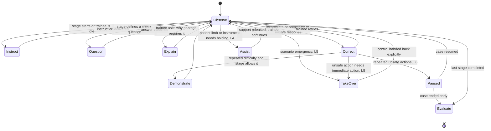
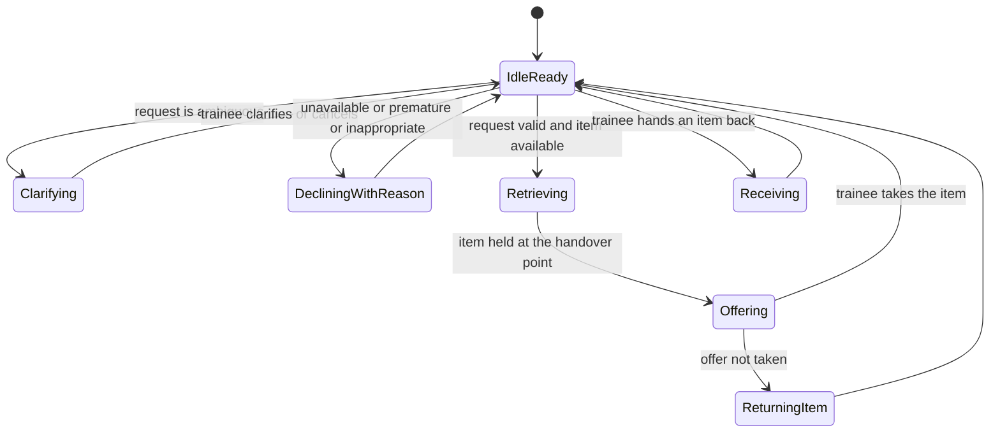
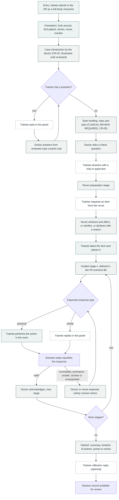
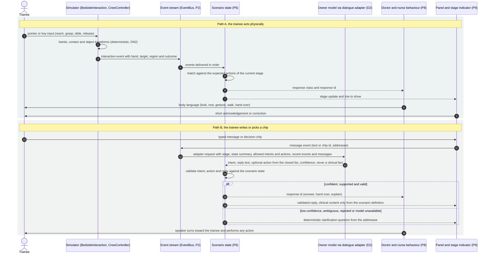
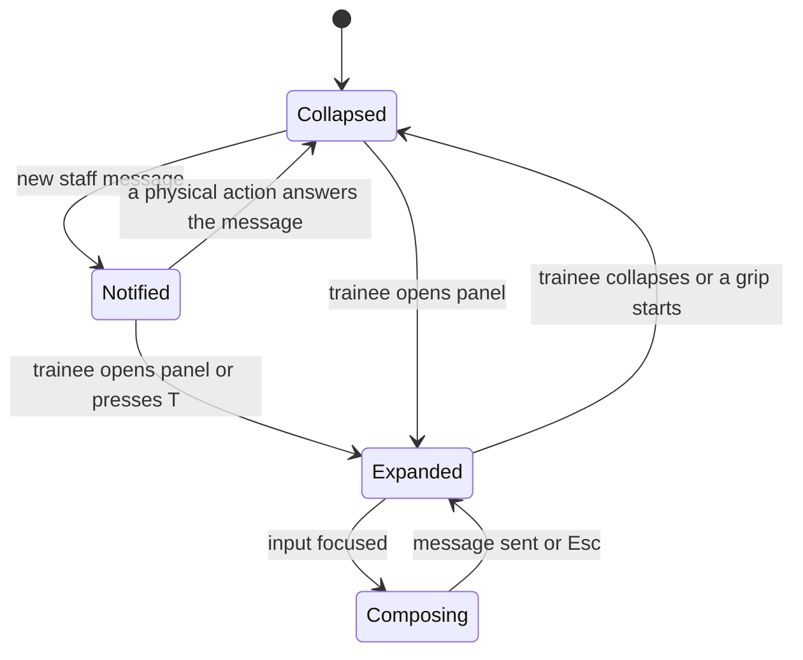

# 04 — Experience and Workflow Design

**Purpose.** This document proposes the end-to-end training experience that Nabd should deliver: who is in the room and how each person behaves, where everyone stands, how a session runs from entry to debrief, how a physical action or a typed message becomes a response from the doctor or nurse, how the supervising doctor intervenes, and how the screen is reduced to a 3D room with one compact communication panel. It translates the owner's *Nabd Experience & Workflow Brief* into a design that fits the existing v1.5 code and assets. It describes the learner's experience, not the implementation; the engineering path is in [05](05_HAND_CONTACT_AND_MOVEMENT_OPTIONS.md) and [07](07_PRIORITIZED_IMPROVEMENT_ROADMAP.md). **Everything in this document is PLANNED unless a statement explicitly describes the current repository**, in which case it carries an evidence label. All dialogue examples are illustrative interaction patterns, not clinical instructions.

**Status labels used:** VERIFIED (observed in the lead's browser run; cited as R#/B#) · TEST-VERIFIED (a named repository test that passed) · SOURCE-INSPECTED · PARTIALLY VERIFIED · PLANNED · UNKNOWN. Additional markers: **RECOMMENDATION**, **ASSUMPTION**, **PROPOSAL** (a value to validate with the owner), **CLINICAL REVIEW REQUIRED**, **DECIDED** (an owner decision recorded on 2026-11-14), and owner decisions **D1–D10** / decisions that can be made now **DN1–DN6** (defined in [08](08_TECHNICAL_DECISIONS_AND_OPEN_QUESTIONS.md)).

**Related documents:** [README](README.md) · [01 Project understanding](01_PROJECT_UNDERSTANDING.md) · [02 Current-state audit](02_CURRENT_STATE_AUDIT.md) (findings F01–F35) · [03 Gap analysis](03_REQUIREMENTS_GAP_ANALYSIS.md) (gaps G01–G23) · [05 Hands and contact](05_HAND_CONTACT_AND_MOVEMENT_OPTIONS.md) · [06 Appendicitis case](06_APPENDICITIS_CASE_WORKFLOW.md) (CR items) · [07 Roadmap](07_PRIORITIZED_IMPROVEMENT_ROADMAP.md) (P0–P11) · [08 Decisions](08_TECHNICAL_DECISIONS_AND_OPEN_QUESTIONS.md) · [09 Acceptance](09_ACCEPTANCE_AND_VALIDATION_PLAN.md) · [10 Next task](10_NEXT_IMPLEMENTATION_TASK.md) · [11 Full session scenario](11_FULL_SESSION_SCENARIO.md) · [Evidence index](REPOSITORY_EVIDENCE_INDEX.md).

**Source note.** The orientation document `Nabd_v1.5_Repository_Review.md` named in the owner's instructions does not exist anywhere on disk; the repository and the audit evidence are the source of truth. Paths are relative to the project root; `NabdRuntime.js` means `src/app/NabdRuntime.js`.

**Owner decisions of 2026-11-14.** The owner answered several open decisions in an Arabic chat message on 2026-11-14 and asked for the complete session scenario («نرسم السيناريو بالكامل», "let's design the full scenario"), which is now [11](11_FULL_SESSION_SCENARIO.md). A second message the same day settled the remaining decisions and refined four. This document follows those decisions; the decision records are in [08](08_TECHNICAL_DECISIONS_AND_OPEN_QUESTIONS.md).

| Decision | Status after the second message (2026-11-14) | Effect on the experience |
|---|---|---|
| D1 Character assets | DECIDED: option A+, the existing clothed body copied and modified in-house for every person; changing features approved; the nurse is a woman of ordinary appearance with a hair cover and a mask | The trainee is a full body and the camera is its eyes; the doctor and the nurse are copies of the same body; clothing colours differ by role and PPE follows the phase (§2) |
| D2 Dialogue understanding | DECIDED: the conversation partner is the owner's own model, now being trained, behind a validated adapter with a deterministic fallback (effectively option C); it runs both locally and online | Side chat (§6) and the interaction loop (§5) |
| D3 Language register | DECIDED: a middle register between Fusha and colloquial | §11 |
| D4 Controls | DELEGATED with consultation: the team picks the most suitable keyboard and mouse scheme and asks the owner, with a recommendation, where the choice matters | Controls stay device-neutral in this design; "hold-and-act" with mouse and keyboard is the working default (§7.3, §12 Q14) |
| D5 Movement | DECIDED: smooth, natural human movement within joint limits; no hand sinks into the bed or the patient except through an opening the stage declares (wound or incision, port, scope) | Every person moves like a person (DP6); entry into the body only where the scenario allows it |
| D6 Tooling | APPROVED, IN PROGRESS: git, `npm ci`, Playwright; T1 has started | — |
| D7 Clinical review | DECIDED: an admin model with specialist models reviews the content and evaluates sessions; three review labels; certified doctors audit and test the simulator before it is adopted as training (confirmed by the owner) | Review labels on the monitor, in the panel and in the debrief ([06](06_APPENDICITIS_CASE_WORKFLOW.md) §1.3–§1.4) |
| D8 Licences | DECIDED: option A, by our reading of the owner's general approval; legal questions stay flagged | — |
| D9 Targets | DECIDED: the web, in desktop and laptop browsers; Chrome and Safari required, Edge and Firefox expected; an installable or mobile app may come later; Unity is a separate future project | Panel and controls are designed for desktop first |
| D10 Room and equipment | DECIDED: the yellow equipment colour changes; equipment is redesigned toward realism; during laparoscopy a screen showing the procedure stands close to the trainee | Realistic room; scope screen near the working position (§3.2) |

**Working agreement.** The owner wants suggestions raised during the work, each explained with a recommendation, and he answers ([08](08_TECHNICAL_DECISIONS_AND_OPEN_QUESTIONS.md) decision log). The open questions of §12 follow that pattern.

---

## 1. Design principles

Each principle traces to the brief (§2 core principles, §9 UI direction) and to the current state it must move away from.

| # | Brief | Design rule (PLANNED) | Where the build stands today | Phases |
|---|---|---|---|---|
| DP1 | §2.1, §3, §10 | Every person in the room is one connected human body. A hand is never shown without its arm, shoulder and torso. Every person is derived in-house from the bodies already in the project (D1 DECIDED: A+, §2). | Trainee = camera + two gloved forearms (VERIFIED R4, R21; F06). Stretched sleeve to a virtual shoulder while gripping (VERIFIED R10, [evidence/03](evidence/03-forearm-lift-stretched-sleeve.png); `src/staff/CrewController.js:437-453` `updateSleeve`, F07). Full-body supervisor (VERIFIED R4, R13). No nurse (VERIFIED R13). | P3, P8 |
| DP2 | §2.2, §4, §9 | **Act first.** When a request can be answered by a physical action, that action is a complete answer. No chip or button duplicates it. Owner, 2026-11-14: «التواصل يكون بأفعال» ("communication happens through actions"; §7.3). | Grips and releases already raise events (`src/interaction/BedsideInteraction.js` `onEvent`; SOURCE-INSPECTED) but are recorded only inside a started session (VERIFIED R16). | P2, P6 |
| DP3 | §2.3, §4 | One compact, collapsible panel at a screen edge is the only conversation surface. It never becomes full-screen. Owner, 2026-11-14: «في عنا شات على الجانب» ("we have a chat on the side"). | No panel, no text input (VERIFIED R5: 0 `<textarea>`; F22). | P9 |
| DP4 | §2.4, §3.2 | The doctor leads with short instructions, questions and explanations, and adapts to what the trainee actually did. He intervenes along a ladder from silent observation through hints, instructions, demonstration and physical assistance to an emergency take-over or a pause (L0–L6, §8.3). Intervening is normal, not a failure state; demonstration and take-over follow the stage rules (CR-27). | Supervisor is silent and only physically offers, receives or supports (SOURCE-INSPECTED, `CrewController.js:457-486` `update`). | P8, P9 |
| DP5 | §2.5, §3.3 | The nurse hands over only what the scenario marks as available now; otherwise she or he clarifies or declines with a reason. | Absent (F13). | P8, P9 |
| DP6 | §2.6, §6 | The deterministic simulator owns hands, contact and object transforms. Dialogue and any language model, including the owner's model behind the chat (D2), never move a body or an object (DN2, already stated in `docs/Nabd-v0.22-Review-Board.md:56`). Movement is smooth and natural, with joints within natural limits; no hand sinks into the bed or the patient, except an intentional entry through an opening that the stage declares (D5, decided 2026-11-14: «الإيد ما تغوص جوه التخت», "the hand doesn't sink into the bed"). | Contact coverage is the left-forearm drill only (F15). | P3, P5, P7, P8 |
| DP7 | §2.7, §5 | One scenario state (P6) is the single source of truth for stage, equipment, observations, team lines and evaluation. Content below clinician-validated is visibly labelled with its review level (DN5, D7). | One inline 5-step drill (`NabdRuntime.js:5665-5743` `setPhase`, F21); fixed demo vitals (F23). | P6, P10 |
| DP8 | §2.8, §7, §10 | Calm clinical realism. Keep the muted teal palette, Arabic RTL layout and IBM Plex Sans Arabic/Inter (DN6). No scores, streaks, glow or quest lists. | Palette tokens `--teal #356b6b`, `--ink #1d3035` (SOURCE-INSPECTED, `src/styles.css:297-305`). The device casing colour `#ebf641` is a saturated yellow-lime in code (SOURCE-INSPECTED, `NabdRuntime.js:4164`, F28); a yellow endoscopy tower was observed in the room view (VERIFIED R13). D10 (decided 2026-11-14) replaces the yellow and redesigns the equipment toward realism; the interface palette stays. | P4 |
| DP9 | §9 | The 3D room is the interface. Persistent UI is limited to the panel chip, a subtle stage indicator and, only when needed, minimal observations. | 39 visible buttons + 8 visible form controls at 1440×900 (VERIFIED R5); 47 controls visible by default per static count (SOURCE-INSPECTED, F25). | P2, P9 |
| DP10 | §9 | Controls emerge from context: a control exists only while the object or stage it serves is active. | Precedent: `#tool-depth-controls` appears only while a tool is held (SOURCE-INSPECTED, `index.html:154-166`). | P2, P7 |
| DP11 | §5, §8 | Never invent clinical facts. Every clinical item traces to a CR item in [06](06_APPENDICITIS_CASE_WORKFLOW.md) and carries a review status. | No scenario data file exists (F21). | P6, P10 |
| DP12 | §5, §11 item 12 | Every session ends with a debrief built from what the trainee actually did; the owner's admin model evaluates the exported session record (D7). | Result line always reads 5/5; the log is wiped by reset (F24). | P10 |

---

## 2. Participants and roles

### 2.1 Trainee (the learner)

**Responsibilities.** Observe, listen, ask, decide and act; request equipment; respond by acting or by replying in the panel (brief §3.1).

**Body and clothing (PLANNED; D1 DECIDED 2026-11-14: A+).** Owner: «المتدرب بدي إياه جسم يكون، مش إيدين بس. ويكون هو الكاميرا بأبعاد مناسبة فيزيائياً» ("I want the trainee to be a body, not just hands, and to be the camera, at physically appropriate dimensions").
- **Body.** The trainee is a full body: an in-house instance of the existing clothed body `assets/staff/supervisor.glb` on the shared 163-joint skeleton (F14). The torso and arms are visible when the trainee looks down. Both arms are connected shoulder → elbow → wrist → hand, with wrist limits (P3; [05](05_HAND_CONTACT_AND_MOVEMENT_OPTIONS.md) §3(a)). The left glove is always the anatomical left hand (DN4, F08).
- **The camera is the trainee's eyes.** The first-person camera sits at the body's eyes and follows its head. Today it stands at y = 1.60 m (`traineeDefault`, `NabdRuntime.js:4661`; SOURCE-INSPECTED). The shared rig's eyes span y 1.661–1.691 m in the rest pose (DATA-DERIVED (audit analysis) from the bounds of the eye primitive), so the eye height becomes about 1.67 m unless the body is scaled. The head-region meshes (head-and-neck skin, brows, eyes, cap and mask) are hidden from the trainee's own view.
- **Clothing.** Role colours and the garments worn in each phase follow §2.5. Gown, gloves, cap and mask follow the scenario stage; which items, and when, is **CLINICAL REVIEW REQUIRED (CR-31)** ([06](06_APPENDICITIS_CASE_WORKFLOW.md)).

| Behaviour state (PLANNED) | Entered when | What the system does |
|---|---|---|
| Orienting | Session entry, or after the trainee walks | No prompts; staff look toward the trainee once |
| Listening | A staff line is delivered | Speaker turns toward the trainee; the panel shows the line |
| Acting | A grip, touch, slide or placement starts | Panel auto-collapses to its chip (§6); staff observe |
| Requesting | Trainee addresses the nurse or doctor | Request routed through the scenario state (§5) |
| Replying | Trainee types or selects a chip | Intent evaluated against the stage (§5) |
| Waiting | No expected input yet | Doctor's intervention ladder may start (§8.3) |
| Yielding | The supervisor takes over (L5, §8.3) | The trainee releases and steps back (A4, §7.3); control returns with an explicit hand-back |

**Starting point in the repository.**

| Asset / code | What it provides | Status |
|---|---|---|
| `assets/staff/glove-left.glb`, `glove-right.glb` | Nitrile glove, cuff and short sleeve stub; hand-and-forearm cut of the shared rig (F14) | SOURCE-INSPECTED |
| `CrewController.js:21-87` `buildHand`; `:362-435` `updateHand`; `:381-391` finger curl | World-space hands placed from the camera; one curl scalar for 15 phalanges (F10) | SOURCE-INSPECTED |
| `NabdRuntime.js:4661` `traineeDefault` | Stance (0.735, 1.60, 0.15), yaw π/2 (looking toward −X), fov 62 | SOURCE-INSPECTED |
| `focusTraineeArea` (`NabdRuntime.js:4902-4907`), `positionAtWork` (`:5131-5134`) | Both reuse `traineeDefault.position.y`, so the camera height is one constant today; P3 drives it from the body's eyes | SOURCE-INSPECTED |
| `assets/staff/supervisor.glb` | The body the trainee will use (D1 A+): a clothed full body on the shared rig, 13 primitives and 112,480 triangles; its only skin primitive covers the head and neck | DATA-DERIVED (audit analysis) |
| `CrewController.js:356-360` `shoulder()` | Virtual shoulder point; candidate IK anchor until a body exists (P3) | SOURCE-INSPECTED |
| `NabdRuntime.js:5241-5248` `chooseHand`; Q/E at `:5831-5832` | Manual active-hand selection | SOURCE-INSPECTED; with the hand buttons, no visible rest-pose change (VERIFIED R18); Q/E not exercised at runtime |
| Rest view of both gloves | Two forearms entering from the bottom edge | VERIFIED R4, R21 ([evidence/01](evidence/01-default-bedside-view.jpg), [evidence/10](evidence/10-scissors-without-blades.jpg)) |

### 2.2 Supervising doctor

**Responsibilities.** Guide, observe, explain, question, correct calmly, demonstrate or hand over when appropriate, and evaluate (brief §3.2).

**Body and clothing (D1 DECIDED 2026-11-14: A+).** The doctor keeps the existing `supervisor.glb` body, recoloured for his role (§2.5). Its asset already contains a scrub shirt and shorts, a "Long sterile gown" primitive, cap, mask, gloves, trousers and footwear, with materials still named "Patient …" (SOURCE-INSPECTED, asset structure; how it looks is UNKNOWN). The gown primitive spans only y 1.107–1.496 m in the bind pose (DATA-DERIVED (audit analysis) from the GLB accessor bounds), so gown coverage needs a visual review in P8. What the doctor should wear at each stage is **CLINICAL REVIEW REQUIRED (CR-31)**.

**Behaviour states (PLANNED, P8/P9).** None of these states exists today.



| State | Body behaviour (P8) | Panel behaviour (P9) |
|---|---|---|
| Observe | Head and gaze follow the trainee's active hand or the work point; small weight shifts | Silent |
| Instruct | Turns to the trainee; brief hand gesture toward the target | One short instruction line |
| Question | Looks at the trainee and waits | Question line; up to 2–3 chips only if the stage defines discrete answers |
| Explain | Looks at the trainee, may point at the patient or the monitor | Reviewed explanation text only |
| Correct | Calm stop gesture; never a sudden movement | Correction naming the prerequisite or missing part |
| Demonstrate | Walks to a demonstration position and performs the motion (stage-gated) | "Watch first, then you." pattern |
| Evaluate | Faces the trainee | Opens the debrief (§4) |
| Assist (L4) | Walks to the patient's side and reaches with one or both arms (IK); lifts, holds or repositions the patient's hand or arm, or steadies an instrument; keeps clear of the trainee's hands | One line naming what he holds |
| TakeOver (L5) | Moves to the trainee's working position, receives the instrument by handover, performs the critical action, then steps back | Short, calm lines; an explicit hand-back line |
| Paused (L6) | Stops the case and faces the trainee | Pause notice; optional immediate debrief |

The intervention ladder of §8.3 maps onto these states: L0 Observe; L1 and L2 Instruct, Explain or Correct; L3 Demonstrate; L4 Assist; L5 TakeOver; L6 Paused.

**Starting point.** Placement at (−0.79, 0, 0.06) facing +X toward the trainee (`CrewController.js:88-94`); arm aiming `orientArm` (`:117-135`); right-arm two-bone IK `reachSupport` (`:143-175`); finger curl `staffGrip` (`:176-183`); hand-over anchor `offeringPoint` (`:344-346`); posing in `update` (`:457-486`). Today the body teleports to (−1.94, 0, 0.25) in workstation mode and to x = ±0.55 for forearm support, and it leans by rigidly tilting the whole group from the feet (SOURCE-INSPECTED, F11). The returned API (`:535-573`) has no text, voice or gaze method (SOURCE-INSPECTED). The support hand seen in [evidence/04](evidence/04-supervisor-support-hand.png) and [evidence/05](evidence/05-after-release-forearm-supported.jpg) is VERIFIED (R11); that it is the supervisor's own right arm is SOURCE-INSPECTED. **What changes (P8):** walking and turning instead of teleports, spine and hip lean instead of whole-body tilt, head and gaze look-at, a speaking cue tied to panel lines, and reaching with either arm for L4 assistance (today `reachSupport` drives the right arm only).

### 2.3 Nurse

**Responsibilities.** Assist with preparation, receive requests, retrieve and hand over only appropriate and available items, ask for clarification, and explain unavailability or a missing prerequisite step (brief §3.3). In the first session she acts as the scrub nurse who prepares and hands over instruments; a separate circulating role is a future option (cast decision of [11](11_FULL_SESSION_SCENARIO.md) §1). The nurse's exact scope is **CLINICAL REVIEW REQUIRED (CR-26)**.

**Behaviour states (PLANNED, P8/P9).** No nurse exists today.



| State | Body behaviour (P8) | Panel behaviour (P9) |
|---|---|---|
| IdleReady | Stands at the nurse station, hands kept clear of the sterile field (what counts as sterile: **CLINICAL REVIEW REQUIRED, CR-08**), glances at the trainee on a new message | Silent |
| Retrieving | Turns and walks to the instrument trolley, reaches, grasps the item | "One moment." pattern (optional) |
| Offering | Walks to the handover point, extends the item, holds it still until taken | Item name |
| Clarifying | Faces the trainee | One question with 2–3 chips |
| DecliningWithReason | Small head movement, no walking | Short reason from the scenario rules |
| Receiving / ReturningItem | Takes the item back and returns it to the trolley | Silent or a one-word acknowledgement |

**Body and clothing (PLANNED; D1 DECIDED 2026-11-14: A+).** Owner: «رح يكون في عنا كمان ممرضة. بدنا نستورد نفس الجسم الموجود، نعدل عليه شوية أشياء نزبطه أكثر عشان ما نظل نجيب أشياء من برا.» ("We will also have a nurse. We will import the same existing body and adjust a few things to improve it, so that we stop bringing things in from outside.") The nurse is an in-house copy of the same clothed body as the doctor, told apart by role colours and PPE (§2.5) and by limited proportion changes through bone scaling. Clothing is scenario-appropriate and **CLINICAL REVIEW REQUIRED (CR-31)**. The owner writes «ممرضة» (a female nurse), so her lines use feminine Arabic forms (§11).

**Appearance (DECIDED, owner's second message of 2026-11-14).** «لو كانت الممرضة بنت عادي ما عندنا أي مشكلة» ("if the nurse is a woman, that's fine; we have no problem") and «نفس شكل الإنسان العادي، في غطاء على شعرها، في كمامة» ("the same look as an ordinary person, with a cover on her hair and a mask"). She is a woman of ordinary appearance wearing a hair cover (the body's surgical cap primitive) and a face mask. The owner also approved changing the features of the existing models («موافق على تغيير ملامح المجسمات الموجودة», "I agree to changing the features of the existing models"), so her face and proportions may be edited on a copy. No new 3D human is built from scratch.

Honest limitations (from the owner-decision record):
- Every person shares one base body and face; in an operating room, caps and masks hide much of the face.
- A convincingly female nurse may need shape changes beyond recolouring. The rig's `breast.L`/`breast.R` and pelvis bones allow only limited change by scaling; an in-house sculpt of the copy in Blender would still count as in-house. Which technique is used, and the visual result, are UNKNOWN (U24) until an owner visual review against his criterion: an ordinary woman with a hair cover and a mask (§12 Q2).
- Each extra copy of the body adds about 112k triangles (DATA-DERIVED; budget in [05](05_HAND_CONTACT_AND_MOVEMENT_OPTIONS.md) §5), and three instances need a skinned clone or one parse per person (U13).

**Starting point.** No nurse exists. The only reference is the code comment at `NabdRuntime.js:4366` ("scrub-nurse side") (SOURCE-INSPECTED; absence VERIFIED R13). Reusable pieces: the shared rig (F14), the `reachSupport` IK and `staffGrip` patterns, the supervisor tool modes (`offered` set in `resetTool`, `NabdRuntime.js:5531-5536`; `returning` and `returned` set in `interactionEvent` at `5617` and `5636`; mode handling in `CrewController.js:348-354` `setMode`), the back table (`NabdRuntime.js:4366-4386`, `4467-4482`) and the Mayo stand (`4483-4507`). Today the offered tool snaps to `offeringPoint()` and teleports on release (F20); an animated hand-to-hand handover is P7 work.

### 2.4 Patient

**Role in the experience.** The subject of care. The patient's condition, observations and any responses come only from the reviewed scenario definition (DP7, DP11).

**Starting point.** `assets/patient/patient.glb`: about 109k triangles and 163 joints in a standing A-pose, made supine by rotating the whole group (`hd`, `NabdRuntime.js:4585` @45443); four single-material skinned meshes including a baked privacy patch; no animation clips or morph targets; no breathing, facial or pain response (all SOURCE-INSPECTED). The internal atlas lists the cecum, appendix and mesoappendix (VERIFIED R14, [evidence/08](evidence/08-internal-anatomy-atlas.jpg); the appendix itself PARTIALLY VERIFIED).

**Behaviour states (PLANNED).** The patient has no autonomous behaviour. Its pose, exposure and observation outputs change only when the scenario state (P6) says so, for example when a stage sets a pose or an exposure flag.

**Proposals (PLANNED).** Scenario-defined coverage of the patient (gown or drapes per stage; **CLINICAL REVIEW REQUIRED (CR-09)**). Whether the patient speaks or reacts during the case, for example in a pre-procedure conversation, is an open question (§12, Q15) and **CLINICAL REVIEW REQUIRED (CR-16)**. The atlas is used only for reviewed teaching moments, never as interactive tissue, until [06](06_APPENDICITIS_CASE_WORKFLOW.md) defines that use (CR-14).

### 2.5 Role attire, colours and PPE by phase (PLANNED)

Owner: «ويكون الألوان اللي هم لابسينها مختلفة حسب الاختصاص طبعاً.» ("and the colours they wear differ by specialty, of course") and «بدو يكون الإجراءات الطبية يعني حسب الوضع الطبي اللي هم فيه بالعملية.» ("the procedures should follow the medical situation they are in during the operation"). The owner-decision record reads the second sentence as "visible PPE follows the clinical situation and phase".

**Facts** (DATA-DERIVED (audit analysis) from the glTF structure of `assets/staff/supervisor.glb`; how any of it looks is UNKNOWN):
- Each garment is a separate primitive with its own named material: scrub shirt and scrub shorts (both material names still begin with "Patient"), garment edge binding, surgical cap and cap elastic binding, "Long sterile gown", scrub trousers, closed theatre footwear, gloves and face mask.
- All garment base colours are teal or blue-teal shades (the footwear is near-black), so three unmodified copies would be dressed identically.
- The only skin primitive covers the head and neck (y 1.490–1.728 m). The arms are covered by the gown primitive (out to x ±0.47 m, y 1.107–1.496 m) and the hands by the gloves primitive.

| Aspect | Proposal | Status |
|---|---|---|
| Role colours | Each role gets its own scrub and cap colour from a small set of restrained hues that sit with the muted-teal identity (DN6) and can be told apart at a glance. Colour is paired with a second cue (the speaker chip in the panel, §6) for colour-vision deficiencies. Exact values: [11](11_FULL_SESSION_SCENARIO.md) §1 | PROPOSAL for owner and visual review (§12 Q17); D10 (decided 2026-11-14) changes the equipment palette, and the interface palette stays (DN6) |
| Recolouring | Each person gets its own copies of the garment materials, recoloured at load; if instances shared material objects, recolouring one would recolour all | PLANNED (P3, P8) |
| PPE by phase | Each scenario stage lists the garments each person wears (for example scrubs only, or sterile gown and gloves for scrubbed staff; cap and mask), and the character layer shows or hides the matching primitives | Mechanism PLANNED (P6 data, P8 character layer). Which garments in which phase, and the sterility rules: **CLINICAL REVIEW REQUIRED (CR-31, CR-08)** |
| Garment limits | Cap and mask can be hidden freely. Hiding the gown or the gloves would leave arms or hands without any surface, so a phase without them needs in-house geometry, for example bare arms and hands cut from `patient.glb`, which shares the identical skeleton (F14) | DATA-DERIVED (bounds); visual result UNKNOWN |
| Patient | `patient.glb` stays as it is; coverage by gown or drapes per stage | **CLINICAL REVIEW REQUIRED (CR-09)** |

---

## 3. Room layout proposal

### 3.1 Current coordinates (SOURCE-INSPECTED)

The frame: table centre at the origin, +Y up, patient's head toward −Z (back wall), **+X = patient's left** (`NabdRuntime.js:5142-5143`). The room spans x ±3.58 m and z −3.18 to +4.80 m. In the default bedside view the trainee looks toward −X; the trainee's right is therefore −Z (head end) and the left is +Z (foot end), which matches [evidence/01](evidence/01-default-bedside-view.jpg) (patient's head on the right of the screen).

Schematic top-down view (0.2 m per character across, 0.4 m per row; generated from the coordinates below; overhead items not drawn):

```
 x (m)  -3.6  -2.4  -1.2  0.0   +1.2  +2.4  +3.6
        |     |     |     |     |     |     |
z -3.2 |==================S==================|
z -2.8 |                                   C |
z -2.4 |                        .........  C |
z -2.0 |         AAAAA          .       .  C |
z -1.6 |     U   AAAAA          .   1   .  C |
z -1.2 |           M  ::#####:: .       .  C |
z -0.8 |              : # H # : .........  C |
z -0.4 |              : # pp# :              |
z  0.0 |              D># pp#<T        N     |
z  0.4 |  BBBBBBd y  Y: # pp#t:        N     |
z  0.8 |  BBBBBB      : # pp# :              |
z  1.2 |              ::#####::              |
z  1.6 |                               Q     |
z  2.0 |             ............    f       |
z  2.4 |             .     2    .            |
z  2.8 |             .          .            |
z  3.2 |             ............        W   |
z  3.6 |                                     |
z  4.0 |                                     |
z  4.4 |                                     |
z  4.8 |=============///////////=============|
```

Legend: `#` table (procedural footprint ±0.47 × ±1.06 m; the default GLB deck is narrower, F27) · `H` head end · `p` patient · `:` trainee work-walk loop (x ±0.76, z ±1.38) · `<T` trainee default stance, facing −X · `t` practice tray · `D>` doctor idle, facing +X · `d` doctor in workstation mode · `Y` / `y` Mayo stand idle / in workstation mode · `B` back table · `A` anesthesia workstation · `M` vitals monitor · `U` suction · `N` endoscopy tower · `Q` electrosurgical unit · `f` foot pedal · `W` waste/sharps · `C` wall storage (wall-mounted) · `S` head-wall service panel · `/` door · `1`, `2` proposed nurse-and-trolley zones (PLANNED options). Overhead, not drawn: lamp heads at (−0.83, 2.93, 0.05) and (0.83, 2.93, −0.28); service pendant with an infusion rod reaching down to y 1.52 m at (−0.72, −0.78).

| Item | Position (x, y, z) | Code |
|---|---|---|
| Trainee stance | (0.735, 1.60 eye, 0.15); free walk x 0.65–1.36, z −1.14–1.19 | `NabdRuntime.js:4661`; walk clamp `step` (`4931-4937`); loop from `createWorkWalk({ sideX: 0.76, endZ: Un.halfLength + 0.32 })` = 1.38 (`4954`). Loop traversal with these parameters TEST-VERIFIED (`tests/workstation.test.js`, "work walk reaches all four sides without changing the selected work point") |
| Doctor | (−0.79, 0, 0.06); workstation (−1.94, 0, 0.25) | `CrewController.js:88-94`, `:462-463` |
| Back table | (−2.55, 0.02, 0.55), spans x −3.11 to −1.99 | `NabdRuntime.js:4366-4386` |
| Mayo stand | (−0.92, 0.02, 0.52); x −1.61 in work mode | `NabdRuntime.js:4483-4507`, `5183` |
| Vitals monitor | (−1.34, 0.02, −1.03), facing the trainee side | `NabdRuntime.js:4263-4280` |
| Endoscopy tower / ESU | (2.54, 0.02, 0.24) / (2.6, 0.02, 1.54), facing −X | `NabdRuntime.js:4295-4340` |
| Free floor | +X head quadrant x 1.1–3.2, z −2.9 to −0.7; foot end z 1.7–4.6 | DATA-DERIVED (audit analysis) from the coordinates in this table and the GLB bounds; not checked in a browser |

The −X side is crowded (doctor, Mayo, back table, anesthesia, monitor, pendant rod), while +X beyond the trainee is largely empty (SOURCE-INSPECTED, F28).

### 3.2 Proposed stations (PLANNED; every move is P4 work and must be re-measured)

| Station | Proposal | Move needed? | Rationale and constraints |
|---|---|---|---|
| Patient and table | Unchanged at the origin | No (P1 fixes the table-height constants after measurement, F27) | All contact, IK and camera code is calibrated to the origin |
| Trainee | Keep the +X stance as the default station | No | The forearm drill, `nearArm()` and reach gating assume it. Which side the trainee should work from in the appendicitis case is **CLINICAL REVIEW REQUIRED (CR-32)**; P3 must support both sides because `changeWorkSide` already walks to the opposite side (`NabdRuntime.js:5220-5226`) |
| Doctor | Primary station across the table (current idle position, adjusted for full-body clearance); a stage-gated demonstration position; beside the trainee for physical assistance (L4) and at the trainee's working position during an emergency take-over (L5, §8.3); moves by walking (P8) | Yes: remove the teleports | The workstation position (−1.94, 0.25) lands at the back-table edge (overlap UNKNOWN) |
| Nurse | **Option 2 (foot end)**, about 75° to the trainee's left at the default stance; or **Option 1 (+X head quadrant)**, about 125° to the trainee's right, behind the shoulder (angles derived from the stance coordinates and the zone centres; ASSUMPTION until measured) | New | Must stay outside the work-walk loop (\|x\| ≤ 1.01, \|z\| ≤ 1.63). RECOMMENDATION: Option 2, because it is the larger free area and needs less head turning; owner decision (§12). OR team-position conventions are **CLINICAL REVIEW REQUIRED (CR-32)** |
| Instrument trolley | Relocate the back table beside the chosen nurse zone | Yes | Today it is on the crowded −X side, across the table and beyond the supervisor, about 2.7 m from the trainee's virtual shoulder at the default stance, far outside the 0.87 m `canReach` limit (derived from the coordinates above) |
| Near-field surface | Mayo stand on a side reachable by the trainee; absorb the practice-tray role | Yes | The practice tray (0.50, 0, 0.44) overhangs the procedural mattress edge (SOURCE-INSPECTED); the Mayo is across the table today |
| Handover point | On the boundary between the nurse zone and the trainee's reach (0.87 m from the virtual shoulder, `CrewController.js:279-281` `canReach`) | New | Both characters must reach it without entering the sterile field — **CLINICAL REVIEW REQUIRED (CR-08, CR-32)** for what counts as sterile and where handovers happen |
| Vitals monitor | Keep; it already sits about 30° to the right of the trainee's forward direction (derived) | No | Fix the conflicting static device screens (F23) |
| Scope screen (D10, decided 2026-11-14) | During a laparoscopic stage, a screen showing the live scope image stands close to the trainee's working position, in the line of sight and not blocked by staff (slot MON-S, [11](11_FULL_SESSION_SCENARIO.md) §2.3; PROPOSED distance and angles in AC-P4-7). The owner: «وهو قاعد بعمل عملية منظار، يكون الشاشة قريبة منه يبين فيها العملية» ("while he is performing a laparoscopic operation, the screen is close to him and shows the operation") | Yes | The feed already reaches the tower screens and both field displays (`scopeFeed.attach`, `NabdRuntime.js:6028`; `src/instruments/EndoscopeFeed.js`; SOURCE-INSPECTED). The tower (2.54, 0.02, 0.24) is behind the default stance. The field display that «انظر إلى الشاشة» turns to (`setScopeMonitorLook`, 5269-5297) hangs at (−1.38, 1.83, 0.12): across the table, about 2.1 m from the trainee's eyes and beyond the supervisor (DATA-DERIVED). Whether the case uses video at all is decided in [06](06_APPENDICITIS_CASE_WORKFLOW.md) (CR-11, CR-13), and placement for the case is CR-06 and CR-32 |
| Surgical lights | Make the lamps actually light the field (F26, P1), then aim them at the work point through the existing `focusLightTarget` (`NabdRuntime.js:5023-5028` `updateWorkFocusLighting`) | No (behaviour change) | No task light exists in the default GLB path today |
| Room fixes | Floor gaps of 2.6–9.5 cm, outward-facing front wall, flat-shaded GLBs (F28); lime casing replaced and equipment redesigned toward realism, in-house (D10, decided 2026-11-14) | P4 | Restrained palette (DP8); equipment close to its user and suited to the scene |

---

## 4. End-to-end session flow (PLANNED)

The current equivalent is a single drill: "ابدأ التدريب" → `startScenario` (`NabdRuntime.js:5712`) → `setPhase` steps monitor → pickup → aim → deposit → wrist → complete (F21). The start and step 1 of 5 are VERIFIED (R15, [evidence/09](evidence/09-training-step-1-of-5.jpg)); steps 2–5 and completion are SOURCE-INSPECTED only (`NabdRuntime.js:5665-5743`; not exercised at runtime). In P6 this drill becomes the first scenario file (a "skills warm-up", keeping its id `clinical-skills-practice`), and the flow below becomes the shape of every case. Appendicitis stage content lives in [06](06_APPENDICITIS_CASE_WORKFLOW.md).



Solid teal nodes are physical actions, dashed nodes are trainee speech (panel), grey nodes are team or system turns. The complete scene-by-scene script built on this flow, with beats, branches, supervisor interventions and emergency branches for scenes S0–S9, is [11](11_FULL_SESSION_SCENARIO.md) §5–§6.

| Session part | Trainee speaks | Trainee acts | Doctor | Nurse | Scenario state (P6) |
|---|---|---|---|---|---|
| Entry and orientation | — | Walks, looks | Greets with a look; no prompt | Visible at station | Session starts; recording always on (P2) |
| Case introduction | Optional questions | — | Presents the case | Listens | Reviewed case text only |
| Team briefing | Answers check questions | — | Asks, confirms | Confirms role | Records answers |
| Room preparation | Requests items | Receives and places items | Observes | Retrieves and hands over | Equipment availability |
| Guided stages | When the stage expects a verbal response | When the stage expects a physical one | Instructs, corrects, explains | Supports requests | Classifies every response |
| Debrief | Reflection (optional) | — | Summarises | — | Builds the timeline from the event log |

Two rules carry over from current defects. First, switching view or mode must never silently end an activity: today entering room view or anatomy ends the forearm drill, the supervisor support and any placed tool (F31; `NabdRuntime.js:4755-4757` → `5193-5219`). In the planned flow, orientation is part of the session, and developer views are outside it. Second, "reset" must not delete the session record without saying so (F24; `NabdRuntime.js:5952` → `5699-5700`).

---

## 5. Interaction loop (PLANNED)

None of the participants below except the simulator (`BedsideInteraction`, `CrewController`) exists today; the event stream is the P2 extension of the existing `EventBus` (`src/core/EventBus.js`).



**Loop rules (PLANNED).**

1. The scenario state decides; the model only proposes. A chip selection skips the model entirely. **D2 (DECIDED 2026-11-14):** the conversation partner behind the chat is the owner's own model, which is being trained now (owner: «إحنا حالياً قاعدين مندرب الموديل اللي رح يرد عليه», "we are currently training the model that will answer"). P9 therefore builds a dialogue adapter contract, not a fixed chat engine:
   - **Request:** speaker role, register ("middle", §11), stage, a scenario-state summary, the allowed intents and actions (closed lists), recent events and messages, and the trainee's message.
   - **Response:** intent, reply text, an optional action from the closed list, a confidence and a needs-clarification flag. The JSON contract is in [11](11_FULL_SESSION_SCENARIO.md) §3.1.
   - **Validation:** every proposal is checked against the scenario state before it has any effect, and a state-incompatible action is rejected. The model never sets clinical facts or vital signs and never drives transforms (DN2). An unavailable model or low confidence falls back to a deterministic clarification. Every call is logged (`model_reply`, §7.2).
   - This is effectively D2 option C (hybrid), with the owner's model as the model-assisted part. It runs both locally and online (the owner, 2026-11-14: «رح يعمل على الاثنين», "it will run on both"), so the adapter reaches a local endpoint and an online endpoint with the same contract, and falls back to the deterministic path when neither answers (§12 Q5).
2. Every reply that contains clinical content comes from the scenario definition and carries its review status. RECOMMENDATION: accept the model's free reply text only for non-clinical team talk (acknowledgements, clarifications, logistics); for an intent that the scenario marks clinical, the reply is a line from the reviewed line table.
3. A physical action that satisfies a pending question or request closes it. The panel then shows a one-line acknowledgement instead of waiting for typed text (DP2).
4. Staff body behaviour and panel text come from the same response id, so the speaker who turns toward the trainee is always the speaker named in the panel.
5. Response timing budgets are set in P11 against the D9 targets (DECIDED: desktop and laptop computers; Chrome and Safari required, Edge and Firefox expected). This document does not fix numbers; model latency also depends on which endpoint answers, local or online (§12 Q5).

---

## 6. Communication panel specification (PLANNED)

The owner confirmed the side chat on 2026-11-14: «في عنا شات على الجانب التواصل يكون من خلالها.» ("we have a chat on the side, and communication goes through it"). This panel is that chat; the model behind it is the owner's own (D2, §5), and actions in the room count as messages too (§7.3).

No panel exists today (VERIFIED R5). All values in this section are **PROPOSALS** for owner validation in P9; the "Reason / evidence" column cites the current code the proposal must fit.

| Property | Specification | Reason / evidence |
|---|---|---|
| Placement | An overlay inside the 3D viewport, docked to one vertical edge, using CSS logical properties so an LTR build mirrors automatically. **Default: the inline-end edge (screen-left in Arabic RTL)**, in the middle band | In [evidence/01](evidence/01-default-bedside-view.jpg) the screen-right quarter holds the bedside monitor and the patient's head, and the bottom corners hold the gloves; the screen-left quarter shows the patient's lower legs and background. The viewport container is `direction: rtl` (`src/styles.css:40`), so inline-end resolves to screen-left there (SOURCE-INSPECTED). To be re-checked against the P0 visual baselines and again after P4 |
| Coexistence with input | The panel is DOM; pointer events on it never reach the canvas. Because the bedside pointer handlers are bound to the canvas (`BedsideInteraction.js:308` `pointerdown`, `:337` `pointermove`, `:361` `pointerup`), the panel must stay out of the hand's working area and auto-collapse while a gesture is active | In the click-to-hold mode a held grip follows the mouse only while it moves over the canvas; pointer capture applies only during a press (`BedsideInteraction.js:315`, `:335`, `:348-354`) (SOURCE-INSPECTED) |
| Collapsed | A small chip with the last speaker's role initial and an unread dot | Default during physical work |
| Expanded size | At most about one quarter of the viewport width and about half its height; never full-screen. On narrow screens (≤ 650 px, the existing breakpoint), a bottom sheet of at most about 40% of the height; phones and tablets are not D9 targets for now, so this only keeps the existing breakpoint usable | Brief §4: "not a full-screen chat application" |
| Message types | Doctor: instruction, question, explanation, correction, acknowledgement. Nurse: reply, clarification, decline-with-reason, handover notice. Trainee: typed message, chosen chip. System: stage change, "action noted" line, review-level badge (illustrative, AI-reviewed or clinician-validated; [06](06_APPENDICITIS_CASE_WORKFLOW.md) §1.3) | Brief §4 list; D7 |
| Speaker identity | Role chip in Arabic: «المشرف» (the supervising doctor; «الطبيب المشرف» in full), «الممرضة», «أنت», plus one restrained accent per role that matches the role colours of §2.5; the speaking character turns in the room at the same time | Brief §4 "clear speaker identity"; the nurse label follows the owner's «ممرضة» |
| Short history | The last 3–5 messages visible; older ones scroll inside the panel; the full transcript appears only in the debrief | Brief §4 "brief history" |
| Decision chips | At most 2–3, only when the stage defines discrete answers; never offered when the expected answer is a physical action; removed once answered | Brief §4, §9 |
| Text input | One line plus a send button; Enter sends. Typing is safe: the runtime keydown handler already ignores events whose target is an `input`, `textarea` or `select` (`NabdRuntime.js:5821`), so WASD, Q/E and Esc do not fire while typing | SOURCE-INSPECTED |
| Notification | Unread dot plus a single soft pulse, disabled under `prefers-reduced-motion` (the code already honours it, e.g. MonitorUI). No sound in v0; no audio exists today (F22) | Brief §4 "subtle notification" |
| Keyboard | `T` opens the panel and focuses the input; `Esc` inside the panel collapses it. `T` is unused by the current handler (`NabdRuntime.js:5820-5851` uses WASD/arrows, Q, E, F, R, V, Z, X, L, G, +/−, Esc). Final mapping follows D4 (delegated to the team; the owner is asked, with a recommendation, where the choice matters) | SOURCE-INSPECTED |
| Accessibility | The message list is one `role="log"` live region (polite); chips and send are real buttons with 44 px touch targets; mixed Arabic/Latin tokens are isolated (`<bdi>` or `dir="auto"`); contrast uses the existing tokens. The current page has about 10 live regions that can double-announce (`showFeedback` writes to two of them, `NabdRuntime.js:5527-5530`); the panel replaces these, it does not add to them | Audit static inventory of `index.html` (10 `aria-live`/`role="status"` attributes; SOURCE-INSPECTED) |
| Data source | Subscribes to the P2 event stream; renders only lines emitted by the scenario state, including model replies that the state has validated (D2 adapter, §5) | Today `EventBus` carries one channel, `'simulation:event'`, with `DiagnosticsPanel` as its only subscriber (`src/simulation/SimulationManager.js:18`, `src/ui/DiagnosticsPanel.js:14`; `on`/`emit` TEST-VERIFIED in `tests/simulation-manager.test.js`) |



---

## 7. Direct-action responses

### 7.1 Signals that exist today (SOURCE-INSPECTED unless stated)

| Signal | Source | Recorded today | Planned use |
|---|---|---|---|
| `'reach'` | `BedsideInteraction.js:127` | No | "Trainee is reaching": the doctor waits instead of prompting |
| `'outOfReach'` | `:111`; `:181` (3.2 s attach timeout) | As `instrument_pick_failed` or `interaction_error`, reason `out_of_reach` (`NabdRuntime.js:5537` `interactionEvent`) | "Move closer" hint (behaviour VERIFIED R8) |
| `'attached'` | `:261`, `:290`, `:304` | `instrument_picked` / `patient_interaction` (`contact_attached`; region only in workstation mode) | Grasp or contact evidence |
| `'motion'` | `:264`, `:273`, `:305` | No | Summarised (for example lift amount), never logged per frame |
| `'release'` | `:149-150` | `instrument_released` (`success: !cancelled`) / `patient_interaction` (`contact_released`) | Placement and completion checks |
| Logger whitelist | `src/simulation/EventLogger.js:1-15`: `instrument_selected`, `instrument_picked`, `instrument_released`, `instrument_pick_failed`, `hand_changed`, `camera_changed`, `patient_interaction`, `endoscope_moved`, `simulation_stage_changed`, `checklist_item_completed`, `simulation_started`, `simulation_completed`, `interaction_error` | Schema and limits TEST-VERIFIED (`tests/event-logger.test.js`) | Base vocabulary to extend |

Known limits: nothing is recorded before "ابدأ التدريب" (VERIFIED R16); a wrong vitals-quiz answer only increments a retry counter (`NabdRuntime.js:5721-5725` `confirmOxygen`); the supervisor-support toggle (`:5484-5491`) and opening the monitor (`:5744` `openMonitor`) are not logged; a premature tool drop is logged with `success: true` (F24). An unknown event name throws `RangeError` (`EventLogger.js:52`), so every new event below needs a whitelist entry and a test.

### 7.2 New events needed (PLANNED; names are proposals, the schema is fixed in P2/P6)

> **Naming reference (2026-11-14).** The canonical event names and fields for implementation are those in [11](11_FULL_SESSION_SCENARIO.md) §9.2, for example `chat_message`, `chat_decision`, `classification`, `nurse_request` and `supervisor_intervention`. The names below are the earlier working names. 11 §9.2 lists each one as an alias of its canonical event, so the P2/P6 whitelist extension adds one name per event.

| Proposed event | Emitted by | Enables | Phase |
|---|---|---|---|
| `contact_started` / `contact_ended` (hand, part: fingertip or palm, region from bone weights) | Contact service | "Touch the patient here" stages anywhere on the body | P5 |
| `contact_slide_summary` (path length, region sequence, coverage) | Contact service | Sliding-contact and coverage stages without per-frame logging | P5 |
| `object_grasped` / `object_released` (hand, object id, placement target) | Grasp layer | Generalises `instrument_picked/released` to any object, per hand | P7 |
| `handover_offered` / `handover_completed` / `handover_declined` (giver, receiver, item; `declined` = an offer not taken) | Staff behaviour + grasp layer | Nurse and doctor handovers | P7, P8 |
| `equipment_requested` (addressee, item id or unresolved text) | Panel / dialogue adapter (D2) | Nurse request handling (§8.2) | P9 |
| `equipment_request_declined` (item, class: unavailable, ambiguous, premature, inappropriate, unsupported) | Scenario state | Shows in the debrief why an item was not given | P6, P9 |
| `message_sent` / `decision_selected` (a case-specific choice such as `approach_selected` in [06](06_APPENDICITIS_CASE_WORKFLOW.md) is a typed `decision_selected`) | Panel | Verbal responses in evaluation | P9 |
| `staff_line_delivered` (speaker, line id, review status) | Scenario state | Transcript and debrief | P9 |
| `response_classified` (stage, expected action, rule id, class) / `correction_issued` (line id) | Scenario state | Debrief and analytics | P6 |
| `stage_entered` / `stage_completed` (with duration) | Scenario state | Extends `simulation_stage_changed` | P6 |
| `check_item_confirmed` (check id, confirmed by) | Panel or scenario state | Check-list stages defined by the reviewed case | P6 |
| `patient_state_changed` (field, cause) | Scenario state | Pose, exposure and observation changes in the record | P6 |
| `observation_viewed` | Monitor close-up | "Check the monitor" stages | P6 |
| `debrief_viewed` | Debrief view | Confirms the trainee saw the feedback | P10 |
| `support_requested` / `support_ended` | Existing support toggle | Logged assistance | P2 |
| `mode_changed`, `session_reset` | Runtime | Makes F31 and F24 visible, then preventable | P2 |
| `supervisor_intervention` (level L0–L6, reason, stage, duration) | Staff behaviour | Interventions in the debrief; an intervention caused by a scenario emergency is not a trainee fault (§8.3) | P8, P10 |
| `action_recognised` (action id A1–A8, hand, target, stage) | Scenario state | Communication through actions (§7.3) | P6 |
| `model_reply` (intent, confidence, accepted or rejected with the reason, latency) | Dialogue adapter | Audit of every model call (D2, §5) | P9 |
| `emergency_triggered` / `emergency_resolved` (branch, cause: scripted or unsafe action) | Scenario state | Emergency branches ([11](11_FULL_SESSION_SCENARIO.md) §6) | P6, P10 |
| `identification_attempt` (structure id, result) | Scenario state | Identification steps (A3, §7.3) | P6 |

This table is the shared event vocabulary for the plan; [06](06_APPENDICITIS_CASE_WORKFLOW.md) uses the same names, and [11](11_FULL_SESSION_SCENARIO.md) §9 builds its session contracts on it. Where two documents name the same event differently, the P2/P6 whitelist extension (`EventLogger.js:1-15`) fixes one name per event.

### 7.3 Communication through actions (PLANNED; owner requirement of 2026-11-14)

Owner: «التواصل يكون بأفعال.» ("communication happens through actions"). A recognised action is a message in its own right: it closes a pending request or question (loop rule 3, §5), and the panel shows at most a one-line acknowledgement. Recognition is deterministic, from simulator events; no model interprets motion (DN2). The catalogue, detection rules and responses are owned by [11](11_FULL_SESSION_SCENARIO.md) §3.2; the summary below shows what each action can build on today.

| ID | Trainee action (device-neutral) | Meaning to the team | Existing precedent | Phase |
|---|---|---|---|---|
| A1 | Hold the empty hand still in the nurse's handover zone | "Ready to receive the item" | Supervisor hand-off: `offered` set in `resetTool` (`NabdRuntime.js:5531-5536`); `offeringPoint` and `setMode` (`CrewController.js:344-354`); tool held at the offering point (`CrewController.js:494-503`). SOURCE-INSPECTED; the handover itself was not exercised at runtime | P7, P8 |
| A2 | Release a held item inside the handover zone | "Take it back" | Deposit check against `crew.offeringPoint()` in `interactionEvent` (`NabdRuntime.js:5631-5641`), SOURCE-INSPECTED | P7, P8 |
| A3 | Aim the tool tip or the scope view at a structure and hold still, or select it | "This is the structure" | Tool-tip distance check of the drill's aim step (`NabdRuntime.js:5614-5622`), SOURCE-INSPECTED | P6, P7 |
| A4 | Release and step back when the supervisor takes over | "You have control" | None | P7, P8 |
| A5 | Look at the monitor or open its close-up | "I have checked it" | `openMonitor` (`NabdRuntime.js:5744`); SpO₂ symbol quiz `confirmOxygen` (`5721-5734`), SOURCE-INSPECTED | P6 |
| A6 | Ask for help with a chip | "I need guidance" | Nearest precedent: the support-button handler (`NabdRuntime.js:5484-5491`), SOURCE-INSPECTED | P9 |
| A7 | Position the patient's arm | Stage task | Forearm drill (`openForearmPractice` … `updateForearmPractice`, `NabdRuntime.js:5430-5517`); grip, lift and support VERIFIED R7–R11 | P5 |
| A8 | Prepare the field by sliding contact over the abdominal region | Stage task; the technique is **CLINICAL REVIEW REQUIRED (CR-10)** | None; needs whole-body contact (P5) | P5, P6 |

The staff answer through the same channel: the nurse holds out the item and waits (Offering, §2.3), and the doctor looks, points, gestures, demonstrates or physically assists (§8.3). Each recognised action is logged as `action_recognised` (§7.2).

---

## 8. Doctor guidance patterns and nurse request handling (PLANNED)

All examples are generic interaction patterns with placeholders. They are not clinical instructions; real wording comes from the reviewed case in [06](06_APPENDICITIS_CASE_WORKFLOW.md).

### 8.1 Doctor responses by response class (P6 classes)

| Response class | Illustrative trigger | Doctor behaviour | Panel pattern |
|---|---|---|---|
| Valid | Expected action A of stage S completed | Brief nod; looks at the next target | "Good. Next, [next instruction]." |
| Incomplete | A started, but a required part is missing (for example, item released outside the target zone) | Keeps observing; gestures toward the target | "Almost. [Missing part] is still needed." |
| Needs clarification | Typed reply matches two intents | Turns to the trainee | "Do you mean [option 1] or [option 2]?" with 2 chips |
| Premature / out of sequence | Action B attempted while S expects A | Calm raised hand; no alarm | "Before that, we need [A]. Why do you think it comes first?" |
| Unsafe (reviewed rules only) | Action matches a rule marked unsafe in the reviewed scenario | Steps closer; takes over when the rule calls for immediate action (L5) and pauses the case after repeated unsafe actions (L6, §8.3) | "[Reviewed explanation]. Let us return to [step]." — **CLINICAL REVIEW REQUIRED (CR-17, CR-22)** for every rule and its wording |
| Unsupported | Request or action the simulation does not model | Neutral | "This simulation does not cover [X]. Please continue with [Y]." |
| No response (not a response class; a timer trigger) | No relevant action within a stage-defined interval | Intervention ladder: hint (L1) → instruction with the reason (L2) → demonstration (L3, only where the stage allows, CR-27); §8.3 | Hint lines from the scenario file (hint policy CR-21) |

Routing an instrument request made to the doctor (brief §4): each stage carries a teaching-objective flag that selects one of three patterns: ask why it is needed, explain its purpose, or redirect the trainee to the nurse. The item becomes available only when the scenario state allows it.

### 8.2 Nurse request handling

| Class | Condition in the scenario state | Nurse behaviour | Panel pattern | Doctor involvement |
|---|---|---|---|---|
| Available | Item listed for this scenario, available at this stage, request unambiguous | Retrieving → Offering | "Here is [item]." | None |
| Unavailable | Item not in this room's equipment list | Stays IdleReady | "We do not have [item] here." plus an alternative only if the scenario defines one | Optional |
| Ambiguous | Several items match, or confidence is too low | Clarifying | "Which one: [A] or [B]?" (chips) | None |
| Premature | Item becomes available after a prerequisite stage | Stays IdleReady | "That comes after [prerequisite]." | May ask the trainee why, per the stage flag |
| Inappropriate | A reviewed rule marks the item inappropriate now | Looks toward the doctor | "Let me check with the doctor." The doctor explains | Explains (reviewed text) — **CLINICAL REVIEW REQUIRED (CR-07, CR-26)** |
| Unsupported | Item recognised but not modelled for handover | Stays IdleReady | "That item is not part of this simulation." | None |

Which items are available, restricted or inappropriate at each stage, and the nurse's scope, are **CLINICAL REVIEW REQUIRED (CR-06, CR-07, CR-26)**. Every row writes `equipment_requested` and then either `handover_offered` or `equipment_request_declined` with its class (§7.2), so the debrief can show what was asked for and why it was or was not given.

### 8.3 Supervisor intervention ladder (PLANNED; owner requirement of 2026-11-14)

Owner: «إذا في تدخلات عادي يتدخل. إذا في عنا تدخل من قبل المشرف، يمد إيده، يشيل إيد المريض، هو يتصرف إذا صار عنا حالة طارئة» ("If interventions are needed, he simply intervenes. If the supervisor intervenes, he reaches out his hand, lifts the patient's hand, and acts if an emergency arises"). Intervening is a normal part of supervised practice, not a failure state. The supervisor escalates only as far as the situation needs and steps back as soon as it allows. Triggers, choreography, lines and the return of control for each level are specified in [11](11_FULL_SESSION_SCENARIO.md) §4; the summary below fixes the levels that all documents share.

| Level | Supervisor does | Typical trigger (PROPOSED, owner-tunable) | Trainee does | Control returns | Precedent today |
|---|---|---|---|---|---|
| L0 Observe | Silent; head and gaze follow the trainee's hands | Default | Works | — | None: no gaze or head look-at (F11) |
| L1 Hint | One short line in the side chat | Hesitation, or a first minor deviation | Continues | — | None (no chat, F22) |
| L2 Instruct and explain | Explicit instruction plus the reason; clinical reasons only from reviewed content | Hint not taken; an incomplete or premature response | Follows the instruction | — | None |
| L3 Show | Gestures, points or demonstrates with his own hands without touching the trainee's work; at most one subtle marker, no game-like highlight | Repeated difficulty where the stage allows a demonstration (CR-27) | Watches, then repeats | The trainee repeats the step | Building blocks only: arm aiming `orientArm` and two-bone IK `reachSupport` (`CrewController.js:117-135`, `143-175`), SOURCE-INSPECTED |
| L4 Physical assist | Reaches out and lifts, holds or repositions the patient's hand or arm, or steadies an instrument; the owner's example: «يمد إيده، يشيل إيد المريض» | A limb must be held while the trainee works, or the trainee asks (A6, §7.3) | Continues the main task | The supervisor releases on completion or on request | Forearm support: right-arm IK plus a flag that pauses settling (VERIFIED R11; `NabdRuntime.js:5484-5517`); nothing physically holds the limb (F12) |
| L5 Take over | Moves to the working position, receives the instrument from the trainee, performs the critical action, and tells the trainee to assist or step back; the nurse fetches equipment | A scenario emergency ([11](11_FULL_SESSION_SCENARIO.md) §6) or a reviewed unsafe rule (CR-17) | Yields (A4), then assists | An explicit hand-back line and an instrument handover | None; the tool modes `offered`/`returning`/`returned` are the nearest precedent (§2.3) |
| L6 Pause the case | Stops the case; optional immediate debrief | Repeated unsafe actions | Listens and acknowledges | Resume or end | None |

Rules (PLANNED):
- An intervention caused by a scenario emergency is not a trainee fault; the debrief shows it as team support, not as an error.
- Every intervention is logged as `supervisor_intervention` with its level, reason, stage and duration (§7.2).
- Physical assistance and take-over are executed by the deterministic character layer (P8). In L4 the supervisor's hand target drives the same patient-limb IK that the trainee's grip drives today (`createLimbDrag`, `NabdRuntime.js:5395-5428`). Neither the dialogue nor the model moves a body (DN2).
- Today's limits must go first (P8): the rigid whole-body tilt from the feet, the teleports between stations, the right-arm-only reach and support as a flag only (F11, F12).
- When the doctor may demonstrate or take over, and which actions count as unsafe, are **CLINICAL REVIEW REQUIRED (CR-27, CR-17)**; the take-over, pause and hand-back policy (L5, L6) and the physical assistance to the patient (L4) are **CR-35** and **CR-36** in the [06](06_APPENDICITIS_CASE_WORKFLOW.md) §8 register.
- Lines follow §11. For L4, for example: «أنا سأمسك يد المريض الآن، راقب كيف أثبّتها.» ("I will hold the patient's hand now; watch how I steady it.")

---

## 9. Patient observations display

**Facts.** The monitor values come from `dataAt()` in `src/ui/MonitorUI.js:36-45`: fixed demo values with a small sine variation, unrelated to anything the trainee does (SOURCE-INSPECTED, F23). The canvas labels itself "DEMO SIGNALS" (`MonitorUI.js:109`). The API has no setter (`MonitorUI.js:159` returns `{texture, show, update, dialog, getValues}`). The repaint forces scene renders about 12 times per second (F23). The static anesthesia screen shows values that conflict with the monitor (`NabdRuntime.js:4099-4108`). The vitals dialog (`index.html:558-570`) carries the fixed three-button SpO₂ symbol quiz used in step 1 (SOURCE-INSPECTED, `index.html:561-568`; the step-1 instruction itself is VERIFIED R15, the quiz was not answered at runtime). No breathing, facial or other patient body response exists (SOURCE-INSPECTED).

**Proposal (PLANNED, P6/P10).**

1. **In the room first.** The bedside monitor is the primary display; the trainee looks at it or opens the existing close-up dialog. The quiz becomes a doctor question in the panel.
2. **Minimal strip only when needed.** A compact observation line in the panel header appears only in stages where the scenario marks observations as learner-relevant.
3. **One source.** Observation values and trends come from the scenario state, which reads them from the reviewed case file. MonitorUI gains a setter. Values are never generated by a language model and never invented in code. This document deliberately states no values; all of them are **CLINICAL REVIEW REQUIRED (CR-03, CR-15, CR-16)** (D7).
4. **Visible status.** Until the values are clinician-validated, the monitor canvas and the panel show their review-level label in Arabic and English: illustrative, or AI-reviewed (admin model) and not clinician-validated (DN5, D7; [06](06_APPENDICITIS_CASE_WORKFLOW.md) §1.3).
5. **Consistency.** Every device screen either binds to the same state or shows a neutral standby screen; the unreachable monitor branch (`NabdRuntime.js:4088-4098`) is removed. How the existing demo screens are handled during the case is CR-25.
6. **Cost.** Repaint and render only when a value changes (supports P11 budgets).
7. **Body cues** (breathing motion, facial response) are out of scope until the case content is reviewed, then **CLINICAL REVIEW REQUIRED (CR-16, CR-23)** per cue.

---

## 10. UI reduction plan

Trainee mode keeps only what serves the learner; everything else moves behind a developer flag (P2). PROPOSAL: `?dev=1`, consistent with the existing `?debug=1` (diagnostics, `NabdRuntime.js:4633`) and `?qa` (`window.__studioQA`, `NabdRuntime.js:6104-6154`). In trainee mode the developer controls are not rendered at all, so screen readers do not meet them. The inventory is from the audit's static analysis of `index.html` (90 controls; SOURCE-INSPECTED); the runtime count (39 visible buttons, 76 in the DOM, 8 visible form controls) is VERIFIED R5.

| Group (`index.html`) | Today | Trainee mode (PLANNED) | Developer mode (PLANNED) |
|---|---|---|---|
| Header (24-32) | Brand, title, build label | Brand only | Build label |
| `.viewport-tools` (44-52) | Work area, forearm drill, room preview, vitals, fullscreen, grid, home | Fullscreen; recentre view | Grid, room preview, drill shortcuts |
| `.viewport-views` (53-71) | 11 camera presets | — | All presets |
| `#anatomy-toggle`, `#anatomy-controls` (72, 97-115) | Atlas toggle and selectors | Only inside a reviewed teaching stage, with the BodyParts3D attribution visible (F29, F30) | Free atlas |
| `#trainee-hud` (167-193) | 21 buttons + keyboard hint line | None permanent. Walking by keys or drag; L/R hand as a small indicator (Q/E) until P7/D4; a "?" help popover | Region shortcuts, look mode, positioning, "إعادة وضع اليدين" |
| `#scope-station` (73-85) | Contextual scope controls | Only in stages that use the scope | Free scope practice |
| `#work-controls`, `#forearm-actions` (116-153) | Region/action selects, body points, 5 walk buttons, support request | Support becomes a request to the doctor in the panel | All selectors and walk buttons |
| `#tool-depth-controls` (154-166) | Shown while a tool is held | Insert/withdraw/roll only while a depth-capable instrument is held | Pitch/yaw/roll readout |
| `#training-session` (203-235) | Tool and source selects, checklist, feedback, start/reset | Replaced: items come from the nurse; stage indicator replaces the checklist; feedback moves to the panel and debrief | Scenario picker, reset |
| Pose, limb sliders, patient hands, status grid, panel actions (236-307) | Always visible | — | All |
| Vitals dialog (558-570) | Modal with quiz | Monitor close-up, no quiz | — |

**Stage indicator.** Reuse the existing `.viewport-info` pill (`index.html:86-91`, `aria-live="polite"`, written by `setTraineeStatus`, `NabdRuntime.js:4707`) as one small line: the stage name, optionally "n of N" (§12). There is no checklist, score or timer on screen.

**Prompt consolidation.** Today about 15 DOM surfaces carry prompts (audit static inventory; SOURCE-INSPECTED), fed by 32 `setTraineeStatus` and 13 `showFeedback` call sites (F25). The target is three surfaces: the panel, the stage pill, and the in-world target marker (`#training-target`, positioned by `markerWorld`, `NabdRuntime.js:5749`) shown only when a stage needs spatial guidance.

---

## 11. Language and tone (D3; Arabic RTL)

**Facts.** The page is `<html lang="ar" dir="rtl">` (`index.html:2`). Static labels are mostly Modern Standard Arabic; many runtime strings are Levantine colloquial (for example "فلّت", "هسّا", "للتخت", "عم تمشي" in `NabdRuntime.js`, e.g. `:5225`, `:5515`, `:5733`; SOURCE-INSPECTED), and some are English (canvas screens, the pitch/yaw/roll readout). No string catalogue or i18n layer exists.

**Decision D3 (DECIDED 2026-11-14): a middle register.** Owner: «لا عامية كثير ولا فصحى كثير، بالنص بيناتهم.» ("not too much colloquial, not too much Fusha; in the middle between them"). This **supersedes the earlier assumption of this section**, which proposed Fusha for all in-simulation text pending confirmation, and the "Fusha output" recommendation recorded under D3 in [08](08_TECHNICAL_DECISIONS_AND_OPEN_QUESTIONS.md). The owner preferred Fusha for UI copy in previous projects; for this simulator the middle register is the rule. It applies to in-simulation dialogue and trainee-facing prompts.

**Rules (PLANNED).**

- Grammar and vocabulary are mostly Modern Standard Arabic.
- Light, common colloquial connectors are allowed sparingly: تمام، خلّينا، طيب، يعني، بدّك.
- Heavy dialect words are avoided, for example «هسّا» and «عم تمشي» in today's strings.
- Common clinical terms are written in Arabic, with the English term in parentheses where useful. The terms themselves, Arabic versus Latin forms and abbreviations are **CLINICAL REVIEW REQUIRED (CR-24)** per term.
- The trainee may type Fusha, colloquial Arabic or English clinical terms; understanding does not depend on the output register (D2).
- Tone: calm, respectful and second person; one idea per line; no exclamation marks, gamified praise or blame. Corrections name the step, not the person.
- Gendered forms: the owner calls the nurse «ممرضة», so her lines use feminine forms (for example «جاهزة»). How the trainee is addressed is still open (§12 Q6).
- All strings move into one catalogue per language (P2/P9) so that register changes do not touch logic. The existing status strings are rewritten into this register as a text-only change, reviewed against these rules; static labels that are already Modern Standard Arabic stay as they are.

**Calibration examples** (from the owner-decision record; the speaker attribution is illustrative). They calibrate the register only: any clinical content in a real line is **CLINICAL REVIEW REQUIRED (CR-22)**, and sterility rules are CR-08.

| Speaker | Line | English gloss |
|---|---|---|
| Doctor | «تمام، خلّينا نبدأ. عرّفني على المريض باختصار.» | "Fine, let's begin. Introduce the patient to me briefly." |
| Nurse | «جاهزة. أي أداة بدّك أجهّزها لك أولاً؟» | "Ready. Which instrument would you like me to prepare for you first?" |
| Doctor | «لحظة، هذه الخطوة ما زال وقتها مبكراً. ما الذي يجب أن نتأكد منه قبلها؟» | "One moment, it is still too early for this step. What must we confirm before it?" |
| Doctor | «ممتاز، هذا هو المطلوب. ننتقل للخطوة التالية.» | "Excellent, that is what was needed. We move on to the next step." |
| Doctor | «انتبه، يدك قريبة جداً من الحقل المعقّم. ارجع قليلاً.» | "Careful, your hand is very close to the sterile field. Move back a little." |
| Doctor | «أنا سأمسك يد المريض الآن، راقب كيف أثبّتها.» | "I will hold the patient's hand now; watch how I steady it." |

---

## 12. Open experience questions for the owner

Answered on 2026-11-14 and removed: Q3 (the doctor may come to the trainee's side, assist physically and take over in an emergency; §8.3) and Q4 (the trainee's body, not only the arms, is visible when looking down; §2.1). Q2, Q5, Q6, Q9, Q10 and Q14 were narrowed to what remained open. The owner's second message of 2026-11-14 then answered Q2, Q5, Q14 and Q18; they stay in the table, marked ANSWERED, so that references stay valid. The original numbers are kept; Q16–Q18 are new. New questions that arise during the work are raised under the working agreement, each with a recommendation.

| # | Question | Related |
|---|---|---|
| Q1 | Nurse zone: foot end (Option 2, recommended) or +X head quadrant (Option 1)? | §3.2, P4 |
| Q2 | **ANSWERED 2026-11-14.** Nurse appearance: a woman of ordinary appearance with a hair cover and a mask; changing the features of the copied body is approved. Whether bone scaling suffices or an in-house sculpt of the copy is needed is a technique question for the team (U24), checked at owner visual review. | D1 (DECIDED: A+, refined), §2.3 |
| Q5 | **ANSWERED 2026-11-14:** «رح يعمل على الاثنين» ("it will run on both"), locally and online. Still open for the online path: privacy and cost (see Q10 and [08](08_TECHNICAL_DECISIONS_AND_OPEN_QUESTIONS.md) §5). | D2 (DECIDED, refined), §5 |
| Q6 | How should the trainee be addressed in Arabic: masculine forms, feminine forms, or a choice at session start? The register itself is decided (§11). | D3 (DECIDED), §11 |
| Q7 | Should staff lines ever be spoken aloud? This would be a new capability with its own approval. | F22 |
| Q8 | Stage indicator: name only, or name plus "n of N"? | §10 |
| Q9 | Debrief: narrative and timeline only, or also the admin model's per-dimension rubric results? (The brief rules out arcade scoring.) | P10, D7 |
| Q10 | Session records must be exportable for the admin model (D7). Where do exported records go, who may read them, and how long are they kept? Privacy implications follow, especially on the online path that D2 now includes. | F24, D7, D2 |
| Q11 | Free practice (forearm drill, atlas): keep it as a separate practice room, or developer-only? | §10 |
| Q12 | Default panel dock: screen-left (recommended) or screen-right, and should the trainee be able to switch it? | §6 |
| Q13 | May the trainee pause the case, for example while typing? No pause control exists today (SOURCE-INSPECTED); the supervisor's L6 pause is a separate, team-side pause. | §5, §8.3 |
| Q14 | **ANSWERED 2026-11-14 (delegated).** The owner asked the team to find the most suitable control scheme, keyboard and/or mouse, and to bring him each choice that matters with a recommendation. "Hold-and-act" with mouse and keyboard is the working default; touch and XR come later. | D4 (DELEGATED), P7 |
| Q15 | Should the patient speak or visibly react during the case (for example a pre-procedure conversation), or stay silent with the doctor narrating? Any content is CR-16. | §2.4, P10 |
| Q16 | Which emergency branches belong in the first session? The non-clinical equipment disruption (loss of the scope image) is the proposed first one; clinical branches stay candidates until reviewed. | §8.3, [11](11_FULL_SESSION_SCENARIO.md) §6 |
| Q17 | Approve the proposed role colours after a visual review? D10 (decided) changes the equipment colours, not the interface palette, so the role colours are reviewed together with the new equipment palette in P4. | §2.5, D10 |
| Q18 | **ANSWERED 2026-11-14:** «الديسكتوب أبليكيشن» meant running in desktop browsers; an installable desktop app or a mobile app may come in later stages, but «بس حالياً إحنا بدنا إياه على الويب» ("but for now we want it on the web"). | D9 (DECIDED, refined) |
