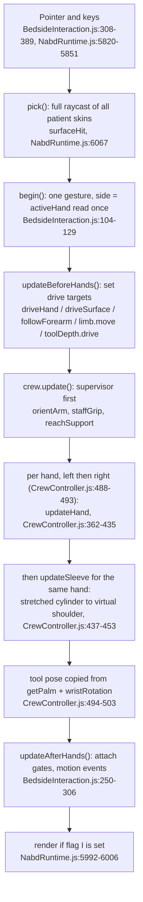
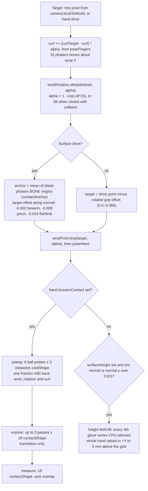
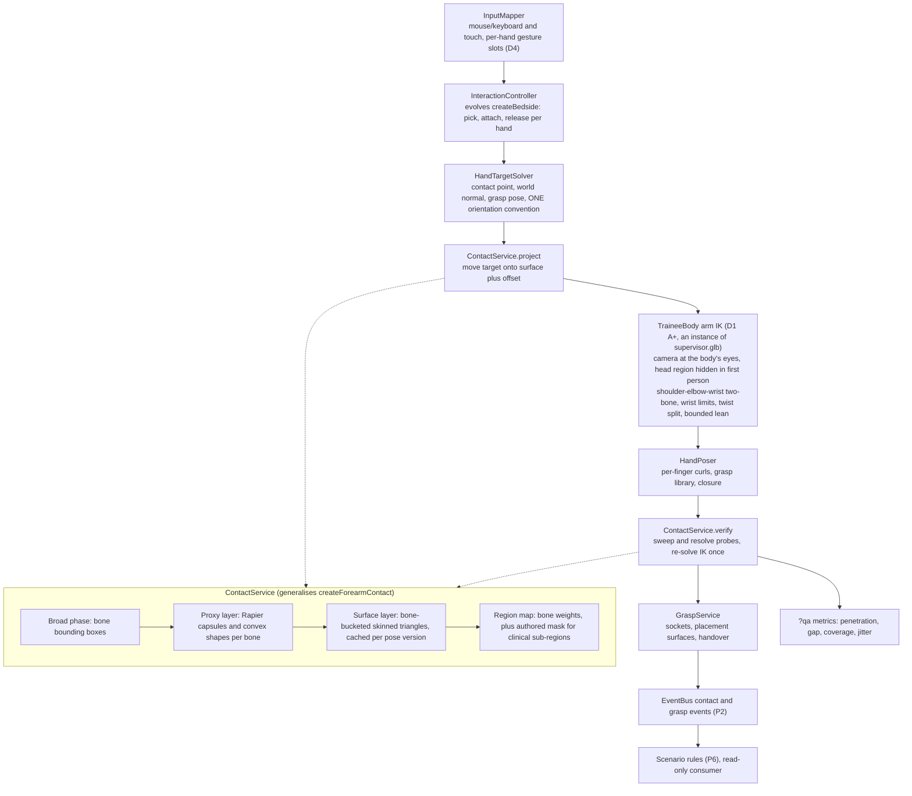

# 05 — Hand, Contact and Movement Options

**Purpose.** This document analyses how the trainee's hands, arms and patient contact work in Nabd v1.5 today. It then compares practical options for the owner's goal: two stable, anatomically coherent hands connected to a full trainee body, and broad, continuous, invisible contact across the patient's body with no visible penetration, no floating gaps and acceptable performance. For each question it recommends one direction and shows how that direction grows out of the existing code rather than replacing it. The code in question is `src/staff/CrewController.js`, `src/interaction/BedsideInteraction.js`, `ForearmContact.js`, `ForearmGrip.js`, `src/patient/AbdomenSurface.js` and the hand-related parts of `src/app/NabdRuntime.js`. Nothing described here as PLANNED has been implemented. The orientation document `Nabd_v1.5_Repository_Review.md` named in the owner's request does not exist on disk, so the repository is the only source of truth.

**Status labels used:** VERIFIED (observed in the audit's browser run, cited R1–R21 or B1–B5) · TEST-VERIFIED (a named repository test that passed) · SOURCE-INSPECTED · PARTIALLY VERIFIED · DATA-DERIVED (audit analysis: computed by read-only scripts from asset or geometry data; never a test result) · PLANNED · UNKNOWN. Recommendations are marked **RECOMMENDATION** and assumptions **ASSUMPTION**.

**Related documents:** [README](README.md) · [01](01_PROJECT_UNDERSTANDING.md) · [02](02_CURRENT_STATE_AUDIT.md) (full text of all findings; this document mainly uses F06–F20) · [03](03_REQUIREMENTS_GAP_ANALYSIS.md) (G03, G07–G15) · [04](04_EXPERIENCE_AND_WORKFLOW_DESIGN.md) · [06](06_APPENDICITIS_CASE_WORKFLOW.md) · [07](07_PRIORITIZED_IMPROVEMENT_ROADMAP.md) (P3, P5, P7) · [08](08_TECHNICAL_DECISIONS_AND_OPEN_QUESTIONS.md) (DN2–DN4; D1, D5 and D9 DECIDED on 2026-11-14; D4 DELEGATED with consultation) · [09](09_ACCEPTANCE_AND_VALIDATION_PLAN.md) (AC-P3-k, AC-P5-k, AC-P7-k) · [10](10_NEXT_IMPLEMENTATION_TASK.md) (T1, T2) · [11](11_FULL_SESSION_SCENARIO.md) (full session scenario; supervisor intervention ladder) · [REPOSITORY_EVIDENCE_INDEX](REPOSITORY_EVIDENCE_INDEX.md)

---

## Recommendations at a glance

| Question | RECOMMENDATION | Owner decision / phase |
|---|---|---|
| (a) Arm and hand rig | Full-body trainee: an in-house instance of the existing clothed body (`supervisor.glb`) on the shared 163-joint skeleton, with the camera at its eyes and its head region hidden in first person. Two-bone arm IK from the real shoulder to the existing hand targets, a separate wrist joint with limits, and removal of the stretched sleeve. | D1 DECIDED (owner, 2026-11-14): option A+ · P3, starting with spike T2 |
| (b) Hand control | Keep kinematic hand targets. Add query-based constraint projection on top. No Rapier `World`. Movement is smooth and natural, within joint limits, and nothing sinks into the bed or the patient except through a declared opening (§3(b)). | DN3, D5 DECIDED (owner, 2026-11-14) · P3, P5, P7, P8 |
| (c) Contact architecture | **Hybrid** of four parts: (1) skeleton-driven proxy shapes for sweep and penetration; (2) bone-bucketed skinned-surface queries for exact placement and sliding; (3) fingertip and palm probes taken from glove vertices; (4) region identification from bone weights. Declared openings (port, scope path, wound or incision) are the only places where entry is allowed. | DN3, D5 DECIDED · P5a, P5b |
| (d) One vs two hands | Per-hand gesture state. An "active + anchored" two-hand scheme (the "hold-and-act" scheme of D4 option A in [08](08_TECHNICAL_DECISIONS_AND_OPEN_QUESTIONS.md)) is the baseline for both mouse/keyboard and touch. Simultaneous schemes come only after user testing. D9 (DECIDED) targets desktop and laptop computers, so mouse and keyboard come first. | D4 DELEGATED with consultation (2026-11-14): this is the working default; the team asks the owner, with a recommendation, where the choice matters · P7 |
| (e) Grasp, hold, release, handover | An authored grasp-pose library with per-finger closure, explicit grip sockets, placement surfaces and an animated hand-to-hand handover. All still kinematic. | D5 DECIDED · P7, P8 |

---

## 1 Current architecture

### 1.1 Components

| Component | Location | What it does in the hand/contact path | Status |
|---|---|---|---|
| `createBedside` | `src/interaction/BedsideInteraction.js:4-420` | Pointer and keyboard state machine: `pick` (39-102), `begin` (104-129), `release` (137-153), `updateBeforeHands` (176-248), `updateAfterHands` (250-306). It holds exactly one `gesture` and one `pointer` (13-15). | SOURCE-INSPECTED |
| `loadCrew` | `src/staff/CrewController.js:2-574` | Builds both gloves (`buildHand`, 21-85), the supervisor (88-183) and the instrument group (185-251). Each crew frame, `update` (457-505) poses the supervisor, then loops over the hands, left then right (488-493), running `updateHand` (362-435) followed by `updateSleeve` (437-453) for each, then sets the tool pose (494-503). | SOURCE-INSPECTED |
| `createForearmContact` | `src/interaction/ForearmContact.js:2-82` | Stateless Rapier shape queries: `refresh` (25-29), `sweep` (31-44), `resolve` (46-65), `measure` (67-75). It creates no `World`, no rigid bodies and no gravity. | SOURCE-INSPECTED. The repository test cannot load (F03), so it is not TEST-VERIFIED; the logic was reproduced only by an audit harness (F15). |
| `createForearmGrip` | `src/interaction/ForearmGrip.js:2-42` | Stores the grip point in the patient's wrist-bone frame. Maps pointer motion to `across` (±0.085 m) and `lift` (−0.024…0.15 m), and steps the patient wrist at ≤ 0.33 m/s through `limb.move`. | SOURCE-INSPECTED |
| Patient limb IK | `createLimbDrag` `NabdRuntime.js:5395-5428`; `T0` (4632 @475), `A0` (@2019), `pd` (@1807), `w0` (@1546) on minified line 4632; min-Y function `$()` at 5916 @1501 | Analytic two-bone IK with a swing cone and a bend limit. Segment samples are kept above the deck or floor. | SOURCE-INSPECTED |
| Forearm drill | `openForearmPractice` / `resetForearmPractice` / `closeForearmPractice` / `updateForearmPractice`, `NabdRuntime.js:5430-5517` | The drill session runs only for `nearArm()`, which always returns the left arm (5371). It handles settling (0.32 m/s) and the supervisor support point. | SOURCE-INSPECTED; R7–R11 VERIFIED |
| `createAbdomenSurface` | `src/patient/AbdomenSurface.js:2-191` | `rebuild` (24-57) rasterises the whole skin into a max-Y height field of 175 × 386 cells at 6 mm. Press and pinch deformation applies inside x ±0.153, z −0.244…−0.066 (line 16). | SOURCE-INSPECTED |
| QA surface | `window.__studioQA.getSimulationState()`, `NabdRuntime.js:6104-6154` (only with `?qa`) | Exposes `forearm.{state, overlap, stops, supportGap, gap, contact}`, `abdomen.penetration` (`crew.measureSurfacePenetration`), and `crew.getState()` (wrists and contact gaps). | SOURCE-INSPECTED (F32) |

### 1.2 Data flow from input to render

Inside `updateHand` (SOURCE-INSPECTED):

### 1.3 Per-frame order and the 15 ms throttle

The single frame loop `ee(now)` (`NabdRuntime.js:5954-6007`, started at 6008) runs these steps in order (SOURCE-INSPECTED):

1. Pose tween `V`, camera drivers.
2. On the first frame after entering a work region: `abdomen.rebuild()` and `crew.setSurfaceHeight` (5973-5980). The rebuild runs again after a non-forearm limb release, which resets `workReady` (5580-5583).
3. `abdomen.update(dt)` (5981).
4. `updateForearmPractice(dt)` (5982): settling IK, `collision.refresh()`, and `crew.setForearmSupport(...)` (5492-5517).
5. `vitals.update(...)` (5983). It returns true about every 82 ms, which sets the render flag `I`.
6. **The crew block** (5984-5991), which runs only if `crew && (I || bedside.active || now < animateCrewUntil)` **and** more than 15 ms have passed since the last crew update (unless reduced motion is on). It calls `t.updateMatrixWorld(true)`, then `bedside.updateBeforeHands(min(0.05, Δ))`, then `crew.update(min(0.08, Δ))`, then `bedside.updateAfterHands()`.
7. Render if `I` is set.

Consequences:
- **Update rate.** Hand, contact, grip, IK and instrument steering are capped at about 66 Hz. When nothing is held, no `animateCrew` window is open and nothing else sets `I`, they run at about 12 Hz, driven by the vitals repaint (F23). Hand simulation is therefore coupled to an unrelated UI repaint. Whether the 15 ms throttle causes visible lag or jitter on high-refresh displays is UNKNOWN (U18 in [08](08_TECHNICAL_DECISIONS_AND_OPEN_QUESTIONS.md)).
- **Slow frame rates.** Motion uses `dt` capped at 0.05 s or 0.08 s, so below about 20 fps hands and limbs move slower in wall time.
- **Wall-clock gates.** The 130 ms "closing" delay and the 3.2 s attach timeout use `performance.now()` (BedsideInteraction.js:16, 180, 281).
- **Handlers outside the loop.** Patient limb drags in room view (`md`, 4632 @2317), the finger-curl sliders and the hand-curl demo run outside this loop (the demo, `runPatientHandDemo` at 5872, has its own `requestAnimationFrame`, 5887 and 5890).

### 1.4 Key data of the current system

| Item | Value | Where | Status |
|---|---|---|---|
| Glove meshes | `glove-left.glb`: glove 8,482 vertices / 13,178 tris, cuff 503 / 650, sleeve stub 357 / 510. They span fingertips to just distal of the elbow. The right glove is the X-mirror asset. | `assets/staff/glove-*.glb` | DATA-DERIVED |
| Finger pads | Every 2nd vertex with weight ≥ 0.28 on a distal phalanx. Left: **1,381 flat / 670 pinch**; right: 1,373 / 650. All are CPU-skinned on every `surfaceContact` call. | `CrewController.js:53-68, 310-320` | SOURCE-INSPECTED; counts DATA-DERIVED |
| Attach gates | 0.018 m (touch, press, pinch), 0.024 m (limb, tool palm), 0.028 m plus overlap ≤ 0.003 plus 130 ms (forearm) | `BedsideInteraction.js:255, 270-281, 293-294` | SOURCE-INSPECTED |
| Rapier probes | 6 balls at **bone origins**: `finger3-1` (r 0.010), then `finger1-3`…`finger5-3` (0.008, 0.007, 0.007, 0.006, 0.005) | `CrewController.js:80`; `ForearmContact.js:17` | SOURCE-INSPECTED |
| Rapier obstacles | Upper-arm capsule r **0.043**, half-height ½·\|shoulder–elbow\| − 0.024. Forearm capsule r **0.022**, half-height ½·\|elbow–wrist\| − 0.006. Mattress cuboid with half-extents **0.47 × 0.10 × 1.06**, top at deck height `m`. | `ForearmContact.js:14-18, 25-29` | SOURCE-INSPECTED |
| Query count | Sweep 6 × 3 = 18 `castShape`; resolve ≤ 3 × 18 = 54 `contactShape`; measure 18. Total **≈ 90 Rapier calls per collided hand per crew frame**. | `ForearmContact.js:31-75` | SOURCE-INSPECTED |
| Height-field lift | Every 4th vertex of all glove primitives (glove, cuff, sleeve stub): ≈ 2,336 CPU-skinned vertices per hand per crew frame, while the workstation is active, the hand has no forearm contact, and the drive normal is missing or has y > 0.62 | `CrewController.js:333-342, 425-434` | SOURCE-INSPECTED; count DATA-DERIVED |
| Skin raycast | The bundled three.js r180 skinned raycast (`function Kr`, `NabdRuntime.js` line 29 @117859) evaluates 3 skinned vertices per triangle, with no BVH. For the body skin primitive alone (105,822 triangles) one full pick costs ≈ 318k skinned-vertex evaluations; the privacy, brow and eye meshes add ≈ 3.4k triangles more. It runs on every idle mouse move and on every `touch` crew frame. | `NabdRuntime.js:6067`; `BedsideInteraction.js:206-218, 355-359` | SOURCE-INSPECTED path; count DATA-DERIVED; time UNKNOWN (U7 in [08](08_TECHNICAL_DECISIONS_AND_OPEN_QUESTIONS.md)) |
| Reach gate | Target point `y ≥ 0.72` and within **0.87 m** of a virtual shoulder 0.17 m to the side of and 0.225 m below the camera (plus a fixed 0.02 m world-X offset) | `CrewController.js:279-281, 356-360` | SOURCE-INSPECTED |
| Rest pose | Camera-local `(±0.175, −0.207, −0.51)`, or ±0.131 on narrow screens; world-space lerp toward it | `CrewController.js:364-371` | SOURCE-INSPECTED |

---

## 2 Problems with evidence, and what the learner sees

Full text of each finding is in [02](02_CURRENT_STATE_AUDIT.md). Where nothing was observed in a browser, this table says what the learner **would** see according to the code, and the visual result stays UNKNOWN.

| ID | Problem | Evidence | What the learner sees |
|---|---|---|---|
| F06 | The trainee is a camera plus two floating gloved forearms. There is no body, shoulder, elbow or arm IK, and the wrist and forearm move as one rigid piece. | `CrewController.js:21-26` (hands added to the scene, not to a body), 392-396 (`poseHand` moves the whole asset rigidly), 356-360 (`shoulder()` is a computed point only) | **VERIFIED** (R4, R21): two gloved hands and forearm stubs entering from the bottom edge or a corner of the view, with no upper arm or body ([evidence/01-default-bedside-view.jpg](evidence/01-default-bedside-view.jpg), [evidence/10-scissors-without-blades.jpg](evidence/10-scissors-without-blades.jpg)). |
| F07 | In workstation modes, one straight `CylinderGeometry(0.036, 0.057, 1)` is stretched from the GLB sleeve rim to the virtual shoulder (`scale.y = length`). | `CrewController.js:75, 437-453`; shown when `surfaceHeight` is set (5976), hidden on leave (5201) | **VERIFIED DEFECT** (R10): while the wrist is held and lifted, a very large, elongated dark-teal volume runs from the bottom of the view to the patient's wrist, with a jagged open edge, and partly hides the gripping glove ([evidence/03-forearm-lift-stretched-sleeve.png](evidence/03-forearm-lift-stretched-sleeve.png)). |
| F08 | Left/right asset mapping is fixed with no mirroring. The active hand changes only via Q/E or the hand buttons and is read once per gesture. | `CrewController.js:87`; `NabdRuntime.js:5241-5248, 5831-5832, 5947-5949`; `BedsideInteraction.js:105, 120` | **VERIFIED** (R18): pressing the hand buttons toggles their pressed state but gives no visible rest-pose change, so nothing in the 3D view shows which hand will act. Cross-body reach is allowed (`canReach` checks only target height and distance from that hand's virtual shoulder, `CrewController.js:279-281`), so the left glove can be sent to the far right, across the idle right glove (SOURCE-INSPECTED; UNKNOWN visually). |
| F09 | Hand orientation conventions are inconsistent. (1) The `contactRotation` normal branch is about 180° from the no-normal and forearm branches. (2) The default `wristToTool` rotation is fixed in world space. (3) Instrument roll is unlimited. (4) Hands lag in world space after camera jumps. | `CrewController.js:238, 282, 293-304, 321-331`; `InstrumentKinematics.js:118-127`; `BedsideInteraction.js:187, 226` | **UNKNOWN visually** (SOURCE-INSPECTED; U6 in [08](08_TECHNICAL_DECISIONS_AND_OPEN_QUESTIONS.md)). Predicted: fingers pointing back toward the trainee during `touch`/`press`; a turn of about 180° as an abdomen pinch attaches; palm-up rolls with no limit; hands visibly sweeping through space after a view jump. |
| F10 | 15 phalanx bones per glove are driven by one `curl` scalar about local X. Metacarpals and the wrist are not driven. Whether local X is the true flexion axis is unknown. | `CrewController.js:39-43, 381-391` | **UNKNOWN visually** (U5 in [08](08_TECHNICAL_DECISIONS_AND_OPEN_QUESTIONS.md)). Predicted from the code: all fingers close as one unit; no wrist flexion or deviation; the thumb rotates about the same local axis as the fingers. |
| F12 | "مساندة المشرف" support = supervisor right-arm 2-bone IK (`reachSupport`, world-fixed pole) plus a flag that pauses settling. Nothing physically holds the forearm. | `CrewController.js:143-175, 466-485`; `NabdRuntime.js:5441-5447, 5497, 5509-5514` | **VERIFIED** (R11): a gloved supervisor hand appears holding the forearm from above, and after release the forearm stays raised ([evidence/04-supervisor-support-hand.png](evidence/04-supervisor-support-hand.png), [evidence/05-after-release-forearm-supported.jpg](evidence/05-after-release-forearm-supported.jpg)). The support label requires a gap below 0.020 m (`NabdRuntime.js:5513-5514`); R11 showed it once, from the +X stance only (other stances: U9 in [08](08_TECHNICAL_DECISIONS_AND_OPEN_QUESTIONS.md)). Whether the supervisor's rigidly tilted body intersects the bed or patient is UNKNOWN (U16 in [08](08_TECHNICAL_DECISIONS_AND_OPEN_QUESTIONS.md)). Switching to room view silently ends support (R12 correction, F31). |
| F15 | Forearm contact uses Rapier queries against only 3 shapes (left upper-arm capsule, left forearm capsule, mattress cuboid), with 6 ball probes at bone origins. It works in the forearm drill only and on the left arm only. | `ForearmContact.js:14-18, 31-75`; `CrewController.js:80, 411-423`; `NabdRuntime.js:5371, 5430-5437` | **VERIFIED** that the drill grips and lifts (R9). Outside it, nothing stops a hand entering the torso, thighs, the patient's hand or the other limbs (visual UNKNOWN). Fingertips (2.3–3.2 cm beyond the probe bones, DATA-DERIVED), palm, heel and wrist are not probed. Three more SOURCE-INSPECTED observations: one sweep fraction is shared by all probes, so a probe that touches with a short path can freeze the whole hand; the `followForearm` carry and the patient-arm IK motion are never swept; and a `forearmContact` stays on a hand after an attached release (`BedsideInteraction.js:142-144`). |
| F16 | Capsules do not match the skin. | `ForearmContact.js:14-15`; bind-pose skin distances: forearm skin 2.07–5.43 cm from the bone line (median 3.22 cm) against a 2.2 cm capsule; upper arm 3.22–7.63 cm (median 4.99 cm) against 4.3 cm | DATA-DERIVED: a probe can sink a median of about 1 cm (up to about 3.2 cm) into the visible forearm before Rapier reports contact, and can stop up to about 1.1 cm short of parts of the upper arm. Visual effect UNKNOWN. |
| F17 | Outside the drill: (1) targeting raycasts all non-privacy skin; (2) attach gates are pad-proximity checks to a point; (3) the only penetration guard is a top-down height-field lift that runs only for upward normals. (4) The touch-follow loop uses an object-local, unskinned normal as if it were a world normal. (5) The forearm grip normal is the bind-pose normal. | `BedsideInteraction.js:39-101, 212-213, 49-51`; `CrewController.js:310-320, 425-434`; bundled three.js raycast, `NabdRuntime.js` line 29 @118166 (`u.normal=`) | **UNKNOWN visually**. Predicted from the code: on the supine patient a front-of-body local normal (0,0,1) is used as world (0,0,1) instead of about (0,1,0), which tilts the glove and can skip the lift gate. The grip normal can be tilted by tens of degrees, because the bind-pose forearm differs from the supine pose by about 60° (DATA-DERIVED). Side surfaces (flanks, lateral limbs) get no penetration correction at all. |
| F18 | Two-hand simultaneous interaction is impossible by construction: one `gesture`, one `pointer`, non-primary pointers ignored, and one tool group. | `BedsideInteraction.js:13-15, 309, 334, 395`; `CrewController.js:185, 255` | SOURCE-INSPECTED (two-hand use was not exercised at runtime). The learner can act with one hand at a time; the other hand idles at its rest pose. |

**Why these matter together.** The owner's task instructions ask for hands that "remain connected to the correct arms and body". The brief (§6) asks that hands never "swap sides, flip, twist, jump", never "visibly pass through the patient", and that contact work "across the patient's body". Today:
- continuity is faked by a camera-anchored stretched cylinder (F06, F07);
- orientation comes from several unrelated conventions (F09);
- collision exists for one limb only and is not tight even there (F15, F16);
- elsewhere, contact means "close enough to a point" plus a vertical lift (F17).

The options below address these root causes rather than the individual symptoms.

---

## 3 Option analyses

### 3(a) Arm and hand rig

**Asset facts that shape the options:**
- **Shared skeleton** (DATA-DERIVED). `assets/patient/patient.glb` and `assets/staff/supervisor.glb` share a byte-identical 163-joint skeleton `PatientRig`: same joint order, inverse-bind matrices and rest pose. `index.html:537` (inside the licence notes that sit in an HTML comment, lines 310-557, so never shown to users) attributes the base mesh and rig to Innerscene's "Male base mesh, rigged A-pose", adapted from MakeHuman, CC0 1.0. That supports, but does not prove, the MakeHuman-style origin (F14; U19 in [08](08_TECHNICAL_DECISIONS_AND_OPEN_QUESTIONS.md)).
- **Bones available** (DATA-DERIVED from the GLB joint list): `clavicle`, `shoulder01`, `upperarm01/02`, `lowerarm01/02`, `wrist`, `metacarpal1-4`, 15 phalanges per hand, and `spine01-05`, `neck01-03` and `head`. **ASSUMPTION:** `upperarm02` and `lowerarm02` are twist segments; their role must be confirmed in the T2 spike.
- **Glove assets** (DATA-DERIVED). The glove GLBs (skin `GloveRig_left`/`_right`) use the same 163 joint names but **different** inverse-bind matrices and rest pose. They are re-bound cuts and cannot be dropped onto the full-body skeleton without rebinding.
- **Supervisor gloves** (DATA-DERIVED from the GLB structure). `supervisor.glb` already contains a "Supervisor gloves" primitive (27,362 tris) skinned to the shared skeleton.
- **Supervisor size** (DATA-DERIVED). The supervisor body is about 112,480 triangles in total.
- **Arm length versus the reach gate** (DATA-DERIVED from bind-pose joint positions). Shoulder-to-elbow ≈ 0.260 m, elbow-to-wrist ≈ 0.274 m, so shoulder to wrist ≈ 0.53 m; wrist to middle-finger MCP is 0.116 m. Today's reach gate accepts contact points up to **0.87 m** from the virtual shoulder. That gap is consistent with the long stretched sleeve seen in R10. By this arithmetic a real arm on this skeleton could not reach the farthest targets allowed today without a step or a torso lean; the exact margin depends on where the body's shoulder sits relative to the camera, which T2 must measure.

The comparison below is the background analysis of 2026-11-13. The owner's decision of 2026-11-14 follows it.

| Criterion | A1 Keep glove-only forearms, improve the sleeve (e.g. two-segment sleeve with a fake elbow) | **A2 Full-body trainee on the shared 163-joint rig with two-bone arm IK** | A3 New avatar on a different rig with retargeting |
|---|---|---|---|
| Fit with current project | Highest: changes only `updateSleeve` and `shoulder()` | High. Reuses `getBone`-by-name code (`CrewController.js:11-19`), the analytic IK in `reachSupport` (143-175) and patient `T0` (4632), the hand targets from `driveHand`/`driveSurface`, and the supervisor's skinned gown and gloves. | Low to medium. Needs a retargeting layer. The identifier `SkeletonUtils` does not occur in `NabdRuntime.js` (grep: 0 matches); whether an equivalent clone or retarget helper is bundled under a minified name is UNKNOWN (U13 in [08](08_TECHNICAL_DECISIONS_AND_OPEN_QUESTIONS.md)). |
| Visual and interaction quality | Still "floating arms": no shoulder, torso or clothing continuity. The brief asks for a trainee who "appears as a complete human character" (§3.1) and rejects "floating hands, or disconnected limbs" (§10). | Intended (PLANNED): a connected shoulder–elbow–wrist chain, real reach limits, clothing sleeves skinned to the real arm bones (the supervisor's sleeve on the same rig is visible in R11, [evidence/04-supervisor-support-hand.png](evidence/04-supervisor-support-hand.png)), consistent left/right. Actual visual quality UNKNOWN until the T2 spike. | Potentially best looking, but the result depends on the source asset and retarget quality. |
| Complexity | Small | Large. The main work: body–camera coupling, head hiding in first person, IK with a correct elbow pole per side, wrist limits, twist distribution over `lowerarm01/02`, and rebinding or replacing the glove meshes. | Large, plus licensing and retarget tuning per character. |
| Performance | Unchanged | Adds up to about 112k triangles per reused full body (DATA-DERIVED), against today's 299k–464k per view (VERIFIED R6). Needs head/lower-body culling in first person and a shared parse or clone. | Depends on the asset. |
| Reuse potential | None beyond the trainee | The same rig, IK utility and grasp poses serve the trainee, the doctor and the nurse (P8). | Moderate |
| Risks | Fails the brief; a throw-away investment | Same adult male body for everyone under D1 option A (a trade-off the owner accepted with option A+; see the decision below). Camera, head and neck clipping. Unknown visual quality until the T2 spike. | Licence provenance (F30-type gaps), rig mismatch, skinning artefacts. |

**RECOMMENDATION (rig): A2.** A2 is the only option that can meet the brief's requirement of a trainee who "appears as a complete human character" (§3.1; compare principle 1, "People, not floating hands", §2) while keeping the existing skeleton, bone-name code, IK code and supervisor clothing. The analysis above paired A2 with D1 option B (new bodies generated on the identical 163-bone skeleton); that pairing is superseded by the decision below and kept only as background.

**Decision D1 (owner, 2026-11-14): option A+ — reuse the existing clothed body in-house.** Owner: «المتدرب بدي إياه جسم يكون، مش إيدين بس. ويكون هو الكاميرا بأبعاد مناسبة فيزيائياً» and «بدنا نستورد نفس الجسم الموجود، نعدل عليه شوية أشياء نزبطه أكثر عشان ما نظل نجيب أشياء من برا» ("the trainee must be a body, not only hands, and be the camera, at physically appropriate dimensions"; "we import the same existing body and adjust it, so that we stop bringing things in from outside"). This supersedes the earlier recommendation of option B and rules out external character assets (option C). A2 stays the rig approach; A+ fixes the body asset. The trainee, the supervising doctor and the nurse are each an instance of `assets/staff/supervisor.glb`, modified in-house (role colours by material recolouring, PPE by phase, limited proportion changes by bone scaling); the patient stays `assets/patient/patient.glb`. Consequences for the arm and hand work:

| Consequence | What it means | Status / evidence |
|---|---|---|
| First-person body | The trainee is a full body; the torso and arms are visible when looking down, and both arms connect to real shoulders | PLANNED (P3) |
| Camera at eye height | The camera is the trainee's eyes. Today it stands at y = 1.60 m (`traineeDefault`, `NabdRuntime.js:4661`), a constant that `focusTraineeArea` (`4902-4907`) and `positionAtWork` (`5131-5134`) reuse. The shared rig's eyes span y 1.661–1.691 m in the rest pose, so the eye height becomes about 1.67 m unless the body is scaled. The default pitch (−0.60) and the bedside framing are then re-checked against the P0 visual baselines | Camera SOURCE-INSPECTED; eye height DATA-DERIVED (audit analysis); framing PLANNED |
| Head hiding | The trainee's head-region primitives are hidden for the main camera: the head-and-neck skin (22,871 triangles; the only skin primitive in `supervisor.glb`, y 1.490–1.728 m), brows 648, eyes 1,060, cap 2,040 + 718 and mask 10,304, about 37.6k triangles in all. The mask (y 1.556–1.657 m) sits just below and in front of the eyes, so it would likely intrude into a downward view if left visible. The technique (per-primitive visibility, render layer or bone collapse) is chosen in T2 | Counts and bounds DATA-DERIVED (audit analysis); visual effect UNKNOWN; technique PLANNED |
| Arm IK from the real shoulders | `shoulder()` (`CrewController.js:356-360`) gives way to the body's `upperarm01.L/R` joints; two-bone IK runs from there to today's hand targets with a side-mirrored pole. The visible arm is the body's own gown sleeve (out to x ±0.47 m in the bind pose) and gloves primitive, skinned to the real arm bones, which replaces the stretched sleeve (F07) | PLANNED (P3); bounds DATA-DERIVED |
| Hands | The body's own gloves primitive (27,362 triangles, already skinned to the shared skeleton) is the first candidate for the trainee's hands. The separate glove GLBs stay until T2 shows that the body's gloves hold up at first-person distance; the probe vertices of §3(c) layer 3 follow whichever glove is kept | PLANNED; visual result UNKNOWN |
| Triangle budget | 112,480 triangles per staff copy (11 clothing and skin primitives totalling 110,772, plus brows 648 and eyes 1,060; the gloves alone are 27,362 and the footwear 17,414). Three staff copies are about 337k, plus about 109k for the patient: about 446k for the people alone, against 378,534–387,848 for the whole default bedside view today (VERIFIED R6). Hiding the trainee's head region saves about 37.6k. Measurement and possibly mesh simplification are needed (P0, P3, P8; U1) | DATA-DERIVED (audit analysis) |
| Three instances | A skinned clone, or one parse of the GLB per person, is needed | UNKNOWN (U13) |
| Garment limits | The arms and hands are covered only by the gown and the gloves, so a phase without them needs in-house bare-arm and hand geometry (for example cut from `patient.glb`, which shares the skeleton); see [04](04_EXPERIENCE_AND_WORKFLOW_DESIGN.md) §2.5 | DATA-DERIVED (bounds); visual result UNKNOWN |
| Shared base body | Every person shares one base body and face (caps and masks hide much of the face). The owner approved changing the features of the copies on 2026-11-14 ("copy it and modify it", never a new 3D human from scratch). The nurse is a woman of ordinary appearance with a hair cover and a mask; that may need shape changes beyond recolouring: the `breast.L/R` and pelvis bones allow limited scaling, and an in-house Blender sculpt of the copy would still count as in-house | Appearance DECIDED (D1 refined); technique and visual result UNKNOWN (U24) until the owner's review |
| Skeleton origin | U19 no longer gates the choice of body, because no new body is generated; it remains a provenance question (D8) | — |

**PLANNED technical shape of A2 under D1 A+** (detail in P3):
- **Body and camera.** Instance `supervisor.glb` as the trainee body and place it so that its eyes coincide with the camera; the head follows the look direction within neck limits, and the head-region primitives are hidden for the main camera.
- **Hands.** Use the shared-rig gloves: the body's own gloves primitive, or the trainee glove meshes rebound to the full-body bind pose. Keep the hand *targets* produced by `BedsideInteraction` exactly as they are today.
- **IK.** Replace `shoulder()` (`CrewController.js:356-360`) with the body's `upperarm01.L/R` joint. Solve shoulder → elbow → wrist with a side-mirrored elbow pole (unlike `reachSupport`'s world-fixed pole at line 155). Add a small `clavicle`/`shoulder01` assist and a bounded `spine01-03` lean for far targets. Out of reach, keep today's behaviour, which already tells the learner to step closer (R8).
- **Wrist.** A separate wrist joint with flexion/extension and deviation limits. Forearm twist goes to `lowerarm02`. Limit values must come from a cited anthropometric source and are not asserted here.
- **First person.** Hide the head region for the main camera only (per-primitive visibility, render layer or bone collapse; the technique is chosen in T2), so that other views still show a complete person.
- **Clean-up.** Remove `updateSleeve` (F07).

### 3(b) Kinematic hand control versus physics-assisted control

| Criterion | **B1 Kinematic targets + query-based constraint projection (current pattern, extended)** | B2 Rapier `World` with kinematic hand bodies and joints (dynamic fingers) | B3 Fully dynamic articulated hand (PD-driven bodies) |
|---|---|---|---|
| Fit | Direct extension of `ForearmContact` (stateless `castShape`/`contactShape`). DN2 is already stated in `docs/Nabd-v0.22-Review-Board.md:56`: the deterministic simulator owns hand pose and contact. | Needs a World step in the frame loop, per-frame collider updates for a skinned patient and body handles. None of this exists today (F15). | As B2, plus tuning of motor gains |
| Quality | Repeatable placement by construction, with no solver iterations that could add jitter. Penetration is controlled by explicit projection. Actual smoothness and residual penetration must be measured (section 6). | More "emergent" contact, but with jitter and solver tuning. A pose-driven patient still has to be represented as moving kinematic colliders. | Most natural in theory; unstable at mouse-input speeds without careful filtering |
| Complexity | Medium | Large | Very large |
| Performance | Bounded query count (section 5) | Simulation step plus collider sync every frame | Highest |
| Reuse | Same service serves the trainee, the supervisor support pose and nurse handovers | Partial | Low |
| Risks | Needs careful probe and proxy design (section 3c) | Non-determinism across frame rates conflicts with DN2. Tunnelling at the 15 ms crew rate. | Same, amplified |

**RECOMMENDATION: B1** (DN3), **now DECIDED** under D5 (owner, 2026-11-14): kinematic control with constraints.

Reason: the patient is driven by pose and IK, not by physics. A physics world would therefore not make the patient more physical, only the hands less predictable. Rapier 0.21.0 is already vendored (`vendor/rapier/rapier.mjs`) and used exactly this way.

If objects later need to drop or settle, a narrow, optional World *for instruments only* could be proposed under the D5 revisit rule, without changing hand control.

**D5 movement rules (DECIDED 2026-11-14; canonical in [08](08_TECHNICAL_DECISIONS_AND_OPEN_QUESTIONS.md) D5).** The owner: «طريقة الحركة الفيزيائية بدها تكون حركة انسيابية، نفس حركات الإنسان الطبيعية» ("the physical movement must be smooth, the same as a person's natural movements"). B1 implements it as four rules for every person and every held object:
1. **Smooth motion:** no snapping and no in-view teleports.
2. **Natural joint limits:** "the leg doesn't turn 360 degrees". The limits are written in the P3 and P8 design notes, and the patient keeps its IK swing and bend limits.
3. **No sinking:** "the hand doesn't sink into the bed, my hand doesn't sink into the patient's body". The proxy and surface layers of §3(c) resolve every probe out of the table, the mattress and the patient.
4. **Opening exception:** «ما أفوت إيدي جوه جسم المريض إلا في حالة إذا كان في جروح أو إذا كان في منظار» ("I don't put my hand inside the patient's body except when there are wounds or a scope"). Entry is allowed only through an opening that the active stage declares (a wound or incision, a port, or the scope path), and only for what the stage allows through it.

Rule 4 becomes a "declared openings" input to the contact service (P5; AC-P5-10) and to instrument handling (P7). Inside a declared opening a permitted object is not resolved out of the body and is not counted as penetration; everywhere else, rules 2 and 3 apply. In v0 the only opening that exists is the instrument port: the remote-centre kinematics already insert a port-capable instrument along its shaft (`src/instruments/InstrumentKinematics.js:3-153`; TEST-VERIFIED, `tests/instrument-depth.test.js`). Wounds and incisions are not simulated ([06](06_APPENDICITIS_CASE_WORKFLOW.md) §10), so hands never enter. Where openings are and what may pass is **CLINICAL REVIEW REQUIRED (CR-12, CR-13)**. INV-11 in [09](09_ACCEPTANCE_AND_VALIDATION_PLAN.md) checks all four rules.

### 3(c) Contact architecture across the whole patient

**Patient geometry facts** (DATA-DERIVED from the bind pose of `assets/patient/patient.glb`, body skin primitive):

| Region (by dominant bone) | Triangles | Area (m²) | Tris per cm² | Median edge (mm) | p90 edge (mm) | Max edge (mm) |
|---|---|---|---|---|---|---|
| Torso (spine, breast, pelvis, clavicle, shoulder) | 10,950 | 0.450 | 2.4 | 11.1 | 16.5 | 26.8 |
| Thighs | 5,206 | 0.385 | 1.4 | 15.2 | 20.4 | 26.4 |
| Lower legs | 3,640 | 0.267 | 1.4 | 15.0 | 30.2 | 38.8 |
| Upper arms | 4,944 | 0.196 | 2.5 | 11.3 | 15.8 | 21.2 |
| Forearms | 4,902 | 0.131 | 3.7 | 7.9 | 18.5 | 21.7 |
| Head and face | 30,818 | 0.155 | 19.9 | 2.3 | 7.4 | 19.6 |
| Hands | 24,622 | 0.081 | 30.2 | 2.5 | 4.7 | 14.5 |
| Feet | 17,094 | 0.124 | 13.8 | 3.1 | 10.4 | 19.1 |
| Neck | 1,654 | 0.028 | 6.0 | 7.3 | 9.0 | 15.3 |
| Other (small facial and miscellaneous bones) | 1,992 | 0.002 | — | 1.8 | 2.6 | 6.7 |
| Whole skin primitive | **105,822** (70,278 vertices) | **1.818** | — | 3.6 | 14.1 | 38.8 |

Each triangle is assigned to the region of the dominant bone of its first vertex; the whole-primitive edge statistics are from a sample of every third triangle. More than half of all triangles (head, face and hands) cover about 13% of the surface. The thighs and lower legs are the **sparsest** parts of the mesh, and the torso, where most bedside and abdominal contact will happen, is the next sparsest. Of 163 joints, 119 dominate at least one vertex.

**Options:**

**C1 — Extend skeleton-driven proxies to the whole body.** This generalises today's pattern: capsules, or convex hulls fitted per bone segment, refreshed from bone matrices like `refresh()` (`ForearmContact.js:25-29`).
- *Fit:* excellent. It uses the same API.
- *Quality:* stable sweeps and fast penetration resolve, but the shapes are approximations. F16 shows centimetre-level mismatch with single capsules. Flattened cross-sections (forearm, thigh) and concave areas (axilla, groin edge, navel, neck) cannot match the skin, so used alone C1 would leave either sinking or floating gaps (visibility UNKNOWN until measured).
- *Performance:* cheap; proxies refit from about 20–50 bone transforms, not from vertices.
- *Verdict:* a necessary layer, not sufficient on its own.

**C2 — Dense invisible point cloud (the owner's concept), analysed honestly.**
- *Where the points come from.* Using mesh vertices as points gives 70,278 points, but more than half sit on the head and hands. On the torso, neighbouring points are typically 1.1 cm apart and up to 2.7 cm apart; on the lower legs, up to 3.9 cm. A uniform resample would need about 18,200 points at 10 mm spacing or about 72,700 at 5 mm (DATA-DERIVED from the 1.82 m² area).
- *Cost.* Every point must be re-skinned (4 weighted bone transforms) whenever the patient's pose changes, and a spatial index rebuilt for neighbour searches against the hand probes. At 10 mm spacing that is still cheaper than today's single full-skin raycast (≈ 318k skinned-vertex evaluations, section 1.4), so **performance is not the main problem**.
- *Gaps.* Points are independent and have no surface between them. A probe ball of 5–10 mm radius (today's sizes, `ForearmContact.js:17`) can pass between torso points that are 11–27 mm apart. To close the gaps, each point needs a radius of at least half the spacing, which inflates the surface outward and creates the floating gaps the brief forbids.
- *Jitter.* The contact point and normal must be estimated from discrete neighbours, so the contact jumps from sample to sample while sliding. That is exactly the jitter and snapping the brief forbids.
- *Verdict:* the *experience* is right; the *primitive* is wrong. Not recommended as the implementation.

**C3 — Mesh-based closest point with a BVH.** The query is exact and continuous on the real triangles.
- A ready-made BVH library for three.js is a **new dependency**. This plan does not propose it. Adopting one would need its own explicit owner-approval decision, recorded in [08](08_TECHNICAL_DECISIONS_AND_OPEN_QUESTIONS.md) next to D5 and D6; no such decision exists there today. **RECOMMENDATION:** this plan reads the D6 standing download authorisation (2026-11-14) as covering development tools, not a new runtime dependency that ships to trainees; such a dependency would still be raised as a proposal under the working agreement.
- The BVH would also need refitting whenever the patient moves, after CPU-skinning all 70,278 vertices.
- A dependency-free variant is feasible: per-bone **triangle buckets** built once from skin weights. Only the buckets near the hand are skinned, and those skinned positions are cached until the patient's pose or deformation changes.
- *Verdict:* use the bucketed variant as a layer.

**C4 — Signed distance fields** (per-segment grids, rigid with each bone).
- Gives smooth normals and fast queries, but needs offline tooling that the repository does not have.
- Memory cost per segment; seams at joints where segments blend; no help for the deformable abdominal patch.
- *Verdict:* defer.

**C5 — HYBRID (RECOMMENDED; PLANNED).** Four layers, all deterministic and kinematic (DN2, DN3):

1. **Proxy layer (sweep and penetration).** Capsules or convex hulls per bone segment, **auto-fitted to skin weights** in the bind pose: vertices weighted to that bone, a radius chosen at a low percentile so the proxy stays just inside the skin, and several capsules where the cross-section is flattened. Fitted offline into a small data table and refreshed per crew frame from bone matrices. A cheap broad phase on bone bounding boxes keeps only the few proxies near each hand. This layer is intended to prevent tunnelling at the 15 ms update rate, and it replaces today's 3-shape set.
2. **Surface layer (exact placement and sliding).** Per-bone triangle buckets of the real skin (from skin weights). For the candidate buckets: skin the bucket vertices, then compute the closest point and a **skinned, world-space** normal (barycentric interpolation of skinned vertex normals). The probe is placed at that point plus its radius plus a small skin offset. Sliding means re-projecting each crew frame onto continuous triangles, with hysteresis between touching and released. Because every normal is computed in world space from skinned data, this design removes the F17 normal-space errors by construction (to be confirmed by the section 6.1 normal-space fixture). It also keeps today's raycast targeting but restricts it to buckets (proxy ray test first, then bucket triangles).
3. **Hand probes from glove vertices, not bone origins.** For each digit: a distal pad and a fingertip probe. Plus palm centre, thenar, hypothenar and heel probes. Positions are fixed glove-vertex indices skinned each frame, which is meant to cover the 2.3–3.2 cm fingertip blind zone (F15). Under D1 A+ the indices come from whichever glove T2 keeps: the body's own gloves primitive or the rebound glove GLBs.
4. **Region identification from bone weights.** The contacted triangle's dominant bones map to segment regions: forearm, upper arm, chest wall, thigh, and so on. This replaces the supine-only coordinate heuristic `inferWorkRegion` (`NabdRuntime.js:4966-4973`). Bone weights **cannot** distinguish clinically meaningful sub-regions of the abdomen: the torso skin vertices are dominated by `spine01`–`spine05` (5,430 vertices) and `breast.L/R` (1,070), with small `pelvis`, `clavicle` and `shoulder01` shares (DATA-DERIVED). A handful of spine bones therefore cannot separate abdominal sub-areas. Those sub-regions need a separately authored surface map (for example a UV mask, since the skin has `TEXCOORD_0`), and their boundaries are **CLINICAL REVIEW REQUIRED**. This map is clinical review item CR-33 in [06](06_APPENDICITIS_CASE_WORKFLOW.md) §8 (reviewed at CRC-4 in [09](09_ACCEPTANCE_AND_VALIDATION_PLAN.md)); no clinical meaning may be attached to an abdominal sub-region before it is signed off.

**Phase split.** Layer 1 is P5a (after P2). Layers 2–4 are delivered in P5b together with the hand probes that use them, as scheduled in [07](07_PRIORITIZED_IMPROVEMENT_ROADMAP.md) ("P5b Hand probes and sliding contact"). Layers 2 and 4 depend only on patient data, so they may be prototyped during P5a.

**How the hybrid still gives the owner's "dense, continuous, invisible" experience:**
- *Dense.* Every non-privacy skin triangle belongs to some bucket, so the whole surface is a contact candidate (the privacy patch stays excluded, as today: `target-filter.js`; TEST-VERIFIED by `tests/target-filter.test.js` on mock objects only).
- *Continuous.* The closest point moves smoothly over triangles rather than jumping between samples.
- *Invisible.* No markers are drawn; feedback is the hand settling onto the skin.
- *Coherent with fingers and palm.* Each probe is resolved against the same surface, so fingertips, pads and palm agree.

These are design intentions (PLANNED). Coverage, penetration, gap and jitter become measured numbers (section 6), not claims, and the look of the contact is decided only by the owner's visual review in a visible window.

### 3(d) One-hand versus two-hand interaction and control schemes (D4)

Today: one gesture slot and one pointer, multi-touch ignored, one tool group (F18).

| Scheme | Mouse + keyboard | Touch | Fit and risk |
|---|---|---|---|
| **CS1 Active + anchored (RECOMMENDED baseline)** | The pointer drives the active hand. When that hand holds something (grip, support, instrument) and the learner switches hands (Q/E or the hand buttons), it stays **anchored** at its contact while the other hand acts. | Same, with on-screen hand toggles | Builds on the existing click-to-hold semantics (`BedsideInteraction.js:361-367`). Needs two gesture slots and per-hand contact state. Covers "stabilise with one hand, act with the other". Low risk. |
| CS2 Coordinated templates | For specific bimanual tasks (for example lifting a limb with both hands, or a two-handed instrument hold), one pointer drives a shared target and both hands keep their grasp offsets | Same | Needs authored task templates. Good for teaching-specific actions. |
| CS3 Modifier-driven second hand | Holding a modifier while dragging drives the non-active hand | — | Harder to learn; risk of input mistakes |
| CS4 True multi-touch | — | Each touch pointer drives one hand | Requires removing the `!ev.isPrimary` filter (309, 338). Assigning hands by screen half could feel like hands "switching", which conflicts with the brief's left/right stability. Only after user testing. |
| XR controllers | — | — | A future project (no XR in this plan). Per-hand world-space targets keep the door open. |

**RECOMMENDATION:** move to per-hand gesture state (P7) and adopt CS1 for both mouse/keyboard and touch, with CS2 templates where a scenario needs them. Decide CS3 and CS4 after user testing. D4 was DELEGATED to the team on 2026-11-14 («ممكن تكون بالكيبورد وممكن تكون بالماوس», "it could be with the keyboard and it could be with the mouse"): CS1 with mouse and keyboard is the working default, and the team asks the owner, with a recommendation, wherever the choice matters. D9 (DECIDED 2026-11-14) targets desktop and laptop browsers, so mouse and keyboard are the primary target and touch follows later. (The control-scheme labels CS1–CS4 are local to this section; M1–M12 are the metrics of [09](09_ACCEPTANCE_AND_VALIDATION_PLAN.md) and T1 is the next task in [10](10_NEXT_IMPLEMENTATION_TASK.md).)

Left/right identity stays a fixed asset mapping (DN4). There is no automatic hand switching mid-gesture; any "nearest free hand" choice may happen only at gesture start, and only with owner approval.

### 3(e) Grasp, hold, release and handover

**Current mechanics** (SOURCE-INSPECTED):
- **Grasp.** A grasp is a distance gate (`updateAfterHands`, `BedsideInteraction.js:250-306`) plus a global curl target (`CrewController.js:381-384`).
- **Hold.** Instruments are *copied* to a fixed palm offset `(0,0,−0.086)` and take the wrist rotation (500-503). The offset value is TEST-VERIFIED as configuration only, by `tests/instrument-config.test.js` ("instrument grip offsets preserve the existing v0.22 anchor"); the visual fit of the grip is untested. The shaft is therefore always collinear with the hand's forward axis for all four tools, including the scissors and needle holder, whose handles are built as finger rings (`ringInstrument`, `CrewController.js:215-230`). **ASSUMPTION:** a single collinear palm grip will not look right for ring-handled tools; their grip appearance is UNKNOWN today, because they currently render without blades (F19, R20).
- **Release.** Release teleports the tool to the tray (`parkTool`, 257-262) or to the supervisor's offering point (344-346, 496-499). There is no hand-to-hand transfer.
- **Forearm support.** Support is a flag that pauses settling (F12).

| Topic | Options | RECOMMENDATION |
|---|---|---|
| Hand shape | (i) One curl scalar (today). (ii) Authored per-object grasp poses (power, precision pinch, ring-handle, flat support, wrap around a limb), with per-finger curls. (iii) Fully procedural per-finger closure until contact. | **(ii) plus limited (iii):** start from an authored pose, then close each finger until its fingertip probe touches the object's or the limb's proxy (layer 1) or surface (layer 2). Today's curl table is the seed of the pose library. |
| Attachment | (i) Copy the transform each update (today). (ii) Parent the object to a hand bone. | **A grip socket per hand and per object grip transform, still applied by copying in the same update after the hand pose.** This keeps state explicit, avoids reparenting surprises, and lets the object blend from its world pose into the socket over a short approach instead of snapping. |
| Release | (i) Teleport (today). (ii) Physics drop. (iii) Placement surfaces. | **(iii):** declared placement surfaces (tray top, trolley, Mayo stand and drape planes) with an orientation rest pose and a short settle animation. An unplaced release returns the object to its last valid place with an animation and is logged. This stays kinematic (D5). |
| Handover | (i) Teleport between modes (today). (ii) Choreographed transfer. | **(ii):** giver presents the handle, receiver's IK reaches the socket, receiver closes, a brief two-hand overlap, giver opens and retracts. The existing tool modes `offered`/`returning`/`returned` (`CrewController.js:253, 348-354`) map onto these phases. The same mechanism serves the doctor and nurse in P8, including the supervisor's emergency take-over, in which the trainee hands the instrument to the doctor (L5 in [04](04_EXPERIENCE_AND_WORKFLOW_DESIGN.md) §8.3). |
| Persistence | Today, switching to room view or anatomy silently ends a grip, the support and any placed tool (F31). | Held and anchored states end only by an explicit release or an explicit, logged cancel. |

---

## 4 Recommended target architecture

Everything in this section is a **RECOMMENDATION** and **PLANNED**. None of these services exists in the repository today.

The loop is **project → solve → verify**. Scenario, dialogue and AI layers only read events; they never set transforms (DN2).

**How it evolves from the current code:**

| Current element | Fate | Phase |
|---|---|---|
| `createForearmContact` (`ForearmContact.js:2-82`) | **Extended** into a whole-body contact service with the same `refresh`/`sweep`/`resolve`/`measure` vocabulary, more shapes, and **per-probe** sweep fractions. The existing two test cases become its first regression fixture. | P5a |
| `BedsideInteraction.pick` (39-102) | **Extended**: proxy ray test first (P5a), then a bucket query and region from bone weights (P5b) | P5a, P5b |
| Single `gesture`/`pointer` (13-15) | **Replaced** by per-hand gesture slots | P7 |
| `updateHand` (362-435) | **Split**: target smoothing stays; the contact block moves into the contact service; the height-field lift (425-434) is **retired** once the P5 acceptance criteria pass | P3/P5 |
| `updateSleeve` (437-453), `shoulder()` (356-360), `canReach` (279-281) | **Replaced** by the body's real shoulder, IK reachability and the lean budget | P3 |
| Camera height `traineeDefault.position.y` (`NabdRuntime.js:4661`; reused at 4907 and 5134) | **Driven** by the trainee body's eye position (about 1.67 m in the rest pose unless the body is scaled; D1 A+) | P3 |
| Glove GLBs (`assets/staff/glove-*.glb`) built by `buildHand` (`CrewController.js:21-85`) | **Replaced** by the body's own gloves primitive if T2 confirms it at first-person distance; otherwise rebound to the full-body bind pose. The left/right mapping stays fixed (DN4) | P3 |
| `contactRotation` (293-304), `wristToTool` default (238, 282), unlimited roll | **Replaced** by one hand-frame convention and wrist and forearm limits | P3 |
| `poseFingers` (386-391) | **Extended** to per-finger curls and grasp poses | P3, P7 |
| `surfaceContact` pads (53-68, 310-320) | **Replaced** by a fixed set of glove-vertex probes; the pad metric stays until parity is shown | P5b |
| `followForearm` (546-554) | **Stays**, but the carry becomes swept (today it is not swept) | P5 |
| `nearArm` (`NabdRuntime.js:5371`, hard-wired to `leftArm`) | **Generalised** so the forearm drill works on either arm | P5 |
| `createForearmGrip` | **Stays**; gains a depth axis and re-basing after camera look or zoom (its axes are frozen at attach today) | P5/P7 |
| `createLimbDrag`, `T0`/`A0`/`pd`, `$()` | **Stay** (patient IK); torso and limb proxies may later feed `$()` | — |
| `reachSupport` (143-175) | **Generalised** into a shared two-bone IK utility with a mirrored pole, used by the trainee, the doctor and the nurse | P3, P8 |
| `AbdomenSurface` deformation | **Stays** (visual patch); the height field stays for landmarks only | — |
| Instrument copy to palm (500-503) | **Extended** to grip sockets | P7 |
| `window.__studioQA` | **Extended** with the new metrics (section 6) | P0, P5 |

**Prerequisites from P1/P2** (detail in [07](07_PRIORITIZED_IMPROVEMENT_ROADMAP.md)):
- From P1:
  - transform the touch-follow and forearm-grip normals into world space (F17);
  - clear stale `forearmContact` after an attached release;
  - align the table-height constants with the table GLB (F27, after measurement) before the mattress proxy is refitted.
- From P2:
  - an always-on event stream;
  - an explicit frame-update registry, so that hand simulation no longer depends on the vitals repaint.

---

## 5 Performance budget proposal (PLANNED; to be confirmed by P0 measurements)

**What is known about performance today:**
- The audit has no valid FPS figure, because the browser pane was hidden and rAF was throttled (runtime environment note; U1 in [08](08_TECHNICAL_DECISIONS_AND_OPEN_QUESTIONS.md)). The first valid reading came from the T1 run on 2026-11-14: about 66 FPS idle in the default view, headed Chrome 157 on the Intel Iris Xe. That is the idle loop rate, not a contact or active-segment cost.
- Renderer counters are VERIFIED (R6, F33): bedside view 1,167–1,206 draw calls and 378,534–387,848 triangles; forearm drill 479–503 draw calls and 299,400–303,548 triangles.
- The budgets below are **proposals** to be set against D9 reference hardware after P0 has measured the current costs in a visible window. D9 is DECIDED for the targets (desktop and laptop browsers; Chrome and Safari required, Edge and Firefox expected); the reference hardware class and the numbers are still to be set.

| Work per crew frame | Today | Proposed budget |
|---|---|---|
| Rapier shape queries | ≤ 90 per collided hand, forearm drill only (SOURCE-INSPECTED) | ≤ 120 per active hand and ≤ 200 in total. The broad phase limits each hand to ≤ 4 candidate proxies; query vectors are reused instead of allocated per call. |
| Full-skin raycasts | 1 per `touch` crew frame plus 1 per idle mouse move, each ≈ 318k skinned-vertex evaluations (DATA-DERIVED) | **0 full-skin raycasts** during contact. Picks use a proxy ray test plus at most 2 buckets. |
| Patient skinning for queries | All 70,278 vertices on workstation entry (`rebuild`). In addition, `createLimbDrag.move` nulls the skins' bounding volumes after every IK step (`NabdRuntime.js:5418`), so the next skin raycast re-skins every vertex to recompute the bounding sphere (SOURCE-INSPECTED) | Only the candidate buckets, **cached** until the patient pose, IK or abdominal deformation changes the pose version. **ASSUMPTION:** about 5k–10k vertices per hand; buckets on the patient's own hands are denser (24,622 triangles in 0.081 m²), so this figure must be measured |
| Glove skinning | Up to 1,381 pad entries per `surfaceContact` call (left glove, flat profile) plus ≈ 2,336 vertices per hand for the lift | ≤ 32 probe vertices per hand |
| Proxy refresh | 3 shapes | About 20–50 shapes, refreshed from bone matrices only |
| CPU time for contact plus IK | UNKNOWN | ≤ 2 ms per crew frame on D9 reference hardware (proposal) |
| Scene load from added bodies | — | Under D1 A+: 112,480 triangles per staff copy, and about 446k for the three staff plus the patient, against 378,534–387,848 for the whole default bedside view today (VERIFIED R6). The first-person trainee hides its head region (about 37.6k fewer). All counts DATA-DERIVED; measure in P0/P3 and simplify meshes if needed (U1). Bedside-view draw calls and triangles stay within a D9-agreed margin of the P0 baseline. |
| Update rate | ≤ 66 Hz, about 12 Hz idle via the vitals flag | A fixed contact step, independent of the vitals repaint (P2 registry) |

---

## 6 Test plan

The thresholds belong in [09](09_ACCEPTANCE_AND_VALIDATION_PLAN.md) as AC-P3-k, AC-P5-k and AC-P7-k (for contact, for example: proxy fit AC-P5-2, coverage AC-P5-3, penetration and gap AC-P5-4, sliding and jitter AC-P5-5, region identification AC-P5-6, budget AC-P5-7). This section defines *what* is measured and *how*.

**6.1 Unit fixtures (after `npm ci`, P0).**
- Restore `tests/forearm-contact.test.js`. It has 2 cases and failed at import in the audit because the `three` package was missing (F03); since `npm ci` in the T1 run (2026-11-14) both cases pass (TEST-VERIFIED). Make it the regression for the generalised service.
  - **Openings (D5).** A probe inside a declared opening is not resolved out for a permitted object, and is resolved out for any other object; once the opening closes, nothing stays inside (AC-P5-10).
- New fixtures, using the same `node --test` pattern:
  - **Sweep.** Per-probe sweep fractions, and a probe that touches with a short path must not freeze the other probes.
  - **Proxy fit.** For each bone segment, the share of skin vertices weighted > 0.8 that lie within ±tolerance of the proxy surface (bind pose of `patient.glb`).
  - **Surface queries.** Bucket closest-point and normal against analytic shapes; the skinned normal must be in world space (guards F17).
  - **IK.** Elbow pole on the anatomically correct side for both arms; wrist limits respected; reach refused beyond arm length plus the lean budget.
  - **Grasp.** Grasp-pose application, and the socket blend reaching the exact socket.
- Fixtures inject Vector3 and Quaternion through the same dependency-injection parameters the runtime uses (`NabdRuntime.js:5434-5436`), so they exercise the module logic. Note: the tests inject classes from the npm `three` package, while the app injects its inline bundled copy; nothing tests the app's inline three.js copy (F02), so runtime checks must cover that.

**6.2 Left/right invariants as tests (F08, DN4).**
- `hands.left` uses `glove-left`, and no negative scale exists anywhere.
- The `buildHand` basis gives a dorsal direction matching each anatomical side (`CrewController.js:30-37`).
- At rest, the left glove is at camera-space x < 0.
- One orientation convention: fingers point away from the shoulder in **every** drive path (guards F09).
- A held tool stays with its holding hand after Q/E.
- No hand ever takes the other side's target without an explicit choice.

**6.3 `?qa` metrics** (existing ones extended; F32).

Existing:
- `forearm.{state, overlap, stops, supportGap, gap, contact}`;
- `abdomen.penetration`;
- `crew.wrists`, `crew.contact`.

New (PLANNED):

| Metric | Definition |
|---|---|
| `maxPenetration` | Worst signed distance of all probes, plus a fixed glove-vertex sample, against the exact surface layer, per frame and per region |
| `floatingGap` | Distance from each probe that is "touching" to the surface |
| `coverage %` | Share of an area-weighted, region-stratified sample of non-privacy skin points where a scripted touch attaches and stays in contact |
| `jitter` | Root-mean-square frame-to-frame contact displacement along the normal while input is still, and tangential smoothness while sliding |
| `region` | The region reported against the expected region for scripted points |
| `sleeveLength` | Recorded until removal, as the F07 regression |

**6.4 Scripted interaction runs (automated with Playwright, which D6 approved on 2026-11-14; the documented manual protocol stays as a fallback).**
- Use `?qa` plus a PLANNED QA helper that drives scripted touch, slide and grasp paths across these regions: forearm, upper arm, chest wall, abdomen, thigh, shin, the patient's hand, and the face.
- The privacy region must refuse contact.
- Run each path for each hand, and for the trainee standing on each side of the bed.
- Run in Chrome and in Safari's engine (D9 requires both). On Windows, Safari's engine can only be approximated by Playwright's WebKit build, part of D6 option A, which was approved on 2026-11-14; in the T1 run WebKit 27.2 ran the app with no console errors. Final Safari confirmation needs a Mac.

**6.5 Visual review protocol.**
- Run in a **visible** window on D9 hardware, in Chrome and Safari (D9), at fixed camera presets.
- Capture screenshots at defined steps into `evidence/`.
- Checklist: no visible penetration, no floating gap, no stretched or disconnected limb, wrist and every other joint within natural limits, correct left/right, fingers closing coherently, smooth sliding and smooth motion overall, believable handover, and entry into the body only through a declared opening (D5).
- Each item is recorded as pass or fail by the owner and one reviewer. A VERIFIED claim needs both the metric and the image.

---

## 7 Limitations and honesty

1. **Three different things must not be confused:**
   - **Visual contact feedback:** the hand settles onto the skin and the fingers conform.
   - **Collision:** proxy and probe geometry prevents visible penetration within a measured tolerance.
   - **Tissue deformation:** today only `AbdomenSurface`, a kinematic vertex displacement of about 7 mm (press) or up to about 3.8 cm (pinch) inside one abdominal patch (SOURCE-INSPECTED).

   None of the three is tissue mechanics.
2. **No tissue mechanics or physical forces.** There is no force, stiffness, friction, haptic output or physiological response, and none is proposed here. "Touch recognised" is a geometric event. Any clinical meaning attached to a touch (for example a patient response, or tenderness at a site) is scenario content marked **CLINICAL REVIEW REQUIRED** (see [06](06_APPENDICITIS_CASE_WORKFLOW.md), CR-15 and CR-16) and must come from approved, reviewed sources. This document asserts no such content.
3. **The hybrid still approximates.** The proxies are bind-pose fits. The surface layer uses CPU skinning of the same mesh the GPU renders, so it should agree with what is drawn, but agreement during abdominal deformation and pose transitions must be measured, not assumed. Penetration "within tolerance" is a measured result, not a guarantee.
4. **Region labels are geometric, not clinical.** Bone weights give body segments only. Clinical sub-regions need an authored, reviewed map.
5. **The patient pose is limited.** The region map and the proxies must be validated in every patient pose that a scenario uses. Today only supine is used for bedside work.
6. **Full-body realism is UNKNOWN** until the T2 spike has been reviewed visually by the owner. Source reading cannot establish how the reused body (D1 A+) looks in first person, how well recolouring, changed features and bone scaling tell the three staff apart, or how a female nurse derived from the shared male base will look (the owner's criterion: an ordinary woman with a hair cover and a mask; U24).
7. **Openings are permissions, not tissue.** The D5 opening exception lets a permitted object pass a declared opening; it does not simulate cutting, a wound edge or tissue around an instrument. In v0 the only opening is the instrument port.

---

## 8 Mapping to phases

| Phase | Items from this document | Depends on | Decisions |
|---|---|---|---|
| P0 Baseline | `npm ci` so that `forearm-contact.test.js` runs (done in the T1 run: 21 of 21 pass). `?qa` smoke runs and visible-window performance baselines for the forearm drill and bedside view. | — | D6 (APPROVED, in progress), D9 (DECIDED: targets) |
| P1 Verified fixes | World-space touch-follow and grip normals (F17); clear stale `forearmContact`; table-height constants vs the table GLB (F27, after measurement); each fix with a regression check | P0 | — |
| P2 Seams | Event stream for contact and grasp events; frame-update registry decoupling hands from the vitals repaint; `Contact` and `Character` service interfaces | P0 | — |
| **P3 Trainee embodiment** | Option A2 with the body of D1 A+ (an in-house instance of `supervisor.glb`): full body on the shared rig, camera at the body's eyes, two-bone arm IK with mirrored pole, wrist joint and limits, twist split, removal of `updateSleeve`, head-region hiding, one orientation convention (F09), per-finger poses (F10), left/right invariant tests (F08), natural joint limits (D5 rule 2), triangle measurement. Starts with spike **T2** (branch only, time-boxed, owner visual review). | P1, P2 | D1 (DECIDED: A+); D4 (DELEGATED); D5 (DECIDED) |
| **P5a Patient proxy shapes** | C5 layer 1: skeleton-driven proxies auto-fitted to skin weights for the whole patient, broad phase, proxy-fit fixture, penetration readout against the proxies; prototypes of layers 2 and 4 allowed | P2 (and the P1 table-height fix) | D5 (DECIDED) |
| **P5b Hand probes and sliding contact** | C5 layers 2–4: glove-vertex fingertip and palm probes on the P3 hands, per-probe sweep, bucketed skinned-surface placement and sliding, bone-weight regions, one world-space normal convention, coverage / floating-gap / jitter metrics, retirement of the height-field lift once the AC-P5 criteria pass, drill on either arm, declared openings (D5 rule 4, AC-P5-10) | P3, P5a | D5 (DECIDED) |
| **P7 Two hands, grasp and handover** | Per-hand gesture slots, the CS1 scheme plus CS2 templates (§3(d)), grasp-pose library with closure, grip sockets, placement surfaces, animated handover, persistence across view changes (F31), instrument limits (F20), instrument entry only through the declared port (D5 rule 4) | P3, P5 | D4 (DELEGATED with consultation), D5 (DECIDED) |
| P8 (consumer) | Shared IK utility and handover choreography reused by the doctor and nurse; the nurse is a further in-house copy of the same body (a woman with a hair cover and a mask; D1 refined), staff joints within natural limits (D5), and the supervisor reaches with either arm for physical assistance (L4) and takes instruments over in an emergency (L5) | P3, P4 (spine dependencies); it reuses the P7 handover mechanism, which precedes it in the recommended order | D1 (DECIDED: A+), D5 (DECIDED) |
| P11 (continuous) | Sections 6.1–6.5 become the interaction regression suite and final gate | P0 onward | D9 (DECIDED: Chrome and Safari required) |
