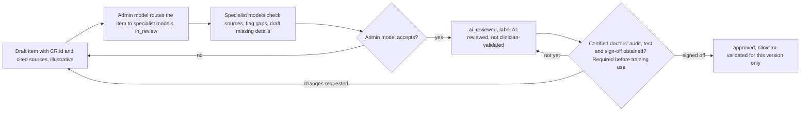
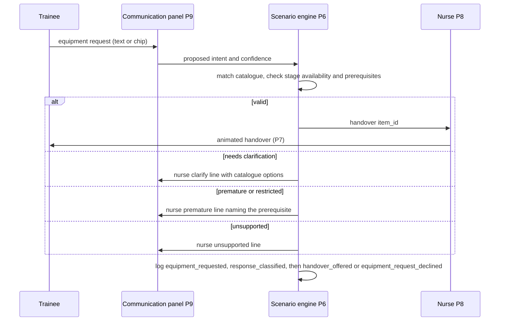
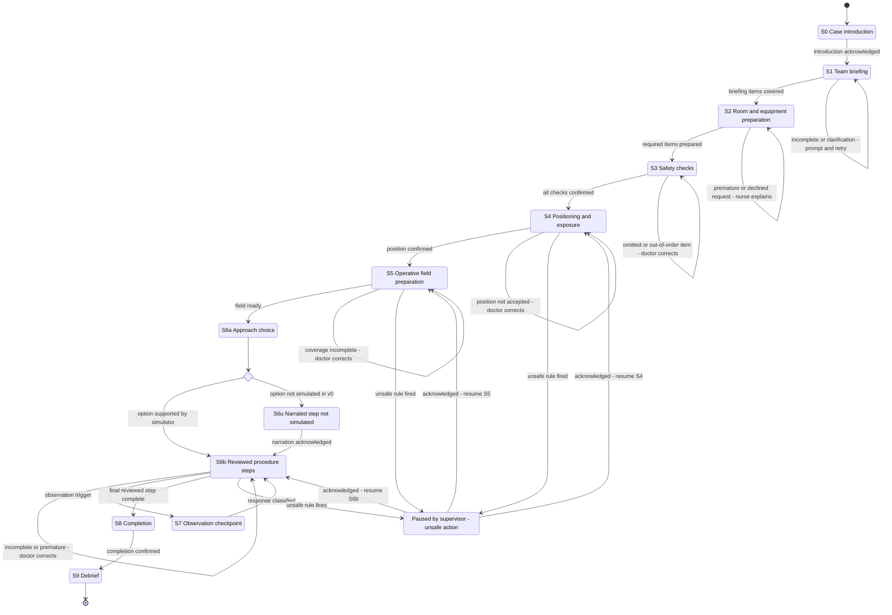

# 06 — Appendicitis Case Workflow (first case, structural design)

This document designs the **structure** of the first training case the owner asked for, an appendicitis case, so the current simulator can grow into it. It covers stages, role boundaries, events, response classes, a data contract for the scenario engine (phase P6) and a clinical review register. It deliberately contains **no clinical content**. Every clinical decision point is an empty placeholder tagged **CLINICAL REVIEW REQUIRED (CR-nn)**. Each one is filled from cited source material, reviewed through the owner's review pipeline (decision D7, DECIDED 2026-11-14: an admin model with specialist models under it; §1.4), and always carries its true review label (§1.3). Certified doctors audit the content and test the simulator before it is adopted as training. The owner confirmed this on 2026-11-14 (D7 refined), so their sign-off is required before the case is used with real trainees; it is also RECOMMENDED before the case is presented externally or described as clinically accurate. Until then the case is built as a prototype. Statements about the repository carry status labels. Everything about the case itself is PLANNED.

**Status labels used:** VERIFIED (lead's browser run, cited R#/B#), TEST-VERIFIED (named passing repository test), SOURCE-INSPECTED, PARTIALLY VERIFIED, PLANNED, UNKNOWN. DATA-DERIVED (audit analysis) marks scratch-script arithmetic, which is never test-verified. **RECOMMENDATION** and **ASSUMPTION** mark non-facts. **CLINICAL REVIEW REQUIRED (CR-nn)** marks every clinical decision point.

**Related documents:** [README](README.md) · [01](01_PROJECT_UNDERSTANDING.md) · [02](02_CURRENT_STATE_AUDIT.md) (findings F01–F35) · [03](03_REQUIREMENTS_GAP_ANALYSIS.md) (gaps G01–G23) · [04](04_EXPERIENCE_AND_WORKFLOW_DESIGN.md) · [05](05_HAND_CONTACT_AND_MOVEMENT_OPTIONS.md) · [07](07_PRIORITIZED_IMPROVEMENT_ROADMAP.md) (P0–P11) · [08](08_TECHNICAL_DECISIONS_AND_OPEN_QUESTIONS.md) (DN1–DN6, D1–D10, unknowns) · [09](09_ACCEPTANCE_AND_VALIDATION_PLAN.md) (AC-P10-k, CRC-n) · [10](10_NEXT_IMPLEMENTATION_TASK.md) · [11](11_FULL_SESSION_SCENARIO.md) (full session script, S0–S9) · [REPOSITORY_EVIDENCE_INDEX](REPOSITORY_EVIDENCE_INDEX.md)

---

## 1. Purpose, boundaries and labelling of unreviewed content

### 1.1 What this document is and is not
- **It is** a stage skeleton, a role split, an event and response contract, and a review register. Phase P10 ("Appendicitis case v0 and training evaluation") fills these in, on top of P6 (scenario state model), P7 (two-hand interaction and handover), P8 (doctor and nurse characters) and P9 (communication panel). See [07](07_PRIORITIZED_IMPROVEMENT_ROADMAP.md).
- **It is not** clinical guidance. It does not claim that an appendectomy simulator exists. The ordering S0–S9 is a structural skeleton. The real sequence, and whether stages are merged, split, reordered or dropped, is **CLINICAL REVIEW REQUIRED (CR-13, CR-18)**.
- **The full session script is in [11](11_FULL_SESSION_SCENARIO.md).** It builds the complete scene-by-scene script of the first session on the same stage IDs S0–S9: cast and stations, the side chat and communication through actions, the supervisor intervention ladder, beats and branches for every scene, emergency branches, equipment availability, the state machine and the admin-model contracts. Its clinical lines are DRAFT and **CLINICAL REVIEW REQUIRED**. This document stays structural and keeps the CR register (§8).
- **Source of truth.** The orientation document `Nabd_v1.5_Repository_Review.md` named by the owner does not exist anywhere on disk. This document treats the repository as the source of truth. `docs/Nabd-v1.0-Change-Log.md:21` lists "appendectomy/laparoscopic and neck scenario entry points". No code backs that line; the only scenario is the generic 5-step drill (F21, F35) **[SOURCE-INSPECTED]**.

### 1.2 Hard boundaries for this case
1. **The scenario definition is the only source of clinical content.** The doctor, nurse, patient observations and evaluation read it. They never generate clinical facts, values or patient responses (brief §5).
2. **The deterministic simulator owns transforms.** Dialogue or language layers never drive hand, contact or instrument poses (DN2; already stated in `docs/Nabd-v0.22-Review-Board.md:56`).
3. **Placeholders stay visibly empty.** An unfilled clinical field renders as a neutral "pending review" token. It never falls back to a plausible-looking default. In particular, the demo constants in `src/ui/MonitorUI.js:36-45` (`dataAt`) must never be presented as case observations (F23, CR-25).
4. **No clinical numbers.** This document states no observation values, thresholds, doses, timings or scores. The only numbers in it are technical facts about the current code and assets (line numbers, coordinates, counts).

### 1.3 Labelling of unreviewed content (DN5, D7) — PLANNED
- Each scenario version carries `review.status`: `illustrative` → `in_review` → `ai_reviewed` → `approved` (for that exact version only) → `retired`. Any edit to an item returns it to `illustrative`.
- Each clinical item carries its own CR reference and status, so review can be partial and traceable.
- D7 (DECIDED 2026-11-14) sets three review levels, each with its own visible label:

| Review level | `review.status` | Meaning | Set by |
|---|---|---|---|
| Illustrative | `illustrative`, `in_review` | Draft or placeholder content; no review completed | Default for every new or edited item |
| AI-reviewed (admin model) — not clinician-validated | `ai_reviewed` | The owner's admin model and its specialist models have reviewed, cross-checked or drafted the item; no qualified clinician has validated it | The review pipeline, with an admin-model review record (§1.4) |
| Clinician-validated | `approved` | Certified doctors have audited, tested and signed off this exact version (record format in [09](09_ACCEPTANCE_AND_VALIDATION_PLAN.md) §6); required before adoption as training (D7, confirmed 2026-11-14) | A recorded human sign-off only |

- A case version takes the lowest level among the CR items that block P10. It is clinician-validated only when all of them are `approved` for that version.
- Below clinician-validated, the version's label appears in four places: at case start, beside the stage indicator, in the debrief header, and in exported event-log metadata. The debrief is titled "practice feedback", not "assessment". **RECOMMENDATION**
- Label texts (PROPOSAL, in the D3 middle register; the final wording goes through the language review of CR-22):
  - Illustrative: «محتوى تدريبي توضيحي — لم تتم مراجعته سريرياً»
  - AI-reviewed: «مراجعة آلية (admin model) — لم يُعتمد سريرياً بعد»
  - Clinician-validated: «معتمد سريرياً لهذا الإصدار»

### 1.4 Review process (D7, DECIDED 2026-11-14) — PLANNED
Owner: «رح يكون في عنا اللي هو الـ admin model. رح يكون في تحتي أكثر من موديل مختصين، هو اللي رح يقيم العملية، هو اللي رح يراجع الحالة، هو رح يعمل باقي التفاصيل.» ("We will have the admin model, with several specialist models under it. It evaluates the operation, reviews the case and works out the remaining details.")

Refinement, the owner's second message of 2026-11-14: «الترخيص اللازم رح يتم تدقيقه من قبل أطباء معتمدين» ("the necessary licensing will be audited by certified doctors") and «رح يتم أخذ الترخيص اللازمة وتجريبه من قبل أطباء قبل اعتماده كتدريب» ("the necessary approvals will be obtained, and it will be tested by doctors before it is adopted as training"). The human stage below is therefore CONFIRMED as the gate for `approved` and for training use. For now the simulator is built as a prototype («بدنا نبني التجربة كتجربة حالياً», "we want to build the experience as an experience for now").



| Step | Who | Works on | Output |
|---|---|---|---|
| Draft | Authors (engineering, the owner) or the admin model filling in remaining details | One scenario item with its CR reference and source fields | Draft item; status `illustrative` |
| Route | Admin model | The item and its register row (§8) | Specialist model(s) chosen from the "Reviewer role" column; status `in_review` |
| Specialist review | Specialist models | The item and its cited sources | Findings, corrections, cross-checks |
| Accept | Admin model | The specialist findings | Review record (model and version, date, findings, sources checked); status `ai_reviewed` |
| Human sign-off (required before adoption as training; D7 confirmed 2026-11-14) | Certified doctors named by the owner | The exact version, audited and tested hands-on in the app | Record in the [09](09_ACCEPTANCE_AND_VALIDATION_PLAN.md) §6 format; status `approved` |
| Session evaluation | Admin model | The exported session record: event log, chat transcript, response classes, interventions | Rubric results, findings and debrief text, labelled with the content's review level (contracts in [11](11_FULL_SESSION_SCENARIO.md) §9–§10) |

**Rules (PLANNED).**
- **Machine-reviewable content.** Every clinical item has a CR id, source fields, a review status and a reviewer identity (P6 schema, §6).
- **Exportable sessions.** The session record is exported before any reset (`exportJSON`, `src/simulation/EventLogger.js:76`; today a reset wipes the log, F24), so that the admin model can evaluate it (P10).
- **Authoring time, not run time.** The admin model works on the scenario definition and on exported session records. During a session the deterministic scenario state classifies every response, and no model generates clinical content (§1.2; DN2).
- **No self-promotion.** Details that the admin model fills in enter as drafts; without a human sign-off they can reach `ai_reviewed` at most.
- **Honesty note.** AI review can draft, cross-check and evaluate. It does not equal validation by a qualified clinician for medical-education claims. The certified doctors' sign-off is required before use with real trainees (confirmed by the owner) and RECOMMENDED before external presentation or any claim of clinical accuracy.
- **Open points.** The owner's models run both locally and online (D2 refined 2026-11-14). For the online path, which session data may leave the device, and under what privacy notice, is still open ([04](04_EXPERIENCE_AND_WORKFLOW_DESIGN.md) §12 Q10). Who the certified doctors are is the owner's to name.

---

## 2. What already exists and can be reused, and what is missing

### 2.1 Reusable pieces

| Capability | Where | Status | Use in this case | Limits that matter |
|---|---|---|---|---|
| Internal atlas: 35 structures, including `cecum`, `appendix`, `mesoappendix` | `src/patient/InternalAnatomy.js:1-12` (labels; line 9), `loadInternalAnatomy` 17-82, attached to `patient.root` at 55; attribution `index.html:114`; `assets/anatomy/PROVENANCE.md` | **VERIFIED R14**: 35 structures, attribution, organ list. Appendix itself **PARTIALLY VERIFIED** (not clearly distinguishable). See [evidence/08-internal-anatomy-atlas.jpg](evidence/08-internal-anatomy-atlas.jpg) | Orientation and structure-identification tasks | Fitted to landmarks, not registered from imaging. Rigid, not bound to bones. Opening anatomy ends trainee mode and any drill (F29, F31). Fitness for teaching is CR-14 |
| Abdominal work point and remote-centre port | `src/app/NabdRuntime.js:4958` (`workRegions.abdomen`), 5014-5022 `workTarget`, 5257-5260 `trainingPort`; `src/instruments/InstrumentKinematics.js:3-153` `createInstrumentDepth` | `createInstrumentDepth` port alignment and pivoting **TEST-VERIFIED** (`tests/instrument-depth.test.js`, "scope must align to the selected port before insertion" and "scope pivots around the selected port after insertion; roll is independent"; mocked crew). `workTarget` and `trainingPort` **SOURCE-INSPECTED** only. Runtime not exercised: **UNKNOWN** | A "port alignment and insertion" step type | One port at a time. No trocar mesh. Allowed only in phases `idle`/`complete` (guard at 5156), so it is free practice today |
| Scope feed | `src/instruments/EndoscopeFeed.js:2-141`; scope layer `InternalAnatomy.js:29-36` | **TEST-VERIFIED** `tests/scope-feed.test.js` (proxy path, mocks). Atlas path **SOURCE-INSPECTED**. Image **UNKNOWN** | A "scope navigation and identification" step type | "Live" is a height test only (`EndoscopeFeed.js:96`). No wall, peritoneum or collision. Second scene render per frame (F20) |
| Grasper and scope instruments | `src/staff/CrewController.js:185-251` | **SOURCE-INSPECTED**. `tests/instrument-config.test.js` covers config only | Pick, carry, port steering | One `tool` group, one visible tool. Grasper has no jaw state. Scissors and needle holder get NaN blade geometry (F19; `CrewController.js:232-233`): scissors **VERIFIED R20** ([evidence/10](evidence/10-scissors-without-blades.jpg)); needle holder **SOURCE-INSPECTED** (same code path, not selected at runtime) |
| Supervisor tool hand-off (`offered` / `returning` / `returned`) | `CrewController.js:344-354`; `NabdRuntime.js:5531-5536` `resetTool`, 5614-5641 | Source select **VERIFIED R17**. Handover not exercised: **SOURCE-INSPECTED** | Starting point for doctor-to-trainee handover | Tool teleports on release. No animated transfer. Supervisor only |
| Supervisor physical support | `CrewController.js:143-175` `reachSupport`; `NabdRuntime.js:5484-5517` | **VERIFIED R11** ([evidence/04](evidence/04-supervisor-support-hand.png), [05](evidence/05-after-release-forearm-supported.jpg)) | Pattern for "doctor assists or demonstrates" (intervention level L4, [11](11_FULL_SESSION_SCENARIO.md) §4) | A logical flag; nothing physically holds the limb (F12). Forearm drill only |
| Vitals monitor surface | `MonitorUI.js` `createVitals`; per-frame call at `NabdRuntime.js:5983`; 3D monitor tap at 6080 | **SOURCE-INSPECTED**. The canvas is labelled "DEMO SIGNALS" | Display surface and dialog only | Values are not linked to anything. The static device screens at `NabdRuntime.js:4099-4108` conflict with it (F23) |
| Event logging | `src/simulation/EventLogger.js:1-15` (13 types; unknown types throw `RangeError` at line 52 in `record`); `src/simulation/SimulationManager.js:18` channel `'simulation:event'` | **TEST-VERIFIED** `tests/event-logger.test.js`, `tests/simulation-manager.test.js`. Runtime **VERIFIED R15/R16** | Event stream for rules, evaluation and debrief | Recorded only inside a session. Wiped by reset (`NabdRuntime.js:5700`, 5952) (F24) |
| 5-step drill | `NabdRuntime.js:5665-5743` (`setPhase`, step table 5669-5677, `startScenario` 5712, `confirmOxygen` 5721, `handleAction` 5735) | Start and step 1 of 5 **VERIFIED R15** ([evidence/09](evidence/09-training-step-1-of-5.jpg)); steps 2–5 and completion **SOURCE-INSPECTED** (not exercised at runtime) | **Format pilot**: P6 migrates it first | Inline and hard-coded. The result always reads 5/5 (5695) (F21, F24) |
| Privacy filter | `src/interaction/target-filter.js:3-12` | **TEST-VERIFIED** `tests/target-filter.test.js` (mock objects only) | Patient dignity during exposure (S4) | In anatomy view the protected region is hidden, not blurred (`InternalAnatomy.js:44`, SOURCE-INSPECTED). Only the single-material branch is reached at runtime, because the loader splits primitives |
| QA automation surface | `NabdRuntime.js:6104-6154` `window.__studioQA` (`?qa`) | **SOURCE-INSPECTED** (F32) | Scenario regression tests (P11) | No test uses it yet |

### 2.2 Missing, all "Does not exist"
- **Scenario and case logic.** No scenario file, rule engine, equipment catalogue or availability model (F21; G19, G21).
- **Dialogue.** No doctor or nurse dialogue, text input or speech (F22; G16–G18).
- **People.** No nurse (F13; G05, G17). No trainee body (F06; G03).
- **Interaction.** No whole-body contact or region identification (F15–F17; G11–G13). No simultaneous two-hand use (F18; G14).
- **Patient and evaluation.** No patient observation model (F23; G20). No evaluation or debrief (F24; G22).
- **Sterility.** Sterile and non-sterile appear only as comments and material names, for example `NabdRuntime.js:4366` "scrub-nurse side".
- **Tissue behaviour.** Nothing exists beyond the abdominal press/pinch patch (Section 10).

**G21 classification: "Does not exist."** The reusable pieces above are infrastructure, not case content.

---

## 3. Roles in this case (boundaries only)

| Role | Today | Planned representation | Owns in the simulation | Must not | Driven by |
|---|---|---|---|---|---|
| Trainee | Camera plus two floating gloved forearms (F06; **VERIFIED R4**, R10) | Full body with the camera at its eyes, an in-house instance of the existing clothed body (P3; D1 DECIDED: A+) | Physical actions, panel replies, decision choices, equipment requests | — | Learner input |
| Supervising doctor | `supervisor.glb` full body visible (**VERIFIED R4, R13**); forearm support **VERIFIED R11**; silent, posed in code, teleports between positions (F11; **SOURCE-INSPECTED**) | Behaviour layer (P8) and lines (P9) | Briefing, instructions, questions, acknowledgement, calm correction, delivering the debrief. Interventions along the ladder L0–L6 ([04](04_EXPERIENCE_AND_WORKFLOW_DESIGN.md) §8.3, [11](11_FULL_SESSION_SCENARIO.md) §4), including physical assistance and an emergency take-over, where the scenario defines them (CR-27); intervening is not a failure state | Invent facts or values. Perform actions the trainee is assessed on unless defined. Move the trainee's hands | Scenario state (P6) plus the dialogue layer (P9; D2 DECIDED: the owner's model behind a validated adapter) |
| Nurse | None (F13; absence **VERIFIED R13**) | Full-body character copied from the same existing body (P8; D1 DECIDED: A+): a woman of ordinary appearance with a hair cover and a mask (D1 refined 2026-11-14), at a station from P4 | Answering equipment requests and availability questions, clarification, handover, room preparation, all within the scope set by CR-26 | Hand over items the current stage restricts. Make clinical decisions for the trainee | Scenario availability rules |
| Patient | `patient.glb` supine; no clips, morphs, breathing or face motion (G02, G20) **[SOURCE-INSPECTED]** | State container (P6), observation model (P10) | Pose, exposure, prepared-region flags, observation values | Show any value or response absent from the reviewed definition. Consciousness and communication are CR-16 | Scenario state only |
| Scenario engine (not a character) | Only `setPhase` | P6 | Stage, expected actions, response class, equipment availability, evaluation | — | Deterministic rules over events |

Who may assume which responsibility is clinical. So are an anaesthesia role (equipment exists in the room, no character does), whether any other team member is represented, what each person wears at each stage, and where each person stands. All are **CLINICAL REVIEW REQUIRED (CR-26, CR-27, CR-30, CR-31, CR-32)**. The experience-level behaviour of each role (states, body language, panel lines) is designed in [04](04_EXPERIENCE_AND_WORKFLOW_DESIGN.md) §2.

---

## 4. Case stage skeleton S0–S9

**Conventions used in this section**
- **Existing events** are already in `SUPPORTED_EVENTS` (`EventLogger.js:1-15`).
- **New events** are PLANNED. Because the logger rejects unknown types (`EventLogger.js:52`, `RangeError` in `record`), each one requires a whitelist extension in P2/P6.
- **Readiness** names the phase that delivers the capability.
- Every "learning intent", "availability rule" and "patient-state output" below is a placeholder.
- Every "(CR-nn)" reference in these tables means **CLINICAL REVIEW REQUIRED (CR-nn)**; the item is defined in Section 8.
- The stage order S0–S9 is structural only; which stages exist, their order and their prerequisites are CR-13 and CR-18.
- The full scene-by-scene script for these stages (beats, branches, supervisor interventions and emergency branches) is [11](11_FULL_SESSION_SCENARIO.md) §5–§6. It refines S6 into draft sub-scenes on a draft laparoscopic path; the choice of approach remains CR-11.

New events (PLANNED, names provisional; the working vocabulary is [04](04_EXPERIENCE_AND_WORKFLOW_DESIGN.md) §7.2, and the canonical names and fields for implementation are in [11](11_FULL_SESSION_SCENARIO.md) §9.2, which maps each name below as an alias):
- **Dialogue and decisions:** `message_sent`, `decision_selected`, `response_classified`, `correction_issued`, `staff_line_delivered`.
- **Equipment:** `equipment_requested`, `handover_offered`, `handover_completed`, `equipment_request_declined`.
- **Checks and patient:** `check_item_confirmed`, `patient_state_changed`, `contact_started` / `contact_slide_summary` (with the region from P5 region identification), `observation_viewed`.
- **Case flow:** `approach_selected` (a typed `decision_selected`), `debrief_viewed`.

Stage entry reuses `simulation_stage_changed`, extended in P6 by `stage_entered` / `stage_completed`.

### S0 — Case introduction
| Aspect | Content |
|---|---|
| Learning intent | Placeholder (CR-01) |
| Physical actions | Look around, approach the bedside (camera movement) |
| Dialogue / decisions | Acknowledge, ask questions; optional chips such as "ready" / "need more information" |
| Doctor | Presents the case text from the definition (CR-02). Answers only from a defined question set; anything else gets "not available in this case" |
| Nurse | At station; not addressed |
| Equipment rule | Placeholder (CR-06). Technical default until reviewed: every item `restricted` (deny by default, not a clinical statement) |
| Patient-state outputs | Initial state record (CR-03, CR-16) |
| Events | Existing: `simulation_started`, `simulation_stage_changed`, `camera_changed`. New: `message_sent`, `decision_selected` |
| Evaluation hooks | Questions asked by intent (informational; weighting CR-20) |
| CR / readiness | CR-01, CR-02, CR-03, CR-16, CR-22 · P6, P9 |

### S1 — Team briefing
| Aspect | Content |
|---|---|
| Learning intent | Placeholder (CR-05) |
| Physical actions | None required; may turn to the speaker |
| Dialogue / decisions | Answer the doctor's questions by chip or free text; state planned items (intents per CR-05) |
| Doctor | Leads; asks defined questions; classifies answers (Section 5) |
| Nurse | Confirms readiness statements drawn from scenario data (CR-26) |
| Equipment rule | Placeholder (CR-06) |
| Patient-state outputs | Unchanged |
| Events | New: `message_sent`, `decision_selected`, `response_classified` |
| Evaluation hooks | Briefing items covered or missed; clarification count (CR-20) |
| CR / readiness | CR-05, CR-22, CR-26 · P6, P8, P9 |

### S2 — Room and equipment preparation
| Aspect | Content |
|---|---|
| Learning intent | Placeholder (CR-06) |
| Physical actions | Move to stations, inspect the trolley, receive handovers, place items at defined locations (P7 controlled placement) |
| Dialogue / decisions | Request items from the nurse by text or chip; ask about availability |
| Doctor | May ask why an item is needed, or redirect the request to the nurse, depending on the teaching objective (brief §4; CR-07) |
| Nurse | Applies the availability rule: hands over, declines with a reason code, or asks for clarification |
| Equipment rule | Per item and stage: `available` / `restricted` / `not_in_case`. Values CR-06, CR-07 |
| Patient-state outputs | Unchanged |
| Events | Existing: `instrument_picked`, `instrument_released`, `instrument_pick_failed`. New: `equipment_requested`, `handover_offered`, `handover_completed`, `equipment_request_declined` |
| Evaluation hooks | Requests against the reviewed list; inappropriate or premature requests (CR-07, CR-18) |
| CR / readiness | CR-06, CR-07, CR-08, CR-26 · P4, P7, P8, P9. Back-table and Mayo-stand items are decorative, not pickable (`NabdRuntime.js:4367`, 4484) **[SOURCE-INSPECTED]**; they must become catalogue items |

### S3 — Safety checks
| Aspect | Content |
|---|---|
| Learning intent | Placeholder (CR-04) |
| Physical actions | Only if the reviewed checks require physical verification (CR-04); otherwise none |
| Dialogue / decisions | Confirm each check item when prompted; answer questions |
| Doctor | Leads or delegates, as CR-04 defines |
| Nurse | Participates as CR-04 and CR-26 define |
| Equipment rule | Placeholder (CR-06, CR-07). Which later stages require S3 to be complete is part of the prerequisite graph (CR-18); this document assumes no ordering |
| Patient-state outputs | Verification flags |
| Events | New: `check_item_confirmed`, `message_sent`, `response_classified` |
| Evaluation hooks | Each item confirmed, omitted or out of order (CR-04, CR-18, CR-20) |
| CR / readiness | CR-04, CR-18 · P6, P9. Candidate source type: recognised surgical safety checklist guidance as adopted by the reviewing institution |

### S4 — Patient positioning and exposure
| Aspect | Content |
|---|---|
| Learning intent | Placeholder (CR-09) |
| Physical actions | Adjust pose or limbs (existing presets through the pose-preset function `G` on minified line `NabdRuntime.js:5916`, which also leaves the workstation; limb grips via `createLimbDrag`, 5395-5428). Expose the region with cover meshes toggled by stage (PLANNED). Whether any of this is a trainee task at all is CR-09 |
| Dialogue / decisions | Confirm positioning; request positioning aids if the definition includes any (CR-09) |
| Doctor | Confirms or corrects |
| Nurse | Assists within the scope set by CR-26 |
| Equipment rule | Placeholder (CR-09) |
| Patient-state outputs | `pose`, `exposure` flags |
| Events | Pose changes are not logged today **[SOURCE-INSPECTED]**. Existing: `patient_interaction`. New: `patient_state_changed` (cause `positioning`) |
| Evaluation hooks | Final pose against the reviewed target (tolerance CR-09). The joint state is exposed today only through the `?qa` hook `window.__studioQA.getJoints` (`NabdRuntime.js:6104-6154`); P6 needs a production accessor |
| CR / readiness | CR-09, CR-23 · P5, P6. Privacy patch retained (`target-filter.js`) |

### S5 — Preparation of the operative field
| Aspect | Content |
|---|---|
| Learning intent | Placeholder (CR-10) |
| Physical actions | Candidate simulator step types only, to be confirmed or replaced by CR-10: a coverage action over a skin region (P5 region identification plus coverage tracking), and stage-toggled static meshes for any covering the reviewed content defines |
| Dialogue / decisions | Request materials; state the method or extent if asked (content CR-10) |
| Doctor | Observes; corrects |
| Nurse | Provides materials according to availability |
| Equipment rule | Placeholder (CR-10) |
| Patient-state outputs | Candidate fields `fieldPrepared[regionId]` (coverage fraction) and `draped`; their meaning and use are CR-10 |
| Events | New: `contact_started` / `contact_slide_summary` (region, coverage), `handover_completed`, `patient_state_changed` |
| Evaluation hooks | Coverage of the reviewed target region, sequence, sterility rules (CR-08, CR-10, CR-18) |
| CR / readiness | CR-08, CR-10, CR-23 · P5, P6. Today `patient_interaction.region` records the selected work region, not the contacted region (`NabdRuntime.js:5546`) |

### S6 — Procedure stages, including the approach choice
| Aspect | Content |
|---|---|
| Learning intent | Placeholder (CR-11, CR-13) |
| Structure | **S6a** approach choice (a decision). **S6b…S6n** procedure steps exactly as the reviewed sequence defines them (CR-13). Each step uses one simulator **step type**: verbal decision; instrument request or handover; port alignment and insertion; scope navigation and identification; region contact; narrated (unsupported) step |
| Physical actions | Per step type. Port and scope work reuse `createInstrumentDepth` and `createScopeFeed` |
| Dialogue / decisions | Choose and justify the approach (options CR-11); answer identification questions (CR-14) |
| Doctor | Asks, guides, may demonstrate (CR-27); pauses on an unsafe action |
| Nurse | Hands over instruments according to step availability (CR-07) |
| Equipment rule | Per step (CR-07); approach-dependent |
| Patient-state outputs | Step-completion flags; observation changes only where the definition specifies them (CR-15, CR-16) |
| Events | Existing: `endoscope_moved` (angles, insertion, tip), `instrument_picked`/`instrument_released`, `patient_interaction`. New: `approach_selected`, `response_classified`, `correction_issued` |
| Evaluation hooks | Matchers for each expected action; motion metrics from `endoscope_moved` (what is assessed: CR-20) |
| CR / readiness | CR-11–CR-15, CR-17, CR-27 · P6, P7, P8. P6 must lift the `idle`/`complete` guard (`NabdRuntime.js:5156`) so port and scope work can run inside a stage |

### S7 — Intra-procedure observations
| Aspect | Content |
|---|---|
| Learning intent | Placeholder (CR-15) |
| Structure | An observation checkpoint the definition can trigger from any stage between S4 and S8 |
| Physical actions | Look at the monitor or tap it (existing tap at `NabdRuntime.js:6080`) |
| Dialogue / decisions | Report the observation; choose a response (options CR-15) |
| Doctor | Asks; responds by response class |
| Nurse | Relays information only if the definition says so (CR-26) |
| Equipment rule | Unchanged unless the definition says otherwise |
| Patient-state outputs | Reviewed observation values only (CR-03, CR-16). The "DEMO SIGNALS" canvas is replaced by data-driven display, never reused (CR-25) |
| Events | Existing: `camera_changed`. New: `observation_viewed`, `decision_selected` |
| Evaluation hooks | Observation noticed or not; class of the response (CR-20) |
| CR / readiness | CR-03, CR-15, CR-16, CR-25 · P6, P9, P10 |

### S8 — Completion
| Aspect | Content |
|---|---|
| Learning intent | Placeholder (CR-19) |
| Physical actions | Return or hand back items to defined locations. Generalises the existing deposit check (`NabdRuntime.js:5631-5641`) |
| Dialogue / decisions | Confirm completion items (CR-19) |
| Doctor / nurse | Confirm; nurse receives items |
| Equipment rule | Accounting rule (CR-19) |
| Patient-state outputs | Final state snapshot |
| Events | Existing: `instrument_released`, `simulation_completed`. New: `handover_completed`, `check_item_confirmed` |
| Evaluation hooks | Completion items done or omitted |
| CR / readiness | CR-19 · P6, P7, P8 |

### S9 — Debrief
| Aspect | Content |
|---|---|
| Learning intent | Placeholder (CR-21) |
| Physical actions | None |
| Dialogue / decisions | Doctor-led reflection questions; free-text replies |
| Doctor | Presents rule outputs: timeline, classes per stage, omissions. Makes no judgement outside the rubric |
| Nurse | Optional (CR-26) |
| Equipment rule | Not applicable; all items `restricted` |
| Patient-state outputs | Frozen final state |
| Events | New: `debrief_viewed`. Export through `exportJSON` (`EventLogger.js:76`) **before** any reset, which today wipes the log (F24) |
| Evaluation hooks | Rubric (CR-20), applied by the admin model to the exported session record (D7, §1.4). The version's review-level label is shown unless it is clinician-validated (§1.3) |
| CR / readiness | CR-20, CR-21 · P6, P9, P10 |

---

## 5. Response classification for this case

These are templates only. Every `{line_id}` points into a reviewed dialogue table (CR-22). Nothing is generated text.

| Class | Structural definition | Detected from events | Detected from dialogue | Doctor template | Nurse template |
|---|---|---|---|---|---|
| **Valid** | Matches an expected action of the current stage, with all prerequisites met | The action's matcher fires; prerequisite set complete | Intent equals the expected intent, with confidence above the technical threshold set in P9 | `{ack_line}` then `{next_instruction}` | Hands over / confirms |
| **Incomplete** | The expected action started, but its completion criteria are unmet at a stage-exit attempt or time-out, or an answer covers only some of the required elements | Partial matcher (some required sub-events present) | Some required intent slots missing | `{prompt_missing_element}`, revealing no more than the hint policy allows (CR-21) | — |
| **Needs clarification** | Input maps to several items or intents, or confidence is too low | Ambiguous target (e.g. contact at a region boundary) | Several catalogue matches, or confidence below threshold | `{clarify_question}` | "Which `{category}` do you mean: `{option_a}` or `{option_b}`?" Options come from the catalogue only |
| **Premature / out of sequence** | Matches a later stage's action, or prerequisites are unmet | Matcher of a future action fires; prerequisites incomplete (CR-18) | Request for an item restricted in this stage | `{premature_line}` naming `{prerequisite_label}` | "That is not available yet; `{prerequisite_label}` is not complete." |
| **Unsafe** | Matches a **reviewed** unsafe rule (CR-17). Unreviewed rules fire only with the illustrative label | Unsafe-rule matcher | Unsafe-rule intent | Pause the stage; `{unsafe_line}`; reviewed explanation; trainee must acknowledge before resuming (pause and takeover policy CR-17, CR-27) | Withholds the handover |
| **Unsupported** | The simulator cannot represent the action or the request | No matcher or catalogue entry; known unsupported step type (Section 10) | Intent outside the case vocabulary | `{unsupported_line}` + `{narrated_alternative}` | "That item is not part of this simulation." |

**RECOMMENDATIONS**
- **Precedence** when several classes apply: unsafe → unsupported → premature → needs clarification → incomplete → valid. Unsafe must never be masked, and an unsupported action cannot be evaluated further.
- **Who decides the class.** Under D2 (DECIDED 2026-11-14: the owner's own model behind a validated adapter with a deterministic fallback, effectively option C), the model may only *propose* an intent, a reply and an action from the closed list, with a confidence. The deterministic rule engine validates the proposal against the scenario state and assigns the class; low confidence or an unavailable model yields "needs clarification".
- **Traceability.** Every class is logged as `response_classified` with the rule ID, so each line of the debrief traces back to a rule and its CR status.



---

## 6. Scenario definition schema sketch (for P6)

This is a sketch, not a final contract (P6 owns that). Clinical fields are `null` or reference a CR item. One stage is shown in full; the others follow the same shape.

```json
{
  "schemaVersion": "0.1-draft",
  "scenarioId": "appendicitis-case-v0",
  "version": "0.1.0",
  "title": { "ar": null, "en": "Appendicitis case v0 (illustrative)" },
  "review": {
    "status": "illustrative",
    "allowedStatuses": ["illustrative", "in_review", "ai_reviewed", "approved", "retired"],
    "approvedVersion": null,
    "reviewers": [
      { "kind": "admin-model", "modelId": null, "modelVersion": null, "specialistModels": [], "decision": null, "date": null, "covers": ["CR-01", "CR-07", "CR-13", "CR-26"] },
      { "kind": "human-clinician", "role": "general-surgeon", "name": null, "decision": null, "date": null, "covers": ["CR-01", "CR-13"] },
      { "kind": "human-clinician", "role": "perioperative-nurse-educator", "name": null, "decision": null, "date": null, "covers": ["CR-07", "CR-26"] }
    ],
    "sources": [
      { "id": "SRC-01", "type": "institutional-protocol", "citation": null, "edition": null, "usedFor": ["CR-04"] }
    ],
    "openItems": ["CR-01", "CR-02", "CR-03"]
  },
  "display": {
    "illustrativeLabel": { "ar": null, "en": "Illustrative training content - not clinically reviewed" },
    "aiReviewedLabel": { "ar": null, "en": "AI-reviewed (admin model) - not clinician-validated" },
    "showLabelUnlessStatus": "approved"
  },
  "roles": {
    "trainee": { "characterId": "trainee" },
    "doctor": { "characterId": "supervisor", "station": null, "lineTable": "doctor" },
    "nurse": { "characterId": "nurse", "station": null, "lineTable": "nurse", "scopeRef": "CR-26" },
    "patient": { "assetId": "patient" }
  },
  "equipment": [
    { "id": "item-01", "label": { "ar": null, "en": null }, "simulatorModel": null, "cr": ["CR-06", "CR-07"], "status": "pending" }
  ],
  "patientState": {
    "observations": [
      { "id": "obs-01", "label": null, "unit": null, "initial": null, "behaviour": null, "display": "monitor", "cr": ["CR-03", "CR-16"], "status": "pending" }
    ],
    "flags": { "names": ["positioned", "exposed", "fieldPrepared", "draped"], "cr": ["CR-09", "CR-10"], "status": "pending" }
  },
  "stages": [
    {
      "id": "S3",
      "name": { "ar": null, "en": "Safety checks" },
      "learningIntent": { "text": null, "cr": ["CR-04"] },
      "entry": { "requires": null, "cr": ["CR-18"] },
      "equipmentAvailability": { "item-01": "restricted" },
      "expectedActions": [
        {
          "id": "S3-A1",
          "kind": "dialogue",
          "matcher": { "event": "check_item_confirmed", "where": { "checkId": null } },
          "prerequisites": [],
          "required": true,
          "cr": ["CR-04"]
        }
      ],
      "rules": [
        {
          "id": "S3-R1",
          "class": "premature",
          "when": { "event": null, "before": null },
          "doctorLine": "doctor.premature-01",
          "cr": ["CR-18"],
          "status": "illustrative"
        }
      ],
      "patientStateOutputs": [{ "on": "S3-A1", "set": { "flag": null } }],
      "evaluationHooks": [{ "id": "E-S3-1", "metric": "required-actions-completed", "weight": null, "cr": ["CR-20"] }],
      "exit": { "when": "allRequiredComplete" }
    }
  ],
  "dialogue": {
    "doctor": { "premature-01": { "text": { "ar": null, "en": null }, "cr": ["CR-22"], "status": "pending" } },
    "nurse": {}
  },
  "responseClasses": ["valid", "incomplete", "needs_clarification", "premature", "unsafe", "unsupported"],
  "evaluation": { "rubricRef": null, "criticalItems": [], "cr": ["CR-20"] },
  "debrief": { "sections": ["timeline", "classesPerStage", "omissions", "observationsNoticed"], "cr": ["CR-21"] }
}
```

**Field notes (structure only, no clinical content)**
- `equipment[].simulatorModel` names how an item is represented: one of the existing instrument models (`grasper`, `scope`, `scissors`, `needleHolder`; `CrewController.js:194-199`), a future catalogue model, or `"narrated"`. Which real items the case uses is CR-06 and CR-07.
- `review.reviewers[].kind` is `admin-model` (the D7 pipeline; it can lift items to `ai_reviewed`) or `human-clinician` (the certified doctors' sign-off, required before adoption as training; only it can lift items to `approved`). Section 1.3 maps the statuses to the visible labels.
- `entry.requires` takes a list of stage-completion conditions of the form `"<stageId>.complete"`; the actual list is CR-18.
- `rules[].when` takes an event type from the logger whitelist and an optional stage-completion condition (`before`); both are filled only from reviewed content (CR-17, CR-18). The class `premature` above shows the shape, not a rule.

**Validation rules for P6 (RECOMMENDATION)**
- The loader refuses `status: "approved"` while any `cr` item in the file is still open.
- `ai_reviewed` requires an `admin-model` review record for every CR item it covers; `approved` requires a `human-clinician` record with a decision for every covered CR item. An admin-model record alone never yields `approved` (§1.3–§1.4).
- Every `doctorLine` or nurse line resolves to an entry in the dialogue table.
- Every `matcher.event` and `rules[].when.event` is in the logger whitelist as extended in P2/P6 (`check_item_confirmed` in the example is a new event, not yet in `EventLogger.js:1-15`).
- **The 5-step drill is migrated first.** It is encoded in this format (`scenarioId: "clinical-skills-practice"`) and must reproduce today's behaviour before any appendicitis content is added. This is the format pilot named in P6.

---

## 7. Stage flow with correction loops



**Reading notes**
- `Paused` resumes the stage that raised it (the engine stores the origin). Which rules exist and where they apply is CR-17.
- The `approach` choice, and whether a non-simulated option is offered at all, is CR-11.
- Whether S7 can also fire during S4, S5 or S8 is set by the definition (CR-15).

---

## 8. Clinical review register

**Review route (D7, DECIDED 2026-11-14; §1.4).** Every item is first reviewed by the owner's admin model, which routes it to the specialist model that matches the "Reviewer role" column and records the result (`ai_reviewed`). The same column names the human specialty for clinician validation (`approved`) by certified doctors, which the owner confirmed on 2026-11-14 as required before the simulator is adopted as training. Reviewer roles are roles, not names; naming the doctors stays with the owner under D7. "Blocking phase" is the phase that cannot be called complete for this case until the item reaches the review level the owner sets for it: `ai_reviewed` at minimum for the prototype under D7, and `approved` before use with real trainees. The matching checkpoints (CRC-n) and acceptance criteria (AC-P10-k) are defined in [09](09_ACCEPTANCE_AND_VALIDATION_PLAN.md). Clinical items raised by the full session script in [11](11_FULL_SESSION_SCENARIO.md) are numbered from CR-34 (11 §13); they follow the same rules and are registered below as CR-34 to CR-42 (rows taken from 11 §13.1, which also keeps the prototype-slice notes; this register is canonical, and each row's checkpoint is in [09](09_ACCEPTANCE_AND_VALIDATION_PLAN.md) §6).

| ID | Item | Why it needs review | Proposed source type | Reviewer role (specialist-model route; human specialty of the certified doctors) | Blocks |
|---|---|---|---|---|---|
| CR-01 | Target learner level and learning objectives | Determines everything else; not stated in the brief | Curriculum documents of the target programme | Clinical education lead + surgeon | P10 |
| CR-02 | Case presentation narrative | Clinical facts about the patient | Reviewed case-writing by faculty | General surgeon | P10 |
| CR-03 | Initial observations and their display | Values must not be invented (brief §5) | Institutional protocols; peer-reviewed references chosen by reviewers | Anaesthesia clinician + surgeon | P10 |
| CR-04 | Pre-procedure safety-check items, who leads, order | Patient-safety content | Recognised surgical safety checklist guidance as adopted locally | Theatre nurse lead + surgeon | P10 |
| CR-05 | Team briefing content and expected trainee contributions | Clinical and team-practice content | Institutional theatre protocols | Surgeon + nurse educator | P9 content, P10 |
| CR-06 | Room setup and equipment present for this case | Defines the catalogue and availability | Institutional preference lists / protocols | Perioperative nurse educator | P10 (P4 stations are generic) |
| CR-07 | Instruments and items per stage; request and handover rules | Availability logic for the nurse | Institutional protocols; surgical texts | Perioperative nurse educator + surgeon | P8 behaviour content, P10 |
| CR-08 | Sterility rules represented, and how breaches are handled | Safety-critical; no sterility logic exists | Perioperative nursing standards | Perioperative nurse educator | P10 |
| CR-09 | Patient position, exposure, positioning aids, pose tolerance | May need poses that do not exist (Section 10) | Institutional protocols | Surgeon + anaesthesia clinician | P10 (pose authoring) |
| CR-10 | Operative-field preparation: agent, method, extent, any timing requirement, covering or draping, and whether any of it is a trainee task | Explicitly reserved by the brief §8 | Local skin-preparation policy; national guidance | Surgeon + infection-prevention nurse | P5 region set, P10 |
| CR-11 | Approach options offered and how the choice is judged | Clinical decision-making | Specialty-society guidance; surgical texts | General surgeon | P10 |
| CR-12 | Access sites (ports or incision) and their representation | Explicitly reserved by the brief §8 | Surgical texts; institutional practice | General surgeon | P10 |
| CR-13 | Procedure step sequence and step types (physical / verbal / narrated) | Core clinical sequence | Surgical texts; faculty consensus | General surgeon | P6 case file, P10 |
| CR-14 | Fitness of the BodyParts3D atlas for identification teaching | Atlas is fitted to landmarks and rigid (F29) | Anatomy references | Anatomist or surgeon | P10 |
| CR-15 | Intra-procedure observation checkpoints, triggers, expected responses | Patient-response content | Peer-reviewed references chosen by reviewers | Surgeon + anaesthesia clinician | P10 |
| CR-16 | Patient-state model: what changes, why, how it is shown; level of consciousness or communication | Brief forbids invented responses | As CR-15 | Anaesthesia clinician | P10 |
| CR-17 | Unsafe-action rules and the correction wording | Safety-critical classification | Institutional policy; faculty consensus | Surgeon + nurse educator | P6 rule content, P10 |
| CR-18 | Prerequisite graph (premature / out-of-sequence rules) | Encodes the sequence | As CR-13 | General surgeon | P6 rule content, P10 |
| CR-19 | Completion items, post-procedure tasks, item accounting | Clinical and safety content | Institutional protocols | Theatre nurse lead | P10 |
| CR-20 | Evaluation rubric, critical items, weighting, pass criteria | Brief §5 reserves evaluation rules | Published structured assessment instruments selected by reviewers | Clinical education lead + surgeon | P10 |
| CR-21 | Debrief content, hint policy, feedback wording | Educational validity | Established simulation-debriefing frameworks | Simulation educator | P10 |
| CR-22 | All doctor and nurse lines | Clinical content and tone | Derived from CR-02 to CR-21 | Surgeon + nurse educator + language reviewer (D3) | P9 content, P10 |
| CR-23 | Visual depiction levels (Section 9) | Brief §8 restraint | Faculty judgement; institutional media policy | Clinical education lead | P10 visuals |
| CR-24 | Arabic clinical terminology (atlas labels `InternalAnatomy.js:1-12`, instrument labels `index.html:208-213`) | Existing labels are unreviewed | Recognised Arabic medical terminology references | Arabic-speaking clinician | P10 |
| CR-25 | Handling of the existing demo monitor and static device screens during the case | Their hard-coded numbers could be read as case data (F23) | — (product decision, then clinical confirmation) | Anaesthesia clinician | P10 |
| CR-26 | Nurse scope: which requests the nurse fulfils, declines or escalates | Professional role boundary | Nursing scope-of-practice documents | Perioperative nurse educator | P8 content, P10 |
| CR-27 | When the doctor may demonstrate or take over | Teaching and safety policy | Faculty policy | Surgeon | P8 content, P10 |
| CR-28 | Whether any medication, fluid or anaesthesia events appear at all, and if so their content | High-risk content; none exists today | Institutional formularies and protocols | Anaesthesia clinician + pharmacist | P10 |
| CR-29 | Case pacing: time compression and narrated skips | Changes clinical realism | Faculty judgement | Simulation educator + surgeon | P10 |
| CR-30 | Other team members represented (e.g. an anaesthesia role) | The brief names only doctor and nurse | Faculty judgement | Surgeon + anaesthesia clinician | P8 scope, P10 |
| CR-31 | Clinical attire and protective equipment for the trainee, doctor and nurse at each stage (the brief names gowns, gloves and masks) | The brief asks for "scenario-appropriate" clothing; no rule exists in the code or assets | Institutional theatre attire policy; perioperative nursing standards | Perioperative nurse educator + surgeon | P3/P8 clothing content, P10 |
| CR-32 | Team positions around the table, the trainee's working side for this case, and where handovers take place | The current +X trainee stance is a technical calibration, not a clinical choice ([04](04_EXPERIENCE_AND_WORKFLOW_DESIGN.md) §3) | Institutional practice; surgical texts | General surgeon + perioperative nurse educator | P10 (P4 and P8 build generic stations) |
| CR-33 | Abdominal surface sub-region map: whether any contact feedback or rule refers to an abdominal sub-region, and if so, the boundaries of each sub-region | Bone weights cannot separate abdominal sub-regions ([05](05_HAND_CONTACT_AND_MOVEMENT_OPTIONS.md) §3(c)), so a separately authored map is needed, and its boundaries carry clinical meaning | Anatomy references; surgical texts | General surgeon or anatomist | P5 region set (only if region-specific meaning is attached), P10 |
| CR-34 | The trainee's operative role per stage and S6 sub-step (observer, assistant, scope holder or operator under supervision), and which sub-steps are performed by the trainee, performed by the supervisor, or narrated (raised in [11](11_FULL_SESSION_SCENARIO.md) §13) | It sets the S1 role line, the S6 beats and what is evaluated | Curriculum documents; faculty policy | Clinical education lead + general surgeon | P6 case file, P10 |
| CR-35 | Take-over and pause policy beyond CR-27 (which keeps when the doctor may take over): what justifies L6, the trainee's task during a take-over, and the criteria for handing control back or ending the case (11 §13) | Safety and teaching policy beyond CR-27 | Faculty policy; simulation-education guidance | General surgeon + simulation educator | P8 behaviour content, P10 |
| CR-36 | The supervisor's physical assistance to the patient (L4): which lifts, holds and repositionings are appropriate, safe ranges and support, and who performs them (11 §13) | The owner's example «يمد إيده، يشيل إيد المريض» is patient handling with clinical target poses | Positioning protocols; perioperative standards | General surgeon + anaesthesia clinician + perioperative nurse educator | P8 behaviour content, P10 |
| CR-37 | Expected safe trainee behaviour, and the team's recovery steps, when the scope image is lost (E0) (11 §13) | E0's mechanics are non-clinical, but the expected behaviour is a safety rule | Surgical texts; institutional practice | General surgeon + perioperative nurse educator | P10 |
| CR-38 | Emergency branch E1 (bleeding): inclusion in v0, triggers, cues and depiction level (with CR-23), expected responses of the trainee, nurse and doctor, equipment, resolution, debrief points; any medication, fluid or blood-product content (CR-28) (11 §13) | Clinical event content; visual restraint | Surgical texts; peer-reviewed references chosen by reviewers | General surgeon + anaesthesia clinician + simulation educator + pharmacist where CR-28 content is included | P10 |
| CR-39 | Emergency branch E2 (change in monitored status): inclusion, which observations change (values via CR-03, CR-15, CR-16), cues, team roles without an anaesthesia character (CR-30), responses, resolution; any medication, fluid or anaesthesia event (CR-28) (11 §13) | Patient-response content; no invented values | Peer-reviewed references and institutional protocols | Anaesthesia clinician + general surgeon + pharmacist where CR-28 content is included | P10 |
| CR-40 | Causal links from trainee actions to E1 or E2: whether any unsafe action may trigger one, which, and whether that suits the learner level (CR-01) (11 §13) | Encodes clinical cause and effect; affects fairness | Faculty consensus; simulation-education guidance | General surgeon + simulation educator | P6 rule content, P10 |
| CR-41 | The identification task (S6.3, A3): target structures and landmarks, the acceptance rule (view centre, dwell, naming), and whether the BodyParts3D atlas depiction suffices (with CR-14) (11 §13) | Anatomical teaching content and its acceptance rule | Anatomy references; surgical texts | Anatomist or general surgeon | P10 |
| CR-42 | Clinical flag of each dialogue intent (which intents may show free model text, which must use catalogue lines or case facts only) and the clinical term list used by the V4 screen (11 §13) | A wrongly flagged intent lets the model's free text reach the trainee as clinical content (D2) | Faculty policy; CR-22 and CR-24 sources | Clinical education lead + general surgeon + language reviewer (D3) | P9 adapter content, P10 |

---

## 9. Visual restraint guidance (brief §8, §10)

| Level | Meaning | Allowed in v0 |
|---|---|---|
| DL0 Abstracted | No depiction; narration or panel text only | Yes, the default for unsupported steps |
| DL1 Surface | Drapes, coverage highlight, subtle contact indication | Yes |
| DL2 Staged internal | Atlas structures in anatomy or scope view, with illustrative colours and attribution | Yes, labelled "illustrative anatomy (BodyParts3D)" |
| DL3 Detailed | Realistic wound, tissue or fluid depiction | Only with a reviewed learning objective and CR-23 sign-off; not planned for v0 |

**RECOMMENDATIONS**
- **No gratuitous detail.** No blood, fluid, smoke or tissue-damage effects in v0, and no pain or distress animation. No code drives the patient's face bones today **[SOURCE-INSPECTED]**; any use of them is CR-16 and CR-23.
- **Dignity.** Keep the baked privacy patch and its exclusion from targeting (`target-filter.js`). Expose regions only through stage-toggled covers (S4).
- **Honest feedback.** Visual contact feedback must stay visibly distinct from real deformation (brief §6). Only the abdominal patch actually deforms (Section 10).
- **Visual identity.** Preserve the muted teal interface identity, Arabic RTL and existing fonts (DN6). Under D10 (decided 2026-11-14) the lime-yellow equipment casing (F28) is replaced and the equipment is redesigned toward realism; during laparoscopic stages a screen with the live scope image stands close to the trainee (P4; AC-P4-7 to AC-P4-9 in [09](09_ACCEPTANCE_AND_VALIDATION_PLAN.md)). Which equipment a stage shows is CR-06.
- **Reduced motion.** Respect `prefers-reduced-motion`. The existing monitor already freezes under it (`MonitorUI.js`).
- **Minimal screen chrome.** The case runs with authoring and debug controls hidden (F25, handled in P2), so the stage indicator and panel stay the only chrome (brief §9).

---

## 10. What cannot be simulated credibly yet

| Capability a case may need | Current support (evidence) | Credible in v0? | Suggested v0 representation |
|---|---|---|---|
| Tissue cutting, dissection, division, suturing | None. `AbdomenSurface.js` only presses and lifts skin vertices inside `bounds` x ±0.153, z −0.244…−0.066 (line 16) **[SOURCE-INSPECTED]** | No | Narrated step (DL0), classed "unsupported" if attempted. Under D5 (decided 2026-11-14) a hand or instrument may enter the body only through an opening the stage declares; v0 declares no wound or incision, only the port |
| Handling the appendix or bowel | Atlas organs are rigid and attached to `patient.root`, not bones (`InternalAnatomy.js:55`). Share of organ vertices inside the deformable patch: appendix 0%, mesoappendix 11%, cecum 34% **[DATA-DERIVED (audit analysis)]** | No | Identification only (anatomy or scope view) |
| Instrument contact with organs or the abdominal wall | None. Scope "live" is a height test (`EndoscopeFeed.js:96`); the scope scene has no wall or peritoneum | No | Constrained port steering; identification questions |
| Several instruments or ports at once | One `tool` group, one gesture, one pointer (F18–F20) | Not before P7 | Sequential single-instrument steps |
| Scissors and needle holder | NaN blade geometry (`CrewController.js:232-233`): scissors **VERIFIED R20**; needle holder **SOURCE-INSPECTED** (same code path) | After the P1 fix: carry only | Carry, hand over, return |
| Grasper jaw action and grasping tissue | Static jaws (`CrewController.js:206-213`) | No | Positioning and insertion only |
| Physical gowning, gloving or personal preparation | Trainee has no body; gloves are always worn (F06) | No | Confirmation in the panel or narration (CR-08, CR-31) |
| Skin preparation as physical coverage | No coverage or decal system; whole-body region identification arrives in P5 | Partly, after P5 | Region contact plus confirmation; before P5, a region choice in the panel |
| Draping | No cloth simulation | Static only | Stage-toggled static meshes (P4, P10) |
| Positions other than supine, sitting or standing | Three preset targets; the whole body rotates rigidly (`NabdRuntime.js:4585` `hd`, 5916 `G`) | Only if the reviewed position is an existing preset (CR-09) | New pose authoring otherwise |
| Physiology and changing observations | Demo constants and sinusoids (F23) | Yes, as data-driven display of reviewed values; no physiological model | Observation table in the definition (CR-03, CR-16) |
| Patient speech, facial or pain response | None **[SOURCE-INSPECTED]** | No | Omitted, or doctor narration if reviewed (CR-16) |
| Nurse handover | No nurse (F13); the supervisor's tool teleports | After P7 and P8 | — |
| Sterility tracking | Comments only | Rule-based zone and object tags (PLANNED P6/P10); no contamination physics | Rule events from tagged contacts (CR-08) |
| Instrument and material accounting | No inventory | Catalogue state in P6 | Completion check (CR-19) |
| Force, haptics, resistance | None; the Rapier queries cover the forearm drill only (F15) | No | Visual feedback only, labelled as such |

**Net position (PLANNED).** v0 can credibly be a guided case driven by dialogue. Its physical tasks would be limited to the simulator capabilities below. Which of them the reviewed case actually uses, if any, is decided by CR-09, CR-10, CR-11 and CR-13; this list is not a statement about how the procedure is performed:
- positioning
- region contact (after P5)
- equipment requests and handovers (after P7/P8)
- port alignment and insertion
- scope navigation and structure identification
- reading observations

Everything else is narrated, labelled illustrative until reviewed, and logged as "unsupported" when attempted, so the gaps feed the roadmap. Building it needs P6, P7, P8 and P9 delivered and the D7 review pipeline running (§1.4); the certified doctors' audit, test and sign-off is required before use with real trainees (D7, confirmed 2026-11-14). Fidelity to the owner's full vision, such as tissue work, depends on later work that is not scheduled in [07](07_PRIORITIZED_IMPROVEMENT_ROADMAP.md).
