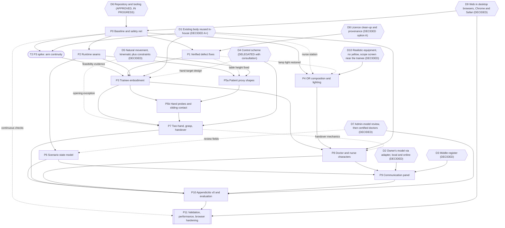

# 07 — Prioritized Improvement Roadmap

**Purpose.** This document turns the audit evidence into a staged plan of twelve phases, P0–P11. The evidence is the findings F01–F35 in [02](02_CURRENT_STATE_AUDIT.md), the gaps G01–G23 in [03](03_REQUIREMENTS_GAP_ANALYSIS.md) and the owner's experience brief. Each phase is tied to the actual files and functions of Nabd v1.5. Each one states its dependencies, what it must not disturb, and what evidence will prove it finished. The plan changes the existing Three.js r180 runtime step by step; it does not replace it. **Apart from T1 (all of P0 plus the F19 item of P1), which started on 14 November 2026 after the owner's approval, nothing in this roadmap has been started.** Every phase below is PLANNED, and each later phase begins only after its owner checkpoint (Section 6).

**Update of 14 November 2026.** The owner decided D1 (option A+: the existing body reused in-house for every person), D2, D3, D7 and D9; the decision log is in [08](08_TECHNICAL_DECISIONS_AND_OPEN_QUESTIONS.md). In a second message the same day he settled the rest:
- **D4** is delegated with consultation: the team picks the control scheme and asks him, with a recommendation, where the choice matters.
- **D5:** smooth, natural movement, with an opening exception.
- **D6** is approved, and T1 is in progress ([10](10_NEXT_IMPLEMENTATION_TASK.md) status note).
- **D8:** option A, by our reading of his general approval.
- **D10:** the yellow changes, the equipment is redesigned toward realism, and during laparoscopy a scope screen stands close to the trainee.

He also refined four decisions: D1 (a female nurse with a hair cover and a mask; changing features approved), D2 (the model runs locally and online), D7 (certified doctors audit and test before adoption as training) and D9 (the web in desktop browsers). The phases below reflect all of these. [11](11_FULL_SESSION_SCENARIO.md) turns them into the full session scenario that P6–P10 implement. Under the working agreement ([08](08_TECHNICAL_DECISIONS_AND_OPEN_QUESTIONS.md) decision log), proposals and improvements that arise during any phase go to the owner with a recommendation.

**Status labels used:**
- **VERIFIED**: seen in the audit's browser run (R1–R21) or build checks (B1–B5).
- **TEST-VERIFIED**: a named repository test passed.
- **SOURCE-INSPECTED**: the code was read but not executed.
- **PARTIALLY VERIFIED**, **PLANNED**, **UNKNOWN**: as defined in the [README](README.md).
- **DATA-DERIVED (audit analysis)**: computed by read-only audit scripts. It is never a test result.
- **CLINICAL REVIEW REQUIRED**: clinical content that needs qualified review before use.

**Related documents:** [README](README.md) · [01](01_PROJECT_UNDERSTANDING.md) · [02](02_CURRENT_STATE_AUDIT.md) · [03](03_REQUIREMENTS_GAP_ANALYSIS.md) · [04](04_EXPERIENCE_AND_WORKFLOW_DESIGN.md) · [05](05_HAND_CONTACT_AND_MOVEMENT_OPTIONS.md) · [06](06_APPENDICITIS_CASE_WORKFLOW.md) · [08](08_TECHNICAL_DECISIONS_AND_OPEN_QUESTIONS.md) · [09](09_ACCEPTANCE_AND_VALIDATION_PLAN.md) · [10](10_NEXT_IMPLEMENTATION_TASK.md) · [11](11_FULL_SESSION_SCENARIO.md) (full session scenario) · [Evidence index](REPOSITORY_EVIDENCE_INDEX.md)

**Input notes.**
- **Missing orientation document.** The owner named `Nabd_v1.5_Repository_Review.md`, but it does not exist anywhere on disk. The repository is therefore the source of truth.
- **Workstream letters.** The letters A–G are the owner's own workstreams from his task instructions (§4 of that request): A stabilise the foundation, B human characters and OR composition, C natural hands and body movement, D patient contact and collision, E doctor, nurse and communication, F scenario intelligence and the appendicitis workflow, G validation and training assessment. Section 3.1 maps each workstream to the gaps and phases. The owner allowed the workstreams to be reordered, split or combined; this roadmap splits them across phases rather than running them one after another.
- **Citation format.** Paths are relative to the repository root. Minified lines of `src/app/NabdRuntime.js` are cited as `line@byte`.

---

## 1. Ordering principles

### 1.1 Foundations before dependent features
- **The runtime is one shared closure.** `src/app/NabdRuntime.js` has 6,160 lines (748 KB) in one IIFE, with three.js r180 inlined. App code starts at line 3860@71276, and the render flag `I` is set in 38 places (F01). In that structure, a change in one subsystem can silently change another. So every change is made on top of a recorded baseline (P0). Seams (P2) come before large features.
- **Shared parts come before the parts that use them:**
  - the event stream (P2) before the scenario engine (P6);
  - the scenario engine before dialogue (P9);
  - character bodies (P3, P8) before characters that talk or hand items over;
  - whole-body contact (P5) before two-hand grasping (P7).
- **Clinical content comes last (P10).** It needs every mechanism to exist, and it needs the D7 review pipeline: the owner's admin model, then the sign-off of certified doctors, which the owner confirmed is required before adoption as training. Building it earlier would hard-code unreviewed content into unfinished systems.

### 1.2 Why the baseline comes first
- **No version control (F05).** There is no diff, no rollback and no record of what a change did.
- **Incomplete test results (F03).** The suite has 13 files with 21 cases, but `node --test` reports only 20 results, of which 19 pass. The one test aimed at a v1.5 feature, `tests/forearm-contact.test.js`, fails at import because the bare package `three` is not installed (B1).
- **Untested core (F02).** No test covers `NabdRuntime.js`, `CrewController.js`, `BedsideInteraction.js`, `AbdomenSurface.js`, `InternalAnatomy.js`, `MonitorUI.js` or `DiagnosticsPanel.js`. The tests use fakes or mocks (two only read real files: asset hashes and source import paths), and none runs the app's bundled three.js. The scissors defect (F19) is VERIFIED at runtime (R20), yet no test detects it.
- **Vite build not runnable (F04).** The Vite build could not be run in this audit because `vite` is not installed (no `node_modules`; B3). Whether it succeeds is UNKNOWN. The standalone preview build works (B4).
- **Frame rate unknown (F33).** Renderer counters are VERIFIED (R6), but FPS is UNKNOWN: the audit's browser pane was hidden, which throttles `requestAnimationFrame`.
- **The test hook already exists (F32).** `window.__studioQA` (`?qa`, NabdRuntime.js:6104-6154) is ready to use but no test calls it. Using it costs little.

### 1.3 Why bodies and physical actions come before dialogue
- **The brief puts action first.** The learner acts in the room (brief §2, principle 2). The learner must not be forced to type when a physical action is the correct answer (brief §4).
- **The doctor must see what the trainee does.** The doctor should adapt to what the trainee actually did (brief §3.2, §5). The scenario model in P6 builds its state from physical-interaction events. Without a reliable physical layer, dialogue has nothing trustworthy to respond to.
- **A handover needs a body and a mechanism.** A nurse who hands over equipment needs a body (P8) and a working handover (P7). A chat panel built first would describe actions the scene cannot show.
- **The simulator owns the physical layer (DN2).** The deterministic simulator owns per-frame hand, contact and physics transforms. Dialogue and AI layers never drive them. This is already stated in `docs/Nabd-v0.22-Review-Board.md:56`.
- **The most visible gap is physical.** The trainee appears as floating forearms, and the sleeve stretches when reaching (F06, F07; VERIFIED R4, R10; [`evidence/03-forearm-lift-stretched-sleeve.png`](evidence/03-forearm-lift-stretched-sleeve.png), [`evidence/01-default-bedside-view.jpg`](evidence/01-default-bedside-view.jpg)).

### 1.4 Preserve what already works (DN1, DN3, DN4, DN6)

| Working today | Status | Built on in |
|---|---|---|
| Forearm drill: grip, lift, supervisor support, release | VERIFIED (R7–R11) | P3 regression reference, P5 template |
| Rapier 0.21.0 shape-query contact (`src/interaction/ForearmContact.js`) | SOURCE-INSPECTED. The logic was reproduced only by an audit harness (DATA-DERIVED); the repository test cannot load (F03) | P5 |
| Full-body supervisor with right-arm two-bone IK (`reachSupport`, `src/staff/CrewController.js:143-175`) | Visible body and support hand VERIFIED (R4, R11, R13); that the support hand is the supervisor's own IK-driven arm is SOURCE-INSPECTED (`CrewController.js:481-485`) | P3, P8 |
| Remote-centre instrument kinematics (`src/instruments/InstrumentKinematics.js`) | TEST-VERIFIED (`tests/instrument-depth.test.js`, target maths only) | P7, P10 |
| Scope feed (`src/instruments/EndoscopeFeed.js`) | TEST-VERIFIED for the proxy path only (`tests/scope-feed.test.js`) | P10 |
| Session event log (`EventLogger.js`, `SimulationManager.js`) | TEST-VERIFIED (`tests/event-logger.test.js`, `tests/simulation-manager.test.js`) | P2, P6, P10 |
| Internal atlas of 35 structures, including the appendix | VERIFIED (R14); the appendix itself is PARTIALLY VERIFIED | P10 |
| Visual identity: muted teal, Arabic RTL, IBM Plex Sans Arabic and Inter | SOURCE-INSPECTED | every phase (DN6) |

### 1.5 Small verified steps with owner checkpoints
Every phase ends with evidence and an owner checkpoint (Section 6):
- **Visual changes** are reviewed against the P0 baseline screenshots.
- **Behaviour changes** are reviewed against the smoke protocol.
- **Clinical content** goes through the D7 pipeline: review by the owner's admin model, and the certified doctors' sign-off, required before use with real trainees.
- **Proposals** that arise during a phase go to the owner with a recommendation (working agreement, [08](08_TECHNICAL_DECISIONS_AND_OPEN_QUESTIONS.md)).

---

## 2. Dependency graph

Legend:
- **Rectangles** are phases.
- **Hexagons** are owner decisions that gate a phase. Their labels show the status after the owner's second message of 14 November 2026: DECIDED, APPROVED (in progress) or DELEGATED; none is pending or open.
- **The rounded node** is the T2 spike. Since D1 is decided, T2 tests the decided approach and feeds its evidence into P3.
- **Dashed edges** are a refinement made in this document (Section 4), continuous validation, or a decided item that informs a phase without gating it.

Recommended order: P0 → P1 → P2 → (P3 ‖ P4) → (P5 ‖ P6) → P7 → P8 → P9 → P10. P11 runs alongside every phase and ends as the final gate.

---

## 3. Overview

### 3.1 Workstreams A–G (the owner's lettering)

| Letter | Owner's workstream | Gaps mainly covered | Phases that carry it |
|---|---|---|---|
| A | Stabilise and understand the existing foundation (preserve the working scene and assets, module responsibilities, risky coupling, frame-update ownership, repeatable test/build/browser baselines) | G23 (foundation part); findings F01–F05, F32 | P0, P1, P2 |
| B | Human characters and operating-room composition | G01, G03, G04, G05, G06 | P3, P4, P8 |
| C | Natural hands and body movement (L/R identity, hand-to-arm continuity, wrist and fingers, reach, grasp, release, handover) | G07, G08, G09, G10, G14, G15 | P3, P7 |
| D | Patient contact and collision | G02 (patient body as contact surface), G11, G12, G13 | P1 (normal and table fixes), P5 |
| E | Doctor, nurse and communication | G16, G17, G18 | P8, P9 |
| F | Scenario intelligence and the appendicitis workflow | G19, G20, G21 | P2 (event stream), P6, P10 |
| G | Validation and training assessment | G22, G23 (validation part) | P0 onward, P10 (evaluation, debrief), P11 |

G15 (instruments and equipment) is placed under C because instrument handling is a hand-and-grasp problem in this codebase (one shared tool group driven by the glove, F19, F20).

### 3.2 Phase overview

| Phase | Objective | Workstreams | Effort | Depends on | Can run in parallel with | Decision gates |
|---|---|---|---|---|---|---|
| **P0** Baseline and safety net | Make the untouched v1.5 tree reproducible, tested and measured | A, G | Small–Medium | — | P11 begins here | D6 APPROVED 2026-11-14 (T1 in progress); D9 decided 2026-11-14 (budget numbers still PROPOSED) |
| **P1** Verified defect fixes | Fix the six verified or source-confirmed defects, each with a regression check | A, B (lamp light), C (instruments), D (normals, table) | Small | P0 | P2 | D8 decided 2026-11-14 (option A: the Rapier notice goes into P1) |
| **P2** Runtime seams | Add an event stream, a frame-update registry, service interfaces, and separate trainee and developer controls | A, F | Medium | P0 | P1 | None (owner review of the control split) |
| **P3** Trainee embodiment | Give the trainee a full body, continuous arms, stable left and right hands, and per-grasp finger poses | B, C | Large | P1, P2, D1 | P4 | D1 decided 2026-11-14 (option A+; T2 checks feasibility); D4 delegated (hand-target design chosen by the team, owner consulted) |
| **P4** OR composition and lighting | Lay out stations, task lighting, a restrained palette, realistic equipment, a scope screen near the trainee, and space for the nurse | B | Medium | P0 (refinement: P1 for the light and table) | P3 | D10 decided 2026-11-14 (yellow replaced, equipment redesigned toward realism, scope screen near TR-1); D1 decided: the nurse is a full-body copy of the shared body, which sizes her station (see [08](08_TECHNICAL_DECISIONS_AND_OPEN_QUESTIONS.md)) |
| **P5** Whole-body patient contact | Contact proxies for the whole body, hand probes, sliding contact, region identification, declared openings | D, C | Large | P2 (P5a); P3 (P5b); D5 | P6 | D5 decided 2026-11-14 (natural movement; opening exception) |
| **P6** Scenario state model | Data-driven scenarios, rules over events, response classes, the drill migrated into the new format | F, G | Medium | P2 | P5 | None (DN5 applies) |
| **P7** Two-hand interaction, grasp, handover | State per hand, a two-hand scheme, grasp poses, placement, handover | C | Large | P3, P5 | Character and station work of P8 | D4 delegated with consultation; D5 decided (opening exception for instruments) |
| **P8** Doctor and nurse characters | A staff behaviour layer, the supervisor's intervention ladder and a nurse character, with retrieval and handover | B, E | Large | P3, P4, D1 (refinement: P7 for handover) | Panel UI of P9 | D1 decided (option A+; the nurse is a woman with an ordinary appearance, a hair cover and a mask); D5 decided (natural movement) |
| **P9** Communication panel | A discreet team channel driven by scenario state, with an adapter for the owner's own model | E, F | Medium–Large | P6, P8 | P8 (panel UI after P6) | D2 and D3 decided 2026-11-14; the model runs locally and online (one contract, two endpoints); privacy and cost of the online path TO CONFIRM |
| **P10** Appendicitis case v0 and evaluation | An illustrative case under clinical review, an observation model, and a debrief | F, G | Large | P6, P7, P8, P9, D7 | P11 | D7 decided (admin-model review, then the certified doctors' sign-off, required before adoption as training) |
| **P11** Validation and hardening | Continuous checks, then the final gate | G, A | Medium (final gate) | P0 onward | All phases | D9 decided (browser matrix; the web in desktop browsers); budget still PROPOSED |

---

## 4. Phases

Every phase uses the same eleven fields required by the owner. Everything a phase proposes is PLANNED. Facts about the current code carry their own labels.

### P0 — Baseline and safety net

**Objective.** Make the untouched v1.5 tree reproducible, testable and measurable, so that every later change can be compared with it. That means:
- version control;
- dependencies restored from the existing lockfile;
- all 21 test cases passing;
- a working Vite build;
- a browser smoke protocol built on the existing `?qa` API;
- visual and performance baselines captured in a visible window.

Findings addressed: F02, F03, F04, F05, F32 and F33. F34 (clean default loads) becomes a regression check.

**Why it comes at this point.** See Section 1.2. P0 is the cheapest phase and removes the largest risk: today there is no way to tell whether a change broke something.

**Current dependencies.**
- **D6 (APPROVED on 2026-11-14; in progress):** `git init` and a baseline commit, `npm ci`, and the browser-automation dev dependency (Playwright, pinned to 1.64.1). The owner also authorised further downloads without asking. What T1 has done so far, and what remains, is in the status note of [10](10_NEXT_IMPLEMENTATION_TASK.md); the plain-language explanation is in [08](08_TECHNICAL_DECISIONS_AND_OPEN_QUESTIONS.md) D6.
- **D9 (DECIDED on 2026-11-14 for platforms and browsers):** desktop computers; Chrome and Safari mandatory, Edge and Firefox expected. The minimum machine and the numeric budget are still PROPOSED. Baselines can be captured now, but they carry no pass or fail thresholds until the owner confirms the budget.
- **Not a dependency: running the app locally.** The simulator already runs without any project change: `scripts/serve.mjs` in the built-in browser (VERIFIED B5, R1–R3), `start-dev.bat`, or VS Code Live Server (UNKNOWN, U23). P0 builds a safety net for changes; it is not needed to open the app.

**Existing modules/assets likely involved.**
- **Package files.** `package.json` scripts `test` (`node --test`), `build` (`vite build`), `preview`, `serve` and `preview:standalone`. `package-lock.json` (lockfile v3) resolves three 0.180.0, vite 6.4.6, esbuild 0.25.12 and rollup 4.68.2 (SOURCE-INSPECTED). `.gitignore` already excludes `node_modules/`, `dist/` and `.vite/`.
- **`vite.config.mjs:5-15`.** A `writeBundle` plugin copies `assets/` and `vendor/rapier/` into the build. It uses `resolve('assets')`, so the build must run from the project root.
- **Scripts.** `scripts/serve.mjs` uses Node built-ins only and listens on 127.0.0.1:4173 by default. `scripts/build-preview.mjs` writes `dist/Nabd-Clinical-Simulator-v1.5-Preview.html` (B4: PASS).
- **Tests.** The 13 `tests/*.test.js` files. `tests/forearm-contact.test.js:3` imports `{ Vector3, Quaternion }` from `'three'`.
- **Inspection hooks.**
  - `window.__studioQA` (NabdRuntime.js:6104-6154) offers `getTargets`, `getAssetStatus`, `getSimulationState`, `getScopePixels`, `getState`, `getCamera`, `workMoving`, `getJoints` and `setPose`. `getSimulationState` returns forearm overlap, stops and support gap, plus instrument, scope, phase, `supervisorVisible`, vitals and camera.
  - `window.NabdSimulation` (NabdRuntime.js:15-27).
  - The `?debug=1` overlay (`src/ui/DiagnosticsPanel.js`, `src/core/PerformanceMonitor.js`).

**Expected user-visible result.** The application does not change. The owner receives:
- a baseline commit;
- test and build reports;
- a smoke checklist with results;
- screenshots of four fixed views;
- a performance table.

**Main risks.**
- `npm ci` needs network access to the npm registry (covered by D6).
- The Vite build may fail for reasons not yet known (F04). Also, `vite build` empties `dist/`, which the standalone preview writes into too.
- Screenshots are not pixel-stable. The vitals vary on a sine wave (`src/ui/MonitorUI.js:36-45`), and the hands ease toward their targets. Comparisons therefore need a settle time and a visual review, not pixel equality.
- `getSimulationState` reads `abdomen`, `crew` and `toolDepth` without null checks. The protocol must wait for `#model-status` to reach `data-state="ready"` (set at NabdRuntime.js:6104).
- The `?debug=1` FPS is the `requestAnimationFrame` rate, not the render rate (`src/ui/DiagnosticsPanel.js`). It must be labelled that way.

**What should not be changed.**
- Nothing under `src/`, `assets/`, `vendor/` or `scripts/`, and not `index.html`. The single exception is the F19 fix (two expressions at `src/staff/CrewController.js:232-233`) that T1 carries from P1 ([10](10_NEXT_IMPLEMENTATION_TASK.md)).
- `three` stays at 0.180.0, and the inline r180 bundle is untouched.
- Dependencies are restored with `npm ci` only, never `npm install` or `npm update`. `package.json` and `package-lock.json` change only for the browser-automation dev dependency that D6 approved (Playwright, pinned to 1.64.1), in its own commit.

**Acceptance criteria.** Summarised here; the full set is AC-P0-* in [09](09_ACCEPTANCE_AND_VALIDATION_PLAN.md).
- A baseline commit of the untouched tree exists.
- `npm test` reports 21 of 21 passing.
- `npm run build` succeeds, and the built app passes the smoke protocol.
- The standalone preview still builds.
- The smoke protocol is written down, and automated with Playwright (D6 approved).
- Four baseline views are captured at fixed presets and a 1440×900 viewport, with renderer counters recorded and compared with the R6 ranges (a difference is investigated, not assumed to be a failure).
- FPS is recorded in a visible window, with the hardware and browser identified.

**How it can be tested.**
- Run the commands themselves.
- Run the smoke protocol against `npm run serve` and against the Vite preview.
- Compare the renderer counters with R6.
- With Playwright approved (D6), also run the smoke protocol in its WebKit and Firefox builds. WebKit is a first approximation of Safari on Windows (D9, U21), reported as "WebKit on Windows". These runs are recorded but do not gate P0; the browser matrix is gated in P11. In the T1 run WebKit 27.2 ran the app with no console errors, while Playwright's bundled Firefox did not launch in this environment (BLOCKED, U3).

**What evidence will prove completion.**
- The commit hash.
- The command output of `npm ci`, `npm test`, `npm run build` and `npm run preview:standalone`.
- The completed smoke checklist.
- Screenshots and the performance table, all stored under `docs/improvement-plan/`.

**Estimated relative effort.** Small–Medium.

### P1 — Verified defect fixes

**Objective.** Fix the defects that were VERIFIED at runtime or confirmed in source. Each fix is a separate change with its own regression check.
1. **F19, scissors and needle-holder blades.** `src/staff/CrewController.js:232-233` passes `instruments.scissors.length` and `instruments.needleHolder.length`, which are `undefined`. The map entries are `{ model, config }` (194-199). For the scissors this is VERIFIED R20: four `computeBoundingSphere(): Computed radius is NaN` errors after selecting the tool, and no blades in [`evidence/10-scissors-without-blades.jpg`](evidence/10-scissors-without-blades.jpg). The needle holder was not selected at runtime; it uses the same code path (SOURCE-INSPECTED). The fix is to use `instruments.scissors.config.length` and `instruments.needleHolder.config.length`. T1 carries it.
2. **F26, surgical-lamp task light.** The two lamp "spots" are `DirectionalLight`s (NabdRuntime.js:4033), children of `fixtures`. `fixtures` is hidden when the light GLB loads (4563), so the default path has no lamp light (SOURCE-INSPECTED). P1 keeps the existing light objects active in the GLB path, with the same type, colour and intensity as the fallback path. *Scope refinement:* turning them into true spotlights and tuning the look is a design change and belongs to P4.
3. **F17, normal spaces.**
   - (a) Touch-follow treats an object-local, unskinned `hit.normal` as a world normal: line 213 transforms the normal only when `hit.normal` is absent (`src/interaction/BedsideInteraction.js:212-213`; SOURCE-INSPECTED, visual effect UNKNOWN). The minimal fix converts it to world space.
   - (b) The forearm grip uses the bind-pose (unskinned) normal (`BedsideInteraction.js:49-51`; SOURCE-INSPECTED). DATA-DERIVED: there are about 60° between the bind and supine forearm directions. The minimal fix derives the normal from the CPU-skinned triangle.

   Full skinned-normal unification belongs to P5.
4. **Stale `forearmContact` after an attached release.** A glove keeps its collision object after an attached release (`BedsideInteraction.js:142-144`; `CrewController.js:545`). Both gloves can then carry it, and `overlap` and `stops` hold whichever hand was measured last (SOURCE-INSPECTED; runtime effect UNKNOWN).
5. **F27, table height.** The default table GLB's pad tops are at y ≈ 0.953 and its deck is about 0.28–0.31 m wide per side (DATA-DERIVED from `assets/operating-table/top.glb`). The code assumes a deck at 0.900 that is 0.47 m wide per side (`Un` at NabdRuntime.js:3860@72814; SOURCE-INSPECTED). That half-width is used by the limb floor `$()` (5916) and by the Rapier mattress (`ForearmContact.js:16`, via `bed.width` at 5436) (SOURCE-INSPECTED). Whether the patient visibly sinks into the pads is UNKNOWN. Measure first, using the P0 side-view screenshots and `__studioQA.getState().bounds`. Change the constants only if the interpenetration is confirmed.
6. **F30 (partial), Rapier licence.** Add Rapier 0.21.0 (Apache-2.0) to the licence list in `index.html:311-315`. Ship its licence text with the standalone preview: `scripts/build-preview.mjs:89-90` embeds only `rapier.mjs`. The remaining licence items are decided under D8.

**Why it comes at this point.**
- The fixes are small, already diagnosed and independent of any new architecture.
- Each fix shows that the P0 pipeline catches regressions.
- F17 and F27 feed P3 and P5. Fixing them now stops later phases building on wrong numbers.

**Current dependencies.**
- P0.
- D8: decided on 2026-11-14 as option A ([08](08_TECHNICAL_DECISIONS_AND_OPEN_QUESTIONS.md), our reading of the owner's general approval), so item 6 can proceed. The remaining licence and provenance items do not block P1; they are done in P11, and the flagged legal questions are answered before external distribution.
- Not affected by D10: item 2 makes the default path match the lighting the fallback path already has. **ASSUMPTION:** that fallback lighting reflects the intended look. The owner still reviews it visually.

**Existing modules/assets likely involved.**
- **Instruments.** `CrewController.js` `ringInstrument` (215-230) and its calls (232-233).
- **Lighting.** NabdRuntime.js lamp heads and spots (4016-4037), the light GLB swap (4559-4566), `updateWorkFocusLighting` (5023-5028).
- **Hand contact.** `BedsideInteraction.js` `pick` (39-102), `release` (137-153), touch-follow (204-218). `CrewController.js` `contactRotation` (293-304) and the contact offset (405-406). The height-field lift (425-434) is gated on `normal.y > 0.62`.
- **Table and patient fit.** `ForearmContact.js:7-18`. NabdRuntime.js `Un` (3860@72814), `Pr.supine` (4585@44234), `$()` (5916), `openForearmPractice` (5430-5437).
- **Licences.** `index.html:311-315`, `scripts/build-preview.mjs:89-90`, `vendor/rapier/LICENSE`.

**Expected user-visible result.**
- The scissors and needle holder show blades, and no console error appears when either is selected.
- In the default path, the work area gets the lamp light that today appears only in the fallback path.
- Hand orientation during workstation touch is computed from a world-space normal. Whether this looks better is confirmed by screenshot.
- Nothing else changes.

**Main risks.**
- The light fix changes the look of the whole room, including exposure and shadows, and adds lighting cost.
- Changing the table constants moves the limb floor, the Rapier mattress and the height-field lift.
- The normal fix may make the 180° orientation difference in `contactRotation` (F09) more visible. That is P3 work: record it, do not patch it ad hoc.

**What should not be changed.**
- Instrument dimensions in `src/instruments/InstrumentConfig.js` (TEST-VERIFIED by `tests/instrument-config.test.js`) and the grip offsets.
- Scenario thresholds.
- Light colours and intensities, beyond restoring the fallback-path values.
- The GLB files.

**Acceptance criteria.** One criterion per fix, each tied to a regression check:
- **AC-P1-1 (F19):** zero NaN errors for all four tools, and blades visible in a tray-view screenshot.
- The other fixes are AC-P1-* in [09](09_ACCEPTANCE_AND_VALIDATION_PLAN.md).

**How it can be tested.**
- **Instruments:** select each tool while capturing the console.
- **Lighting and table:** screenshots at the P0 presets, compared with the baselines. For the table, add side-view screenshots and the `getState().bounds` readout.
- **Stale contact:** read `getSimulationState().forearm` after a release with each hand.
- **Normals:** new Node unit tests with fake vector classes, following the existing test pattern.
- **Everything:** the full `npm test` run.

**What evidence will prove completion.**
- Before-and-after screenshot pairs.
- Console captures.
- QA readouts saved as JSON.
- Test logs.
- One commit per fix.

**Estimated relative effort.** Small.

### P2 — Runtime seams for new features

**Objective.** Add the extension points later phases need, without rewriting `NabdRuntime.js`.
1. **Always-on event stream** on the existing `EventBus` (`src/core/EventBus.js:2-40`).
   - Today the runtime's `record` calls are guarded by `nabdSimulation.snapshot().sessionId` (for example NabdRuntime.js:4733, 5244, 5538; SOURCE-INSPECTED). The only unguarded one is the initialisation-error record in the `C0().catch` handler (6154). So nothing is recorded before «ابدأ التدريب» is pressed (VERIFIED R16).
   - The new stream carries reach, attach, release, sampled motion, camera and mode events at all times.
   - The session log keeps its current, TEST-VERIFIED behaviour (`tests/simulation-manager.test.js`, `tests/event-logger.test.js`).
2. **Explicit frame-update registry.** The current order in `ee(now)` (NabdRuntime.js:5954-6007) becomes an ordered list of named updaters. The order stays the same, as do:
   - the crew gate at 5984: `I || bedside?.active || now < animateCrewUntil`, then more than 15 ms since the last crew update;
   - the render-on-demand flag `I`.
3. **Narrow interfaces:**
   - **Character** (load, place, pose, update, getState): first implemented by wrapping the supervisor code in `CrewController.js:88-183` and `457-486`.
   - **Contact** (refresh, sweep, resolve, measure): the shape `createForearmContact` already has (`src/interaction/ForearmContact.js:2-82`).
   - **Scenario** (start, handleEvent, getState, availability): an adapter around `setPhase` and its helpers (NabdRuntime.js:5665-5743).
4. **Trainee mode vs developer mode (F25).** Put the authoring and debug controls behind a developer flag: pose buttons, limb sliders, the patient finger-curl demo, the joint handles («نقاط التحكم») and the grid toggle (`index.html:236-307` and the viewport tools). Trainee mode keeps only training controls.
   - `index.html` has 90 controls; static analysis shows 47 visible by default in trainee mode.
   - At runtime, 39 visible buttons and 8 visible form controls were counted (R5).
5. **Scope refinement: an explicit notice for silent teardown (F31).** Switching to room view or anatomy ends the forearm drill, the supervisor's support and any placed tool, with no notice. The chain is NabdRuntime.js:4755-4757 to 5193-5219. P2 adds a visible notice. It does not change the teardown itself.

**Why it comes at this point.**
- From P3 onward, every feature must subscribe to events, register per-frame work, and plug in characters, contact and scenarios. Adding all of that directly to the closure would deepen F01.
- Separating the trainee and developer controls must come before the P9 panel. Otherwise the panel lands on an already crowded screen.

**Current dependencies.**
- P0. P1 may run in parallel.
- The owner reviews the proposed split of trainee and developer controls (Section 6).

**Existing modules/assets likely involved.**
- **Core.** `src/core/EventBus.js`.
- **Simulation.** `src/simulation/SimulationManager.js:18` (publishes `simulation:event`); `EventLogger.js:1-15` (`SUPPORTED_EVENTS`) and 37 (`maxEvents = 10000`).
- **Diagnostics.** `src/ui/DiagnosticsPanel.js` (today the only subscriber).
- **NabdRuntime.js.**
  - The frame loop `ee` (5954-6007).
  - `setTraineeStatus` (4707), `showFeedback` (5527), `interactionEvent` (5537-5663).
  - `enterTraineeMode` (4731), `exitTraineeMode` (4755), `leaveWorkstation` (5193).
- **Staff.** `CrewController.js` `loadCrew` (2 onward).
- **Markup.** The `index.html` side panel and the HUD (167-193).

**Expected user-visible result.**
- Trainee mode shows fewer controls; the authoring tools reappear with the developer flag.
- A notice appears before or when a view change ends an active drill.
- Otherwise, behaviour and visuals match the P0 baselines.

**Main risks.**
- Re-ordering or re-gating the frame loop changes timing. Hand updates are throttled to more than 15 ms apart, and the vitals repaint keeps renders at about 12 Hz (F23).
- Hiding controls removes demo tools the owner may use.
- Always-on events must not flow into the 10,000-event session log.
- Changing `window.NabdSimulation` would break existing external use.

**What should not be changed.**
- The frame order and its gating.
- The meaning of `I`.
- The session-log behaviour asserted by the tests.
- Arabic texts, within the seams and the control split. The rewrite of the status strings into the middle register decided under D3 is a separate, owner-reviewed text change in its own commit ([08](08_TECHNICAL_DECISIONS_AND_OPEN_QUESTIONS.md) D3).
- The visual identity (DN6).

**Acceptance criteria.** Summarised here; the full set is AC-P2-* in [09](09_ACCEPTANCE_AND_VALIDATION_PLAN.md).
- Events are captured before a session starts.
- With the registry in place, the smoke results and renderer counters are identical to the baseline.
- The developer flag hides and restores exactly the agreed controls.
- All earlier tests stay green.

**How it can be tested.**
- New Node unit tests for the registry and the stream (pure logic).
- A control-count query added to the smoke protocol.
- Screenshot comparison.
- An event dump before the session starts.

**What evidence will prove completion.**
- Test logs.
- Control counts before and after.
- Screenshots.
- Event dumps.

**Estimated relative effort.** Medium.

### P3 — Trainee embodiment

**Objective.** Replace today's trainee representation, a camera plus two floating gloved forearms (F06; VERIFIED R4, R21), with a full-body trainee whose arms run continuously from shoulder to elbow to wrist to hand.
- **A body: an instance of the existing clothed body (D1 option A+, decided 2026-11-14).** The owner: «المتدرب بدي إياه جسم يكون، مش إيدين بس» ("I want the trainee to be a body, not just hands"). The trainee is a copy of `assets/staff/supervisor.glb` on the shared 163-joint skeleton (F14), with trainee role materials. The colour proposal is in [11](11_FULL_SESSION_SCENARIO.md) §1; which garments are worn in each phase is CLINICAL REVIEW REQUIRED (CR-31).
- **The camera at the body's eyes.** The owner: «ويكون هو الكاميرا بأبعاد مناسبة فيزيائياً» ("and he is the camera, at physically correct dimensions"). Today the camera is fixed at y = 1.60 (`traineeDefault`, `src/app/NabdRuntime.js:4661`; SOURCE-INSPECTED). The shared rig's eyes sit at ≈1.66–1.69 m in rest pose (DATA-DERIVED from `supervisor.glb`). The first-person camera therefore follows the body's `head`, `eye.L` and `eye.R` joints, at about 1.67 m unless the body is scaled.
- **Arm IK.** A two-bone arm IK runs from the body's shoulder to the existing hand targets (`wristPoint` and `wristRotation`, computed in `updateHand`, `CrewController.js:362-435`).
- **A real wrist.** The wrist becomes a separate joint with limits. Today the hand and forearm are one rigid piece, and instrument roll wraps without limit and rotates the whole hand (`adjustRoll`, `InstrumentKinematics.js:119-128`, wrap at 122; applied in `aimInstrument`, `CrewController.js:271`; F09).
- **No more stretched sleeve.** The stretched sleeve cylinder is removed (F07; `updateSleeve`, `CrewController.js:437-453`; VERIFIED R10).
- **First-person view.** The trainee's own head is hidden from the first-person camera, while the torso and both arms stay visible when looking down. The exposed skin primitive of `supervisor.glb` spans only y ≈ 1.49–1.73 m, the head and neck (DATA-DERIVED). Hiding can therefore work per primitive (skin, cap, cap binding, mask, brows, eyes) or by collapsing the head joint; T2 chooses.
- **One orientation convention (F09).**
  - Today the normal branch of `contactRotation` (293-304) turns the hand about 180° from both its no-normal branch and the `'forearm'` branch of `driveSurface` (321-331).
  - The default `wristToTool` rotation is fixed in world space (238, 282).
- **Finger poses per grasp (F10).** Today one curl scalar bends 15 phalanges about their local X axis (`poseFingers`, 386-391).
- **Left/right invariants as tests (F08, DN4).** The mapping is fixed (`hands`, `CrewController.js:87`), there is no mirroring, and the active hand changes only through `chooseHand` (NabdRuntime.js:5241-5248).

P3 starts with spike T2 ([10](10_NEXT_IMPLEMENTATION_TASK.md)). Since D1 is decided, T2 tests the decided approach: arm continuity, eye height, head hiding, skinned cloning (U13) and the cost of a second full body (U22).

**Why it comes at this point.**
- It answers brief §3.1 (the trainee appears as a complete human character) and §10 (no floating hands or disconnected limbs).
- It removes the most visible defect.
- P5b probes, P7 grasping and P8 staff behaviour all need the same body and arm model.
- It needs P1's normal fix, and P2's Character interface and frame registry.

**Current dependencies.** P1, P2 and D1 (decided on 2026-11-14: option A+). D4 was delegated to the team on 2026-11-14: P3 designs the hand targets on the working default ("hold-and-act" with mouse and keyboard) and asks the owner, with a recommendation, where a choice matters ([08](08_TECHNICAL_DECISIONS_AND_OPEN_QUESTIONS.md)). D5 (decided the same day) sets natural joint limits for the trainee's body and arms (INV-11 in [09](09_ACCEPTANCE_AND_VALIDATION_PLAN.md)).

**Existing modules/assets likely involved.**
- **`CrewController.js`:**
  - `buildHand` (21-85; finger pads 53-68; `contactProbes` at 80) and `hands` (87);
  - the supervisor group (88-115) and `orientArm` (117-135);
  - `reachSupport` (143-175), an analytic two-bone IK already running on the shared rig;
  - `aimInstrument` (264-274), `getPalm` (275-278), `canReach` (279-281), `driveHand` (282);
  - `shoulder` (356-360), `poseHand` (392-396), `setVisible` (507-514).
- **NabdRuntime.js:** the fixed first-person camera preset `traineeDefault` (4661), the trainee-mode and camera functions in 4707-4947 (for example `enterTraineeMode` 4731, `exitTraineeMode` 4755), `loadCrew` wiring (4688-4696), and the patient IK helpers `T0` (4632@475) and `A0` (4632@2019).
- **Assets:**
  - `assets/staff/supervisor.glb` has a 163-joint skeleton byte-identical to `patient.glb` (F14; DATA-DERIVED).
  - `glove-left.glb` and `glove-right.glb` share the 163 joint names but have different inverse-bind matrices and rest poses (DATA-DERIVED). **RECOMMENDATION:** rebind them before use on the shared skeleton.

**Expected user-visible result.**
- Looking down, the trainee sees their own arms and body in clinical clothing in the trainee's role colours.
- The view is at the trainee body's eye height.
- Gripping and lifting the patient's wrist (the R9 and R10 situation) shows a continuous arm with a bending elbow instead of a stretched tube.
- Left and right hands keep their identity and do not flip when contact starts.

**Main risks.**
- **One base body (D1 option A+).** The trainee, doctor and nurse share one base body and face. Caps, masks and role colours carry most of the distinction; whether this reads well is an owner visual-review item. The skeleton's MakeHuman-style origin, named in the licence comment at `index.html:537`, is not independently confirmed (F14, U19); it now matters for provenance and in-house re-sculpting rather than feasibility.
- **IK and camera artefacts.** The camera may clip into the head or shoulders, the elbow may flip, and the arms may cross: `canReach` allows cross-body reach.
- **Camera height change.** Moving the eye from 1.60 m to about 1.67 m changes the default framing. V1 and the drill views are re-captured and reviewed against the P0 baselines.
- **Cost.** A body like the supervisor adds about 112k triangles (DATA-DERIVED from `assets/staff/supervisor.glb`: 112,480 triangles in 13 primitives) to a default view that already makes 1,167–1,206 draw calls (VERIFIED R6). With three staff copies and the patient, the people alone reach ≈446k triangles (DATA-DERIVED), more than the 378k–388k of the whole default view today (VERIFIED R6; U22).
- **Drill regression.** The forearm drill's Rapier probes are glove bone origins. A new hand must keep equivalent probes, or the drill regresses.

**What should not be changed.**
- The fixed left/right asset mapping (DN4).
- The hand-target API that `BedsideInteraction.js` and `InstrumentKinematics.js` call: `driveHand`, `driveSurface`, `aimInstrument` and `getPalm`.
- The `ForearmContact.js` logic.
- The supervisor's support behaviour (R11).

**Acceptance criteria.** Summarised here; the full set is AC-P3-* in [09](09_ACCEPTANCE_AND_VALIDATION_PLAN.md).
- No sleeve cylinder in any mode.
- The left/right invariant tests pass.
- During scripted reaches, the elbow and wrist angles stay within their limits.
- The R7–R11 drill sequence reproduces.
- The owner signs off the visuals.
- The camera follows the body's eyes, the body is visible when looking down with the head hidden in first person, and role materials are per-instance copies (AC-P3-10 to AC-P3-12, added to [09](09_ACCEPTANCE_AND_VALIDATION_PLAN.md) on 2026-11-14; the camera-to-eye offset is read through `getCamera()` and the trainee's eye joints via `?qa`).

**How it can be tested.**
- Node unit tests for the IK and the left/right invariants, using fake vector classes as the existing tests do.
- A browser re-run of R7–R11 with screenshots at the P0 presets.
- Scripted reaches, with joint angles read through `?qa`.
- Renderer counters compared with P0.

**What evidence will prove completion.**
- A screenshot pair: [`evidence/03-forearm-lift-stretched-sleeve.png`](evidence/03-forearm-lift-stretched-sleeve.png) against the new equivalent view.
- Test logs.
- Joint-angle traces.
- Renderer counters.
- The owner's sign-off.

**Estimated relative effort.** Large.

### P4 — Operating-room composition and lighting

**Objective.** Give the room a formal layout, with stations for the trainee, doctor, nurse, patient and table, the lights, the monitors and the trolley. Keep the stations as data that P6 scenarios and P8 characters can reference. Fix:
- **F26, lighting design.** This builds on P1's restoration: spotlight behaviour and tuning.
- **F27, layout consequences** of the table measurement.
- **F28, room GLBs.**
  - The four trimesh-generated room GLBs have only a `POSITION` attribute: no normals or UVs (DATA-DERIVED). The bundled GLTFLoader therefore flat-shades them, and the canvas material assigned to the anesthesia screen glass (NabdRuntime.js:4572-4577) has no UVs to map onto (SOURCE-INSPECTED). The on-screen result is UNKNOWN.
  - The front-wall planes face out of the room (3880-3882; SOURCE-INSPECTED, visual effect UNKNOWN).
  - The device casing is lime-yellow `#ebf641` (4164); D10 (decided 2026-11-14) replaces it.
  - Equipment sits about 2.6–9.5 cm above a floor whose top is at y = −0.025 (SOURCE-INSPECTED arithmetic and DATA-DERIVED asset bounds; whether the gaps are visible is UNKNOWN). For example, `wheelSet` (4189-4198) puts each wheel bottom at the group's y plus its `y` argument (0.04–0.06 at the call sites), measured from y = 0 rather than from the floor top.
  - The −X side is crowded: supervisor, Mayo stand, back table, anesthesia unit and monitor.

**Palette and role colours.** The palette stays restrained. The owner asked for clothing colours that differ by role under D1: «ويكون الألوان اللي هم لابسينها مختلفة حسب الاختصاص» ("and the colours they wear differ by specialty"). The proposed role colours ([11](11_FULL_SESSION_SCENARIO.md) §1, kept within the current muted-teal identity) are reviewed here together with the room lighting, because lighting changes how they read. The interface identity (DN6) is unchanged.

**Realistic equipment and the scope screen (D10, decided 2026-11-14).** The owner: «اللون الأصفر مش إشي ثابت، عادي بنغيره. ونغير أصلاً شكل الأجهزة بما يتناسب مع واقعيتها» ("the yellow is not something fixed; it's fine, we change it, and we even change the shape of the equipment to match how it looks in reality"), and «وهو قاعد بعمل عملية منظار، يكون الشاشة قريبة منه» ("while he is performing a laparoscopic operation, the screen is close to him"). P4 therefore also:
- **replaces the lime-yellow casing** on all equipment, including the field-display mounts (`NabdRuntime.js:4291`), starting from the neutral satin white or grey of the GLB equipment and settled at owner visual review (AC-P4-8);
- **redesigns the procedurally built devices toward realism, in-house:** the vitals monitor, endoscopy tower, ESU, suction cart and field displays (`nd()` equipment, 4166-4520). Each stands on the floor and has a provenance entry under D8 (AC-P4-9);
- **places the equipment each stage needs close to its user** and suited to the scene (catalogue CR-06, team positions CR-32);
- **adds a scope screen near the trainee (station slot MON-S, [11](11_FULL_SESSION_SCENARIO.md) §2.3)** for laparoscopic stages: close to TR-1, in the line of sight and not blocked by staff (AC-P4-7). The live feed already reaches the tower screens and both field displays (`scopeFeed.attach`, `NabdRuntime.js:6028`; `src/instruments/EndoscopeFeed.js`; SOURCE-INSPECTED). Today, though, the display that «انظر إلى الشاشة» turns to (`setScopeMonitorLook`, 5269-5297) hangs across the table, about 2.1 m from the trainee's eyes and above eye level (DATA-DERIVED), and the tower stands behind the trainee. P4 moves or adds the screen and points the look step at it.

**Nurse station (D1 decided: the nurse is a full-body instance of the shared body).** Clear floor space is kept for the nurse and for the handover point (station slots NUR-1 and NUR-H in [11](11_FULL_SESSION_SCENARIO.md) §2). Measured from current geometry (SOURCE-INSPECTED and DATA-DERIVED), the free space is in one of two places:
- the +X head corner (x 1.1 to 3.2, z −2.9 to −0.7);
- the foot end (z 1.7 to 4.6).

The back table on the crowded −X side is commented as the "scrub-nurse side" (NabdRuntime.js:4366). Where each person stands at each stage is CLINICAL REVIEW REQUIRED (CR-32), so stations are data that a scenario stage assigns, not hard-coded positions.

**Why it comes at this point.**
- P4 mostly touches `nd()`, while P3 touches `CrewController.js`, so the two can run in parallel.
- It must come before P8, because characters need stations.
- It must come before P10, because only equipment relevant to the case should be prominent (brief §7).

**Current dependencies.**
- P0 for the baselines.
- *Refinement:* P1 for the restored lamp light and the table constants (the spine lists P0 only; lighting and layout design should build on the corrected values).
- D10 (decided 2026-11-14) for the equipment colour, shapes and the scope screen; the interface identity is not part of it. Role clothing colours follow the D1 decision and the owner's review of the [11](11_FULL_SESSION_SCENARIO.md) §1 proposal.
- D1 (decided): the station sizes come from the shared body.

**Existing modules/assets likely involved.**
- **`nd()` in NabdRuntime.js (3860-4583).**
  - Room envelope: 3868-3936.
  - Lights: 4016-4070.
  - `screenTexture`: 4073-4163.
  - Equipment: 4166-4520.
  - `loadEmbeddedAsset`: 4523-4544.
  - GLB swaps: 4546-4581.
- **Other runtime code.**
  - `updateWorkFocusLighting` (5023-5028).
  - The work walk `createWorkWalk` (4954; `src/core/WorkstationNavigation.js`).
  - The camera presets `S(k)` (5854).
  - The Mayo stand relocation (5183, 5211).
  - The scope screen path (D10): `setScopeMonitorLook` (5269-5297), `syncScopeStation` (5298-5303), `scopeFeed.attach` (6028) and `src/instruments/EndoscopeFeed.js`.
- **Supervisor placement.** `CrewController.js:88-94` and 462-463.
- **Assets.** `assets/operating-table/base.glb`, `assets/operating-table/top.glb`, `assets/surgical-system/light-pendant-system.glb` and `assets/anesthesia/workstation.glb`.

**Expected user-visible result.**
- A calmer, organised room with a lit work field.
- Realistic equipment in restrained colours, without the lime-yellow casing, that stands on the floor.
- During laparoscopy, a screen with the live scope image close to the trainee and in view.
- An uncluttered −X side, with defined places for the doctor and the nurse, and a handover point the trainee can reach.
- Role colours that stay distinguishable under the task lighting.

**Main risks.**
- Moving equipment invalidates the camera presets and the work-walk loop.
- Lights that cast shadows add rendering cost.
- The equipment GLBs have no generator script (F30), so fixing the assets themselves is not reproducible. Prefer load-time fixes, such as computing normals, or in-house replacements with a provenance entry.
- A scope screen near the trainee can crowd the work area or block the view of the patient; its place is checked by the sight-line test of AC-P4-7 and stays outside the sterile field (CR-08).
- Realistic equipment can add triangles and draw calls; counters are compared with the P0 baselines.
- Changing the interface identity (tokens, fonts, RTL) is not part of D10 and is not allowed.

**What should not be changed.**
- The table at the origin and the axis conventions (+X is the patient's left). Many constants depend on them.
- The Arabic RTL interface and the palette tokens (D10 covers equipment only).
- The collision-relevant table dimensions, except as decided in P1.

**Acceptance criteria.** Summarised here; the full set is AC-P4-* in [09](09_ACCEPTANCE_AND_VALIDATION_PLAN.md).
- The owner approves a layout drawing.
- Measured equipment-to-floor gaps are within the equipment floor-contact tolerance of AC-P4-3 in [09](09_ACCEPTANCE_AND_VALIDATION_PLAN.md) (PROPOSED, for owner confirmation; separate from the hand-contact gap metric M2).
- A task light is present in the default path.
- Renderer counters are within the D9 budget.
- D10: a scope screen within the PROPOSED distance and angles of TR-1 with a clear sight line (AC-P4-7), no lime-yellow casing (AC-P4-8), and realistic in-house equipment resting on the floor (AC-P4-9).

**How it can be tested.**
- Screenshot sets at fixed presets.
- A Node test over the station table that checks for overlaps and floor contact.
- Renderer counters.

**What evidence will prove completion.**
- A top-down layout diagram.
- Before-and-after screenshots.
- A counter table.
- The owner's sign-off.

**Estimated relative effort.** Medium.

### P5 — Whole-body patient contact

**Objective.** Generalise the forearm pattern into contact across the whole body (G11–G13), following the option recommended in [05](05_HAND_CONTACT_AND_MOVEMENT_OPTIONS.md).
- **P5a: patient proxy shapes (after P2).**
  - Proxy shapes driven by the skeleton cover the whole patient: limb capsules plus torso, pelvis, head and hand shapes.
  - They are fitted automatically from skin weights, replacing radii set by hand. That fixes F16 (DATA-DERIVED):
    - the forearm capsule sits about 1 cm inside the skin (median), and up to about 3.2 cm;
    - the upper-arm capsule protrudes up to about 1.1 cm.
  - The shapes refresh from the bones every frame, as `refresh()` does today.
- **P5b: hand probes and sliding contact (after P3).**
  - Fingertip and palm probes are taken from hand vertices, instead of the six bone origins in `contactProbes` (`CrewController.js:80`). DATA-DERIVED: today the fingertips reach 2.3–3.2 cm beyond the probes.
  - The hand is placed at the closest point on the skinned surface, so it can slide. This replaces the full-skin raycast that runs every crew frame (`BedsideInteraction.js:204-218`).
  - Regions are identified from bone weights. This replaces the fixed supine-only `inferWorkRegion` rules (NabdRuntime.js:4966-4973).
  - One normal space is used everywhere.
  - Contact work stays within a performance budget. Today one collided hand can make up to about 90 Rapier calls per frame (SOURCE-INSPECTED), and every `surfaceContact` call CPU-skins up to about 1,381 pad entries (flat pads of the left glove; DATA-DERIVED).
- **Approach.** Keep stateless shape queries (DN3; D5, decided 2026-11-14: kinematic control with constraints).
- **D5 movement rules.** The owner: «الإيد ما تغوص جوه التخت، إيدي ما تغوص جوه جسم المريض» ("the hand doesn't sink into the bed; my hand doesn't sink into the patient's body"). No hand or probe sinks into the table, the mattress or the patient beyond the M1 thresholds. The one exception is an intentional entry through an opening that the active stage declares: a wound or incision, a port, or the scope path («إلا في حالة إذا كان في جروح أو إذا كان في منظار», "except when there are wounds or a scope"). P5 adds declared openings to the contact service as scenario data (AC-P5-10; rule 4 of D5 in [08](08_TECHNICAL_DECISIONS_AND_OPEN_QUESTIONS.md); [05](05_HAND_CONTACT_AND_MOVEMENT_OPTIONS.md) §3(b)). In v0 the only opening is the instrument port; hands never enter.
- **Feedback vs collision.** Visual contact feedback stays separate from collision and from tissue deformation. No tissue mechanics are claimed.
- **First step.** The brief (§6) asks for the interaction model, its limitations and its test method before implementation. P5 therefore opens with that note, based on [05](05_HAND_CONTACT_AND_MOVEMENT_OPTIONS.md), for owner review.

**Why it comes at this point.**
- It needs P2's Contact interface and frame registry.
- P5b needs P3's hand and arm model.
- It needs P1's normal-space and table fixes.
- Grasping in P7 depends on it.

**Current dependencies.**
- P2 and D5 for P5a.
- P3 for P5b.
- *Refinement:* the P1 table-height fix must be in before the mattress proxy is fitted.

**Existing modules/assets likely involved.**
- **`ForearmContact.js:2-82`:** `createForearmContact`, `refresh` (25), `sweep` (31), `resolve` (46), `measure` (67).
- **`CrewController.js`:** finger pads (53-68), `surfaceContact` (310-320), `maxPenetration` (333-342), and the collision block in `updateHand` (411-434).
- **`BedsideInteraction.js`:** `pick` (39-102), `begin` (104-130), `updateBeforeHands` (176-247), `updateAfterHands` (250-306).
- **`src/interaction/target-filter.js`:** the privacy filter (TEST-VERIFIED, `tests/target-filter.test.js`, using mock objects).
- **`src/patient/AbdomenSurface.js`:** `rebuild` (24-57), `height` (77-88), and the deformable-patch bounds (16).
- **NabdRuntime.js:**
  - `nearArm` (5371; hard-wired to the left arm);
  - `openForearmPractice` (5430-5437) and `createLimbDrag` (5395-5428);
  - `$()` (5916) and the Rapier import (6088-6099).
- **`vendor/rapier/rapier.mjs`** (Rapier 0.21.0).

**Expected user-visible result.**
- A gentle touch anywhere on the patient, except the privacy region, is recognised.
- The hand rests on the surface without visibly sinking or floating, and slides along it.
- The drill works on both arms.

**Main risks.**
- CPU cost of skinning and queries.
- Jitter from the sweep, which rolls the whole hand back by one shared fraction.
- Rapier loads only after the crew and is used only in the drill (6088-6099). If contact becomes core, the Rapier failure path must degrade gracefully.
- The privacy region must stay excluded.
- The deformable abdomen patch (`AbdomenSurface.js:16`, x ±0.153, z −0.244…−0.066) does not include the footprint of the atlas appendix (DATA-DERIVED from `assets/anatomy/internal-atlas.glb`). Contact is not deformation.

**What should not be changed.**
- The privacy filtering.
- The kinematic approach (D5, decided 2026-11-14).
- The forearm drill, as the regression reference: its two repository test cases and the R7–R11 sequence.

**Acceptance criteria.** Summarised here; the full set is AC-P5-* in [09](09_ACCEPTANCE_AND_VALIDATION_PLAN.md).
- Penetration and gap metrics per body region are within the thresholds set in [09](09_ACCEPTANCE_AND_VALIDATION_PLAN.md).
- Entry into the body happens only through a declared opening (AC-P5-10; INV-11).
- Region identification is correct on scripted samples.
- Performance is within the D9 budget.
- The forearm drill regression passes.

**How it can be tested.**
- Repository tests that fit proxies against `patient.glb` data, turning today's DATA-DERIVED checks into repeatable tests.
- Scripted browser sweeps across regions, with penetration read through `?qa`. Today that readout covers `abdomen.penetration` and `forearm.overlap`; it would be generalised.
- Profiles taken in a visible window.

**What evidence will prove completion.**
- Per-region metric tables.
- Test logs.
- Screenshots of contact in each region.
- Performance profiles.

**Estimated relative effort.** Large.

### P6 — Deterministic scenario state model

**Objective.** Scenarios become data, and their behaviour comes from rules over events.
- **Scenario definitions.** Each defines stages, expected actions, equipment availability, patient-state outputs and a clinical-review status (DN5).
- **Rules.** Rules are evaluated over the P2 event stream.
- **Response classes** (brief §5):
  - valid;
  - incomplete;
  - needs clarification;
  - premature or out of sequence;
  - unsafe;
  - unsupported.
- **The first scenario is the existing drill.** The 5-step `'clinical-skills-practice'` drill (F21) is migrated into the format with identical outcomes. Today it is inline in NabdRuntime.js:5665-5743, with detection in `interactionEvent` (5537-5663).
- **Outcomes per step.** Each step's outcome is recorded. Today the result line always reads 5 of 5 (5695; F24), and a premature drop is logged with `success: true`.

**Why it comes at this point.**
- P8 (nurse availability), P9 (dialogue) and P10 (the case) all read scenario state.
- The model is pure logic that Node can test, so it can run in parallel with P5.

**Current dependencies.** P2.

**Existing modules/assets likely involved.**
- **NabdRuntime.js:**
  - `mark` (5519), `showFeedback` (5527);
  - `setPhase` (5665-5697; step table 5669-5677);
  - `clearScenario` (5699), `startScenario` (5712), `confirmOxygen` (5721), `handleAction` (5735);
  - the free-practice guards in `selectWork` (5155-5156) and `openAnatomy` (4814).
- **`src/simulation/SimulationManager.js`:** `startSession` (22-28), `setStage` (30-38).
- **`src/simulation/EventLogger.js`:** `SUPPORTED_EVENTS` (1-15).
- **`index.html`:** the training panel (203-235) and the vitals dialog (558-570).

**Expected user-visible result.**
- The existing drill looks and behaves the same, but a scenario file drives it.
- The result shows the outcome of each step.
- Unreviewed content is labelled illustrative.

**Main risks.**
- Behaviour drifts during the migration.
- The uncalibrated thresholds (0.052, 0.088, 0.10, 0.18 and 0.045 m) are carried over unchanged.
- The rule language gets over-designed.

**What should not be changed.**
- DN2: a scenario never sets transforms.
- The drill's thresholds and texts during the migration.
- The session-log tests.

**Acceptance criteria.** Summarised here; the full set is AC-P6-* in [09](09_ACCEPTANCE_AND_VALIDATION_PLAN.md).
- The migrated drill matches the event traces recorded in P0.
- Scripted sequences produce the expected response classes.
- The review status is shown.

**How it can be tested.**
- Node tests that replay "golden" event traces, captured with the P0 smoke protocol.
- A browser run through all five steps.

**What evidence will prove completion.**
- Test logs.
- The golden traces.
- The scenario file.
- Screenshots.

**Estimated relative effort.** Medium.

### P7 — Two-hand interaction, grasp quality and instrument handover

**Objective.**
- **Gesture state per hand.** Today there is one `gesture` and one `pointer`, and non-primary pointers are ignored (`BedsideInteraction.js:13-15`, 309, 334, 395; F18).
- **A two-hand control scheme** (D4, delegated with consultation on 2026-11-14). The team chooses the most suitable keyboard and mouse scheme, starting from the "hold-and-act" working default, and asks the owner with a recommendation where the choice matters. The owner: «طريقة التحكم، بدنا نشوف أنسب طريقة تحكم ممكنة» ("as for the control method, we want to find the most suitable one possible").
- **Natural movement and the opening exception (D5, decided 2026-11-14).** Held instruments and hands move smoothly and never pass through the table or the patient. A port-capable instrument enters only through the selected port while the stage declares it, using the existing remote-centre kinematics; scissors and needle holder (`supportsDepth: false`) stay outside (AC-P5-10, INV-11; [08](08_TECHNICAL_DECISIONS_AND_OPEN_QUESTIONS.md) D5 rule 4).
- **A grasp pose for each object.**
- **Controlled release and placement.** Today a release away from a target teleports the tool to the tray or to the supervisor (`resetTool`, NabdRuntime.js:5531-5536; F20).
- **An animated hand-to-hand handover.** Today the tool snaps to `offeringPoint` (`CrewController.js:344-346`, 496-499).
- **F20 fixes:**
  - one shared `tool` group (`CrewController.js:185-200`) becomes separate instrument objects;
  - the fixed palm offset (`getPalm`, 275-278; tool copy at 500-503) becomes attachment to the grasp frame;
  - port and scope work become available inside scenarios, not only in free practice (`selectWork` guard, 5156);
  - the live scope's second scene render on every dirty frame (`EndoscopeFeed.js:94-118`) gets a budget.

**Why it comes at this point.**
- It needs the body and arms from P3 and the contact from P5.
- Nurse handover choreography (P8) and the case (P10) depend on it.

**Current dependencies.** P3, P5, D4 (delegated; working default plus owner consultation) and D5 (decided).

**Existing modules/assets likely involved.**
- **`BedsideInteraction.js`:** `pick` (39-102), `begin` (104-130), `release` (137-153), `move` (155-168), `updateBeforeHands` (176-247), `updateAfterHands` (250-306), the pointer handlers (308-390) and `keyboardGrip` (393).
- **`src/interaction/hold-gate.js`.**
- **`CrewController.js`:** the instruments (185-251), the tool modes (253 and 344-354), `aimInstrument` (264-274) and the tool update (494-505).
- **`InstrumentKinematics.js`:** 3-153 (TEST-VERIFIED target maths).
- **`EndoscopeFeed.js`.**
- **`InstrumentConfig.js`:** its unused fields `supportsAxialRoll`, `maxInsertion` and `requiresSelectedPort`.

**Expected user-visible result.**
- Both hands can act at once, for example to hold and support, or to pass an instrument.
- Objects close inside the hand and stay where they are put down.
- Instruments visibly change hands.

**Main risks.**
- Controlling two hands with mouse and keyboard is hard (D4); the team's choice goes to the owner with a recommendation.
- The interaction state can multiply.
- Contact cost doubles.
- Single-hand flows and the drill can regress.

**What should not be changed.**
- The remote-centre maths (TEST-VERIFIED).
- The left/right mapping.
- DN2.

**Acceptance criteria.** AC-P7-* in [09](09_ACCEPTANCE_AND_VALIDATION_PLAN.md). In summary:
- Both hands are independently controllable.
- No teleport on release.
- The handover is visible.
- All single-hand regressions pass.

**How it can be tested.**
- Unit tests of the per-hand state machine with a fake crew object, as `tests/instrument-depth.test.js` does.
- Scripted browser sequences.
- The regression smoke run.

**What evidence will prove completion.**
- Screen recordings or screenshot series of a handover.
- Test logs.
- Smoke results.

**Estimated relative effort.** Large.

### P8 — Supervising doctor and nurse characters

**Objective.** A behaviour layer for full-body staff on the shared rig:
- **Stations** taken from P4.
- **Turning and walking** instead of teleporting. Today the supervisor teleports (`CrewController.js:462-463`, 466-471).
- **Gaze and head look-at.** No neck, head or spine bone is driven today.
- **Restrained gestures.**
- **A spine lean** instead of tilting the whole body from the feet. Today the whole group rotates by `offer*0.24` and `0.42*supportBlend` rad (457-471).
- **Demonstration.**
- **A nurse character from the same body** (F13; D1 option A+, decided 2026-11-14). The owner: «رح يكون في عنا كمان ممرضة» ("we will also have a nurse"). She is a copy of the shared clothed body with her own role materials and small proportion changes through bone scaling (`breast.L`/`breast.R`, `pelvis.L`/`pelvis.R`; visual result UNKNOWN, U24). An in-house Blender sculpt of the copy still counts as option A+. Her appearance was DECIDED on 2026-11-14: «لو كانت الممرضة بنت عادي ما عندنا أي مشكلة» ("if the nurse is a woman, that's fine") and «نفس شكل الإنسان العادي، في غطاء على شعرها، في كمامة» ("the same look as an ordinary person, with a cover on her hair and a mask"). Changing the features of the copies is approved, and no new 3D human is built from scratch. Which requests she fulfils, declines or escalates is CR-26.
- **Natural movement (D5).** Staff walk and reach smoothly within natural joint limits, so legs never turn through full circles, and their hands never sink into the bed or the patient (INV-11).
- **Attire and protective equipment by phase.** Staff garments change with the case stage, for example a sterile gown and gloves for scrubbed staff versus scrubs only. They switch as material and visibility states of the shared body ([11](11_FULL_SESSION_SCENARIO.md) §1). The rules are CLINICAL REVIEW REQUIRED (CR-31, CR-08).
- **The supervisor intervention ladder L0–L6** ([11](11_FULL_SESSION_SCENARIO.md) §4): observe, hint, instruct and explain, show, physical assist, take over, pause the case.
  - **L4, physical assist**, is the owner's own example: «يمد إيده، يشيل إيد المريض» ("he reaches out his hand and lifts the patient's hand"). The supervisor's hand target drives the same patient-limb IK (`createLimbDrag`, NabdRuntime.js:5395) that the trainee's grip drives through `limb.move` (`src/interaction/ForearmGrip.js:24`) (SOURCE-INSPECTED). The trainee carries on.
  - **L5, take over in an emergency.** The supervisor moves to the working position, takes the instrument through the P7 handover, performs the critical action, tells the trainee to assist or step back, and hands control back explicitly; the nurse fetches equipment.
  - Intervening is a normal part of teaching, not a failure state. An intervention caused by a scenario emergency is not counted against the trainee ([11](11_FULL_SESSION_SCENARIO.md) §4 and §10). When the doctor may demonstrate or take over is CR-27.
- **Both-arm IK.** `reachSupport` (`CrewController.js:143-175`, called at 483) drives the supervisor's right arm only; L4 and L5 need both arms. The support itself is a flag that pauses settling (`station.support`, NabdRuntime.js:5484-5517; F12), so L4 must make the holding visible through the arm, not only through the flag.
- **Equipment retrieval and handover choreography,** using P7's handover.
- **Staff collision avoidance.** Whether the supervisor overlaps the trolley, or reaches into the bed while supporting, is UNKNOWN today.

No GLB contains animation clips, and the app uses no `AnimationMixer`. Walking therefore needs either clips authored in-house (D1 option A+) or procedural movement.

**Why it comes at this point.**
- It needs bodies (the P3 pattern), stations (P4) and handover (P7).
- P9 dialogue needs speakers with a physical presence.

**Current dependencies.**
- P3, P4 and D1 (decided on 2026-11-14: option A+).
- *Refinement:* P7 is needed for handover choreography and for the L5 instrument take-over. Work on the bodies and stations may overlap P7.

**Existing modules/assets likely involved.**
- **`CrewController.js`:**
  - the supervisor (88-115), `orientArm` (117-135), `reachSupport` (143-175);
  - `staffGrip` (176-183), `offeringPoint` (344-346), `setMode` (348-354);
  - `update` (457-486).
- **NabdRuntime.js:**
  - the crew wiring (6022-6087) and the support flow (5484-5517);
  - the patient-limb IK `createLimbDrag` (5395-5428), for the L4 assist;
  - the back table (4366-4386; the comment at 4366 calls it the "scrub-nurse side") and the Mayo stand (4483-4507).
- **`src/interaction/ForearmGrip.js`** (`limb.move` at 24), the trainee-side pattern that L4 reuses.
- **`assets/staff/supervisor.glb`**, the body for the doctor and the nurse, with its separately named clothing materials (DATA-DERIVED).

**Expected user-visible result.**
- A doctor who faces and looks at the trainee or the work site, steps between positions, leans naturally and demonstrates.
- A doctor who can reach in and lift or hold the patient's hand, and take over in an emergency, then hand control back.
- A nurse at her own station, a woman of ordinary appearance in her role colours, with a hair cover and a mask, who fetches equipment and hands it over.

**Main risks.**
- Motion looks unnatural. The brief (§10) asks to avoid exaggerated animation.
- Procedural walking may not look good enough.
- The doctor and the nurse share one base face and build (D1 option A+), and bone scaling may not give a convincing female nurse (U24); an in-house sculpt of the copy is the fallback, which the owner's approval of changed features allows. (Third-party assets, and their licence risk, are ruled out by D1.)
- Three full bodies add rendering cost: ≈337k triangles for the staff alone (DATA-DERIVED; U22).
- The supervisor's support can regress.
- A physical intervention (L4, L5) that looks abrupt or intrusive would contradict the brief's restraint (§10).

**What should not be changed.**
- The supervisor's forearm support (R11).
- DN2: staff move the patient only through the existing IK paths.

**Acceptance criteria.** AC-P8-* in [09](09_ACCEPTANCE_AND_VALIDATION_PLAN.md). In summary:
- No teleports while in view.
- No measured intersections with the table or equipment.
- The nurse completes a retrieval and handover.
- The owner signs off the visuals.
- The intervention ladder L0–L6 in scripted runs, a scripted L4 assist (lifting and holding the patient's hand) and a scripted L5 take-over with an explicit hand-back, each without teleports or intersections and with a `supervisor_intervention` event logged ([11](11_FULL_SESSION_SCENARIO.md) §4), plus the nurse as the same body in distinct attire: AC-P8-8 to AC-P8-11, added to [09](09_ACCEPTANCE_AND_VALIDATION_PLAN.md) on 2026-11-14.

**How it can be tested.**
- Unit tests of the behaviour state machine.
- Scripted intersection checks of bounding volumes.
- Visual review and renderer counters.

**What evidence will prove completion.**
- Recordings.
- Intersection reports.
- Counters.
- The owner's sign-off.

**Estimated relative effort.** Large.

### P9 — Compact communication panel and team dialogue

**Objective.**
- **A discreet panel at the screen edge** (brief §4) with:
  - speaker identity;
  - a short history;
  - decision chips;
  - a text input;
  - a subtle notification when a message arrives.
- **Doctor and nurse lines driven by P6 scenario state.**
- **Direct actions count as answers:** the panel acknowledges a physical action in the scene. The owner: «التواصل يكون بأفعال» ("communication is through actions"). Staff answer with actions as well as words; the action catalogue is in [11](11_FULL_SESSION_SCENARIO.md) §3.2.
- **An adapter for the owner's own model (D2, decided 2026-11-14).** The owner: «إحنا حالياً قاعدين مندرب الموديل اللي رح يرد عليه» ("we are currently training the model that will answer"). P9 builds an adapter contract, not a chat engine ([08](08_TECHNICAL_DECISIONS_AND_OPEN_QUESTIONS.md) D2; JSON in [11](11_FULL_SESSION_SCENARIO.md) §3.1):
  - input: a scenario-state snapshot, the speaker role, the allowed intents and actions (closed lists from P6), recent events, the trainee's message and the register;
  - output: an intent, reply text, an optional action from the closed list, and a confidence value;
  - output is validated against scenario state before it has any effect, and a deterministic fallback answers with "needs clarification" when the model is unavailable or unsure;
  - every call is logged; the model never sets clinical facts or vital signs and never drives transforms (DN2);
  - the model runs both locally and online (the owner, 2026-11-14: «رح يعمل على الاثنين», "it will run on both"), so the adapter supports a local endpoint and an online endpoint with the same contract, plus the deterministic fallback (AC-P9-13); privacy and cost of the online path are TO CONFIRM.
- **Middle register (D3, decided 2026-11-14).** The owner: «لا عامية كثير ولا فصحى كثير، بالنص بيناتهم» ("not too much colloquial and not too much Fusha; in the middle"). Lines are mostly Modern Standard Arabic with light, common colloquial connectors. Current strings are partly colloquial: 32 `setTraineeStatus` and 13 `showFeedback` call sites (F25). Their rewrite is a separate, owner-reviewed text change ([08](08_TECHNICAL_DECISIONS_AND_OPEN_QUESTIONS.md) D3).
- **Fewer prompt surfaces.** Status text is spread over about 15 separate DOM surfaces today (SOURCE-INSPECTED; [02](02_CURRENT_STATE_AUDIT.md) §3.17). They consolidate into the panel plus small contextual prompts.

**Why it comes at this point.**
- It needs scenario state (P6) and characters with presence (P8).
- The panel UI itself can start once P6 is done.

**Current dependencies.** P6 and P8. D2 and D3 were decided on 2026-11-14, and D2's hosting was settled the same day (local and online). The local endpoint can be integrated once the owner's model is available; the online endpoint also waits for the privacy and cost answers.

**Existing modules/assets likely involved.**
- **NabdRuntime.js:**
  - `setTraineeStatus` (4707) and `showFeedback` (5527);
  - `instructionForWork` and `updateWorkLabels` (5113-5130);
  - the keydown handler (5820-5851), whose filter already skips typing in form fields.
- **`index.html`:** the `aria-live` status pill (86-91) and the vitals dialog (558-570), today's only decision UI.
- **`src/styles.css`:** the tokens, for example `--teal #356b6b`.
- **`src/core/EventBus.js`.**

No text input exists today; every `<input>` is a checkbox or a range (F22).

**Expected user-visible result.**
- A small panel at the edge shows the doctor's and the nurse's messages, reply chips and a text box.
- Responses follow what the trainee says or does.
- There is no full-screen chat.

**Main risks.**
- The panel grows until it dominates the screen.
- Conflicts with RTL layout or keyboard shortcuts.
- The online endpoint brings the app's first network calls (none exist today, F22). Privacy and cost still need the owner's answers; offline behaviour is covered by the local endpoint and the fallback. The local endpoint competes with rendering for the learner's machine, and browser rules for calling a local service may constrain it (UNKNOWN until P9).
- Free reply text can carry clinical claims that validation cannot fully check. Clinical statements must come from reviewed scenario lines ([08](08_TECHNICAL_DECISIONS_AND_OPEN_QUESTIONS.md) D2).
- Invented clinical content. This is prohibited.
- Several live regions announcing the same text twice.

**What should not be changed.**
- DN2.
- Scenario state as the single source of truth.
- The visual identity.

**Acceptance criteria.** AC-P9-* in [09](09_ACCEPTANCE_AND_VALIDATION_PLAN.md). In summary:
- A panel-size limit.
- Every response can be traced to scenario state.
- Deterministic fallback behaviour.
- A text review against D3.

**How it can be tested.**
- Unit tests of intent matching and response selection.
- Contract tests of the adapter with a scripted stand-in model: disallowed actions are rejected, low confidence falls back to clarification, and every call is logged.
- Scripted dialogue transcripts.
- Review by the owner, and clinical review where the content is clinical (CRC-* in [09](09_ACCEPTANCE_AND_VALIDATION_PLAN.md)).

**What evidence will prove completion.**
- Transcripts.
- Test logs.
- Screenshots at 1440×900 and at 1366×768 (D9: desktop only; phone width is no longer a target).

**Estimated relative effort.** Medium–Large.

### P10 — Appendicitis case v0 and training evaluation

**Objective.**
- **An illustrative appendicitis scenario** in the P6 format. Today no such scenario exists: the appendectomy claim in `docs/Nabd-v1.0-Change-Log.md:21` is not backed by code (F21, F35).
- **Clinical review through the D7 pipeline (decided 2026-11-14).** The owner's admin model supervises several specialist models; it reviews the case, evaluates the trainee's operation and fills in the remaining details. The owner: «هو اللي رح يقيم العملية، هو اللي رح يراجع الحالة» ("it is the one that will evaluate the operation and review the case").
  - Every clinical item stays CLINICAL REVIEW REQUIRED (CR-01–CR-42 in the [06](06_APPENDICITIS_CASE_WORKFLOW.md) §8 register; CR-34–CR-42 were raised in [11](11_FULL_SESSION_SCENARIO.md) §13).
  - Each item carries one of three labels (DN5): "illustrative", "AI-reviewed (admin model) — not clinician-validated" or "clinician-validated". The case shows the lowest level among its active items.
  - AI review does not equal clinical validation. The owner confirmed on 2026-11-14 that certified doctors audit the content and test the simulator before it is adopted as training: «رح يتم أخذ الترخيص اللازمة وتجريبه من قبل أطباء قبل اعتماده كتدريب» ("the necessary approvals will be obtained, and it will be tested by doctors before it is adopted as training"). Their sign-off is required before use with real trainees and RECOMMENDED before external presentation. Until then P10 delivers a prototype.
- **A patient-observation model driven by reviewed values.** It replaces the demo `dataAt` (`MonitorUI.js:36-45`), which has no setter (`MonitorUI.js:159`; F23).
- **Evaluation and debrief built from the event log.** Today the log lives in memory only and is wiped on reset (NabdRuntime.js:5700, 5952; F24).
  - The session record is exported for the admin model, which returns scores per rubric dimension, findings, debrief text and a review status ([11](11_FULL_SESSION_SCENARIO.md) §9 and §10).
  - The non-clinical rubric dimensions are specified in [11](11_FULL_SESSION_SCENARIO.md) §10; the clinical criteria are CR-20.
  - The supervisor's spoken summary reaches the trainee through the P9 panel.

This plan sets no vital-sign values or thresholds. It also sets no step sequence, instruments, antiseptic, incision details or patient responses. All of these enter through the D7 review pipeline, from the sources it records, and carry their review label: **CLINICAL REVIEW REQUIRED**.

**Why it comes at this point.** It needs every mechanism: the scenario engine, two-hand handling, the characters and the communication panel.

**Current dependencies.** P6, P7, P8 and P9. D7 was decided on 2026-11-14, and the certified doctors' sign-off was confirmed the same day as the gate for "clinician-validated" and for training use; who they are is the owner's to name.

**Existing modules/assets likely involved.**
- **Atlas.** The structures `appendix`, `cecum` and `mesoappendix` (`src/patient/InternalAnatomy.js:1-15`; scope layer 29-36). VERIFIED R14, with the appendix itself PARTIALLY VERIFIED.
- **Scope and instruments.** `EndoscopeFeed.js` and `InstrumentKinematics.js`.
- **Abdomen.** `AbdomenSurface.js`. Its deformable patch does not include the appendix footprint (DATA-DERIVED).
- **Simulation and monitor.** `EventLogger.js`, `SimulationManager.js` and `MonitorUI.js`.

**Expected user-visible result.** A complete illustrative case: briefing, team communication, physical steps, observations on the monitor, and a debrief. It always shows its review level, and it is not labelled "clinician-validated" without a clinician's sign-off.

**Main risks.**
- Unreviewed clinical content presented as fact.
- AI review mistaken for clinical validation; the label must say "not clinician-validated" until a qualified clinician signs off.
- Gratuitous imagery (brief §8).
- Scope limitations: "live" is only a height test (`EndoscopeFeed.js:96`), and there is no collision with organs.

**What should not be changed.**
- The review labels: content always shows its true level, and only a clinician sign-off with CRC records moves it to "clinician-validated".
- No invented values.
- DN2.

**Acceptance criteria.** Summarised here; the full set is AC-P10-* and CRC-* in [09](09_ACCEPTANCE_AND_VALIDATION_PLAN.md).
- A complete walkthrough.
- Debrief content traceable to the event log.
- Every CR item resolved or still visibly flagged at its review level.

**How it can be tested.**
- Scenario tests over recorded traces.
- Full walkthroughs.
- Admin-model review and evaluation runs over exported session records.
- Clinical review sessions (RECOMMENDED).

**What evidence will prove completion.**
- Admin-model review and evaluation records, with the model versions used.
- Signed clinician review records, where obtained.
- Walkthrough recordings.
- Example debriefs.

**Estimated relative effort.** Large: content plus clinical review.

### P11 — Validation, performance and browser hardening

**Objective.** Run continuous checks from P0 onward:
- tests stay green;
- the smoke protocol grows with each phase;
- renderer counters and FPS are tracked.

Then pass a final gate:
- a browser matrix (D9, decided 2026-11-14): Chrome, Edge and Firefox on Windows, plus Safari on macOS.
  - During development on Windows, Playwright's WebKit build stands in for Safari (D6 approved 2026-11-14); its results are reported as an approximation (AS15). Firefox needs a working launch path first: Playwright's bundled Firefox is BLOCKED in this environment (T1 run; U3).
  - The final Safari check runs on a Mac or a remote real-device service. It includes the feature checks of U21, for example `roundRect` at NabdRuntime.js:4080 and 4113 (Safari 16 or later per MDN data).
- performance budgets;
- an interaction regression suite;
- clinical review records: the admin-model records (D7), and the certified doctors' sign-off records, required before adoption as training (otherwise the case stays a labelled prototype);
- licence and provenance records under D8 option A, with the flagged legal questions answered before external distribution.

This phase also:
- reconciles the repository documents with the code (F35);
- addresses the roughly 12 Hz re-render forced by the vitals repaint, if the budgets require it (F23; `MonitorUI.js:130-148`, called at NabdRuntime.js:5983).

**Why it comes at this point.**
- Any phase can regress the earlier ones.
- The final gate checks the prototype against the success list in the brief (§11).

**Current dependencies.** It starts with P0. The final gate comes after P10. It needs the D9 budget confirmed by the owner, and access to a Mac (or a remote real-device service) for Safari.

**Existing modules/assets likely involved.**
- `tests/`.
- `?qa` (NabdRuntime.js:6104-6154).
- `?debug=1` (`src/ui/DiagnosticsPanel.js`): its FPS is the rAF rate, and the heap value is computed but never shown.
- `src/core/PerformanceMonitor.js`.

**Expected user-visible result.** Stable behaviour on the agreed browsers and hardware: Chrome and Safari as required, Edge and Firefox as expected.

**Main risks.**
- So far only Chromium 152 with Intel Iris Xe has been observed.
- Safari can only be approximated on Windows, so Safari-only defects may surface late (AS15).
- Touch devices are out of scope for now (D9), and there is no multi-touch in trainee mode.
- GPU variance.

**What should not be changed.** Budgets and the matrix, once agreed, without an owner decision.

**Acceptance criteria.** AC-P11-* in [09](09_ACCEPTANCE_AND_VALIDATION_PLAN.md).

**How it can be tested.**
- Matrix runs.
- Budget measurements in a visible window.
- The regression suite.

**What evidence will prove completion.**
- A matrix report.
- A performance report.
- A regression report.
- The clinical review records (admin-model records, and clinician sign-off records where obtained).

**Estimated relative effort.** Medium (final gate).

---

## 5. Deferred and explicitly not planned

| Item | Decision | Reason |
|---|---|---|
| Migration to Unity or another engine | Not in this plan. Possible as a **separate future project** once the requirements are stable | DN1. The brief can be met step by step on the current runtime. A migration would throw away systems whose behaviour was verified in the browser run (for example R1–R3, R7–R11, R14, R15) before the requirements are proven. The owner confirmed on 2026-11-14: «حالياً انسى موضوع Unity» ("for now, forget the Unity topic"). |
| Hybrid runtime (two engines, server-side rendering, native wrapper) | Not planned | It adds integration and delivery complexity, and no finding shows it is needed. |
| Phones and tablets, including a mobile app | Not planned now | D9 (decided 2026-11-14): desktop computers only. The owner mentioned a mobile application as a possible later stage. The existing `max-width: 650px` layout rules (`src/styles.css:113`, `:286`) are kept, not developed. |
| A packaged desktop application (PWA or native wrapper) | Not planned now; possibly a later stage | D9 refined 2026-11-14: «ديسكتوب أبليكيشن» ("desktop application") meant running in desktop browsers, and «بس حالياً إحنا بدنا إياه على الويب» ("but for now we want it on the web"). An installable app would be a separate decision ([08](08_TECHNICAL_DECISIONS_AND_OPEN_QUESTIONS.md) D9). |
| Volumetric tissue mechanics (deformable volumes, cutting, bleeding) | Not planned | The brief forbids claiming tissue mechanics unless they are implemented and validated. Today's deformation is vertex displacement inside a 0.31 m-wide abdominal patch (`AbdomenSurface.js:16`). Validating it would need biomechanical and clinical data that the project does not have. |
| A Rapier world with dynamic bodies | Not planned | D5 (decided 2026-11-14) keeps kinematic shape queries with constraints (DN3); a World returns only through the revisit rule in [08](08_TECHNICAL_DECISIONS_AND_OPEN_QUESTIONS.md) D5. |
| Backend sync (accounts, persistent logs, LMS, multi-user) | Not planned | The app makes no network calls today (F22). Persistence raises privacy and hosting decisions that the brief does not ask for. P10's debrief works in-session. The owner's D2 model also runs online (decided 2026-11-14); that hosted endpoint is the owner's service, reached through the adapter, and its privacy and cost are TO CONFIRM. It does not add accounts or persistent logs to the app. |
| VR / WebXR | Not planned | D4 lists XR only as a future input consideration. XR needs a different interaction design and different performance budgets. |
| AI or dialogue layers driving hand, contact or physics transforms | Excluded | DN2 (`docs/Nabd-v0.22-Review-Board.md:56`). |
| Upgrading three.js or other dependencies | Not planned | `three` stays at 0.180.0. Any upgrade would need its own owner decision and a full re-baseline. |

---

## 6. Owner review checkpoints between phases

Nothing moves to the next phase until the owner has seen the evidence and answered the question in the last column. Approval is given per checkpoint; it does not carry over to later phases.

| Checkpoint | When | The owner reviews | The owner decides |
|---|---|---|---|
| 0 | Before P0 | This roadmap and [08](08_TECHNICAL_DECISIONS_AND_OPEN_QUESTIONS.md) | **Passed on 2026-11-14:** the owner agreed to the plan's decisions and approved D6, and T1 started. Still open: the reference machine and the PROPOSED budget (D9) |
| 1 | After P0 (T1) | Test and build reports, smoke results, baseline screenshots, FPS table, the F19 fix | Accept the baseline. Approve P1's remaining fixes and P2. D8 is already decided (option A), so the Rapier notice goes into P1 |
| 2 | After P1 | Before-and-after screenshots, especially the lamp lighting and table fit | Accept the visual changes. D10 is decided; review the proposed replacement palette before P4 palette work |
| 3 | After P2 | Trainee-mode screen against developer mode, plus the event stream | Approve the control split. D5 is decided; approve the P5a design note that applies its movement rules |
| 4 | After T2 (P3 spike) | Spike screenshots of arm continuity, eye height and head hiding, counters with a second full body, findings note | D1 is decided (option A+): confirm the spike supports it. Answer the team's D4 recommendation for the hand-target design, if one is raised. Approve the start of P3 |
| 5 | After P3 and P4 | Trainee body, room layout drawing with the nurse station and the scope screen near TR-1, realistic equipment without the yellow casing, lighting, role colours ([11](11_FULL_SESSION_SCENARIO.md) §1 proposal), counters | Visual sign-off of body, layout, equipment, scope screen placement, lighting and role colours |
| 6 | Before P5 implementation | The P5 contact-model note: model, limits, tests (brief §6) | Approve the approach and thresholds |
| 7 | After P5 and P6 | Per-region contact metrics, and the drill running from a scenario file | Accept them. Confirm the response classes |
| 8 | After P7 and P8 | Two-hand and handover recordings, doctor and nurse behaviour, the supervisor's L4 assist and L5 take-over | Visual sign-off, including the nurse against the owner's criterion (an ordinary woman with a hair cover and a mask). Approve the D4 two-hand scheme the team recommends. D2 and D3 are decided, including both endpoints (local and online): approve the adapter contract before P9, and answer privacy and cost for the online path |
| 9 | After P9 | Panel screenshots, dialogue transcripts and adapter contract-test logs | Accept the panel and its middle register |
| 10 | During and after P10 (the earlier CRC sessions run from P6 onward, as scheduled in [09](09_ACCEPTANCE_AND_VALIDATION_PLAN.md) §6) | Admin-model review and evaluation records (D7); CR items with qualified reviewers where engaged (CRC-1–CRC-7 in [09](09_ACCEPTANCE_AND_VALIDATION_PLAN.md)) | Accept the admin-model records. Before use with real trainees, the certified doctors' audit and test, which the owner confirmed on 2026-11-14; until then the content keeps its "illustrative" or "AI-reviewed (admin model) — not clinician-validated" label and the case stays a prototype |
| 11 | P11 final gate | Browser matrix (Chrome, Edge and Firefox on Windows; Safari on macOS), performance and regression reports, licence and provenance records | Declare the prototype ready against brief §11. Confirm the D8 records and answer the flagged legal questions before any external distribution |
