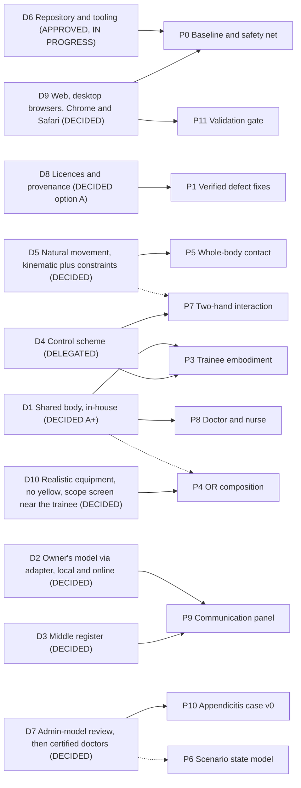

# 08 — Technical Decisions and Open Questions

This document records the technical decisions that the improvement plan depends on. It separates three kinds of item. Decisions that can be made now (DN1–DN6) follow directly from the evidence and the owner's constraints. Decisions that need the owner (D1–D10) each come with options, trade-offs, the work they block and a deadline. On 14 November 2026 the owner decided five of them (D1, D2, D3, D7 and D9); in a second message the same day he settled the other five (D4, D5, D6, D8 and D10) and refined D1, D2, D7 and D9. The decision log below shows the current state of each. Unknowns (U1–U24) must be investigated, and each is assigned to the phase that resolves it. An assumptions register and a short list of plain-language questions for the owner close the document. The orientation document `Nabd_v1.5_Repository_Review.md` named in the owner's request does not exist anywhere on disk, so the repository at `C:\Users\ss\Nabd-Clinical-Simulator-v1.5-Forearm-Contact` is treated as the only source of truth.

**Status labels used:** VERIFIED (executed and observed in the audit browser run; cited as R1–R21 and build checks B1–B5), TEST-VERIFIED (a named repository test that passed), SOURCE-INSPECTED, PARTIALLY VERIFIED, PLANNED, UNKNOWN. Results from read-only audit scripts are labelled DATA-DERIVED (audit analysis) and are never test evidence. Recommendations and assumptions are marked **RECOMMENDATION** and **ASSUMPTION**. Decision states are **DECIDED** (the owner answered), **APPROVED** (the owner said yes to the recommended option) and **IN PROGRESS** (the approved work has started), **DELEGATED** (the owner left the choice to the team, which consults him with a recommendation whenever a choice matters), **PENDING** (explained, awaiting the owner's yes) and **OPEN** (not yet answered); an interpretation of the owner's answer that still needs his confirmation is marked **TO CONFIRM**. Results of the T1 run of 14 November 2026 are cited as "T1 run"; a check that could not run in this environment is marked **BLOCKED**.

**Owner quotes.** The owner answered on 14 November 2026 in two messages in Jordanian colloquial Arabic: a first message (D1, D2, D3, D7, D9) and a second one later the same day (all remaining decisions, plus refinements), followed a minute later by a one-line authorisation for downloads (D6). Short excerpts are quoted exactly in «…», each followed by an English gloss. How each answer is turned into a planning decision is this plan's interpretation.

**Related documents:** [README](README.md) · [01](01_PROJECT_UNDERSTANDING.md) · [02](02_CURRENT_STATE_AUDIT.md) (findings F01–F35) · [03](03_REQUIREMENTS_GAP_ANALYSIS.md) (gaps G01–G23) · [04](04_EXPERIENCE_AND_WORKFLOW_DESIGN.md) · [05](05_HAND_CONTACT_AND_MOVEMENT_OPTIONS.md) · [06](06_APPENDICITIS_CASE_WORKFLOW.md) (clinical review items CR-nn) · [07](07_PRIORITIZED_IMPROVEMENT_ROADMAP.md) (phases P0–P11) · [09](09_ACCEPTANCE_AND_VALIDATION_PLAN.md) (acceptance criteria AC-P*, checkpoints CRC-*) · [10](10_NEXT_IMPLEMENTATION_TASK.md) (task T1) · [11](11_FULL_SESSION_SCENARIO.md) (full session scenario) · [REPOSITORY_EVIDENCE_INDEX](REPOSITORY_EVIDENCE_INDEX.md)

---

## Decision log

| ID | Status | Date | Decision |
|---|---|---|---|
| D1 | DECIDED (owner); refined | 2026-11-14 (both messages) | Option A+: the trainee, supervising doctor and nurse are copies of the existing clothed body, modified in-house; changing their features is approved, and no new 3D human is built from scratch. The nurse is a woman with an ordinary appearance, a hair cover and a mask. The patient keeps `patient.glb`. Supersedes the earlier recommendation B |
| D2 | DECIDED (owner); refined | 2026-11-14 (both messages) | The trainee talks to the owner's own model, now in training, through a validated adapter with a deterministic fallback. The model runs both locally and online: one contract, two endpoints. Privacy and cost of the online path TO CONFIRM |
| D3 | DECIDED (owner) | 2026-11-14 | In-simulation text uses a middle register between Fusha and colloquial Arabic |
| D4 | DELEGATED with consultation (owner) | 2026-11-14 (second message) | The team picks the most suitable keyboard and mouse control scheme during implementation and asks the owner, with a recommendation, whenever a choice matters. The "hold-and-act" recommendation (option A) is the working default |
| D5 | DECIDED (owner) | 2026-11-14 (second message) | Smooth, natural human movement within joint limits; no hand sinks into the bed or the patient's body, except intentional entry through wounds or incisions, ports or the scope when the scenario calls for it. Kinematic control plus constraints (option A) |
| D6 | APPROVED, IN PROGRESS (owner) | 2026-11-14 (second message) | Option A: git baseline `acdab52` tagged `v1.5-baseline`, `npm ci`, 21 of 21 tests, Vite build, Playwright 1.64.1 and its browsers. The owner authorised further downloads without asking. All of it is in place on the branch `t1-baseline-f19` (no remote; nothing pushed). The T1 run was done on 2026-11-14, but T1 is not yet complete (7 of 11 criteria MET, 4 PARTIALLY MET) and awaits owner checkpoint 1 ([10](10_NEXT_IMPLEMENTATION_TASK.md); [phase-reports/P0-completion.md](phase-reports/P0-completion.md)) |
| D7 | DECIDED (owner); refined | 2026-11-14 (both messages) | The admin model and specialist models are the AI review stage. Certified doctors audit the content and test the simulator before it is adopted as training: their sign-off is CONFIRMED as the gate for "clinician-validated" and for training use. For now the simulator is built as a prototype |
| D8 | DECIDED (our reading of the owner's general approval) | 2026-11-14 (second message) | Option A: add the missing Rapier Apache-2.0 notice (P1) and the font licence texts, and document asset provenance (P11). Legal questions, such as the share-alike notes, stay flagged |
| D9 | DECIDED (owner); refined | 2026-11-14 (both messages) | The web, in desktop browsers: Chrome and Safari mandatory, other modern browsers expected. An installable desktop app or a mobile app may come in later stages. Unity deferred. The minimum machine and the performance budget are still PROPOSED |
| D10 | DECIDED (owner) | 2026-11-14 (second message) | The yellow equipment colour changes; equipment is redesigned toward realism in-house; the room is realistic, with the equipment close and suited to each scene; during laparoscopy a screen showing the procedure stands close to the trainee in the line of sight. The interface identity (DN6) is unchanged |

DN1–DN6 need no owner input beyond approving the plan at checkpoint 0 ([07](07_PRIORITIZED_IMPROVEMENT_ROADMAP.md) §6). For each decided item, the option analysis of 13 November 2026 is kept below as short background.

### Working agreement (owner, 2026-11-14)

The owner wants proposals and improvements raised while the work is under way, not only at the planned checkpoints:
- «وأي اقتراح أنت بتقترحه أثناء سير العملية أعطيني إياه برضه ما في عندي أي مشكلة» — "And any suggestion you make while the work is under way, give it to me as well; I have no problem with that."
- «بتطرح علي السؤال، بتوضحه، بتحكيلي أجوبتك وإيش توصيتك وأنا برد عليك» — "You put the question to me, explain it, tell me your answers and what you recommend, and I reply."

**How it is applied.** Each proposal or question is explained in plain language, with the options, a **RECOMMENDATION**, and what it affects. The owner answers, and the answer is recorded here as a decision, or in the phase report of [09](09_ACCEPTANCE_AND_VALIDATION_PLAN.md) §7. A proposal never changes scope by itself: anything that touches clinical content, privacy, cost or the visual identity waits for his answer. The same pattern governs the delegated D4.

---

## Decision map

The diagram shows which owner decisions gate which roadmap phases (phase detail is in [07](07_PRIORITIZED_IMPROVEMENT_ROADMAP.md)). Labels show each decision's status after the owner's second message of 14 November 2026. Solid edges gate a phase. Dashed edges inform it: D1 → P4 for the nurse station, D7 → P6 for the review fields, and D5 → P7 for the movement rules and the opening exception.

---

## 1. Decisions that can be made now

These six decisions need no new information. They keep working systems in place, match rules the project already states, and keep the owner's experience brief central.

### DN1 — Stay on Three.js r180 and the existing runtime; change it incrementally

- **Rationale.**
  - The runtime boots and renders in a real browser. All 21 modules, 9 GLBs and Rapier return HTTP 200, with no console errors in the default flows (VERIFIED R1–R3; F34).
  - three.js r180 is inlined in `src/app/NabdRuntime.js` (6,160 lines, 748 KB, one IIFE; app code starts at line 3860 @71276; F01).
  - Domain modules already receive three.js classes by injection: `loadCrew` at `NabdRuntime.js:4688-4696` and `createForearmContact` at `NabdRuntime.js:5434-5436`. New modules can therefore be added without editing the bundle.
  - The owner ruled out engine migration. Unity is only a separate future project, which he confirmed again on 2026-11-14 (D9).
- **Consequences.**
  - New capabilities arrive as injected modules behind the P2 seams. The closure is not rewritten.
  - One test file imports the npm package `three` (locked at 0.180.0; `tests/forearm-contact.test.js:3`), which is a second copy of the library; no test runs the app's bundled copy (F02). Every phase therefore pairs unit tests with a browser check that exercises the bundled copy ([09](09_ACCEPTANCE_AND_VALIDATION_PLAN.md) §2.2).
  - The acceptance criteria in 09 describe behaviour, not engine internals, so they would carry over to any future engine.

### DN2 — The deterministic simulator owns per-frame hands, contact and physics; dialogue and AI layers never drive transforms

- **Rationale.**
  - This is already a project rule. `docs/Nabd-v0.22-Review-Board.md:56` says clinical agents "must not drive per-frame physics or hand transforms".
  - The frame loop `ee` (`NabdRuntime.js:5954-6007`) runs deterministically. Its gated crew block (`5984-5991`) runs `bedside.updateBeforeHands`, then `crew.update`, then `bedside.updateAfterHands`.
  - Brief §5 forbids the agent from inventing clinical facts.
- **Consequences.**
  - The P6 scenario logic and the P9 dialogue layer consume events. They emit discrete, validated commands, for example "nurse: deliver item X to station Y", and the P8 character layer executes them deterministically.
  - A language component returns an intent from a closed list, reply text and at most one action from a closed list (the D2 adapter, decided 2026-11-14). It never returns a pose or a value, and clinical statements reach the trainee only from reviewed scenario lines (D2 RECOMMENDATION).
  - Event streams become replayable test fixtures (AC-P6-4).

### DN3 — Extend the existing Rapier shape-query contact pattern; do not replace it

- **Rationale.**
  - `src/interaction/ForearmContact.js` (82 lines) uses Rapier 0.21.0 (Apache-2.0) only for stateless `castShape`/`contactShape` queries. The obstacles are two capsules and a mattress cuboid (`ForearmContact.js:14-18`). There is no World and there are no bodies (F15).
  - The drill grips, lifts and supports in the browser (VERIFIED R7–R11).
  - The logic of both repository test cases in `tests/forearm-contact.test.js` was reproduced by an audit script. That result is DATA-DERIVED (audit analysis), not TEST-VERIFIED: the repository test itself fails at import (F03). Since the T1 run of 14 November 2026, `npm ci` has installed `three`, and both cases pass: TEST-VERIFIED.
  - The known weaknesses are fitting and coverage problems, not library problems: the capsule-to-skin mismatch (F16), six probes at bone origins, and coverage of the left arm only.
- **Consequences.** P5 generalises the pattern: skeleton-driven proxies fitted from skin weights, plus hand probes taken from glove vertices. No new physics package is added. D5 (decided 2026-11-14) keeps the approach kinematic with constraints; a Rapier World for objects would come back only through the revisit rule under D5.

### DN4 — Left/right identity stays a fixed asset mapping, protected by invariant tests

- **Rationale.**
  - `src/staff/CrewController.js:87` builds `hands = { left: buildHand(leftAsset, -1), right: buildHand(rightAsset, 1) }`. Nothing reassigns it, and no negative scale exists anywhere (SOURCE-INSPECTED; F08).
  - Switching the active hand changes no rest pose (VERIFIED R18).
  - The apparent flips come from inconsistent orientation conventions (F09), not from swaps.
- **Consequences.** P3 unifies the conventions and does not re-map assets. The invariant tests become permanent cross-cutting checks (INV-3 in 09 §5): asset identity, positive determinant, lateral ordering and handedness basis.

### DN5 — Scenario content is data with a clinical-review status; unreviewed content is visibly labelled illustrative

- **Rationale.**
  - The only scenario is a generic 5-step drill written inline in `setPhase` (`NabdRuntime.js:5665-5743`; F21).
  - `docs/Nabd-v1.0-Change-Log.md:21` claims appendectomy and neck scenario entry points, but no code backs them (F35). This shows how content claims drift from reality.
  - The monitor already labels its own output "DEMO SIGNALS" (`src/ui/MonitorUI.js:109`), which is a useful precedent.
  - Brief §5 requires illustrative labelling until qualified review.
- **Consequences.**
  - The P6 schema stores a review status, reviewer, date and source for each item. For an AI review, the reviewer field names the model and its version (D7).
  - Since the D7 decision, the status has three levels: "illustrative" → "AI-reviewed (admin model) — not clinician-validated" → "clinician-validated". The UI always shows the lowest level among the active items.
  - Only CRC records with a qualified clinician (09 §6) move content to "clinician-validated". P10 cannot drop the lower labels without them.

### DN6 — Preserve the current interface identity; equipment changes follow D10

- **Rationale.**
  - `index.html:2` declares Arabic RTL (`lang="ar" dir="rtl"`).
  - `src/styles.css` defines muted teal tokens (`--teal: #356b6b`, `--teal-deep: #244f53`, lines 303-304) and embeds IBM Plex Sans Arabic and Inter (lines 2-4). It has no glow or neon rules (SOURCE-INSPECTED).
  - Brief §10 asks for the identity to be preserved.
- **Consequences.** New panels reuse the existing tokens and fonts. The lime-yellow casing `#ebf641` (`NabdRuntime.js:4164`) looks un-clinical; D10 (decided 2026-11-14) replaces it and redesigns the equipment toward realism in P4. D10 does not touch the interface tokens, fonts or RTL layout, which this decision keeps.

---

## 2. Decisions requiring owner approval

Since the owner's second message of 14 November 2026, no decision is open or pending. Each item leads with the owner's words and the recorded decision, then its implications, residual risks and limits, and what it unblocks; its option analysis of 13 November 2026 follows as background. A refinement from the second message is recorded in its own block, so the first answer stays readable.

### D1 — Character asset strategy for the trainee, supervising doctor and nurse

**Status: DECIDED (owner, 2026-11-14) — option A+, "reuse the existing body in-house with modifications"; refined the same day (changing features approved; female nurse with a hair cover and a mask).** This supersedes the earlier recommendation B and rules out external character assets (option C).

**Owner's words.**
- «المتدرب بدي إياه جسم يكون، مش إيدين بس. ويكون هو الكاميرا بأبعاد مناسبة فيزيائياً» — "I want the trainee to be a body, not just hands, and the trainee is the camera, at physically correct dimensions."
- «بدنا نستورد نفس الجسم الموجود، نعدل عليه شوية أشياء نزبطه أكثر عشان ما نظل نجيب أشياء من برا» — "Let's import the same existing body and modify a few things to improve it, so we stop bringing things in from outside."
- «ويكون الألوان اللي هم لابسينها مختلفة حسب الاختصاص» — "And the colours they wear differ by specialty."

**Refinement (owner's second message, 2026-11-14): DECIDED.**
- «موافق على تغيير ملامح المجسمات الموجودة» — "I agree to changing the features of the existing models."
- «أنا كان قصدي إنه ما نرجع نبني مجسم إنسان 3D طالما إنه موجود عندنا مجسم، ممكن نقدر ننسخه، نعدل عليه شوي، نعمل شوية اختلافات» — "What I meant is that we don't go back to building a 3D human model while we already have one; we can copy it, modify it a little and make some differences."
- «لو كانت الممرضة بنت عادي ما عندنا أي مشكلة» — "If the nurse is a woman, that's fine; we have no problem with it."
- On how the nurse should look: «نفس شكل الإنسان العادي، في غطاء على شعرها، في كمامة» — "The same look as an ordinary person, with a cover on her hair and a mask."

What this adds to the decision:
- **Modifying the look is approved,** including the faces and features of the existing bodies, not only clothing colours. The rule is "copy and modify, never build a new 3D human from scratch". An in-house sculpt or edit of a copy in Blender stays within A+.
- **The nurse is a woman** with an ordinary human appearance, a hair cover (surgical cap) and a face mask. Both garments already exist as separate primitives of `supervisor.glb` (`Surgical cap • spun fabric`, `Surgical face mask`; DATA-DERIVED). Her appearance is no longer TO CONFIRM.
- **Owner's acceptance criterion for the nurse:** at visual review she reads as an ordinary woman wearing a hair cover and a mask. Which in-house technique achieves that (bone scaling, a sculpt of a copy, or both) is still UNKNOWN (U24) and is settled at the start of P8.

**Recorded decision.**
- **People.** The trainee (المتدرّب), the supervising doctor (الطبيب المشرف) and the nurse (الممرضة) are instances of the clothed full body `assets/staff/supervisor.glb`. The patient (المريض) keeps `assets/patient/patient.glb`. Both files share a byte-identical 163-joint skeleton (F14; DATA-DERIVED).
- **Differences per role, all made in-house.**
  - Clothing colours by role or specialty, by recolouring materials at runtime. The supervisor GLB already keeps its clothing in separately named materials: scrub shirt, scrub shorts, edge binding, surgical cap, cap binding, long sterile gown, scrub trousers, theatre footwear, gloves and face mask, besides skin, brows and eyes (DATA-DERIVED from its glTF material list).
  - Protective clothing shown according to the clinical situation and phase, for example a sterile gown and gloves for scrubbed staff versus scrubs only. Which garments each role wears in each phase, and the sterility rules, are **CLINICAL REVIEW REQUIRED** (CR-31 and CR-08 in [06](06_APPENDICITIS_CASE_WORKFLOW.md)).
  - Small proportion changes through bone scaling.
- **The trainee.**
  - The trainee is a full body, and the first-person camera is the trainee's eyes.
  - Today the camera is fixed at `traineeDefault = { position: (0.735, 1.60, 0.15), yaw: π/2, pitch: −0.60, fov: 62 }` (`src/app/NabdRuntime.js:4661`; SOURCE-INSPECTED).
  - The shared rig's eyes sit at y ≈ 1.661–1.691 m in rest pose (DATA-DERIVED from the position bounds of the eyes primitive in `supervisor.glb`; the supervisor group stands at y = 0 without scaling, `src/staff/CrewController.js:88-93`). The camera therefore follows the body's head and eye position, about 1.67 m unless the body is scaled. The rig has `head`, `eye.L` and `eye.R` joints to anchor it (DATA-DERIVED).
  - The body is visible when looking down, the trainee's own head is hidden in first person, and the arms connect to the shoulders (P3).

**Implications.**
- P3 builds the trainee as an instance of the shared body, with the camera at its eyes, the head hidden and trainee role materials ([07](07_PRIORITIZED_IMPROVEMENT_ROADMAP.md) P3).
- P4 sizes the nurse station and handover point from the same body; P8 builds the nurse and the supervisor's behaviour on it.
- The cast, attire proposal and colours per role are set out in [11](11_FULL_SESSION_SCENARIO.md) §1. The colour values are a proposal for the owner's visual review.

**Residual risks and limits.**
- **One base body and face for everyone.** In an operating room, caps and masks hide much of the face, which helps, and since the second message the features of each copy may also be changed in-house. Whether the three staff read as distinct people is an owner visual-review item.
- **The female nurse.** The owner wrote ممرضة, a female nurse, and confirmed that a woman is fine. A convincing female nurse may need shape changes beyond recolouring. The rig has `breast.L`/`breast.R` and `pelvis.L`/`pelvis.R` joints whose scaling allows limited change (DATA-DERIVED); the visual result is UNKNOWN (U24). A sculpt of a copy made in Blender in-house still counts as option A+. Her appearance is DECIDED (ordinary appearance, hair cover, mask); only the technique remains open.
- **Triangle budget (DATA-DERIVED).**
  - `supervisor.glb` has ≈112,480 triangles per copy: 11 skin and clothing primitives totalling 110,772, plus brows (648) and eyes (1,060). The gloves primitive alone has 27,362 triangles and the footwear 17,414.
  - Three staff copies come to ≈337k triangles; with the patient's ≈109k, the people alone reach ≈446k.
  - For comparison, the whole default bedside view measures 378,534–387,848 triangles today (VERIFIED R6).
  - Measurement, and possibly simplification, is needed (U22; P0 baseline, T2/P3, P8).
- **Cloning.** Three instances need a skinned clone, or one parse per character (U13).
- **Skeleton origin.** The MakeHuman-style origin (U19) no longer decides feasibility. It still matters for provenance and for any in-house re-sculpt (D8).

**What it unblocks.**
- The production trainee body in P3. Spike T2 now tests the decided approach instead of informing a choice.
- Doctor and nurse body work in P8, and the station sizes in P4.
- Clinical clothing (G06) as runtime materials, with the garment rules per phase under CR-31.

**Background: options analysed on 13 November 2026.**

| Option | Summary | After the owner's decision |
|---|---|---|
| **A** | Reuse the shared rig as-is: the same adult male body for everyone | Extended into A+ (chosen) |
| **B** | New bodies generated on the identical 163-bone skeleton (previously RECOMMENDED) | Superseded by A+ |
| **C** | Licensed third-party rigged characters, retargeted | Ruled out: no assets from outside |
| **D** | Commissioned custom models built to the 163-joint skeleton | Not chosen |

The facts behind that analysis still hold:
- **Shared skeleton (DATA-DERIVED).** `patient.glb` and `supervisor.glb` have the same 163-joint skin `PatientRig`: identical joint-name order, inverse-bind matrices and rest transforms. `glove-left.glb` and `glove-right.glb` use the same 163 joint names with different inverse-bind matrices and rest pose; they are re-bound hand-and-forearm cuts of the same rig (F14).
- **Naming and origin.** The joint names include `spine01`–`spine05`, `clavicle.L/R`, `shoulder01`, `upperarm01/02`, `lowerarm01/02`, `wrist`, `metacarpal1`–`4`, `finger1-1`…`finger5-3`, `neck01`–`03`, `head` and facial `oris*`/`levator*` joints (DATA-DERIVED). The licence comment at `index.html:537` names Innerscene's "Male base mesh, rigged A-pose", "adapted from MakeHuman", under CC0 1.0. A MakeHuman-style skeleton is an inference to confirm (U19). All four human GLBs report the exporter "Khronos glTF Blender I/O v4.3.47" (DATA-DERIVED). No `.blend` source files are in the repository.
- **Code (SOURCE-INSPECTED unless marked).** Code drives bones by name: `getBone` (`CrewController.js:11-19`) and the supervisor IK `reachSupport` (`CrewController.js:143-175`). No GLB has animation clips or morph targets (DATA-DERIVED). `loadCrew`'s `loadAsset` parses each staff GLB separately (`NabdRuntime.js:4691-4695`). Grep finds no `SkeletonUtils` identifier in the bundle, so whether a skinned-clone helper exists is UNKNOWN (U13).
- **Garment provenance.** `assets/staff/ASSET-PROVENANCE.md` describes the supervisor's garments as a procedural gown, cap, gloves and face mask. Two clothing materials are still named "Patient scrub shirt • woven blue" and "Patient scrub shorts • woven blue" (DATA-DERIVED).

**Deadline met.** The decision came before T2, so the main P3 work can start after the T2 review (checkpoint 4 in [07](07_PRIORITIZED_IMPROVEMENT_ROADMAP.md) §6).

### D2 — Dialogue understanding

**Status: DECIDED (owner, 2026-11-14) — the conversation partner is the owner's own model, connected through a validated adapter with a deterministic fallback; refined the same day: the model runs both locally and online.** In terms of the options below this is option C (hybrid), with the owner's model in the place of "B".

**Owner's words.** «إحنا حالياً قاعدين مندرب الموديل اللي رح يرد عليه» — "We are currently training the model that will answer." «بدنا نكون منتبهين لهاي النقطة» — "We need to keep this point in mind."

**Refinement (owner's second message, 2026-11-14): hosting DECIDED.** Answering the question «هل يعمل النموذج على جهازك نفسه أم عبر الإنترنت؟» ("Does the model run on your own device or over the internet?"), the owner wrote: «رح يعمل على الاثنين» — "It will run on both."
- **One contract, two endpoints.** The adapter supports a **local endpoint** (a model running on the learner's computer) and an **online endpoint** (a hosted service), both behind the same request and response contract of [11](11_FULL_SESSION_SCENARIO.md) §3.1, plus the deterministic fallback. Validation (rules 1–5 below) is identical for both, so the scenario outcome never depends on which endpoint answered; latency is the only expected difference.
- **Endpoint choice** is configuration, not code: which endpoint is tried first, the time limit before the fallback, and whether the online endpoint is allowed at all in a given deployment (**RECOMMENDATION:** the local endpoint first where it is installed, then the online one, then the deterministic fallback). Every `model_reply` log entry records which endpoint answered (AC-P9-11, AC-P9-13).
- **Still open for the online path (TO CONFIRM):** whether trainee text and session records may leave the computer, the privacy notice and consent that this needs, and who pays for the service (§5).

**Recorded decision: what P9 builds.** A dialogue adapter contract, not a fixed chat engine. Its JSON form is specified in [11](11_FULL_SESSION_SCENARIO.md) §3.1.
- **Input to the model:** a scenario-state snapshot, the speaker role (doctor or nurse), the intents and actions allowed in the current stage (closed lists from P6), recent events, the trainee's message and the language register (D3).
- **Output from the model:** an intent, reply text, an optional requested action from the closed list, and a confidence value.

**Rules that bind the adapter.**
1. The deterministic scenario state (P6) stays the single source of truth.
2. Model output is validated against that state before it has any effect. An action that the state does not allow is rejected.
3. The model never sets clinical facts or vital signs, and never drives transforms (DN2).
4. A deterministic fallback handles an unavailable model or low confidence with the "needs clarification" response, so a session can still be completed without the model.
5. Every model call is logged. **RECOMMENDATION:** log the model version with each call, so that evaluations stay reproducible.

**Facts that still hold (SOURCE-INSPECTED).**
- Today there is no text input, chat, audio, AI or network call of any kind (F22).
- `src/simulation/EventLogger.js:35` describes the log as "In-memory … No external transmission or persistence".
- Delivery is static: `scripts/serve.mjs` serves files, and the standalone preview is a single HTML file. No server exists that could hold an API key.

**Implications.**
- P6 exposes the allowed intents and actions of every stage as data, so the adapter can send closed lists.
- P9 builds and tests the adapter against a scripted stand-in model on both endpoint types, so the owner's model can be connected when it is ready.
- The U20 test set now measures the owner's model, in the middle register (D3), on both endpoints.

**Residual risks and limits.**
- **Online path.** Trainee text leaves the device and the app makes its first network calls (F22); cost, latency and outages apply, and a static client cannot hold an API key (AS3), so the online endpoint needs a service that holds any key. Privacy and cost stay TO CONFIRM (§5).
- **Local path.** The model competes with WebGL rendering for the same machine; feasibility and its effect on the D9 budget are UNKNOWN until measured. Browser security rules for a web page calling a service on the learner's own computer (for example mixed-content and private-network restrictions) may also constrain it; this is checked in Chrome and Safari in P9 (UNKNOWN).
- **Free reply text.** Validation can check intents and actions, but it cannot fully check free text for clinical claims. **RECOMMENDATION:** clinical statements in replies come only from reviewed scenario lines or state values (DN5, CR-22); the model's own wording is limited to non-clinical team communication, such as acknowledgements, clarifications and logistics.
- **Arabic quality** in the middle register is UNKNOWN until measured on a reviewed test set (U20).
- **Versions.** The model and the scenario data must match: the adapter offers only the intents and actions of the active scenario version (AS14).

**What it unblocks.** The P9 adapter design and its contract tests for both endpoints; the P6 intent and action fields. The P9 panel UI can start once P6 exists, as before. The local endpoint can be integrated as soon as the owner's model is available; the online endpoint also waits for the privacy and cost answers.

**Background: options analysed on 13 November 2026.**

| Option | Summary | After the owner's decision |
|---|---|---|
| **A** | Scripted decision choices plus deterministic intent matching; fully offline; Arabic needs normalisation (hamza forms, ta marbuta, diacritics) and synonym lists | Kept as the deterministic fallback |
| **B** | LLM-assisted understanding constrained by scenario state; needs a backend or proxy for keys; trainee text leaves the device | Realised by the owner's own model |
| **C** | Hybrid: A as the core, B behind validation, deterministic fallback (previously RECOMMENDED) | Chosen in effect |

### D3 — Language register for in-simulation text

**Status: DECIDED (owner, 2026-11-14) — a middle register between Fusha and colloquial Arabic.**

**Owner's words.** «لا عامية كثير ولا فصحى كثير، بالنص بيناتهم» — "Not too much colloquial and not too much Fusha; in the middle between them."

**Recorded decision.**
- Grammar and vocabulary are mostly Modern Standard Arabic.
- Light, common colloquial connectors are allowed sparingly: تمام، خلّينا، طيب، يعني، بدّك.
- Heavy dialect words are avoided.
- Common clinical terms are written in Arabic, with the English term in parentheses where useful.
- The register applies to in-simulation dialogue and to trainee-facing prompts. The owner preferred Fusha for UI copy in earlier projects; for this simulator the middle register is the rule.

Tone examples, for calibration only (any clinical content in a line is CR-22; the full set is in [11](11_FULL_SESSION_SCENARIO.md) §3.3):
- «تمام، خلّينا نبدأ. عرّفني على المريض باختصار.» — "Fine, let's begin. Introduce the patient to me briefly."
- «لحظة، هذه الخطوة ما زال وقتها مبكراً. ما الذي يجب أن نتأكد منه قبلها؟» — "One moment, it is still too early for this step. What must we make sure of first?"
- «أنا سأمسك يد المريض الآن، راقب كيف أثبّتها.» — "I will hold the patient's hand now; watch how I steady it."

**Facts (SOURCE-INSPECTED).**
- Static labels in `index.html` are mostly Fusha.
- Runtime status strings are partly colloquial, for example «فلّت», «هسّا», «للتخت» and «إيد» (as in «إيد المشرف بتقرب من الساعد», `NabdRuntime.js:5514`). They come from 32 `setTraineeStatus` and 13 `showFeedback` call sites in `NabdRuntime.js` (F25).

**Implications.**
- The existing status strings are rewritten into the middle register as a separate, owner-reviewed text change, scheduled with the P2 trainee-mode work or with P9. It stays out of the P2 control split and the P6 drill migration, whose before-and-after comparisons need unchanged texts ([07](07_PRIORITIZED_IMPROVEMENT_ROADMAP.md) P2 "What should not be changed"; AC-P6-2 in [09](09_ACCEPTANCE_AND_VALIDATION_PLAN.md)).
- **ASSUMPTION** (unchanged): trainees will type a mix of Fusha, colloquial Arabic and English clinical terms, so input understanding must tolerate all three (U20).
- A language reviewer checks the lines against this register (CR-22 already names one).

**What it unblocks.** P9 dialogue and panel authoring; P10 lines (still CR-22); the rewrite of the existing status strings.

**Background: options analysed on 13 November 2026.** A: Fusha for all UI and character lines. B: colloquial team dialogue with Fusha interface text. C: Fusha output with input understanding that tolerates colloquial Arabic and English clinical terms (previously RECOMMENDED). The owner chose a register between A and B. Option C's tolerant input understanding is kept.

### D4 — Primary input devices and the two-hand control scheme

**Status: DELEGATED with consultation (owner, 2026-11-14, second message).**

**Owner's words.**
- «طريقة التحكم، بدنا نشوف أنسب طريقة تحكم ممكنة» — "As for the control method, we want to find the most suitable control method possible."
- «ممكن تكون بالكيبورد وممكن تكون بالماوس. حسب إحنا منشوف إيش الأنسب طريقة بالنسبة إلنا» — "It could be with the keyboard and it could be with the mouse, depending on what we find most suitable for us."
- «بتطرح علي السؤال، بتوضحه، بتحكيلي أجوبتك وإيش توصيتك وأنا برد عليك» — "You put the question to me, explain it, tell me your answers and what you recommend, and I reply."

**Recorded decision.**
- The team chooses the most suitable control scheme for handling hands and instruments, by keyboard and/or mouse, during implementation (P3 hand targets, P7 two-hand scheme).
- Whenever a choice matters to the learner's experience, for example the two-hand scheme, key assignments or a mode switch, the team asks the owner under the working agreement (decision log): the question explained, the options, and a **RECOMMENDATION**. His answer is recorded in the phase report and, if it changes this decision, here.
- **Working default:** option A below, mouse and keyboard with "hold-and-act". It stays the default until user testing or the owner's answer changes it.
- [11](11_FULL_SESSION_SCENARIO.md) keeps describing physical actions device-neutrally, with today's default mapping as an example.

**Facts (SOURCE-INSPECTED).**
- There is one gesture and one pointer, and non-primary pointers are ignored (`src/interaction/BedsideInteraction.js:13-15, 309`).
- The active hand changes only through Q/E or the hand buttons (`chooseHand`, `NabdRuntime.js:5241-5248`).
- Touch is partly handled: a larger pick radius for touch (0.057 vs 0.042, `BedsideInteraction.js:106`) and a look-mode switch (`lookModeEnabled`, line 312). There is no multi-touch, because non-primary pointers are ignored (line 309). How touch behaves in practice is UNKNOWN; it was not exercised at runtime (U2).
- The bundled three.js core contains `WebXRManager`. XR is unused.

| Option | Strengths | Weaknesses |
|---|---|---|
| **A** Mouse and keyboard as primary, with a "hold-and-act" scheme: one hand keeps an anchored hold while the pointer drives the other; switch hands with Q/E or by target side (**RECOMMENDED; working default under the delegation**) | Builds on the current gesture model; precise; testable through `?qa` | Two hands never move simultaneously; needs clear hand indicators |
| **B** Touch-first, one finger per hand | Natural on tablets | Conflicts with the look and zoom gestures; occlusion on small screens; larger test matrix |
| **C** XR controllers | Natural two-hand use | New interaction model and device testing; out of scope until after P11 |

**RECOMMENDATION (working default since the delegation):** option A. With D9 limited to desktop computers, a touch mode with explicit per-hand toggles is deferred rather than built as a secondary mode. XR is deferred.
**No longer blocking.** The P3 hand-target design and the P7 control scheme proceed on the working default. The P7 scheme is documented with the team's recommendation and shown to the owner at checkpoint 8 (AC-P7-1).

### D5 — Physics approach and natural movement

**Status: DECIDED (owner, 2026-11-14, second message) — smooth, natural human movement under constraints; this is option A below (kinematic control plus shape queries and constraints).**

**Owner's words.**
- «طريقة الحركة الفيزيائية بدها تكون حركة انسيابية، نفس حركات الإنسان الطبيعية» — "The physical movement must be smooth, the same as a person's natural movements."
- «يعني الرجل ما تلف 360 درجة، الإيد ما تغوص جوه التخت، إيدي ما تغوص جوه جسم المريض» — "That is, the leg doesn't turn 360 degrees, the hand doesn't sink into the bed, and my hand doesn't sink into the patient's body."
- «ما أفوت إيدي جوه جسم المريض إلا في حالة إذا كان في جروح أو إذا كان في منظار أو احتجت أنا مثلاً إني أعمل جروح أو أفوت. هذا الوضع طبيعي» — "I don't put my hand inside the patient's body except when there are wounds, or a scope, or when I need, for example, to make incisions or go in. That situation is normal."

**Recorded decision: movement rules.** They apply to every person in the room (trainee, supervising doctor, nurse and patient) and to held instruments.
1. **Smooth motion.** Bodies, hands and objects move continuously: no snapping, no teleport in view and no sudden jumps (AC-P7-3, AC-P7-5, AC-P8-2).
2. **Natural joint limits.** Every joint stays within documented natural limits; a leg never turns 360°, an elbow never bends backwards. The limit values come from a cited anthropometric source in the P3 and P8 design notes (as [05](05_HAND_CONTACT_AND_MOVEMENT_OPTIONS.md) §3(a) already requires); the patient's limbs keep the swing and bend limits of their IK (`createLimbDrag`, `NabdRuntime.js:5395-5428`; SOURCE-INSPECTED).
3. **No sinking.** No hand, body or held instrument sinks into the bed (operating table and mattress), the patient's body, another person or equipment, beyond the measured tolerances of [09](09_ACCEPTANCE_AND_VALIDATION_PLAN.md) (M1; AC-P8-3).
4. **Opening exception.** Entry into the patient's body is allowed only through an opening that the active scenario stage declares: a wound or incision, a port, or the scope's path. Only what the stage allows may pass (for example a port-capable instrument through the selected port), and only while the stage allows it. Entry anywhere else is resolved out of the body and counted as penetration. Where openings exist and what may pass is case content: **CLINICAL REVIEW REQUIRED (CR-12, CR-13)**.

**How it maps onto the plan.**
- Option A already provides the mechanism: deterministic kinematic targets with constraint projection ([05](05_HAND_CONTACT_AND_MOVEMENT_OPTIONS.md) §3(b), B1). Rules 2 and 3 are the P3, P5 and P8 constraints; rule 4 becomes a "declared openings" input to the P5 contact service and the P7 instrument handling (AC-P5-10); INV-11 in [09](09_ACCEPTANCE_AND_VALIDATION_PLAN.md) §5 checks all four rules once each moving part exists.
- **In v0, the only opening that exists is the instrument port.** The scope and port-capable instruments already pivot about a remote centre and insert along their shaft (`createInstrumentDepth`, `src/instruments/InstrumentKinematics.js:3-153`; TEST-VERIFIED in `tests/instrument-depth.test.js`). Hands never enter, and wounds and incisions are not simulated (cutting is not credible in v0, [06](06_APPENDICITIS_CASE_WORKFLOW.md) §10); a stage that needs them narrates them.

The owner's request that the supervisor can lift and hold the patient's hand ([11](11_FULL_SESSION_SCENARIO.md) §4, level L4) fits option A: the supervisor's hand target can drive the existing patient-limb IK (`createLimbDrag`, `NabdRuntime.js:5395`), which the trainee's grip already drives through `limb.move` (`src/interaction/ForearmGrip.js:24`) (SOURCE-INSPECTED). It needs no physics world.

| Option | Strengths | Weaknesses |
|---|---|---|
| **A** Keep kinematic control plus Rapier shape queries (**chosen**, with the movement rules above) | Deterministic. Matches DN2 and DN3. Bounded cost: up to about 90 Rapier calls per collided hand per frame, derived from `ForearmContact.js` (SOURCE-INSPECTED) | Objects cannot rest, fall or stack physically; placement must be scripted |
| **B** A Rapier World with kinematic and dynamic bodies, from the same vendored package | Physical resting and dropping of instruments | Needs stepping, per-frame sync of skinned proxies to kinematic bodies, and tuning. Risk of jitter. Not needed for the brief, which forbids claiming tissue mechanics |

**Revisit rule.** Option B is reconsidered only if kinematic placement in P7 fails its acceptance criteria, only after measurement, and only through the working agreement (a proposal with a recommendation to the owner).
**Unblocked:** the detailed design of P5 (P5a start) and P7 release and placement.

### D6 — Repository and tooling approvals

**Status: APPROVED, IN PROGRESS (owner, 2026-11-14, second message) — option A, including Playwright.**

**Owner's words.** First message: «بدنا تزبطلنا إياه يشتغل على الجهاز اللي هو حالياً محلي عليه» — "We want you to set it up to run on the machine where it currently sits, locally." «بالنسبة إلها أنا مش فاهمها مية بالمية. إنت تقدر تعطيني تفاصيلها.» — "As for that one, I don't understand it one hundred percent. You can give me its details." After the plain-language explanation below, second message:
- «موافقتك على تسجيل النسخ وتنزيل الأدوات. طيب ما عندي أي مشكلة» — "[On] your approval for recording versions and downloading the tools: fine, I have no problem with it."
- «وإذا بتحتاج أنت تنزيل أي إشي إضافي بتقدر تحكيلي عنه، تبلغني عنه ورح أنزله» — "And if you need to download anything extra, you can tell me about it and I'll download it."
- A minute later: «اي شي تحتاج تنزله نزله بدون ما ترجعلي» — "Anything you need to download, download it without coming back to me."

**Recorded decision.** Option A is approved and T1 has started. The owner also gave a **standing authorisation for downloads** needed by the work, without asking him first. **RECOMMENDATION:** each download is still recorded in the phase report (what, version, source, size), pinned to an exact version, and kept out of anything that ships to trainees unless a phase approves it.

**Progress in the T1 run (14 November 2026; detail and remaining steps in [10](10_NEXT_IMPLEMENTATION_TASK.md)):**
- **Version control.** A git repository was created; the baseline commit `acdab52` of the untouched tree plus `docs/improvement-plan/` is tagged `v1.5-baseline`; T1 works on the branch `t1-baseline-f19`.
- **Dependencies.** `npm ci` completed; `three` 0.180.0 and `vite` 6.4.6; `package-lock.json` unchanged by it (AC-P0-2).
- **Tests.** `npm test` passes 21 of 21, so both `tests/forearm-contact.test.js` cases are now TEST-VERIFIED (F03 resolved).
- **Vite build.** It succeeds, and it deletes the standalone preview from `dist/` (U17 settled; T1 step 5 rebuilds the preview after it).
- **Playwright.** `@playwright/test` is pinned to 1.64.1, released about a month earlier; 1.65.1 was only one day old and was avoided. Playwright's browsers were downloaded (about 1.3 GB).
- **Browsers (VERIFIED, T1 run).** The installed Chrome 157 and Edge 157 drive fine in automated runs. Playwright's bundled WebKit 27.2 runs the app with no console errors (ready after ≈3.5 s). Playwright's bundled full Chromium and Firefox fail to launch in this environment; Firefox is recorded as **BLOCKED** here, to be resolved (U3). *Later T1 runs found that WebKit on Windows loses its WebGL context in some boots and shows a blank 3D view after any canvas resize (U3, U21 in §3).*
- **First valid frame rate.** Headed Chrome on the Intel Iris Xe: ready after ≈3.4 s and about 66 FPS idle in the default view. Idle measures the loop rate, not rendering cost ([09](09_ACCEPTANCE_AND_VALIDATION_PLAN.md) §2.4); the full performance capture is running. *The capture has since finished and supersedes this reading (U1 and U8 in §3).*
- *Status after the T1 run (14 November 2026):* the smoke suite, the V1–V4 baselines, the performance capture, the P0 probes and the F19 fix (`006881f`) are done; T1 is not yet complete (7 of 11 criteria MET, 4 PARTIALLY MET) and awaits owner checkpoint 1 ([phase-reports/P0-completion.md](phase-reports/P0-completion.md)).

**D6 in plain language** (as explained to the owner before his approval; "today" means before T1).
- **git** is a saved history of every change, with undo. Each change is stored as a numbered save point, a "commit", that can be compared with the one before it or taken back. Today the folder has no history at all (F05), so a bad change cannot be undone cleanly.
- **`npm ci`** installs the exact tool versions already listed in `package-lock.json`: three.js 0.180.0 and Vite 6.4.6, with their helper packages. One test file needs three.js; the app itself keeps its own built-in copy. Vite is the build tool. The tools go into `node_modules/`, which `.gitignore` already excludes, and no project file changes. Without them, the two forearm-contact test cases cannot run (so 21 of 21 is impossible today), and neither can the Vite build (F03, F04).
- **Playwright** (optional) is a test robot. It opens Chromium, Firefox and WebKit, clicks through the smoke checks and takes screenshots automatically. WebKit is the engine inside Safari, and Playwright's WebKit build is the only way to approximate Safari on this Windows computer (D9). It adds one development-only package plus browser downloads; none of it ships to trainees.

**Running the simulator locally needs none of this.** Node.js v26.13.1 is already installed (B1).
- **Built-in browser preview.** The project's own `scripts/serve.mjs` uses only Node built-ins and listens on 127.0.0.1:4173 by default; `PORT` and `HOST` change that (`scripts/serve.mjs:7-8`). The audit served the app this way in the Claude desktop app's built-in browser, on port 4190 (VERIFIED B5, R1–R3). On 2026-11-14 it was started again at `http://localhost:4190` through a preview entry named "nabd-simulator", kept in the desktop session's own preview configuration outside the project folder; no project file changed.
- **`start-dev.bat`.** Double-click it. It checks `node --version` and runs `npm run serve`, which is `node scripts/serve.mjs` on port 4173 (SOURCE-INSPECTED). Then open `http://127.0.0.1:4173` in Chrome.
- **VS Code Live Server.** `.vscode/extensions.json` already recommends the extension `ritwickdey.LiveServer`. Whether the app runs correctly under it was not tested: UNKNOWN (U23). *The T1 run has since found that it does, emulated with the owner's installed extension code (U23 in §3).*

**Facts before T1** (superseded by the progress list above).
- The folder was not a git repository: `git rev-parse` failed (F05), and a read-only re-check on 2026-11-14 gave the same result.
- `node_modules` was absent, while `package-lock.json` existed (lockfile v3; three 0.180.0, vite 6.4.6).
- The Vite build had not been run (F04). `tests/forearm-contact.test.js` failed at import (F03).

| Option | Strengths | Weaknesses |
|---|---|---|
| **A** `git init` plus a baseline commit of the untouched v1.5 tree and `docs/improvement-plan`; `npm ci` from the existing lockfile; Playwright as an optional dev dependency (**RECOMMENDED; APPROVED 2026-11-14**) | Rollback; all 21 test cases runnable; Vite build checkable; automated smoke and screenshot runs; WebKit runs as the only Safari approximation on Windows | One new dev-only package, which needs the owner's approval |
| **B** git and `npm ci` only, with a documented manual browser protocol | No new dependency | Manual smoke runs are slower and less repeatable; no way to check Safari's engine on Windows |
| **C** Status quo | Nothing changes | No rollback, one test file cannot run, no Vite build |

D9 strengthens option A: with Safari now mandatory, Playwright's WebKit build is the only way to check Safari's engine on this Windows machine before a Mac is available.

**Unblocked:** all of P0 and task T1 ([10](10_NEXT_IMPLEMENTATION_TASK.md)), now in progress. Running and viewing the simulator locally never depended on D6.

### D7 — Clinical source material, reviewers and sign-off

**Status: DECIDED (owner, 2026-11-14) — review and evaluation by the owner's "admin model", which supervises several specialist models; refined the same day: certified doctors audit the content and test the simulator before it is adopted as training.**

**Owner's words.** «رح يكون في عنا اللي هو الـ admin model» — "We will have what is called the admin model." «هو اللي رح يقيم العملية، هو اللي رح يراجع الحالة، هو رح يعمل باقي التفاصيل» — "It is the one that will evaluate the operation, review the case and do the remaining details."

**Recorded decision.** An admin model supervises several specialist models. It reviews the case content, evaluates the trainee's operation and fills in the remaining clinical details.

**Refinement (owner's second message, 2026-11-14): human sign-off CONFIRMED.**
- «الترخيص اللازم رح يتم تدقيقه من قبل أطباء معتمدين» — "The necessary licensing will be audited by certified doctors."
- «بس إحنا حالياً بدنا نبني التجربة كتجربة حالياً» — "But for now we want to build the experience as an experience [a prototype]."
- «رح يتم أخذ الترخيص اللازمة وتجريبه من قبل أطباء قبل اعتماده كتدريب» — "The necessary approvals will be obtained, and it will be tested by doctors before it is adopted as training."

This plan reads «الترخيص» here as the clinical approval of the content; the owner gave it in reply to the licence question of D8, whose software-licence part is recorded under D8. What it adds:
- **Two stages, both now part of the decision.** Stage 1 is the AI review by the admin model and its specialist models; stage 2 is an audit and hands-on test by **certified doctors**.
- **Gate.** Stage 2 is CONFIRMED by the owner as the gate for the label "clinician-validated" and for adopting the simulator as training with real trainees. It is no longer only a recommendation.
- **Until then the simulator is a prototype** ("an experience"). Content shows "illustrative" or "AI-reviewed (admin model) — not clinician-validated", as before.
- **Still for the owner:** who the certified doctors are, the sources they use, and the signature method of the [09](09_ACCEPTANCE_AND_VALIDATION_PLAN.md) §6 records. This plan names none of them.

**Implications.**
- **Machine-reviewable content.** Each scenario item carries structured CR references, source fields, a review status and the reviewer's identity; for an AI review, that is the model and its version (P6 schema; DN5).
- **Exportable session record.** The session record is exported for the admin model's evaluation. The admin model returns scores per rubric dimension, findings, debrief text and a review status (P10; the contracts are in [11](11_FULL_SESSION_SCENARIO.md) §9 and §10).
- **Three content labels (DN5).** "illustrative" → "AI-reviewed (admin model) — not clinician-validated" → "clinician-validated".
- **Filled-in details are authoring-time content.** Details the admin model fills in enter the scenario data with their label and reach the trainee only through the P6 review-status gate. At runtime no model sets clinical facts or vital signs (DN2; the D2 rules).

**Required honesty note.** AI review can draft, cross-check and evaluate. It does not equal validation by a qualified clinician for medical-education claims. The sign-off of certified doctors is required before use with real trainees (the owner CONFIRMED this on 2026-11-14), and it is also RECOMMENDED before external presentation and before any claim of clinical accuracy.

**Residual risks and limits.**
- The accuracy of the admin model and the specialist models is UNKNOWN to this plan; model errors in clinical content remain possible.
- Reviews must be reproducible. **RECOMMENDATION:** each review record names the model versions used.
- If the admin model runs online, exported session records leave the learner's device (AS13; privacy of the online path TO CONFIRM, as for D2).
- Nothing becomes clinical fact by being written in this plan. Every clinical item remains **CLINICAL REVIEW REQUIRED** (CR-01 to CR-42 in the [06](06_APPENDICITIS_CASE_WORKFLOW.md) §8 register; CR-34 to CR-42 were raised in [11](11_FULL_SESSION_SCENARIO.md) §13).

**What it unblocks.**
- The P6 review fields and the P10 export and evaluation pipeline.
- P10 content can reach "AI-reviewed (admin model) — not clinician-validated" without waiting for human reviewers, so the prototype can be built and shown internally.
- The "clinician-validated" level and adoption as training need the certified doctors' sign-off, recorded through CRC-1 to CRC-7 ([09](09_ACCEPTANCE_AND_VALIDATION_PLAN.md) §6).

**Background: options analysed on 13 November 2026.** A: individual qualified reviewers named by the owner. B: review through an institution's simulation or medical-education unit. C: defer all clinical content and keep the case illustrative only. The owner's pipeline (admin model, then certified doctors) combines his own AI review with option A or B as the human stage; which of the two applies follows from whom he names.

### D8 — Licence clean-up and provenance acceptance

**Status: DECIDED (2026-11-14, second message) — option A, by this plan's reading of the owner's general approval.**

**Basis, stated as an interpretation.** The owner's direct answer to the licence question concerned clinical approval by certified doctors («الترخيص اللازم رح يتم تدقيقه من قبل أطباء معتمدين», "the necessary licensing will be audited by certified doctors"), which is recorded under D7. On software and asset licences he gave no separate answer, but he opened the message with «طيب أنا موافق على قراراتك» ("Fine, I agree with your decisions"). This plan therefore proceeds with the recommended option A. **This is our interpretation**, and the owner can overrule it at any checkpoint.

**Recorded decision.**
- **P1 (item 6):** add Rapier 0.21.0 (Apache-2.0) to the third-party list (`index.html:311-315`) and ship its licence text with the standalone preview and the Vite output (AC-P1-6).
- **P11:** replace the 5-line font stubs `vendor/fonts/*.txt` with the full licence texts; write the provenance records of the four trimesh-generated equipment GLBs; make the atlas attribution visible wherever the atlas renders, including the scope; record every in-house change made under D1 and D10.
- **Flagged, not decided:** the share-alike notes (CC BY-SA 2.1 JP on the FMA-derived lung and liver sources, `assets/anatomy/PROVENANCE.md`) and any other legal question. They stay open for legal advice before external distribution. This document is not a legal opinion.

D1 option A+ brings in no new external assets, so the scope below is unchanged (F30). Garments, textures, sculpts and redesigned equipment made in-house still get a provenance entry.

**Facts (SOURCE-INSPECTED; F30).**
- Rapier (Apache-2.0) is missing from the third-party list. `index.html:311-315` lists only three.js, the fonts and the patient.
- Rapier's LICENSE is not embedded by the standalone builder (`scripts/build-preview.mjs:89-90`).
- The files `vendor/fonts/*.txt` are 5-line stubs.
- The four equipment GLBs generated with trimesh have no provenance file and no generator script.
- `assets/anatomy/PROVENANCE.md` records historical CC BY-SA 2.1 JP notices on the FMA lung and liver sources.
- The atlas attribution (`index.html:114`) is visible only in anatomy mode, although the scope also renders the atlas.

| Option | Strengths | Weaknesses |
|---|---|---|
| **A** Fix the notices now and document provenance (**RECOMMENDED; chosen 2026-11-14**) | Low effort; removes the clearest gaps | Leaves the share-alike question to the owner |
| **B** Option A plus replacing uncertain assets (FMA-derived lung and liver, trimesh equipment) | Cleanest chain of provenance | Asset work; risk of visual regressions |
| **C** Accept as-is, with a recorded owner risk acceptance | No effort | Distribution risk stays open |

**RECOMMENDATION (now the recorded decision):** option A. The Rapier notice goes into P1 and the remaining records into P11. Before external distribution, the owner should seek legal advice on the share-alike question. This document is not a legal opinion.
**Unblocked:** the P1 Rapier-notice item. **Still blocked:** any external release, until the flagged legal questions are answered (checkpoint 11 at the latest).

### D9 — Target hardware, browsers and performance budget

**Status: DECIDED (owner, 2026-11-14) for platforms and browsers — desktop computers; Chrome and Safari mandatory; other modern browsers expected; Unity deferred; refined the same day: the web now, in desktop browsers.** The minimum machine and the numeric performance budget stay PROPOSED until the owner confirms them.

**Owner's words.** «لازم يعمل على سفاري، لازم يعمل على كروم أو على أي متصفح ويب آخر» — "It must work on Safari, it must work on Chrome or on any other web browser." «بدنا نحاول نخليه قادر يفتح على الديسكتوب أبليكيشن حالياً» — "For now we want to make it able to open on the desktop application." «حالياً انسى موضوع Unity» — "For now, forget the Unity topic."

**Recorded decision.**
- Desktop and laptop computers. Phones and tablets are not targets for now.
- Chrome and Safari are mandatory. Edge and Firefox are expected to work.
- The Claude desktop app's built-in browser is used for development previews.
- Unity is a separate future project, deferred and out of scope now ([07](07_PRIORITIZED_IMPROVEMENT_ROADMAP.md) §5).

**Refinement (owner's second message, 2026-11-14): "desktop application" DECIDED.**
- «الديسكتوب أبليكيشن قصد إنه بشتغل على الديسكتوب على متصفحات الديسكتوب» — "By 'desktop application' I meant that it runs on the desktop, in desktop browsers."
- «ديسكتوب أبليكيشن هذا ممكن في مراحل لاحقة نعمله. ننزله على الجهاز أو يكون موبايل أبليكيشن حسب» — "A desktop application is something we might make in later stages: install it on the device, or it could be a mobile application, depending."
- «بس حالياً إحنا بدنا إياه على الويب» — "But for now we want it on the web."

So the target now is the web, in desktop browsers (the built-in browser serves development previews). An installable desktop app or a mobile app may come in a later stage, as a separate decision; neither is planned now. The earlier TO CONFIRM on this point is closed.

**Facts.**
- The audit observed one configuration: Chromium 152 (Electron built-in browser), Windows 11, Intel Iris Xe via ANGLE D3D11, WebGL2, 1440×900.
- FPS from that run is not valid, because the hidden pane throttled `requestAnimationFrame`.
- **T1 run (14 November 2026; VERIFIED):** the installed Chrome 157 and Edge 157 drive fine in automated runs; Playwright's WebKit 27.2 runs the app with no console errors (ready ≈3.5 s); its bundled full Chromium and Firefox fail to launch here (Firefox BLOCKED, to be resolved). In headed Chrome on the Intel Iris Xe the app is ready after ≈3.4 s and runs at about 66 FPS idle in the default view, the first valid frame-rate reading (idle loop rate, not a budget result); the full performance capture is running.
- The renderer counters are valid. Draw calls range from 479 to 1,520 and triangles from 299k to 464k, depending on the view (VERIFIED R6; F33).
- Safari runs only on Apple devices. On this Windows machine its engine can only be approximated by Playwright's WebKit build, which is part of D6 option A. Final Safari confirmation needs a Mac, or a remote real-device service, before release.

**Browser features the code relies on.** The code locations are SOURCE-INSPECTED. The minimum versions come from MDN's browser-compat-data, retrieved on 2026-11-14; running the app is still required to confirm them (U21).

| Feature | Where it is used | Safari | Chrome | Firefox | If missing |
|---|---|---|---|---|---|
| `CanvasRenderingContext2D.roundRect` | `src/app/NabdRuntime.js:4080` (helper `round` inside `screenTexture`) and `:4113` | 16 | 99 | 112 | No feature check around the calls; the effect on the room build is UNKNOWN |
| WebGL2 | The renderer | 15 | 56 | 51 | No 3D view |
| `HTMLDialogElement.showModal` | `src/ui/MonitorUI.js:153` (vitals dialog, `index.html:558`) | 15.4 | 37 | 98 | The vitals dialog cannot open |
| `Array.prototype.at` | `src/staff/CrewController.js:69`, only as the `??` fallback when no "Scrub sleeve" material is found | 15.4 | 92 | 90 | Effect UNKNOWN |
| `Object.hasOwn` | `src/app/NabdRuntime.js:5916`, `src/patient/InternalAnatomy.js:22` | 15.4 | 93 | 92 | Effect UNKNOWN |
| CSS `dvh` units | `src/styles.css:19` and later rules | 15.4 | 108 | 101 | Layout heights differ |
| CSS `backdrop-filter`, unprefixed | `src/styles.css:49`, `:640` | 18 (with the `-webkit-` prefix since 9) | 76 | 103 | No blur behind the trainee HUD (cosmetic) |

Two further differences are cosmetic or debug-only: `overscroll-behavior-x` (`src/styles.css:172`; Safari 16, partial support) and the non-standard, Chromium-only `performance.memory`, read only by the `?debug=1` overlay (`src/ui/DiagnosticsPanel.js:21`). Older, widely supported features are listed without checking compatibility data (knowledge-based **ASSUMPTION**): ES modules (`index.html:571`), the dynamic `import()` of Rapier (`NabdRuntime.js:6092`), WebAssembly (Rapier's compat build), Pointer Events with pointer capture (`BedsideInteraction.js:315`, `:335`) and `ResizeObserver` (`NabdRuntime.js:5854`).

By these data, the highest minimum among the functional features is Safari 16 (`roundRect`). Which Safari versions must be supported is **TO CONFIRM**. **RECOMMENDATION:** the current and previous major Safari versions on macOS.

**Implications.**
- The P11 browser matrix is Chrome, Edge and Firefox on Windows, plus Safari on macOS ([07](07_PRIORITIZED_IMPROVEMENT_ROADMAP.md) P11; AC-P11-2 in [09](09_ACCEPTANCE_AND_VALIDATION_PLAN.md)).
- From P0, smoke runs include Playwright WebKit, since D6 option A was approved on 2026-11-14. Such runs are reported as "WebKit on Windows", never as "Safari" (AS15).
- Firefox and Safari move from "to be checked" to required or expected (U3, U21).
- Touch and phone layouts are not targets for now, so U2 is a record only. The existing `max-width: 650px` layout rules (`src/styles.css:113`, `:286`) are kept as they are.

**Still PROPOSED, for owner confirmation.**
- Minimum machine: an integrated-GPU laptop like the observed Intel Iris Xe class.
- Budget: median frame time ≤ 16.7 ms and p95 ≤ 33.3 ms on the minimum machine in the four baseline views; load to interactive ≤ 10 s from a local server. The metrics are defined in [09](09_ACCEPTANCE_AND_VALIDATION_PLAN.md) §3.
- D1 option A+ puts pressure on this budget (U22).

**What it unblocks.** The browsers for the P0 smoke runs and baselines; the P11 matrix; the U3 and U21 investigations.
**Still blocked by the open budget:** the pass or fail reading of the P0 performance capture, the P5 contact budget and the P8 character count.
**Deadline for the budget:** before the P0 performance capture.

**Background: options analysed on 13 November 2026.** A: an integrated-GPU laptop minimum with current Chromium, Firefox and Safari, desktop and laptop only (previously RECOMMENDED); it matches the decision on platforms and browsers. B: a discrete-GPU minimum; not decided, since the hardware class stays PROPOSED. C: tablets and phones as well; not chosen for now.

### D10 — Changes to the visual identity

**Status: DECIDED (owner, 2026-11-14, second message) — the yellow changes, the equipment is redesigned toward realism, and during laparoscopy the screen stands close to the trainee.** Clothing colours by role were asked for under D1; their proposed values ([11](11_FULL_SESSION_SCENARIO.md) §1) are reviewed together with the room in P4.

**Owner's words.**
- «اللون الأصفر على الأجهزة، اللون الأصفر مش إشي ثابت، عادي بنغيره» — "The yellow on the equipment is not something fixed; it's fine, we change it."
- «ونغير أصلاً شكل الأجهزة بما يتناسب مع واقعيتها» — "And we even change the shape of the equipment to match how it looks in reality."
- «بدنا نخلي الغرفة واقعية، الأجهزة واقعية، تكون قريبة، تكون مناسبة للمشاهد» — "We want to make the room realistic and the equipment realistic, close by and suited to the scenes."
- «يعني وهو قاعد بعمل عملية منظار، يكون الشاشة قريبة منه يبين فيها العملية اللي بده إياها» — "That is, while he is performing a laparoscopic operation, the screen is close to him and shows the operation he needs."

**Recorded decision (all P4 work).**
1. **Palette.** The lime-yellow `casing` is replaced on all equipment, including the field-display mounts. Starting point (**RECOMMENDATION**): the neutral satin white or grey already present on the GLB equipment (former option B), adjusted at owner visual review.
2. **Realistic equipment.** The procedurally built devices (vitals monitor, endoscopy tower, ESU, suction cart, field displays) are reshaped toward real equipment, in-house (procedural geometry or GLBs made in-house, each with a provenance entry under D8; no external assets, in the spirit of D1). Each item stands on the floor (AC-P4-3) and stays clear of people and stations (AC-P4-2).
3. **Equipment close and suited to each scene.** Stations hold the equipment a stage needs within reach or sight of the person who uses it; what a case needs is CR-06, and team positions are CR-32.
4. **Scope screen near the trainee.** During a laparoscopic stage, a screen showing the live scope feed stands close to the trainee's working position TR-1, in the trainee's line of sight and not blocked by staff ([11](11_FULL_SESSION_SCENARIO.md) §2.3 slot MON-S; AC-P4-7 with PROPOSED distance and angles). It replaces today's arrangement for the look-at-the-screen step.
5. **Not changed by D10:** the interface identity (muted teal tokens, IBM Plex Sans Arabic and Inter, Arabic RTL; DN6, INV-9). Clothing colours by role follow D1.

**Facts.**
- `casing` = `#ebf641` (`NabdRuntime.js:4164`), a saturated lime-yellow. It is used on the vitals monitor, endoscopy tower, ESU, suction cart and field-display mounts (SOURCE-INSPECTED).
- The room overview shows a yellow endoscopy tower (VERIFIED R13). The owner has now said the colour is not intended to stay.
- **The live scope feed already reaches several screens.** `scopeFeed.attach` puts the feed on both endoscopy-tower screens and on both field displays (`NabdRuntime.js:6028`; feed module `src/instruments/EndoscopeFeed.js`, `attach` at line 121) (SOURCE-INSPECTED; live view at runtime UNKNOWN, not exercised in the audit).
- **Where those screens are today** (SOURCE-INSPECTED; distances DATA-DERIVED arithmetic).
  - The tower (2.54, 0.02, 0.24) stands behind the trainee's default stance, so it is not in view while working.
  - The two field displays hang at (±1.38, 1.83, 0.12). Each is 0.92 × 0.5175 m and is hidden until the scope station is ready (`syncScopeStation`, `NabdRuntime.js:5298-5303`).
  - «انظر إلى الشاشة» ("look at the screen") turns the camera to the display on the side opposite the trainee (`setScopeMonitorLook`, 5269-5297; display chosen at 5280-5281).
  - From TR-1 (eyes at 0.735, 1.60, 0.15) that display is about 2.1 m away horizontally, across the table and beyond the supervisor at SUP-A, and its centre is about 0.23 m above today's eye height.
  - Whether the supervisor blocks the view of it is UNKNOWN.

| Option | Strengths | Weaknesses |
|---|---|---|
| **A** Keep everything | No change | Clashes with brief §7 ("restrained medical color palette") and with the owner's answer |
| **B** Change only the casing to a neutral already present on the GLB equipment, such as satin white or grey (previously **RECOMMENDED**) | Smallest change; restrained look | Needs a visual review; leaves the shapes as they are |
| **C** Broader restyle | Could unify the room | Risks the preserved identity (DN6) |

The decision goes beyond option B, because the equipment's shape changes as well, but it stays narrower than option C: the interface identity is kept.

**Unblocked:** palette and equipment work in P4, with owner visual review at checkpoint 5.

---

## 3. Unknowns requiring investigation

None of these can be settled from source code alone. The evidence each one needs is listed, together with the phase that produces it ([09](09_ACCEPTANCE_AND_VALIDATION_PLAN.md) defines the protocols).

**P0 probe results (T1 run, 14 November 2026).** T1 step 9 (AC-P0-9) probed U1–U3, U6–U12, U14–U18, U21 and U23 on the unmodified v1.5 code (F19 not yet applied), on one laptop (Intel Iris Xe, 144 Hz panel, 1440×900), in headed Chrome 157 for anything timing-related, headless Edge 157 and Playwright WebKit 27.2 ("WebKit on Windows", never "Safari", AS15). Each row below now carries a **T1 probe verdict** — SETTLED, PARTIALLY SETTLED or BLOCKED — with its key number; the observations are VERIFIED (T1 run) unless marked otherwise. The earlier T1 notes in rows U1, U3, U8, U17 and U21 are kept as recorded. Methods and full numbers: [phase-reports/P0-unknowns.md](phase-reports/P0-unknowns.md); smoke and performance runs: [evidence/baseline-p0/RESULTS.md](evidence/baseline-p0/RESULTS.md). The probe scripts ran from outside the repository and are not committed, and neither are their raw JSON and screenshots (P0-unknowns names them).

| ID | Unknown | Why it matters | How to investigate | Phase |
|---|---|---|---|---|
| U1 | Frame time and FPS on target hardware in a visible window (F33). First reading, T1 run 2026-11-14 (VERIFIED): about 66 FPS idle in the default view, headed Chrome 157 on the Intel Iris Xe; idle is the loop rate, not the active-segment budget measure. **T1 probe verdict: PARTIALLY SETTLED.** The 09 §2.4 capture (3 runs × V1–V4, timing flags on, 144 Hz panel) supersedes that preliminary reading: idle 133–144 rAF FPS with about 12 renders/s (vitals repaint); active M7 median 7.0–13.9 ms, p95 14.0–27.8 ms; heaviest V3 room orbit 69.5 FPS. Outside that protocol, mouse hover drops the loop to ≈42 FPS (U7) and a live scope costs ≈8 % (U10). Whether this laptop is the D9 reference or minimum machine, and the budget, are owner decisions; the probe recommends adding a hover segment to 09 §2.4 (**RECOMMENDATION**) | Sets the performance budget and how many characters fit | Performance protocol (09 §2.4) on D9 machines: four views, three runs (captured in T1 on one machine) | P0 |
| U2 | Touch and mobile behaviour (not exercised at runtime; no multi-touch by construction, `BedsideInteraction.js:309`). **T1 probe verdict: PARTIALLY SETTLED (emulated touch only).** With Chrome touch emulation, S1–S3 and S4 step 1 work by tap and one-finger drag (wrist lift 0.109 m, support label shown, 0 console errors); a two-finger spread does nothing, because the second finger is a non-primary pointer. No real tablet was used | Scope of D4. Since D9 (2026-11-14) phones and tablets are not targets for now, so this is a record only | A real tablet plus touch emulation; smoke flows S1–S4 | P0 record; P7/P9 design |
| U3 | Firefox and Safari. **T1 probe verdict: WebKit PARTIALLY SETTLED (WebKit on Windows only); Firefox BLOCKED.** WebKit runs smoke S1–S9 except the S2 R8 check (it grips before «اقترب»); 2 of 6 cold loads lost the WebGL context (one ready after 17.7 s, one never); the 3D view goes blank after any canvas resize (U21). Firefox cannot start here: Windows reports a side-by-side error, "Dependent Assembly mozglue … could not be found", although the DLL is present; **ASSUMPTION:** the agent sandbox interferes. **RECOMMENDATION:** retry from a normal terminal or with an installed release Firefox | D9 requires Safari and expects Firefox. T1 run 2026-11-14: Playwright's WebKit 27.2 runs the app with no console errors (a first look at Safari's engine, AS15); the installed Chrome 157 and Edge 157 drive fine; Playwright's bundled Firefox (and its bundled full Chromium) fail to launch in this environment, so **Firefox is BLOCKED** here, to be resolved. The Rapier dynamic `import()` (a `data:` URL in the standalone build) is still untested outside Chromium; Safari-specific API checks are U21 | Run smoke flows S1–S9 in each browser; resolve the Firefox launch failure, or use an installed Firefox | P0, P11 |
| U4 | Patient/table interpenetration (F27). GLB pad tops at y≈0.953 vs code deck at 0.900 (`Un.high`, `NabdRuntime.js:3860@72814`); patient back at y≈0.905–0.927 (DATA-DERIVED by an audit script; not independently re-checked) | Visible sinking into the table; the contact surfaces are calibrated to the wrong table | Table-edge screenshots, plus measuring skinned back vertices against the pad top | P1 measure; P1/P4 fix |
| U5 | Finger flexion axis (F10): all 15 phalanges, thumb included, rotate about local X (`CrewController.js:39-43` bend table; `poseFingers`, 386-391) | Fingers may bend sideways or backwards | Curl sweeps at 0, 0.5 and 1 per digit from three views; expert review | P3 spike |
| U6 | Visual effect of the orientation conventions (F09): the normal vs no-normal branches of `contactRotation` (`CrewController.js:293-304`), the abdomen-pinch flip at attach, the world-fixed `wristToTool`, unlimited roll, and world-space lag after camera jumps. **T1 probe verdict: PARTIALLY SETTLED.** Per-frame wrist logging, without the P2 QA extension: a pinch click on the abdomen centre turned the right glove **125.7° between two rendered frames** (press: 92°), consistent with the ≈180° branch difference; a view reset left the gloves up to 0.182 m off their final camera-space position, settling in 181 ms; roll wraps with no stop (30 × 15° steps). The attach moment itself was not isolated, cross-body reach and `wristToTool` with a held tool were not exercised, and the visual judgement needs a §2.5 review | Hands may look reversed or twisted | Scripted repro of each path; video clips; wrist-rotation logging (needs the P2 QA extension) | P0 record; P3 fix |
| U7 | Cost of the full-skin CPU raycasts (105,822-triangle skin) on every idle mouse move and every touch-follow frame. **T1 probe verdict: SETTLED for hover; PARTIALLY for touch-follow.** One `surfaceHit` costs **40–43 ms**, and every idle mouse move runs one; ≈91 % of busy CPU is inside `intersectObjects`; the loop falls from 141.6 to 41.7 FPS while hovering. No ray is rejected early: the camera sits inside the skin's 0.928 m bounding sphere. Touch-follow never attached in the probe, so its per-crew-update cost is expected from the source (the same `surfaceHit`, SOURCE-INSPECTED), not measured | Contact budget for P5 | Browser profiler in a visible window; instrumented timing | P0 baseline; P5 |
| U8 | Rapier load time. The overlay stays up until the 4.3 MB `vendor/rapier/rapier.mjs` resolves (`NabdRuntime.js:6088-6104`). First readings, T1 run 2026-11-14 (VERIFIED): ready after ≈3.4 s in headed Chrome and ≈3.5 s in Playwright WebKit; cold and warm cache not yet separated. **T1 probe verdict: SETTLED (this machine).** Ready in headed Chrome: cold 1.54–2.35 s, warm 1.16–1.45 s (the perf run agrees: cold 1,621–2,476 ms, warm 1,209–1,349 ms). The 4.34 MB `rapier.mjs` downloads in 13–33 ms; Rapier adds ≈1.5 s only on the first load in a fresh browser process, otherwise ≤0.25 s. WebKit on Windows: 2.29–2.76 s, with context loss in 2 of 6 cold loads. All far below the PROPOSED ≤10 s from a local server | Time to interactive | Navigation timing to `#model-status[data-state="ready"]`, cold and warm cache | P0 |
| U9 | Supervisor support reach from every trainee stance. The label «المشرف مسنّد الساعد», shown only when the support gap is < 0.020 m (`NabdRuntime.js:5513-5514`), was observed once, with the trainee at +X (VERIFIED R11). **T1 probe verdict: SETTLED.** After support is set and the trainee releases, the support holds (gap < 0.020 m, label shown) at all 40 work-walk stations around the whole bed; the supervisor switches to +X whenever the trainee's x < 0 (`NabdRuntime.js:5511`). Gripping is possible only from +X stations at z ≥ 0.075 (out of reach 5 of 5 at z −0.185 and −0.445) | Support may fail on other sides | `__studioQA.getSimulationState().forearm.supportGap` from each work-walk station | P0 record; P8 |
| U10 | Scope feed cost: a live scope adds a second render per dirty frame, of a separate scope scene (atlas clone) into a 960×540 target (F20). **T1 probe verdict: SETTLED (single live run).** Look drag at the port station: scope live 75.0 FPS (frame-interval p95 27.7 ms) against 81.3–82.5 FPS (p95 20.9 ms) not live, so ≈8 % frame rate and ≈1.5 ms of app time per frame; the scope render call itself costs 0.26–0.39 ms of CPU | Budget with the scope live | Frame time with the scope live vs not live | P0 if reachable; P7 |
| U11 | Standalone preview over `file://` (B4 was tested over http only). **T1 probe verdict: SETTLED for Chrome, Edge and WebKit on Windows.** The rebuilt preview (34.70 MiB) reaches ready over `file://` in 2.52 s (headed Chrome), 2.73 s (headless Edge) and 3.16 s (WebKit); Rapier loads through its `data:` URL import; 0 console errors or warnings; no request beyond the file. Firefox BLOCKED (U3); Safari on macOS UNKNOWN | Offline delivery path | Open the generated HTML from disk in each browser | P0 |
| U12 | Whether the appendix is visible and selectable as intended (F29; R14 is PARTIALLY VERIFIED). **T1 probe verdict: PARTIALLY SETTLED.** Selecting and isolating the appendix works (smoke S7: only `appendix` visible, read-out «الزائدة الدودية»). At the S9 scope pose the scope frustum holds the "Appendix training proxy" but not the BodyParts3D `appendix` (NDC −1.30, 1.41) or `mesoappendix`, also after 30 roll steps; pitch and yaw were not swept. "As intended" is the owner's call; the depiction stays CLINICAL REVIEW REQUIRED | First-case anatomy | Isolate the appendix in the anatomy view and take screenshots; aim the scope at the atlas region that holds the `appendix` structure. The owner defines "as intended". The anatomical depiction is CLINICAL REVIEW REQUIRED | P0 record; P10 |
| U13 | Whether the bundle can clone skinned scenes (no `SkeletonUtils` identifier found) | Memory and parse cost per extra character; D1 option A+ needs three staff instances of `supervisor.glb` | Clone `supervisor.glb` in the spike; otherwise write a helper or parse once per character | P3 spike |
| U14 | WASD walking (R19 not confirmed; likely caused by the hidden pane). **T1 probe verdict: SETTLED.** WASD works in a visible window: free view, D held 2 s → 1.255 m (A 1.26 m, S 0.71 m, W stops at the bed after 0.085 m); at a workstation A/D move ≈1.30 m along the loop and W/S stop at the approach limits. R19 was a hidden-pane artefact (smoke S8 agrees: 1.20–1.27 m) | Basic locomotion | Run in a visible window | P0 |
| U15 | How the room GLBs look: flat shading, the outward-facing front wall, equipment floating 2.6–9.5 cm above the floor, the anesthesia screen without UVs (F28). **T1 probe verdict: SETTLED as data; visual review open.** Measured on the live scene: all 355 meshes of the 4 room GLBs lack normals and UVs (354 flat-shaded); the 3 front-wall planes at z 4.8 face outward and are culled from inside; the anesthesia screen glass has a canvas texture but no UVs; gaps above the floor top: table base 3.9 cm, anesthesia unit 6.0 cm, supervisor 2.6 cm, procedural carts up to 8.75 cm. How visible this is remains a §2.5 / D10 review item | The "formal operating room" impression | Preset screenshots; expert review | P0 record; P4 |
| U16 | Whether the supervisor's body intersects the bed or patient during the support tilt, and the trolley in the workstation. **T1 probe verdict: SETTLED as a geometric indication (upper bound).** During the support tilt, 2,126–2,593 of 38,083 sampled supervisor vertices lie inside the patient's skin height-span (up to 0.216 m below the skin top) and ≈2,300 inside table-top part boxes; at the workstation stand 387 lie inside the back-table trolley and the Mayo tray; at rest the hands overlap the tray (52). Visual confirmation from a QA camera is a §2.5 item | Believable staff | Trainee-mode viewpoints (room view ends support, F31) or a QA camera | P0 record; P8 |
| U17 | **Settled in the T1 run (2026-11-14; VERIFIED):** the Vite build works after `npm ci` (F04 resolved), and `vite build` empties `dist/`, deleting the standalone preview. **T1 probe verdict: SETTLED (lead).** Build ≈1.0 s; one bundle `assets/index-B9Tyn-f5.js` of 763.67 kB (gzip 213.51 kB) with Vite's >500 kB chunk warning; the preview was rebuilt afterwards (34.70 MiB), and the post-fix build deleted it again, so it has to be rebuilt after every Vite build | Delivery | Rebuild the preview after the Vite build (10 step 5); a separate output folder would need an owner-approved config change | P0 (done) |
| U18 | Hand lag or jitter from the 15 ms crew throttle on high-refresh displays. **T1 probe verdict: SETTLED (144 Hz panel).** While walking, **45 %** of rendered frames with camera motion show hands not yet updated; glove screen-position jerk p95 8.5 px (max 9.7 px). Paced to ≈48 Hz, p95 0.4 px; under reduced motion 0 px. The throttle (`NabdRuntime.js:5984`) causes visible hand jitter above ≈66 Hz | Hand stability | Capture on a 120 Hz or faster display | P0; P3 |
| U19 | Skeleton origin: MakeHuman variant, source files, licence of the original download (D1) | Provenance of the body that D1 option A+ reuses, and source files for in-house modification. (Option B, which depended on it, is superseded.) | Compare the joint list with candidate rig exports; ask the asset's author | Before P3 main work |
| U20 | Arabic intent-recognition quality, deterministic and through the owner's own model (D2), in the middle register (D3) | Whether free-text replies work | A reviewed test set of trainee phrasings per intent; measure accuracy | P9 |
| U21 | Safari and WebKit compatibility: `CanvasRenderingContext2D.roundRect` at `src/app/NabdRuntime.js:4080` and `:4113` (Safari 16 or later per MDN data), the other features listed under D9, WebGL2 rendering differences and the Rapier WebAssembly load. **T1 probe verdict: PARTIALLY SETTLED (WebKit on Windows only).** Every D9 feature exists in WebKit 27.2 except CSS `overscroll-behavior-x` (cosmetic) and `performance.memory` (debug overlay only); `roundRect` is called 57 times with 0 errors; `showModal`, the Rapier WebAssembly and the `data:` import work. **Defect:** after any canvas resize the WebKit window shows a blank 3D view while the drawing buffer holds the correct image (screenshot pixel standard deviation 0.5–6.2 against 58–92 in Chrome), so the smoke suite's counter-based WebKit V1–V4 PASS must be read with this in mind. The app has no `webglcontextlost` handling (AC-P11-4). Safari on macOS stays UNKNOWN | D9 makes Safari mandatory; only Chromium has been observed | Playwright WebKit on Windows (D6 option A, approved) as an approximation, reported as such (first look in the T1 run: the app runs with no console errors in WebKit 27.2); the real check in Safari on macOS, on a Mac or a remote real-device service | P0 first look (recorded, not gating); P11 final |
| U22 | Rendering budget with three staff copies plus the patient: ≈112,480 triangles per staff copy and ≈446k for the people alone (DATA-DERIVED), against 378k–388k for the whole default view today (VERIFIED R6) | D1 option A+ and the D9 budget | Draw calls, triangles and frame time with one, then three, staff copies in a visible window; try simplifying the heaviest primitives (gloves 27,362 and footwear 17,414 triangles) | T2/P3; P8 |
| U23 | Whether the app runs correctly under VS Code Live Server, which `.vscode/extensions.json` recommends; not tested. **T1 probe verdict: SETTLED (emulated with the owner's installed extension code, Live Server 5.7.10; VS Code itself not driven; 127.0.0.1:4319 instead of the extension's 0.0.0.0:5500).** Every module, GLB and Rapier returned 200 with correct types (`.mjs` as `application/javascript`, `.glb` as `model/gltf-binary`); S1 passes in Chrome and WebKit on Windows with 0 console errors. The standalone preview takes 12.0 s to ready through it (the 36 MB file is read synchronously to inject the reload script) | The owner named it as a way to open the app | Open the app through Live Server and run smoke flow S1 ([09](09_ACCEPTANCE_AND_VALIDATION_PLAN.md) §2.2): HTTP 200 for all modules, GLBs and Rapier, correct types for `.mjs` and `.glb`, zero console errors | On request; not a P0 gate |
| U24 | Which in-house technique gives a convincing female nurse from a copy of the shared body: scaling `breast.L`/`breast.R` and `pelvis.L`/`pelvis.R`, an in-house Blender sculpt of the copy, or both. The owner's acceptance criterion is now simple (D1 refinement, 2026-11-14): she reads as an ordinary woman wearing a hair cover and a mask | D1 option A+; the nurse is a woman (ممرضة), and changing features is approved | Branch-only variants with screenshots; owner visual review against that criterion | P8 start |

---

## 4. Assumptions register

Each entry is a planning **ASSUMPTION**, not a fact. Each names the decision or unknown that will confirm or overturn it.

| ID | Assumption | Basis | Risk if wrong | Confirmed by |
|---|---|---|---|---|
| AS1 | Desktop or laptop with mouse and keyboard is the primary setup | Current controls; no multi-touch | Touch-first redesign of P7 and P9 | D9 confirmed desktop or laptop on 2026-11-14; the input scheme is delegated to the team under D4 (keyboard and/or mouse) |
| AS2 | Arabic RTL stays the primary language; English clinical terms may appear | `index.html:2`; mixed strings today | Layout and input-matching rework | D3 decided on 2026-11-14 (middle register; English terms in parentheses where useful) |
| AS3 | Delivery stays static, with no backend, unless D2 adds one | `scripts/serve.mjs`; standalone HTML; no network calls (F22) | Hosting the owner's model online needs new infrastructure | D2 refined 2026-11-14: the model runs locally and online, so the online path needs a hosted endpoint outside the static app; the app itself stays static. Privacy and cost of that path TO CONFIRM |
| AS4 | The 163-joint skeleton is MakeHuman-derived | `index.html:537-538`; joint names | A provenance gap for the body that D1 option A+ reuses; harder in-house re-sculpting | U19 |
| AS5 | One learner per session; no multi-user | Brief §1 describes a single trainee | Networking and state sync would be required | Owner |
| AS6 | Kinematic interaction with visual contact feedback meets the learning goals; no tissue mechanics are claimed | Brief §6 | Physics scope grows (D5 option B) | D5 decided 2026-11-14 (kinematic with constraints and natural movement); P5 review |
| AS7 | The forearm drill remains a supported free-practice mode that must not regress | Headline feature of v1.5 | Lost working functionality | INV-4 in 09 |
| AS8 | `npm ci` reproduces the locked toolchain from the public registry | `package-lock.json` v3 | P0 needs a dependency recovery step | Confirmed in the T1 run (2026-11-14): `npm ci` completed and the lockfile was unchanged |
| AS9 | The observed Intel Iris Xe class represents the minimum learner machine | The only observed hardware | Budget too loose or too strict | D9; U1 |
| AS10 | Certified doctors are available for the required human sign-off before use with real trainees | Brief §5 and §8; the D7 refinement of 2026-11-14 («رح يتم أخذ الترخيص اللازمة وتجريبه من قبل أطباء قبل اعتماده كتدريب») | P10 content cannot rise above "AI-reviewed (admin model) — not clinician-validated", and the simulator is not adopted as training | D7: the owner confirmed the sign-off on 2026-11-14; the names of the doctors are still his to give |
| AS11 | The lime casing colour is unintended | Out of line with the palette | D10 option B would undo a deliberate choice | Confirmed by D10 on 2026-11-14: «اللون الأصفر مش إشي ثابت» ("the yellow is not something fixed") |
| AS12 | Three full-body characters plus the patient fit the budget (each human GLB is about 110k triangles) | Asset data | Fewer or lighter characters | U1; U22; P3; P8 |
| AS13 | Event logs stay on the learner's device | `EventLogger.js:35` | Privacy notice and consent are needed if the D2 or D7 models run online | D2 refined 2026-11-14: the model also runs online, so on that path the assumption does not hold. The privacy notice and consent are TO CONFIRM; the local path keeps logs on the device |
| AS14 | The owner's model can work within the adapter contract: an intent from the closed list of the active scenario version, reply text, an optional allowed action and a confidence value | D2 decision | An extra translation layer, or reliance on the deterministic fallback | P9 integration with the owner's model |
| AS15 | Playwright WebKit on Windows is close enough to Safari for early checks | D9; D6 option A | Safari-only defects are found late, at the macOS check | U21; P11. WebKit runs began in the T1 run (2026-11-14) |

---

## 5. Questions for the owner

The owner's two messages of 14 November 2026 answered the questions on D1–D10, including the earlier follow-ups on the desktop application (D9), where the model runs (D2), the nurse's appearance (D1) and the clinician sign-off (D7). Those questions are removed. New questions that arise during the work are raised under the working agreement (decision log), each explained and with a recommendation. The questions below are still open.

1. Do you have the original source files (for example `.blend` files) for the patient and supervisor bodies, or know exactly where they came from? They would make the in-house changes under D1 easier. (U19)
2. What should "the appendix is visible" mean for you: in the anatomy view only, or also through the scope? (U12)
3. The orientation document `Nabd_v1.5_Repository_Review.md` was not found. Do you have it?
4. Which computer is the minimum, for example a laptop with built-in graphics like the one used in the audit, and which Safari versions must work? **RECOMMENDATION:** that laptop class, and the current and previous major Safari versions on macOS. (D9 budget)
5. When your model runs online, may trainee text and session records leave the computer, what should the privacy notice say, and who pays for the service? (D2, D7)
6. Who are the certified doctors who will audit and test the case, and how should they sign their review records? (D7)
7. The share-alike notes on two anatomy sources (lung and liver) are a legal question. Will you take legal advice before the simulator is distributed outside the team? (D8)
