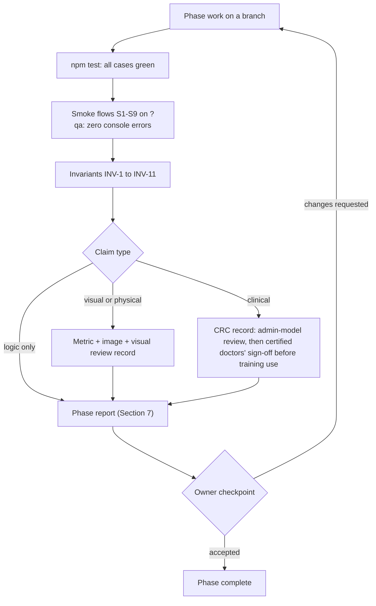
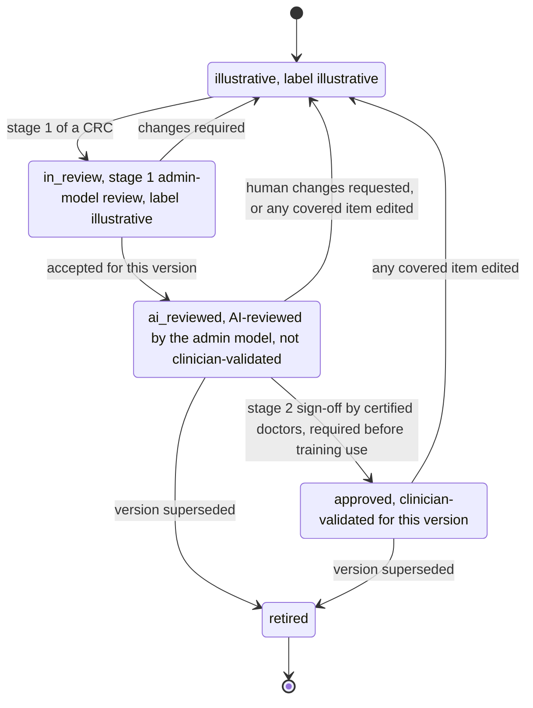

# 09 — Acceptance and Validation Plan

**Purpose.** This document defines what evidence is needed before any phase of the roadmap in [07](07_PRIORITIZED_IMPROVEMENT_ROADMAP.md) may be called complete. It sets the evidence levels, the validation tools (unit suite, browser smoke protocol on the existing `?qa` hook, screenshot baselines, performance capture, expert visual review, clinical review), the metric definitions, the canonical acceptance criteria AC-P0-1 to AC-P11-n, the invariants every phase must keep, the clinical review checkpoints CRC-1 to CRC-7 and the template for a phase completion report. Nothing in this document has been executed: every check, protocol and threshold is PLANNED, and every numeric threshold is **PROPOSED** for owner confirmation under decision D9 (or the decision named beside it). Facts about the current code carry their own labels. The orientation document `Nabd_v1.5_Repository_Review.md` named by the owner does not exist on disk, so the repository is the source of truth.

**Status labels used:** VERIFIED (audit browser run R1–R21, build checks B1–B5) · TEST-VERIFIED (named repository test that passed) · SOURCE-INSPECTED · PARTIALLY VERIFIED · PLANNED · UNKNOWN · DATA-DERIVED (audit analysis; never a test result) · **PROPOSED** (threshold awaiting owner confirmation) · **CLINICAL REVIEW REQUIRED (CR-nn)**.

**Related documents:** [README](README.md) · [01](01_PROJECT_UNDERSTANDING.md) · [02](02_CURRENT_STATE_AUDIT.md) (findings F01–F35) · [03](03_REQUIREMENTS_GAP_ANALYSIS.md) (gaps G01–G23) · [04](04_EXPERIENCE_AND_WORKFLOW_DESIGN.md) · [05](05_HAND_CONTACT_AND_MOVEMENT_OPTIONS.md) · [06](06_APPENDICITIS_CASE_WORKFLOW.md) (CR-01–CR-42; CR-34–CR-42 raised in 11 §13) · [07](07_PRIORITIZED_IMPROVEMENT_ROADMAP.md) (P0–P11) · [08](08_TECHNICAL_DECISIONS_AND_OPEN_QUESTIONS.md) (DN1–DN6, D1–D10, U1–U24) · [10](10_NEXT_IMPLEMENTATION_TASK.md) (T1, T2) · [11](11_FULL_SESSION_SCENARIO.md) (full session scenario; supervisor intervention levels L0–L6) · [Evidence index](REPOSITORY_EVIDENCE_INDEX.md)

**Revision 2026-11-14 (owner decisions, first message).** The owner decided D1, D2, D3, D7 and D9 (decision records in [08](08_TECHNICAL_DECISIONS_AND_OPEN_QUESTIONS.md)). At that point D6 was still pending and D4, D5, D8 and D10 were open; the second revision below settles them. In short:
- **D1, option A+:** every person reuses the existing bodies, modified in-house; the trainee is a full body with the camera at its eyes.
- **D2:** the conversation partner is the owner's own model, reached only through a validating adapter.
- **D3:** a middle register between Fusha and colloquial.
- **D7:** an admin model reviews content and evaluates sessions; content carries one of three trainee-visible labels; human clinical sign-off was then RECOMMENDED (confirmed as required before training use in the second revision below).
- **D9:** desktop and laptop browsers; Chrome and Safari required, Edge and Firefox expected.

D9 fixed the device class and the browsers, not the numeric budget, so every threshold below stays PROPOSED. This revision keeps every existing ID. It appends AC-P3-10 to AC-P3-12, AC-P8-8 to AC-P8-11, AC-P9-8 to AC-P9-12, AC-P10-8, AC-P10-9, AC-P11-7 and AC-P11-8, and updates §1, §2.6, the invariants INV-6, INV-7 and INV-10, and the clinical review checkpoints (Section 6) to the D7 process. Smaller wording changes, with IDs unchanged, are in §2.2, §2.5, §3, §7, the brief §11 traceability table, and the existing criteria AC-P0-8, AC-P3-1, AC-P8-1, AC-P9-1, AC-P9-2, AC-P9-5, AC-P9-6, AC-P10-5, AC-P10-6, AC-P11-2 and AC-P11-6. Section 6 also assigns the new clinical review items CR-34 to CR-42 (raised in [11](11_FULL_SESSION_SCENARIO.md) §13, registered in [06](06_APPENDICITIS_CASE_WORKFLOW.md) §8) to checkpoints, and its status diagram uses the `review.status` values of 06 §1.3.

**Revision 2026-11-14 (owner decisions, second message).** The owner settled the remaining decisions and refined four ([08](08_TECHNICAL_DECISIONS_AND_OPEN_QUESTIONS.md) decision log):
- **D4** is delegated: the team picks the control scheme and consults the owner, with a recommendation, where it matters.
- **D5:** natural movement, with an opening exception.
- **D6** is approved and T1 is in progress.
- **D8:** option A, by our reading of his general approval.
- **D10:** the yellow changes, equipment is redesigned toward realism, and a scope screen stands close to the trainee.
- **D1 refined:** a female nurse with a hair cover and a mask.
- **D2 refined:** a local and an online endpoint.
- **D7 refined:** the certified doctors' sign-off is the confirmed gate for "clinician-validated" and for training use.
- **D9 refined:** the web in desktop browsers.

This revision keeps every existing ID. It appends AC-P4-7 to AC-P4-9 (scope screen near TR-1, no lime-yellow casing, realistic equipment on the floor), AC-P5-10 (declared openings), AC-P9-13 (local and online endpoints) and the invariant INV-11 (natural movement). It updates the wording, with IDs unchanged, of §1, §2.1, §2.2, §2.5, §2.6, §6, §7 (report template), AC-P0-6, AC-P0-9, AC-P4-4, AC-P7-1, AC-P8-11, AC-P9-5, AC-P9-11, AC-P11-6, INV-9, INV-10 and the brief §11 traceability table.

---

## 1. Evidence levels and what counts as completion

| Level | Meaning | Can establish | Cannot establish |
|---|---|---|---|
| VERIFIED | Executed and observed in a recorded browser run (run ID, browser, GPU, viewport stated) | That a flow runs, what it shows, console and network results, renderer counters | Behaviour on other browsers or hardware; FPS unless captured in a visible window |
| TEST-VERIFIED | A named repository test passed in a recorded `npm test` run | Module logic under the test's fakes | Behaviour of the app's inline three.js r180 copy, WebGL, DOM or GLBs (no test touches them; F02) |
| SOURCE-INSPECTED | Code read, not run | What the code is written to do | Visual quality, physical realism, collision reliability, clinical correctness |
| PARTIALLY VERIFIED | Only part of the behaviour was observed | The observed part | The rest |
| DATA-DERIVED (audit analysis) | Read-only scripts over project files | Geometry arithmetic as a hypothesis | Anything as a test result; it must be re-done as a repository test to count |
| UNKNOWN | No reliable evidence | — | — |

**Completion rules (PLANNED).**
1. A phase is complete only when every one of its AC-P<n>-k criteria has the evidence listed in Section 4, at the level listed, and the owner has accepted it at the checkpoint in [07](07_PRIORITIZED_IMPROVEMENT_ROADMAP.md) §6.
2. Source reading alone never proves visual quality, physical behaviour, collision reliability or clinical correctness.
3. A visual or physical claim needs a metric from Section 3, an image or recording, and an expert visual review record (§2.5).
4. A clinical claim needs a CRC record (Section 6). Under D7, an admin-model review record raises an item at most to "AI-reviewed (admin model) — not clinician-validated". Only a record signed by certified doctors makes it "clinician-validated". The owner confirmed on 2026-11-14 that this sign-off is required before the simulator is adopted as training with real trainees (D7); it is also RECOMMENDED before external presentation or any claim of clinical accuracy. Without either record the content stays labelled "illustrative" (DN5).
5. Every phase also keeps the cross-cutting invariants INV-1 to INV-10 (Section 5), and from P3 also INV-11 (natural movement, D5).
6. Results hold only for the configuration that produced them. The audit's single configuration was Chromium 152 (Electron built-in browser), Windows 11, Intel Iris Xe (ANGLE D3D11), WebGL2, 1440×900, and its FPS values are invalid (hidden pane).



---

## 2. Validation infrastructure (all PLANNED)

### 2.1 Unit suite (`node --test`)
- **Today:** 13 files / 21 cases (count SOURCE-INSPECTED: 13 files in `tests/`, 21 `test(` calls). `node --test` reports 20 results: 19 pass, 1 fails, because `tests/forearm-contact.test.js:3` imports the bare package `three` and there is no `node_modules` (F03; VERIFIED B1, whose "20 test files" wording was corrected to 20 reported results by the audit cross-check). `node --check` passes for every `.js`/`.mjs` file in `src/`, `scripts/` and `tests/` (VERIFIED B2). **T1 run (2026-11-14):** after `npm ci`, `npm test` passes 21 of 21, including both `tests/forearm-contact.test.js` cases (now TEST-VERIFIED).
- **Needs** `npm ci` from the existing `package-lock.json` (D6, approved and done in T1). Never `npm install` or `npm update`.
- **Rules.** New tests follow the existing pattern: pure logic, with three.js classes injected exactly as the runtime does (`NabdRuntime.js:5434-5436`). A passing unit test is evidence about module logic only, never about the bundled three.js; every phase pairs it with a browser check (§2.2).
- The case count grows by phase. Each phase report records the total, and no case may be deleted or skipped without owner approval.
- Browser-driven scripts must not match the default `node --test` file patterns (for example not `*.test.js`), so `npm test` stays browser-free. **ASSUMPTION:** names such as `*.spec.mjs` under `tests/browser/` fall outside those defaults; confirm against the Node version actually used in P0. **RECOMMENDATION:** if a browser-automation runner is approved (D6), restrict its test directory to `tests/browser/` so it never collects the `node --test` files.

### 2.2 Browser smoke and regression protocol (`?qa`)
- **Hook (SOURCE-INSPECTED, F32).** `window.__studioQA` exists only with `?qa` (`src/app/NabdRuntime.js:6104-6154`): `getTargets`, `getAssetStatus`, `getSimulationState`, `getScopePixels`, `getState`, `getCamera`, `workMoving`, `getJoints`, `setPose`. `window.NabdSimulation` (`NabdRuntime.js:15-27`) offers `getState`, `getEvents`, `exportEvents`, `clear`.
- **Entry.** `npm run serve` (`scripts/serve.mjs`, 127.0.0.1:4173 by default), URL `/?qa&debug=1`. Wait for `#model-status[data-state="ready"]` (set at 6104) before any QA call: `getSimulationState` reads `abdomen`, `crew` and `toolDepth` without null checks.
- **Order matters.** Entering room view or anatomy silently ends the drill, support and any placed tool (F31). Flows S6 and S7 therefore run after S2–S5 or after a reload.
- **Automation.** Automated with Playwright, which D6 approved on 2026-11-14 (`@playwright/test` pinned to 1.64.1), with the documented manual protocol kept as the fallback. Because D9 requires Safari, the same dependency also provides the WebKit proxy run on Windows (AC-P11-7). T1 run: the installed Chrome 157 and Edge 157 and Playwright's WebKit 27.2 run; Playwright's bundled Firefox does not launch in this environment (BLOCKED, U3).
- **Recorded per flow:** console messages (M11), failed requests, QA readouts saved as JSON, and screenshots where listed.

| Flow | Steps (controls) | Checks / QA readouts | Audit status |
|---|---|---|---|
| S1 Boot | Load, wait for ready | `__studioQA` present; HTTP 200 for 21 modules, 9 GLBs, `vendor/rapier/rapier.mjs`; `#forearm-practice` enabled; V1 counters | VERIFIED R1–R3, R6 |
| S2 Forearm drill | `#forearm-practice` → click wrist → «اقترب» (`[data-work-approach="-1"]`, `index.html:143`) → grip → lift | Out-of-reach status before approach; `forearm.{state, overlap, stops}`; V2 screenshot | VERIFIED R7–R10 |
| S3 Support and release | `#forearm-assist` → release → «إنهاء المساندة» | Label «المشرف مسنّد الساعد» (shown only when `supportGap < 0.020`, 5513-5514); forearm stays raised after release | VERIFIED R11 |
| S4 Training session | «ابدأ التدريب» (`#training-action` or `#trainee-tool`; both call `handleAction`, `NabdRuntime.js:5735`, 5780, 5951; record which was used) → steps 1–5 → result | `phase`, `practice.results`, `NabdSimulation.getEvents()` sequence (golden trace) | Step 1 VERIFIED R15; steps 2–5 UNKNOWN |
| S5 Instruments | Each `#training-tool` value; `#trainee-tray-view`; `#training-source` = staff | Console errors per tool; tray screenshot | Scissors NaN VERIFIED R20; needle-holder NaN SOURCE-INSPECTED (not run); handover UNKNOWN |
| S6 Room and presets | `#toggle-trainee-mode` → each `#camera-*` preset | V3 screenshot and counters; teardown of drill recorded | Room view and presets VERIFIED R6, R13; R12 as corrected by the source cross-check (the drill and support teardown on entering room view is SOURCE-INSPECTED, `NabdRuntime.js:4755-4757`, 5193-5195, 5468-5472) |
| S7 Anatomy | `#anatomy-toggle` → choose the appendix in `#anatomy-organ` → tick `#anatomy-isolate` | `anatomy.keys` (35), `visible`, `selected`; attribution text; V4 | VERIFIED R14; appendix PARTIALLY VERIFIED |
| S8 Hands and locomotion | `#trainee-reach-left/right`, Q/E, hold D for 2 s, `[data-work-step]`, `#work-other-side` | `crew.getState()`; `getCamera()` before/after | Buttons VERIFIED R18; Q/E not exercised (UNKNOWN); WASD UNKNOWN (R19) |
| S9 Port and scope | Scope tool → `#open-tool-field` → align → `[data-tool-depth="1"]` → roll → `#scope-view` | `instrument.{aligned, percent, angles}`, `scope.live`, `getScopePixels()` | Not exercised: UNKNOWN |

Touch checks (U2) use S1–S4; the browser matrix (U3, P11; browsers per D9, AC-P11-7) uses S1–S9. Smoke flow IDs S1–S9 are unrelated to the case stages S0–S9 in [06](06_APPENDICITIS_CASE_WORKFLOW.md).

### 2.3 Screenshot baselines
- **Views.** V1 default bedside view after load; V2 forearm drill after «اقترب»; V3 room view, preset `#camera-room` «من مدخل الغرفة» (ASSUMPTION: matches [evidence/06-room-overview.jpg](evidence/06-room-overview.jpg); confirm in P0); V4 internal anatomy, full view (`#anatomy-reset`). These are the four views with VERIFIED counters (R6). R6 does not record whether «اقترب» had been pressed in its drill view, so a V2 counter difference is explained, not failed.
- **Capture.** Visible window at 1440×900 on the D9 reference machine. Wait until `workMoving()` is false, then a fixed settle time (PROPOSED 2 s). Save `getCamera()`, `cameraRotation` and `cameraFov` beside each image.
- **Storage.** `evidence/baseline-p0/` for P0 and `evidence/p<n>/` per phase. The audit images [01](evidence/01-default-bedside-view.jpg)–[10](evidence/10-scissors-without-blades.jpg) stay unchanged as references of the audited state.
- **Comparison** is by reviewed side-by-side pairs, not pixel equality: the vitals vary on a sine (`src/ui/MonitorUI.js:36-45`) and the hands ease toward their targets.

### 2.4 Performance capture protocol
- **Preconditions.** D9 machine; foreground, unobstructed, visible window (the audit's hidden pane throttled `requestAnimationFrame`); mains power; extensions off. Record browser version, OS, GPU string, display refresh rate, viewport and devicePixelRatio. Also record the OS `prefers-reduced-motion` setting: with it on, the vitals repaint stops after its first draw (`src/ui/MonitorUI.js:132`) and the crew block runs on every frame instead of every > 15 ms (`NabdRuntime.js:5984`, `i` = the reduced-motion media query) (SOURCE-INSPECTED), so the two settings give different loop behaviour.
- **Three segments per view (V1–V4), three runs each, after 10 s settle** (run counts and durations in this section are PROPOSED protocol parameters).
  - *Idle* 30 s, no input. Rendering is on demand (render flag `I`), and the vitals repaint keeps it near 12 Hz (F23; `MonitorUI.js:130-148`, called at 5983), so idle numbers describe the loop, not the rendering cost.
  - *Active* 30 s of continuous input that forces a render every frame: camera orbit in V3/V4, look movement in V1, lift motion in V2. Budgets apply to this segment.
  - *Hover* 30 s of continuous pointer movement with no button pressed, across the patient and the room (added at P1, PR-10). Every move runs the pointer pick, so this is the worst everyday input found in P0 (41.7 FPS in V1; U7, PR-1). Budgets apply to this segment too. `tests/browser/perf-capture.mjs` runs it after the active segment (`--hover <s>`, `--hover 0` skips it).
- **Sources.** rAF timestamps or the browser profiler for M7; the `?debug=1` overlay for M8 and M9. The overlay's FPS is the rAF rate, not the render rate: `diagnosticsPanel.update` runs at the top of every `ee` frame (`NabdRuntime.js:5959`) whether or not the scene renders, and `PerformanceMonitor.sample` counts those calls (`src/core/PerformanceMonitor.js:13-20`; `src/ui/DiagnosticsPanel.js:20-24`) (SOURCE-INSPECTED). It is labelled so.
- **Load (M10).** Three cold (cache disabled) and three warm loads.
- **Extras.** A 120 Hz display capture for U18 when available; scope live vs not live for U10.

### 2.5 Expert visual review protocol
- **Reviewers.** The owner plus one reviewer experienced in 3D characters or animation (named by the owner). Visual review is not clinical sign-off.
- **Material.** Baseline and candidate images at the same presets, plus recordings for motion.
- **Checklist** (from [05](05_HAND_CONTACT_AND_MOVEMENT_OPTIONS.md) §6.5 and brief §7, §10): no visible penetration; no floating gap; no stretched or disconnected limb; wrist within limits; correct left/right; fingers closing coherently; smooth sliding; believable handover; natural staff posture; restrained palette and lighting; no clutter. From P3 (D1): the trainee's body visible when looking down, no head geometry in the first-person view, and a camera height plausible for the body. From P3, P5, P7 and P8 (D5): smooth, natural movement, with no joint turning beyond a natural limit and no hand sinking into the bed or the patient except through a declared opening (INV-11). From P4 (D10): realistic equipment without the lime-yellow casing, and the scope screen close to the trainee during laparoscopy. From P8: roles distinguishable by attire, the nurse reading as an ordinary woman wearing a hair cover and a mask (D1), and physical assistance without visible penetration.
- **Record.** Per item: pass, fail or comment, with reviewer, date and build commit. A "VERIFIED visual" claim needs the metric, the image and this record.

### 2.6 Clinical review protocol (D7, decided 2026-11-14)
1. **Reviewers.** The owner's admin model, with several specialist models under it, reviews the case content, fills in the remaining clinical details and evaluates the trainee's sessions (D7). Certified doctors then audit the content and test the simulator; the owner confirmed on 2026-11-14 that their sign-off is required before the simulator is adopted as training. The owner names them and the clinical sources. This plan names neither.
2. **What reviewers see.** A versioned scenario definition in which every clinical item carries its CR reference, its source fields, its review label and the identity of each reviewer, model or human (DN5; [06](06_APPENDICITIS_CASE_WORKFLOW.md) §1.3; [11](11_FULL_SESSION_SCENARIO.md) §12). The definition must be machine-reviewable, so that the admin model can read it item by item. Human reviewers also get an in-app walkthrough of that exact version. Decisions are recorded per item in the Section 6 formats; any later edit returns the item to `illustrative`.
3. **Three labels, visible to the trainee:** "illustrative" → "AI-reviewed (admin model) — not clinician-validated" → "clinician-validated". Only a signed human record (Section 6) gives the third.
4. **Entry rule.** No clinical value, sequence, instrument, antiseptic, incision detail, patient response or evaluation rule enters the build without source fields and a label. Content drafted or completed by the admin model enters as a draft ("illustrative") and can reach at most "AI-reviewed (admin model) — not clinician-validated" without a human sign-off, never "clinician-validated" ([06](06_APPENDICITIS_CASE_WORKFLOW.md) §1.4). The dialogue model (D2) never supplies clinical content (DN2). **CLINICAL REVIEW REQUIRED**.
5. **Honesty note.** AI review can draft, cross-check and evaluate. It does not equal validation by a qualified clinician for medical-education claims. The certified doctors' sign-off is required before use with real trainees (D7, confirmed by the owner on 2026-11-14) and RECOMMENDED before external presentation or any claim of clinical accuracy. Until then the simulator is built and shown as a prototype.

---

## 3. Metric definitions

All thresholds below are **PROPOSED** (D9, unless another decision is named). "Probe" means a hand contact sample point ([05](05_HAND_CONTACT_AND_MOVEMENT_OPTIONS.md) §6.3).

| ID | Metric | Definition and unit | How measured | Current value | PROPOSED threshold |
|---|---|---|---|---|---|
| M1 | Max penetration depth | Worst signed distance (mm) of probes plus a fixed glove-vertex sample into the skinned patient surface, per frame, per region | `?qa` extension of today's `abdomen.penetration` and `forearm.overlap` | Not measured outside the drill. Drill proxies (F16, DATA-DERIVED): forearm capsule ≈1 cm inside the skin (median, up to ≈3.2 cm); upper-arm capsule protrudes up to ≈1.1 cm | Drill: ≤ 1 mm after resolve (matches the `overlap < .001` assertion in `tests/forearm-contact.test.js:36`, which cannot run today, F03). Whole body: p95 ≤ 2 mm, max ≤ 5 mm |
| M2 | Floating gap | Distance (mm) from each probe in the "touching" state to the surface | `?qa` | UNKNOWN; the height-field lift targets 5 mm above the grid (`CrewController.js:425-434`, SOURCE-INSPECTED) | p95 ≤ 3 mm, max ≤ 8 mm |
| M3 | Contact coverage % per region | Share of an area-weighted, region-stratified sample of non-privacy skin points where a scripted touch attaches and stays | Scripted sweep per hand and per bed side | Forearm drill only, left arm (F15) | ≥ 95 % per region; privacy region 0 % |
| M4 | Contact jitter | (a) RMS frame-to-frame contact displacement along the normal with input still (mm); (b) largest frame-to-frame tangential jump while sliding at a scripted speed (mm) | `?qa` per-frame log | UNKNOWN | (a) ≤ 0.5 mm; (b) ≤ 5 mm |
| M5 | L/R identity invariant | Pass rate of four assertions: asset identity, positive determinant, lateral ordering at rest, handedness basis | Unit tests; `?qa` sample per flow | SOURCE-INSPECTED fixed mapping (F08); no test | 100 % |
| M6 | Hand-swap and flip count | (a) changes of the driving hand without a `chooseHand` input; (b) crew updates where a wrist rotates > 90° without matching input | Event and `?qa` logs over scripted runs | UNKNOWN visually (F09) | 0 and 0 |
| M7 | Frame time median / p95 | rAF interval (ms) in the active and hover segments of §2.4 | §2.4 | UNKNOWN (F33) | Median ≤ 16.7 ms, p95 ≤ 33.3 ms on the minimum machine (08 D9) |
| M8 | Draw calls | `renderer.info` calls via `?debug=1` | §2.4 | V1 1,167–1,206; V2 479–503; V3 1,520; V4 542 (VERIFIED R6) | Unplanned rise > 10 % vs the previous phase triggers review; caps set with D9 after U1 |
| M9 | Triangles | As M8 | §2.4 | V1 378,534–387,848; V2 299,400–303,548; V3 462,240; V4 464,067 (VERIFIED R6) | As M8; planned additions (≈112k per reused body, DATA-DERIVED) listed in the phase report. Under D1 the people alone come to ≈446k triangles (three staff instances of `supervisor.glb` at ≈112,480 each plus the patient at ≈109k; DATA-DERIVED), more than today's whole V1 view |
| M10 | Load time to interactive | Navigation start → `#model-status[data-state="ready"]`, and → `#forearm-practice` enabled (Rapier loaded) | §2.4 | UNKNOWN (U8) | ≤ 10 s from a local server (08 D9) |
| M11 | Console error count | `console.error` messages plus uncaught exceptions and rejections during a flow | Smoke protocol | 0 in default flows (R2); 4 NaN errors after selecting scissors (R20) | 0 |
| M12 | Event completeness | Share of the events a scripted flow expects that appear, in order, with required fields; plus count of unknown-event `RangeError`s (`src/simulation/EventLogger.js:52`) | `exportEvents()` vs the expected list | Nothing recorded before a session (VERIFIED R16) | 100 % and 0 |

Supporting measures used by single phases: visible control count (P2; baseline 39 visible buttons and 8 visible form controls at 1440×900, VERIFIED R5; 90 controls in `index.html`, 47 visible by default per static analysis); joint-limit violations and camera-to-eye offset (P3); staff intersection and teleport counts, and intervention levels demonstrated and logged (P8); panel footprint, model-call log completeness and validation rejections (P9).

---

## 4. Acceptance criteria per phase (canonical)

Each criterion is PLANNED. "Evidence" is what the phase report (Section 7) must attach.

### P0 — Baseline and safety net (Checkpoint 1)

| ID | Criterion | Evidence |
|---|---|---|
| AC-P0-1 | Git repository initialised; a baseline commit holds the untouched v1.5 tree plus `docs/improvement-plan`; `tests/asset-manifest.test.js` passes at that commit | Commit hash, `git show --stat`, clean `git status` |
| AC-P0-2 | `npm ci` completes; `package-lock.json` is byte-identical before and after; `three` resolves to 0.180.0 | Command log; lockfile SHA-256 before/after |
| AC-P0-3 | `npm test` reports 21 cases, 21 pass, 0 fail, including both `tests/forearm-contact.test.js` cases | Full test output |
| AC-P0-4 | `npm run build` exits 0; the built app passes S1–S9 with M11 = 0 apart from the known R20 errors (and the same `Computed radius is NaN` errors for the needle holder, if observed); the standalone preview is not silently deleted by the build (U17) | Build log, output listing, smoke sheet |
| AC-P0-5 | `npm run preview:standalone` still writes `dist/Nabd-Clinical-Simulator-v1.5-Preview.html` (B4: 34.70 MiB) and passes S1 over http; the `file://` result is recorded (U11) | Size, smoke sheet, note |
| AC-P0-6 | Smoke protocol S1–S9 written, executed against `npm run serve` and the Vite preview, automated with Playwright (D6 approved 2026-11-14); results reproduce R1–R21 or explain each difference; R20 reproduced as a known failing check | Protocol, results sheet, QA JSON |
| AC-P0-7 | Baselines V1–V4 captured per §2.3; counters within the R6 ranges, or each difference explained | Images, camera JSON, counter table |
| AC-P0-8 | Performance and load captured per §2.4 (M7, M10) with full hardware identification; thresholds applied once the owner confirms the D9 numeric budget (on 2026-11-14 D9 fixed the browsers, not the budget) | Performance table, profiler trace |
| AC-P0-9 | Every unknown that [08](08_TECHNICAL_DECISIONS_AND_OPEN_QUESTIONS.md) assigns to P0 (U1–U3, U6–U12, U14–U18) has a measured value, an observation or a "not reachable in P0" note; U21 gets a first WebKit look (D6 approved; recorded, not gating); a check that cannot run here is recorded as BLOCKED with its reason (for example Playwright's bundled Firefox, U3) | Unknowns table |
| AC-P0-10 | Apart from the F19 fix carried by T1, nothing under `src/`, `assets/`, `vendor/`, `scripts/` or `index.html` (nor `vite.config.mjs`) differs from the baseline commit; `package.json` and `package-lock.json` differ only by a D6-approved browser-automation dev dependency, in its own commit | `git diff --stat` |

T1 ([10](10_NEXT_IMPLEMENTATION_TASK.md)) is complete when AC-P0-1 to AC-P0-10 and AC-P1-1 hold.

### P1 — Verified defect fixes (Checkpoint 2)

| ID | Criterion | Evidence |
|---|---|---|
| AC-P1-1 | F19: after a fresh load, selecting each of the four tools and opening the tray view gives M11 = 0 (no `computeBoundingSphere(): Computed radius is NaN`); scissors and needle holder show blades | Console capture per tool; before/after pair with [evidence/10](evidence/10-scissors-without-blades.jpg); regression check in S5 |
| AC-P1-2 | F26: in the default GLB path, a read-only `?qa` light listing shows the two lamp lights active, with type, colour and intensity equal to the fallback path | QA JSON; V1/V2 before/after; M7–M9 change recorded |
| AC-P1-3 | F17: (a) touch-follow and (b) forearm-grip normals are world-space skinned normals; new unit tests with rotated fakes agree within 1° (PROPOSED) | Test log; `normal.y` log while sliding across the chest; attach-moment screenshots (U6 recorded, F09 not patched) |
| AC-P1-4 | After an attached release, only the active glove holds a `forearmContact`; `forearm.overlap` and `stops` follow the active hand after a hand switch | QA JSON for both hands; unit test with a fake crew |
| AC-P1-5 | F27: patient-to-pad interpenetration measured first (U4). If confirmed, constants changed so measured penetration ≤ 2 mm (PROPOSED) and S2/S3 still pass; if not, no change | Measurement table, side-view screenshots, `getState().bounds` |
| AC-P1-6 | Rapier 0.21.0 (Apache-2.0) listed in `index.html:311-315`; the standalone preview and the Vite output carry its licence text | Text search of each output |
| AC-P1-7 | One commit per fix; all earlier ACs and INV-1–INV-10 still hold | Commit list, test and smoke results |

### P2 — Runtime seams (Checkpoint 3)

| ID | Criterion | Evidence |
|---|---|---|
| AC-P2-1 | Reach, attach, release, camera, mode and support events are captured before «ابدأ التدريب» (contrast R16); they do not enter the session log; `tests/event-logger.test.js` and `tests/simulation-manager.test.js` pass unchanged | Pre-session event dump; session log of S4 equal to the P0 golden trace except IDs and timestamps |
| AC-P2-2 | The frame registry reproduces the order of `ee` (5954-6007) and the crew gate (5984); a unit test asserts the order; S1–S9 results and M8/M9 stay within the P0 ranges; M7 median not worse by > 5 % (PROPOSED) | Test log, smoke sheet, counters |
| AC-P2-3 | Character, Contact and Scenario interfaces exist, each with a first implementation (supervisor, `createForearmContact`, `setPhase` adapter) and unit tests with fakes | Test log |
| AC-P2-4 | With the developer flag off, exactly the owner-approved authoring controls are absent; with it on, the set of control IDs equals P0 (empty diff) | Control counts and ID diff vs R5; screenshots |
| AC-P2-5 | Switching to room view or anatomy during the drill, support or a placed tool shows a visible notice and logs a `mode_changed` event (a new event type that must be added to `SUPPORTED_EVENTS` in `src/simulation/EventLogger.js`, otherwise `record` throws a `RangeError` at line 52; M12 RangeError count 0); the teardown itself is unchanged (F31) | Screenshot, event dump |
| AC-P2-6 | `window.NabdSimulation` keys unchanged; `__studioQA` changed only additively | Key lists before/after |

### P3 — Trainee embodiment (Checkpoints 4 and 5)

| ID | Criterion | Evidence |
|---|---|---|
| AC-P3-1 | T2 spike (time-boxed, branch only) delivers arm-continuity screenshots in the R9/R10 situation, counters (toward U22), the U13 clone result, the U5 curl sweep and U19 skeleton-origin evidence (under D1 option A+, U19 informs the provenance record, D8, not feasibility); D1 decided (recorded 2026-11-14: option A+, the trainee is an instance of the shared clothed body) | Spike note, images, owner decision |
| AC-P3-2 | No sleeve cylinder exists in any mode (default, workstation, drill, tray, scope) | Scene query via `?qa`; pair with [evidence/03](evidence/03-forearm-lift-stretched-sleeve.png) |
| AC-P3-3 | Shoulder–elbow–wrist chain continuous; segment lengths constant within 1 % (PROPOSED) across the scripted reach set (drill grip and lift, tray pick, abdomen touch; both hands; each work-walk station) | Joint traces via `getJoints` |
| AC-P3-4 | Zero joint-limit violations and zero elbow-pole flips in the scripted reach set, against limits written in the P3 design note and approved by the owner | Traces, unit tests |
| AC-P3-5 | INV-3 tests added and passing; M6 = 0 and 0; a held tool stays with its hand after Q/E | Test log, run log |
| AC-P3-6 | One orientation convention: a unit test asserts fingers point away from the shoulder in every drive path (`contactRotation` both branches, `driveSurface` `'forearm'`, `wristToTool`); instrument roll is limited | Test log; attach-moment screenshots |
| AC-P3-7 | Per-grasp finger poses; curl sweeps 0 / 0.5 / 1 per digit from three views pass visual review for palmar flexion, thumb included (U5) | Images, review record |
| AC-P3-8 | The trainee's head is hidden from the first-person camera; no clipping into the body in V1, V2 and the drill | Images, review record |
| AC-P3-9 | INV-4 holds; M7 within budget; planned M8/M9 increases listed; owner visual sign-off | Smoke sheet, performance table, sign-off |
| AC-P3-10 | The first-person camera is derived from the trainee body's eyes on every crew update (D1). Its position equals the midpoint of the `eye.L` and `eye.R` joints, or a head-bone offset fixed in the P3 design note, within 5 mm (PROPOSED). In the standing default posture the eye height is within ±2 cm (PROPOSED) of the rig's eye height, scaled by any owner-approved body scale. Reference values: `eye.L`/`eye.R` at y ≈ 1.676 m and the eyes primitive at y ≈ 1.661–1.691 m in the rest pose of `assets/staff/supervisor.glb` (DATA-DERIVED (audit analysis)). Today's camera is fixed at y = 1.60 m (`traineeDefault`, `src/app/NabdRuntime.js:4661`, SOURCE-INSPECTED). Presets, look control and the work walk still work (S6, S8) | `getCamera()` against a `?qa` readout of the trainee's eye joints (additive `__studioQA` extension, AC-P2-6) in the standing, reaching and drill postures; unit test with a fake skeleton; smoke sheet |
| AC-P3-11 | Looking down shows the body, and the head stays out of view. With the camera at its lowest look pitch, in the default view and in the drill, the trainee's torso, both arms and both hands are rendered and continuous from shoulder to glove. The head-region geometry is hidden from the first-person camera only, and stays visible to any other camera that shows the trainee. In `supervisor.glb` that region is the primitive with the material "Natural skin • albedo and pores", which spans only y ≈ 1.49–1.73 m (head and neck) in the rest pose, plus the cap, cap binding, face mask, brows and eyes (DATA-DERIVED (audit analysis)). Extends AC-P3-8 | Screenshots at the lowest pitch (V1, V2, drill); per-camera visibility readout via `?qa`; visual review record |
| AC-P3-12 | Role materials applied (D1). The trainee is a skinned clone of the shared clothed body (U13). Its garment materials are per-instance copies, recoloured from a role table held as data (role → material name → colour); the material names are those of `assets/staff/supervisor.glb`, for example "Patient scrub shirt • woven blue", "Surgical cap • spun fabric", "Long sterile gown" and "Surgical face mask" (DATA-DERIVED). Recolouring one instance changes no material of another (doctor, nurse, patient). Colours are a PROPOSAL inside the DN6 identity, approved at owner visual review (D10 if outside it). Which garments and PPE are visible at which stage comes from scenario data and stays flagged CR-31 (and CR-08 for sterility) until reviewed | Material readout per instance via `?qa` (name, colour, owning instance; modelled on the existing `anatomy.patientSkin` listing); unit test of the role table; screenshots; review record |

### P4 — Operating-room composition and lighting (Checkpoint 5)

| ID | Criterion | Evidence |
|---|---|---|
| AC-P4-1 | Top-down layout drawing with stations for trainee, doctor, nurse, patient and table, lights, monitors and trolley, held as data; owner-approved | Drawing, station file |
| AC-P4-2 | A unit test over the station data finds no footprint overlaps and keeps the nurse area clear of the work-walk loop (x ±0.76, z ±1.38; `createWorkWalk({ sideX: 0.76, endZ: Un.halfLength + 0.32 })`, `NabdRuntime.js:4954`, with `Un.halfLength` 1.06; SOURCE-INSPECTED) | Test log |
| AC-P4-3 | Every floor-standing item sits on the floor (floor plane at y = −0.025, `NabdRuntime.js:3872`, SOURCE-INSPECTED) within 2 mm (PROPOSED; an equipment floor-contact tolerance, distinct from the hand-probe metric M2); today 2.6–9.5 cm above it (F28; source and asset arithmetic, visual effect UNKNOWN) | Bounding-box table |
| AC-P4-4 | Task light on the work field in the default path; room GLBs shade with normals; front wall faces inward; casing colour changed as D10 decided (2026-11-14; AC-P4-8) | QA light listing, V1–V3 pairs, review record |
| AC-P4-5 | All camera presets and the work walk still work (S6, S8; `tests/workstation.test.js` passes) | Smoke sheet, preset images |
| AC-P4-6 | M7 within budget and M8/M9 within the D9 caps, with lighting and shadows on; owner visual sign-off | Performance table, sign-off |
| AC-P4-7 | **Scope screen near the operator (D10).** While a laparoscopic stage has the scope station ready (`scopeStationReady`, `NabdRuntime.js:5265`), at least one screen shows the live scope feed. The check is a screen whose material map is `scopeFeed.target.texture`, as the `?qa` screen count already tests (`NabdRuntime.js:6131`). That screen (station slot MON-S, [11](11_FULL_SESSION_SCENARIO.md) §2.3), for each work side the trainee uses, meets three conditions. (a) Its centre is at most 1.5 m horizontally from the trainee's eye position at TR-1 (PROPOSED; today ≈2.1 m to the field display that «انظر إلى الشاشة» turns to, DATA-DERIVED from `NabdRuntime.js:4286`, 4661). (b) Its centre is within ±20° horizontally of the trainee's facing direction toward the work point and between eye level and 25° below it (PROPOSED; today ≈0.23 m above the 1.60 m eye). (c) A sight-line test from TR-1 to the screen centre over the station data finds no staff body at an assigned station and no equipment in the way. The look-at-the-screen step (`setScopeMonitorLook`, `NabdRuntime.js:5269-5297`) turns to this screen. The screen stays outside the sterile field and the work-walk band. Case-specific placement is CR-06 and CR-32; the PROPOSED values are desktop-view ergonomics for the owner to tune, not clinical statements | Station data and sight-line unit test; `getCamera()` and screen-position readout via `?qa`; S9 screenshot from TR-1 with the scope live; owner visual review |
| AC-P4-8 | **No lime-yellow casing (D10).** The `casing` colour `#ebf641` (`NabdRuntime.js:4164`) appears on no material in the room, including the field-display mounts (4291). The replacement colours are listed in the phase report and approved at owner visual review. The interface tokens, fonts and RTL layout are unchanged (INV-9) | `?qa` or unit-test material listing with 0 occurrences; V1–V3 pairs; review record |
| AC-P4-9 | **Realistic equipment on the floor (D10).** Every redesigned device (at least the vitals monitor, endoscopy tower, ESU, suction cart and field displays) is made in-house and has a provenance entry (D8). Its wheels or feet rest on the floor per AC-P4-3 (within 2 mm, PROPOSED). It does not intersect the table, the patient, staff stations or other equipment (AC-P4-2 footprint test extended to equipment). It passes the owner's realism review, with stage-relevant equipment within reach or sight of its user (CR-06) | Bounding-box table; footprint test log; before-and-after screenshots; review record |

### P5 — Whole-body patient contact (Checkpoints 6 and 7)

| ID | Criterion | Evidence |
|---|---|---|
| AC-P5-1 | The contact-model note (model, limits, tests, thresholds; brief §6) approved before implementation | Note, owner decision |
| AC-P5-2 | Repository tests fit proxies to `patient.glb` bind pose: ≥ 95 % of skin vertices weighted > 0.8 lie within the tolerance band per segment, and no proxy protrudes beyond the skin by > 1 mm (PROPOSED); this turns F16 into TEST-VERIFIED data | Test log |
| AC-P5-3 | M3 ≥ 95 % (PROPOSED) per region (forearm, upper arm, chest wall, abdomen, thigh, shin, patient hand, face), per hand, from each bed side; privacy region 0 % | Coverage table |
| AC-P5-4 | M1 and M2 within threshold per region during scripted touch, slide and press | Metric tables, region screenshots |
| AC-P5-5 | M4 within threshold; sliding recordings pass visual review | Logs, recordings, review record |
| AC-P5-6 | Region identification correct on all interior samples; boundary samples listed; every contact normal used for placement is a world-space skinned normal (unit test; extends AC-P1-3 to the whole body) | Sample table, test log |
| AC-P5-7 | Contact plus IK ≤ 2 ms per crew frame; 0 full-skin raycasts during contact; Rapier queries ≤ 120 per hand and ≤ 200 in total ([05](05_HAND_CONTACT_AND_MOVEMENT_OPTIONS.md) §5, PROPOSED); M7 within budget | Profiles |
| AC-P5-8 | A forced Rapier import failure leaves the app usable with a visible notice and no uncaught exception; the only console error is the intended diagnostic (today `console.error('Nabd could not load forearm collision.', …)`, `NabdRuntime.js:6098`), so M11 for this flow counts that one message and nothing else | Smoke sheet |
| AC-P5-9 | INV-4 holds, and the drill works on both arms; feedback is labelled as contact, never as tissue mechanics | Smoke sheet, UI screenshot |
| AC-P5-10 | **Declared openings (D5 opening exception).** The contact service takes the active stage's openings as scenario data: kind (port, scope path, wound or incision), position, radius, and what may pass (hand, port-capable instrument). A permitted object inside a declared opening is not resolved out of the body and is not counted in M1. Anything else, anywhere else, is resolved and counted as usual. Scripted runs show: (a) with no opening declared, hand and instrument probes stay within the M1 thresholds everywhere; (b) a port-capable instrument passes through the selected port (`trainingPort`, `NabdRuntime.js:5257-5260`) while the stage declares it, with the remote-centre maths unchanged (`tests/instrument-depth.test.js` passes); (c) a hand, or a non-port-capable instrument (`supportsDepth: false`), at the same opening is resolved out; (d) once the stage closes the opening, no object remains inside. In v0 the only opening kind is the port; where openings are and what may pass is CR-12 and CR-13. P7 applies the same rule to held instruments | Scripted run log with M1 per probe; unit tests of the opening rule; screenshots |

### P6 — Deterministic scenario state model (Checkpoint 7)

| ID | Criterion | Evidence |
|---|---|---|
| AC-P6-1 | A schema covers stages, expected actions, equipment availability, patient-state outputs and per-item review status (DN5); a test rejects invalid definitions | Schema, test log |
| AC-P6-2 | `'clinical-skills-practice'` runs from a scenario file with thresholds (0.052, 0.088, 0.10, 0.18, 0.045 m; today inline at `NabdRuntime.js:5614`, 5634, 5654, SOURCE-INSPECTED) and Arabic texts unchanged | Diff report, file |
| AC-P6-3 | Each step's outcome is recorded; the result line no longer always reads 5 of 5 (today `${motion.checked.size} من 5`, `NabdRuntime.js:5695`); a premature drop is no longer logged `success: true` (today `success: !cancelled`, 5544) (F24) | Event dump, screenshot |
| AC-P6-4 | The P0 golden traces of S4 replay in Node through the engine and yield the same stage sequence and completion; event streams are replayable fixtures | Test log, traces |
| AC-P6-5 | Scripted sequences yield each of the six response classes (valid, incomplete, needs clarification, premature or out of sequence, unsafe, unsupported), using drill-only, non-clinical rules | Test log |
| AC-P6-6 | INV-6 and INV-7 hold; a browser run through all five steps gives M11 = 0 and M12 = 100 % | Smoke sheet |

### P7 — Two-hand interaction, grasp and handover (Checkpoint 8)

| ID | Criterion | Evidence |
|---|---|---|
| AC-P7-1 | The D4 control scheme is documented with the team's recommendation and approved by the owner where the choice matters (D4 delegated with consultation, 2026-11-14; the working default is "hold-and-act" with mouse and keyboard) | Decision record |
| AC-P7-2 | Both hands act independently (one holds or supports while the other acts); per-hand state-machine tests with a fake crew pass | Test log, recording |
| AC-P7-3 | No teleport on release: a released object moves ≤ 1 cm (PROPOSED) in the next 10 crew updates unless a visible animated return runs | QA trace |
| AC-P7-4 | Objects attach to a grasp frame with per-object grasp poses; finger-to-object penetration ≤ 2 mm (PROPOSED); visual review passes | Metric, images, review record |
| AC-P7-5 | Hand-to-hand handover is animated with no single-frame object jump > 5 cm (PROPOSED); separate instrument objects; port and scope available inside scenarios; scope-feed cost measured (U10) | Recording, trace, profile |
| AC-P7-6 | `tests/instrument-depth.test.js` passes; INV-3 holds; S1–S9 pass; two-hand contact within the AC-P5-7 budget | Test log, smoke sheet, profile |

### P8 — Supervising doctor and nurse (Checkpoint 8)

| ID | Criterion | Evidence |
|---|---|---|
| AC-P8-1 | D1 decided (2026-11-14, option A+: the nurse is an instance of `assets/staff/supervisor.glb`, so its provenance is that asset's plus a record of every in-house modification); provenance and licence recorded (D8) | Provenance file |
| AC-P8-2 | No teleport in view: zero root jumps > 0.1 m in one crew update while inside the camera frustum (PROPOSED) | Trace |
| AC-P8-3 | Zero bounding-volume intersections of staff with table, patient (except the defined support contact), equipment and each other in scripted runs (U16) | Intersection report |
| AC-P8-4 | Whole-body tilt replaced by spine lean (no root rotation about X or Z); head look-at error ≤ 10° (PROPOSED) in scripted states; one scripted doctor demonstration gesture plays within AC-P8-2 and AC-P8-3 (when the doctor may demonstrate is CR-27) | Trace, images, recording |
| AC-P8-5 | The nurse completes request → retrieval → handover → return through the P7 handover; declines unavailable items from scenario state; events logged | Recording, event dump |
| AC-P8-6 | Support still reaches `supportGap < 0.020` m from every work-walk station (U9); DN2 holds | QA table |
| AC-P8-7 | M7 within budget with three full bodies; owner visual sign-off against brief §10 | Performance table, sign-off |
| AC-P8-8 | Each supervisor intervention level of [11](11_FULL_SESSION_SCENARIO.md) §4 (L0 observe, L1 hint, L2 instruct and explain, L3 show, L4 physical assist, L5 take over, L6 pause the case) is demonstrable in its own scripted test run, triggered by the scripted conditions of [11](11_FULL_SESSION_SCENARIO.md) §4 (timers and counters PROPOSED). Each level is logged as `supervisor_intervention` with `level`, `reason` and `stage` (`stage` as the record field; `level`, `reason` and `durationMs` in `metadata`; `record`, `src/simulation/EventLogger.js:51-60`). The event type is added to `SUPPORTED_EVENTS` (lines 1-15), so the M12 `RangeError` count stays 0 (line 52). Every level's choreography stays within AC-P8-2 and AC-P8-3. When the doctor may show or take over is CR-27 | Seven scripted runs, each with a recording and an event dump; M12 report |
| AC-P8-9 | L4 physical assist, the owner's example «يمد إيده، يشيل إيد المريض» ("he reaches out and lifts the patient's hand"). The supervisor's hand target drives the patient's limb IK through the same path the trainee's grip uses: `createLimbDrag` and its `move` (`src/app/NabdRuntime.js:5395-5428`, passed as `startLimb` at 6066; `limb.move`, `src/interaction/ForearmGrip.js:24`; SOURCE-INSPECTED). The supervisor's arm is solved by `reachSupport` generalised to both arms (today right arm only, `src/staff/CrewController.js:143-175`). While lifting and holding: M1 for the supervisor's hand probes against the patient's skinned surface stays within the whole-body M1 threshold (PROPOSED p95 ≤ 2 mm, max ≤ 5 mm); the lifted limb stays inside its IK limits and above the mattress; the trainee keeps control of both hands. After release the limb settles as today (`updateForearmPractice`, `NabdRuntime.js:5492-5517`). Visual review passes | Per-frame QA trace (M1, limb joint angles); recording; review record |
| AC-P8-10 | L5 take-over returns control explicitly. The trigger is a scripted emergency (first the non-clinical scope-signal loss E0 of [11](11_FULL_SESSION_SCENARIO.md) §6) or a classified unsafe action. The supervisor reaches the working position by turning and stepping (no in-view teleport, AC-P8-2), takes the instrument through the P7 handover, and trainee input is limited to the assist or step-back actions that [11](11_FULL_SESSION_SCENARIO.md) §4 defines. Control returns only through an explicit hand-back (a panel line plus an acknowledged action or chip), never through a silent timeout. Start and end are logged (`supervisor_intervention` with level 5, a `reason` that distinguishes a scenario emergency from a trainee action, and `durationMs`), so that P10 does not count an emergency-caused take-over as a trainee fault (weighting CR-20; policy CR-27) | Scripted E0 run with recording and event dump; input log showing control suspended and restored |
| AC-P8-11 | The nurse uses the same body with distinct role attire (D1 option A+): a skinned clone whose recoloured materials differ from the doctor's and the trainee's, per the approved role table (AC-P3-12). Any proportion change is bone scaling within limits written in the P8 design note; the rig has `breast.L`/`breast.R` and `pelvis.L`/`pelvis.R` joints (DATA-DERIVED). The visual result is UNKNOWN (U24) until the owner's visual review, which decides whether an in-house sculpt of the copy is needed. The owner's criterion (D1 refined 2026-11-14) is that she reads as an ordinary woman wearing a hair cover and a mask; which garments show at which stage still follows CR-31. Triangles and draw calls are reported per instance (U22). Three staff instances (≈112,480 triangles each) plus the patient (≈109k) come to ≈446k triangles for the people alone (DATA-DERIVED), above today's whole V1 view (378,534–387,848, VERIFIED R6). Every staff skinned mesh is drawn with frustum culling off and casts shadows (`src/staff/CrewController.js:111-113`; renderer shadow maps enabled on the minified line `src/app/NabdRuntime.js:4632`; SOURCE-INSPECTED). M7 and M9 are within budget, or an owner-approved simplification is recorded | Material and instance readout via `?qa`; side-by-side screenshots of the three staff; M7–M9 table; review record |

### P9 — Communication panel (Checkpoint 9)

| ID | Criterion | Evidence |
|---|---|---|
| AC-P9-1 | The panel shows speaker identity, a short history, decision chips, a text input and a subtle new-message notification; expanded panel ≤ about 25 % of viewport width and ≤ about 50 % of height at 1440×900; on ≤ 650 px a bottom sheet ≤ 40 % of height (narrow desktop windows; D9 excludes phones and tablets for now); collapsed during a grip (PROPOSED; [04](04_EXPERIENCE_AND_WORKFLOW_DESIGN.md) §6) | Measured screenshots at both sizes |
| AC-P9-2 | Every displayed staff line maps to a scenario line ID with review status (`staff_line_delivered`) or, for text produced by the D2 model, to its `model_reply` log entry (AC-P9-11); 0 untraceable lines | Transcript audit |
| AC-P9-3 | With the language layer off or offline, every stage can be finished by chips or direct action; identical inputs give identical transcripts | Transcripts from two runs |
| AC-P9-4 | A physical action that answers a pending instruction is acknowledged without typing | Recording, event dump |
| AC-P9-5 | D2 decided (2026-11-14): the conversation partner is the owner's own model, reached only through the adapter (AC-P9-8). It returns only intents from a closed list; unclear input yields clarification (0 guessed actions); intent accuracy on the reviewed set ≥ 90 % (PROPOSED; U20), measured on each endpoint; network use only to the local and online endpoints the owner configures (D2 refined 2026-11-14: the model runs on both; AC-P9-13) | Test report |
| AC-P9-6 | All panel and status strings pass a register review against D3 (decided 2026-11-14: the middle register; rules and lint in AC-P9-12); doctor and nurse lines flagged CR-22 until CRC-6 | Review record |
| AC-P9-7 | One polite `role="log"` region; no double announcements; typing does not trigger WASD, Q or E; RTL correct | Accessibility check |
| AC-P9-8 | Dialogue adapter contract and state-conflict rejection (D2). The adapter implements the request and response of [11](11_FULL_SESSION_SCENARIO.md) §3.1. Request: role, register, stage, scenario-state summary, allowed intents, allowed actions, recent events, recent messages, trainee message. Response: intent, reply text, optional action from the closed list, confidence, needs-clarification flag. Every response is validated against the P6 scenario state before it has any effect. A fixture suite of conflicting responses (an intent outside the allowed list, an action outside the closed list, an action unavailable at the current stage, an action for another role, a malformed response) is rejected in 100 % of cases with a logged reason, and the scenario state is identical before and after each rejected response | Test log; state snapshots before and after |
| AC-P9-9 | No model output can change vital signs, patient-state outputs, clinical facts or transforms (DN2, INV-7). (a) A static import check shows the adapter cannot reach the monitor, crew, contact, instrument or patient modules. (b) Fixture responses that carry extra fields, such as vital-sign values, patient-state fields or positions, leave `getSimulationState().vitals`, the observation model and every transform unchanged. (c) Reply text that states a number or a clinical value absent from the request's state summary is not displayed and is replaced by the reviewed line for the intent. This PROPOSED rule implements the [08](08_TECHNICAL_DECISIONS_AND_OPEN_QUESTIONS.md) D2 recommendation that clinical statements reach the trainee only from reviewed scenario lines or state values, while the model's own wording stays non-clinical (wording CR-22) | Test log with the import check, fixture runs and state diffs |
| AC-P9-10 | Offline and low-confidence fallback. With the model unavailable (offline, error, or no answer within a PROPOSED time limit), with confidence below a PROPOSED threshold, or with the needs-clarification flag set, the adapter returns the deterministic "needs clarification" response class of P6, with a reviewed clarification line and at most three chips; 0 guessed actions; the stage stays completable by chips or direct action (AC-P9-3) | Scripted runs with the model disabled, delayed and low-confidence; transcripts |
| AC-P9-11 | Every model call is logged: one `model_reply` event per request ([11](11_FULL_SESSION_SCENARIO.md) §9; added to `SUPPORTED_EVENTS`) with request ID, role, stage, intent, confidence, validation outcome (accepted, rejected with reason, fallback), latency, the endpoint that answered (local or online), and model identifier and version. Logged calls equal adapter calls (100 %), and the entries travel in the session export (AC-P10-9). Which trainee text is stored, and where, follows the owner's privacy decision for the online path (TO CONFIRM under D2; INV-10) | Adapter call counter against the event dump; export sample |
| AC-P9-12 | Register check against the D3 rules. Every in-simulation line (scenario lines, fallback and clarification lines, chips, trainee-facing status strings) uses mostly Modern Standard Arabic grammar and vocabulary, uses the light connectors (تمام، خلّينا، طيب، يعني، بدّك) sparingly, avoids heavy dialect words, and gives common clinical terms in Arabic with the English term in parentheses where useful. An automated lint against an owner-maintained list of heavy-dialect words, seeded with colloquial forms found in today's strings (for example «هسّا» and «فلّت», F25), reports 0 hits in scenario and fallback lines. A PROPOSED sample of model replies per stage passes the same review. A named language reviewer signs the record | Lint log; review record; sampled transcripts |
| AC-P9-13 | **Local and online endpoints with one contract (D2 refined 2026-11-14: «رح يعمل على الاثنين», "it will run on both").** The adapter reaches the owner's model through a local endpoint and through an online endpoint, selected by configuration (order, PROPOSED time limit, online allowed or not), with the identical request and response contract of [11](11_FULL_SESSION_SCENARIO.md) §3.1. The AC-P9-8 and AC-P9-9 fixture suites pass unchanged against a scripted stand-in model behind each endpoint. Identical stand-in responses give identical scenario outcomes and transcripts whichever endpoint answers. With one endpoint unavailable the other is used, and with both unavailable the AC-P9-10 fallback applies. Each `model_reply` records the endpoint (AC-P9-11). The online endpoint is never called from a deployment where the owner has not allowed it (INV-10), and the static app holds no API key | Contract-test logs per endpoint; transcripts from both; network log; configuration record |

### P10 — Appendicitis case v0 and evaluation (Checkpoint 10)

| ID | Criterion | Evidence |
|---|---|---|
| AC-P10-1 | A case definition in the P6 format covers the S0–S9 skeleton of [06](06_APPENDICITIS_CASE_WORKFLOW.md); every clinical field carries a CR reference and status | File, schema test |
| AC-P10-2 | No invented values: every displayed observation comes from the definition; empty fields show "pending review"; `dataAt` demo values never appear in case mode (CR-25) | Test, screenshots |
| AC-P10-3 | Full walkthrough of case stages S0–S9, including correction loops, with M11 = 0 and M7 within budget | Recordings, smoke sheet |
| AC-P10-4 | Every debrief statement links to event IDs in the log; the log exports with version and review status | Example debriefs, export |
| AC-P10-5 | Until all blocking CR items have signed human CRC records for this exact version, a non-validated label ("illustrative", or "AI-reviewed (admin model) — not clinician-validated" once admin-model records exist; AC-P10-8) shows in all four places (INV-6) | Screenshots |
| AC-P10-6 | Each CR item in the [06](06_APPENDICITIS_CASE_WORKFLOW.md) §8 register (CR-01–CR-42, including CR-34–CR-42 raised in [11](11_FULL_SESSION_SCENARIO.md) §13, and any later item) has its review records (admin model; human where obtained) or is still visibly flagged; the register table is complete | Register with CRC links |
| AC-P10-7 | Depiction stays at levels DL0–DL2 of [06](06_APPENDICITIS_CASE_WORKFLOW.md) §9 unless CR-23 is signed; no gore or distress effects | Review record |
| AC-P10-8 | Every content item (case fields, observations, staff lines, rules, equipment lists, rubric items) carries exactly one of the three D7 labels ("illustrative", "AI-reviewed (admin model) — not clinician-validated", "clinician-validated"), with its source fields and reviewer identity. The trainee sees the label in the four places of [06](06_APPENDICITIS_CASE_WORKFLOW.md) §1.3 and in the communication panel. A schema test rejects an item without a label, a "clinician-validated" item without a signed human CRC record for this version, and a label change by anyone other than its allowed changer ([11](11_FULL_SESSION_SCENARIO.md) §12). Any edit returns the item to "illustrative" | Schema test log; screenshots of each label in each place |
| AC-P10-9 | The session record exports as JSON in the [11](11_FULL_SESSION_SCENARIO.md) §9 format (scenario ID, version and content hash; the label of every item; the event log, including `supervisor_intervention` reasons; chat, decision and `model_reply` entries; stage outcomes) and validates against its schema. The owner's admin model ingests a sample export without error (owner-supplied evidence). The evaluation it returns (scores per rubric dimension, findings, debrief text, review status) validates and appears in the debrief labelled "AI-reviewed (admin model) — not clinician-validated". Every debrief statement still links to event IDs (AC-P10-4). An intervention logged with a scenario-emergency reason is not counted as a trainee fault (weighting CR-20) | Export sample with schema test; admin-model ingestion record; debrief screenshot |

### P11 — Validation and hardening (Checkpoint 11)

| ID | Criterion | Evidence |
|---|---|---|
| AC-P11-1 | Every phase report contains the Section 7 items (continuous validation) | Report index |
| AC-P11-2 | S1–S9 pass with M11 = 0 on every D9 browser and hardware combination (U3; browsers per AC-P11-7); touch scope per D4 (D9 excludes phones and tablets for now; U2) | Matrix report |
| AC-P11-3 | M7 and M10 within budget in V1–V4 and the case views on the minimum machine; the ≈12 Hz idle repaint handled if the budget needs it (F23) | Performance report |
| AC-P11-4 | The interaction regression suite (drill, regions, two-hand, handover, walkthrough) passes; WebGL context loss and slow-network loading behave as the owner accepts | Regression report |
| AC-P11-5 | D8 resolved; INV-5 holds in every delivery output; the F35 document discrepancies are fixed or annotated | Licence and docs checklist |
| AC-P11-6 | CRC-1–CRC-7 records complete (admin-model records at least; the certified doctors' sign-off is required before adoption as training, Section 6), or the case keeps its non-validated label and stays a prototype; each brief §11 item mapped to evidence below | Records, mapping |
| AC-P11-7 | Browser matrix per D9 (decided 2026-11-14; desktop and laptop only). Chrome (required), Edge and Firefox (expected) on Windows; Safari (required) on macOS, on a real Mac or a remote real-device service. Once D6 approves Playwright, a Playwright WebKit run on Windows from P0 onward, reported as "WebKit on Windows", a proxy for Safari's engine, and never as Safari confirmation (U3, U21; assumption AS15 in [08](08_TECHNICAL_DECISIONS_AND_OPEN_QUESTIONS.md)). The Claude desktop app's built-in browser for development previews (the audit run R1–R21 used a Chromium 152 Electron built-in browser). S1–S9 pass with M11 = 0 in each; browser version, OS and GPU recorded | Matrix report with one smoke sheet per browser |
| AC-P11-8 | API compatibility list checked (U21). The browser-feature table in [08](08_TECHNICAL_DECISIONS_AND_OPEN_QUESTIONS.md) D9 (code locations SOURCE-INSPECTED; minimum versions from MDN browser-compat-data retrieved on 2026-11-14) is re-checked against the compatibility data current at P11, with source and date recorded, and extended with any feature added since. It covers at least: WebGL2; ES modules with dynamic `import()`, including the `data:` URL Rapier load of the standalone build (`src/app/NabdRuntime.js:6088-6092`); WebAssembly (Rapier compat build); Pointer Events with `setPointerCapture` (`src/interaction/BedsideInteraction.js:315`, 335); `CanvasRenderingContext2D.roundRect` in the room builder (`NabdRuntime.js:4080`, 4113); `HTMLDialogElement.showModal` (`src/ui/MonitorUI.js:153`); `ResizeObserver` (`NabdRuntime.js:5854`); `Array.prototype.at`; `Object.hasOwn`; logical assignment `??=` (`NabdRuntime.js:5495`); CSS `dvh` units (`src/styles.css:19`) and `backdrop-filter`. Each entry is confirmed by the AC-P11-7 smoke runs, not by the table alone. Any feature below the owner-confirmed minimum Safari version (TO CONFIRM in [08] D9) gets a fallback or a recorded owner waiver | Updated compatibility table with sources; per-browser smoke sheets; fallback tests or waivers |

### Traceability to brief §11

| Brief §11 item | Criteria |
|---|---|
| 1 Believable operating room | AC-P4-1, AC-P4-3, AC-P4-4, AC-P4-6, AC-P4-7 to AC-P4-9 |
| 2 Patient and human doctor | AC-P8-2, AC-P8-4, AC-P8-7, AC-P8-8, AC-P8-9 |
| 3 Nurse who can assist | AC-P8-1, AC-P8-5, AC-P8-7, AC-P8-11 |
| 4 Natural briefing | AC-P10-3, AC-P9-12, CRC-2 |
| 5 Small chat panel | AC-P9-1, AC-P9-7, AC-P9-8 |
| 6 Reply or act | AC-P9-3, AC-P9-4, AC-P9-10 |
| 7 Request and receive supplies | AC-P7-5, AC-P8-5 |
| 8 Stable, natural hands | AC-P3-2 to AC-P3-7, AC-P3-10, AC-P3-11, AC-P7-2 to AC-P7-4, INV-11 |
| 9 Touch across the body, no penetration | AC-P5-3 to AC-P5-6, AC-P5-10, INV-11 |
| 10 Coherent appendicitis scenario | AC-P10-1, AC-P10-3, AC-P10-8, CRC-4 |
| 11 Contextual guidance and feedback | AC-P6-5, AC-P8-8, AC-P9-2, AC-P9-9 |
| 12 Useful training assessment | AC-P10-4, AC-P10-9, CRC-7 |

---

## 5. Cross-cutting invariants (every phase, from P0)

| ID | Invariant | Check |
|---|---|---|
| INV-1 | Zero console errors and uncaught exceptions in S1–S9. The four R20 NaN errors (and the same NaN errors for the needle holder, if P0 observes them) are a known exception only until AC-P1-1 passes | Smoke sheet (M11) |
| INV-2 | Asset integrity: `tests/asset-manifest.test.js` passes; any asset change comes with a regenerated manifest (`npm run assets:manifest`), a provenance entry and owner approval. RECOMMENDATION: record the SHA-256 of `vendor/rapier/rapier.mjs` in each report, since the manifest excludes it | Test log |
| INV-3 | L/R mapping (DN4): asset identity (`hands.left` from `glove-left`, `CrewController.js:87`), positive determinant (no mirroring), lateral ordering at rest (left glove at camera-space x < 0), handedness basis (`buildHand`, 30-37). Smoke readout before P3; permanent tests from P3 | M5 |
| INV-4 | Forearm drill: S2 and S3 reproduce R7–R11; both `tests/forearm-contact.test.js` cases pass (from P0) | Smoke sheet, test log |
| INV-5 | Licence notices for every component cleared under D8 are present in every delivery output (served tree, Vite output, standalone HTML); Rapier from P1 | Text search |
| INV-6 | Content that is not clinician-validated (not `approved` in [06](06_APPENDICITIS_CASE_WORKFLOW.md) §1.3) shows its D7 label, "illustrative" or "AI-reviewed (admin model) — not clinician-validated", in all four places of 06 §1.3; demo monitor values are never shown as case data; the "DEMO SIGNALS" label (`MonitorUI.js:109`) stays until reviewed data replaces it | Screenshots |
| INV-7 | DN2: no scenario, dialogue or language module writes hand, contact, instrument or patient transforms, and no dialogue or model output sets vital signs or clinical facts (D2); a static import check in the style of `tests/module-graph.test.js` | Test log |
| INV-8 | Privacy: `tests/target-filter.test.js` passes; the privacy region refuses contact (M3 = 0 % there, from P5) | Test log, coverage table |
| INV-9 | Visual identity (DN6): Arabic RTL (`index.html:2`), palette tokens and fonts unchanged. D10 (decided 2026-11-14) changes the equipment's colours and shapes (AC-P4-8, AC-P4-9), not these interface elements | Baseline pairs |
| INV-10 | No network requests beyond the app's own origin, except to the D2 model endpoints that the owner configures: a local endpoint and an online endpoint (D2 refined 2026-11-14; the online one only where he allows it, AC-P9-13). Every such request is logged (AC-P9-11); none today (F22) | Network log per smoke run |
| INV-11 | Natural movement (D5, decided 2026-11-14). (a) Motion of every person and held object is continuous: no in-view teleport or single-frame jump beyond the limits of AC-P7-3, AC-P7-5 and AC-P8-2. (b) Every driven joint of the trainee, staff and patient stays within the limits written in the P3 and P8 design notes, so no full turns (a leg never rotates 360°). (c) No hand, body or held instrument sinks into the table or mattress, the patient, another person or equipment beyond the M1 and AC-P8-3 thresholds. (d) The only exception is an intentional entry through an opening the active stage declares: a port, the scope path, or a wound or incision; AC-P5-10 checks it, and in v0 only the port exists. Checked from P3 as each moving part arrives (trainee P3, contact P5, instruments P7, staff P8); in P0–P2 it is recorded only | Joint-limit traces; M1 per region; intersection reports; recordings with review record |

---

## 6. Clinical review checkpoints CRC-1 to CRC-7

All clinical content is **CLINICAL REVIEW REQUIRED**. Under D7 (decided 2026-11-14) every checkpoint has two stages:
1. **Stage 1, admin-model review.** The owner's admin model and its specialist models review the checkpoint's CR items for one exact scenario version, may fill in the remaining clinical details, and produce one machine-readable review record (format below). Items it accepts move from "illustrative" to "AI-reviewed (admin model) — not clinician-validated".
2. **Stage 2, sign-off by certified doctors (required before adoption as training; CONFIRMED by the owner on 2026-11-14).** Certified doctors in the roles of [06](06_APPENDICITIS_CASE_WORKFLOW.md) §8, named by the owner under D7, audit and test the same version and sign it. Only this stage makes an item "clinician-validated" (the `approved` status of 06 §1.3). It is required before use with real trainees, and RECOMMENDED before external presentation or any claim of clinical accuracy. Until then the simulator is a prototype.

AI review can draft, cross-check and evaluate; it does not equal validation by a qualified clinician. Every CR item in the 06 register (CR-01 to CR-42; CR-34 to CR-42 were raised in [11](11_FULL_SESSION_SCENARIO.md) §13 and imported into 06 §8 on 2026-11-14) is covered by exactly one checkpoint. CR-38 sits in CRC-4; any medication, fluid or blood-product content it includes is reviewed under CR-28 at CRC-5. A CR item added to 06 later must be assigned to a checkpoint here before P10 can close.

| CRC | When | CR items reviewed | Human reviewer roles (06), stage 2 | Unblocks |
|---|---|---|---|---|
| CRC-1 Scope and objectives | During P6, before any case authoring | CR-01, CR-02, CR-23, CR-29, CR-30, CR-34 | Clinical education lead, surgeon, simulation educator, anaesthesia clinician | Case authoring in P10; P8 cast; the trainee's operative role per stage |
| CRC-2 Team roles, attire and briefing | Before P3/P8 clothing content, P8 behaviour content and P9 lines | CR-05, CR-07, CR-26, CR-27, CR-31, CR-35 | Surgeon, nurse educator, perioperative nurse educator, simulation educator | Nurse and doctor behaviour rules; clinical attire per role and stage; take-over, pause and hand-back policy (L5, L6) |
| CRC-3 Room, equipment, positions and safety | Before P10 room setup (P4 and P8 build generic stations until then) | CR-04, CR-06, CR-08, CR-19, CR-32 | Theatre nurse lead, perioperative nurse educator, surgeon | Equipment catalogue, safety stages, case team positions and handover points |
| CRC-4 Procedure sequence and rules | After P6 engine, before P10 rule content (CR-10's region list and the CR-33 abdominal sub-region map may be reviewed earlier if P5 region tests need them; CR-36 before P8 behaviour content is called complete) | CR-09, CR-10, CR-11, CR-12, CR-13, CR-17, CR-18, CR-33, CR-36, CR-37, CR-38, CR-40 | General surgeon, anaesthesia clinician, infection-prevention nurse, nurse educator, perioperative nurse educator, simulation educator, pharmacist (only where CR-38 includes CR-28 content) | Stage graph and response rules; L4 assistance poses; branches E0 and E1; caused emergency triggers (disabled until CR-40 is at least `ai_reviewed`) |
| CRC-5 Observations and patient state | Before the observation model shows case values | CR-03, CR-15, CR-16, CR-25, CR-28, CR-39 | Anaesthesia clinician, surgeon, pharmacist | Monitor display in case mode; branch E2 |
| CRC-6 Anatomy, terminology and lines | During P9/P10 | CR-14, CR-22, CR-24, CR-41, CR-42 | Anatomist or surgeon, clinical education lead, nurse educator, Arabic-speaking clinician, language reviewer (D3) | Atlas use, Arabic labels, staff lines; the identification task (A3); the clinical flag of each dialogue intent |
| CRC-7 Evaluation, debrief and version sign-off | End of P10; gate for P11 | CR-20, CR-21, plus a full walkthrough confirming CRC-1–CRC-6 still apply to this exact version | Clinical education lead, surgeon, simulation educator | The version's label: "AI-reviewed (admin model) — not clinician-validated" after stage 1; "clinician-validated" only after stage 2 |

**Reading "Unblocks".** After stage 1 the dependent work proceeds, with its content labelled "AI-reviewed (admin model) — not clinician-validated". The label reads "clinician-validated" only after stage 2. The admin model's evaluation of trainee sessions (AC-P10-9) carries the same AI label and is not a CRC record.

The diagram uses the `review.status` values of [06](06_APPENDICITIS_CASE_WORKFLOW.md) §1.3. `in_review` is the admin-model review of stage 1 and still shows the "illustrative" label; during a stage 2 human review the status stays `ai_reviewed`.



**Review record formats (one record per CRC session and stage; PLANNED).** Fields are filled by the reviewers, model or human; this plan supplies none of the content.

Stage 1, admin-model review record:

```yaml
record_id: CRC-<n>-<scenario version>-AI-<sequence>
stage: admin_model_review
scenario: { id: <id>, version: <version>, content_sha256: <hash of the definition file> }
build_commit: <commit whose scenario definition was reviewed>
reviewer_model: { name: <admin model>, version: <version>, specialist_models: [<name and version>] }
items:
  - cr: CR-<nn>
    decision: accepted | changes_required | rejected | deferred
    completed_fields: [<field the model filled in, with its source>]
    sources: [<source cited by the model>]
    findings: <text or none>
label_after: "AI-reviewed (admin model) — not clinician-validated"  # accepted items only
invalidated_by: any edit to a covered item or to an item it depends on
```

Stage 2, sign-off record by certified doctors (required before adoption as training; D7 confirmed 2026-11-14):

```yaml
record_id: CRC-<n>-<scenario version>-<sequence>
stage: human_sign_off
scenario: { id: <id>, version: <version>, content_sha256: <hash of the definition file> }
build_commit: <commit reviewed in-app>
items:
  - cr: CR-<nn>
    decision: approved | approved_with_changes | rejected | deferred
    required_changes: <text or none>
    sources: [<title, edition, section supplied by the reviewer>]
reviewers:
  - name: <full name>
    role: <role from 06 §8>
    qualification_statement: <supplied by the reviewer>
    date: <YYYY-MM-DD>
    signature: <method agreed under D7>
conflicts_or_dissent: <text or none>
label_after: "clinician-validated"  # only when all blocking items are approved for this version
invalidated_by: any edit to a covered item or to an item it depends on
```

---

## 7. Completion evidence template

Every phase report is stored as `docs/improvement-plan/phase-reports/P<n>-completion.md` (PLANNED location) and contains:

```markdown
# P<n> completion report
- Phase and scope (07 reference); commit range; branch
- Decisions relied on (DN#, D#) and their recorded outcomes
- Configuration: browser, OS, GPU string, display refresh rate, viewport, Node version
## Acceptance criteria
| AC ID | Result (pass / fail / waived by owner) | Evidence level | Evidence links |
## Tests
- `npm test` totals (cases, pass, fail) and full output link; new tests listed
## Smoke protocol
- S1–S9 results, console error count per flow (M11), QA JSON links
## Invariants
- INV-1 to INV-10: pass/fail with evidence; INV-11 from P3 (recorded only before)
## Proposals and owner answers
- Proposals and questions raised under the working agreement ([08](08_TECHNICAL_DECISIONS_AND_OPEN_QUESTIONS.md) decision log), each with its recommendation and the owner's answer; downloads made under the D6 standing authorisation (what, version, source, size)
## Metrics
| Metric | Previous phase | This phase | PROPOSED/approved threshold |
## Visual evidence
- Before/after pairs at V1–V4 and phase views; recordings; visual review records (§2.5)
## Unknowns
- U# resolved, with method and result; U# still open
## Clinical
- CRC records produced or still pending (stage 1 admin-model, stage 2 human); the D7 label of each CR item; CR items still flagged
## Deviations and known issues
## Owner checkpoint
- Date, decision, conditions
```

A report that leaves any section empty must say why. A criterion without its listed evidence is reported as "not met", never as "assumed".
