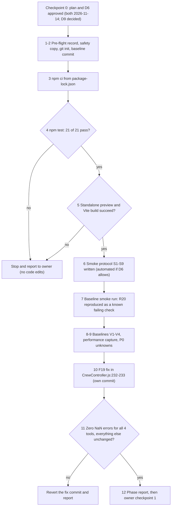

# 10 — Next Implementation Task (T1)

**Purpose.** This document defines the single task to start once the owner approves the plan: **T1 — "Establish the baseline and pass the first verified fix through it."** T1 covers all of P0 (Baseline and safety net) and carries one P1 item, the scissors and needle-holder fix (F19). It gives the scope, steps, affected files, constraints, tests, acceptance criteria, rollback and what the owner will see. **When this task was written, nothing in it had been executed.** Every step, file and result below is written as PLANNED; the only facts are the labelled audit observations. Progress since T1 started on 14 November 2026 is recorded only in the status note below. The owner's orientation document `Nabd_v1.5_Repository_Review.md` does not exist on disk, so the repository is the source of truth.

**Update of 14 November 2026.** The owner decided D9 (desktop computers; Chrome and Safari mandatory) and D1 (option A+), among others ([08](08_TECHNICAL_DECISIONS_AND_OPEN_QUESTIONS.md), decision log). In a second message the same day he approved D6 (option A, including Playwright) and authorised further downloads without asking, and T1 started; see the status note below. Running the simulator locally does not depend on T1: it already works without any project change (Section 3). The task definition below is unchanged; only its approval states are updated.

**Status: the T1 run and the F19 fix are done on branch `t1-baseline-f19`, but T1 is not yet complete under the rule in §9: 7 of its 11 criteria are MET and 4 PARTIALLY MET. Owner checkpoint 1 is pending** ([07](07_PRIORITIZED_IMPROVEMENT_ROADMAP.md) §6). The completion report, with the verdict on AC-P0-1 to AC-P0-10 and AC-P1-1, what is missing, the team actions that close it and the waivers requested from the owner, is [phase-reports/P0-completion.md](phase-reports/P0-completion.md). Commits up to the fix: `acdab52` baseline (tag `v1.5-baseline`; also `main`), `06e2c65` Playwright smoke suite, `a22a424` P0 baseline evidence, `7722a25` owner decisions of 14 November, `006881f` F19 fix. There is no remote, so nothing has been pushed, and nothing is merged into `main`. The progress note below was written while T1 ran and is kept as recorded; the rows added at the end of its table cover steps 6–12.

**Status 14 November 2026: T1 in progress.** Results are from the T1 run: the unit-suite results are TEST-VERIFIED, and the git, dependency, build, browser and performance observations are VERIFIED (T1 run). Nothing here changes the steps or the acceptance criteria.

| Area | Done | Step / AC |
|---|---|---|
| Version control | Git repository created; baseline commit `acdab52` tagged `v1.5-baseline`; work branch `t1-baseline-f19` | Step 2; AC-P0-1 |
| Dependencies | `npm ci` done: `three` 0.180.0, `vite` 6.4.6; `package-lock.json` unchanged by it | Step 3; AC-P0-2 |
| Unit suite | `npm test` 21 of 21 pass; both `tests/forearm-contact.test.js` cases are now TEST-VERIFIED (F03 resolved) | Step 4; AC-P0-3 |
| Builds | The Vite build succeeds (F04 resolved). It empties `dist/` and so deletes the standalone preview, which settles U17; step 5 rebuilds the preview after the Vite build, and the deletion is recorded in the report | Step 5; AC-P0-4, AC-P0-5 |
| Playwright | `@playwright/test` pinned to 1.64.1, released about a month earlier; 1.65.1 was one day old and was avoided. Playwright browsers downloaded (about 1.3 GB) | Step 6 |
| Browsers | Installed Chrome 157 and Edge 157 drive fine. Playwright's WebKit 27.2 runs the app with no console errors (ready ≈3.5 s; "WebKit on Windows", AS15). Playwright's bundled full Chromium and Firefox fail to launch in this environment, so Firefox is **BLOCKED** here, to be resolved (U3) | Step 6; test 13 |
| Performance | Headed Chrome on the Intel Iris Xe: ready ≈3.4 s; about 66 FPS idle in the default view, the first valid frame-rate reading (idle loop rate, not the active-segment budget measure, [09](09_ACCEPTANCE_AND_VALIDATION_PLAN.md) §2.4). A full performance capture is running | Step 8; AC-P0-8 (U1, U8) |
| Smoke suite (added) | `tests/browser/` (`npm run smoke`), run on `serve.mjs` and the Vite preview in Chrome, Edge and WebKit on Windows; Chrome also headed. Before the fix (serve run 2): 48 passed, 2 flaky, 1 failed, 17 skipped (Firefox). R20 reproduced as a known failing check; the needle holder VERIFIED with the same 4 NaN errors. The one failure is WebKit S2 (it grips before «اقترب», so the R8 check fails). [evidence/baseline-p0/RESULTS.md](evidence/baseline-p0/RESULTS.md) | Steps 6–7; AC-P0-6 |
| Visual baselines (added) | V1–V4 in headed Chrome; counters within the R6 ranges except V3 draw calls, 1,528 against 1,520 (cause UNKNOWN) | Step 8; AC-P0-7 |
| Performance (added) | The capture finished and supersedes the preliminary reading above: idle 133–144 rAF FPS with about 12 renders/s; active M7 median 7.0–13.9 ms, p95 14.0–27.8 ms (heaviest V3 room orbit, 69.5 FPS); ready cold 1,621–2,476 ms, warm 1,209–1,349 ms. No threshold applied (D9 budget not confirmed) | Step 8; AC-P0-8 |
| P0 unknowns (added) | U1–U3, U6–U12, U14–U18, U21 and U23 probed; verdicts in [08](08_TECHNICAL_DECISIONS_AND_OPEN_QUESTIONS.md) §3 and [phase-reports/P0-unknowns.md](phase-reports/P0-unknowns.md); Firefox stays BLOCKED (U3) | Step 9; AC-P0-9 |
| F19 fix (added) | Commit `006881f`: `src/staff/CrewController.js:232-233` pass `config.length` for the scissors and needle holder | Step 10; AC-P1-1 |
| Post-fix verification (added) | `npm test` 21/21; build OK (995 ms); smoke on `serve.mjs` in Chrome, WebKit and Edge: 48 passed, 2 flaky (WebKit boot context loss), 1 failed (WebKit S2, pre-existing). S5: 0 console errors for all four tools in all three browsers; with the old known-failure markers still set, Playwright reported "Expected to fail, but passed" for both tools in Chrome and WebKit, and the markers were then removed. Built-in browser: scissors show blades, 0 console errors ([evidence/11](evidence/11-scissors-with-blades-after-f19-fix.jpg)). The post-fix smoke run did not include the Vite preview (AC-P0-4). [evidence/p0-post-fix/post-fix-run.log](evidence/p0-post-fix/post-fix-run.log) | Step 11; AC-P1-1, AC-P0-10 |
| Phase report (added) | [phase-reports/P0-completion.md](phase-reports/P0-completion.md), on the [09](09_ACCEPTANCE_AND_VALIDATION_PLAN.md) §7 template | Step 12 |

**Still to do** (when this note was first written; all of it has since been run, see the added rows, except the post-fix smoke run on the Vite preview; Firefox is recorded as BLOCKED, not resolved; the evidence gaps still open are listed in [phase-reports/P0-completion.md](phase-reports/P0-completion.md)):
- the smoke suite S1–S9 on both servers, with R20 reproduced as a known failing check (steps 6–7; AC-P0-6);
- the V1–V4 baselines and the completed performance capture (step 8; AC-P0-7, AC-P0-8);
- the remaining P0 unknowns (step 9; AC-P0-9), including the Firefox BLOCKED item;
- the F19 fix and its post-fix verification (steps 10–11; AC-P1-1, AC-P0-10);
- the phase report (step 12).

Further downloads, if any, are recorded in the report (D6 standing authorisation).

**Status labels used:** VERIFIED (audit browser run R1–R21, build checks B1–B5, or the T1 run of 14 November 2026) · BLOCKED (a check that could not run in this environment) · TEST-VERIFIED (a named repository test that passed) · SOURCE-INSPECTED · PARTIALLY VERIFIED · PLANNED · UNKNOWN · DATA-DERIVED (audit analysis; never a test result) · **RECOMMENDATION** · **ASSUMPTION**.

**Related documents:** [README](README.md) · [02](02_CURRENT_STATE_AUDIT.md) (F02–F05, F19, F32–F34) · [03](03_REQUIREMENTS_GAP_ANALYSIS.md) (G15, G23) · [07](07_PRIORITIZED_IMPROVEMENT_ROADMAP.md) (P0, P1, P3) · [08](08_TECHNICAL_DECISIONS_AND_OPEN_QUESTIONS.md) (D6, D9, D1, U1–U24) · [09](09_ACCEPTANCE_AND_VALIDATION_PLAN.md) (AC-P0-1 to AC-P0-10, AC-P1-1, S1–S9, §2.3, §2.4, INV-1 to INV-10; INV-11 applies only from P3) · [Evidence index](REPOSITORY_EVIDENCE_INDEX.md)

---

## 1. Task summary

| Scope | Findings | Gaps | Approvals | Effort | Ends at |
|---|---|---|---|---|---|
| All of P0 plus P1 item 1 (F19), exactly as [07](07_PRIORITIZED_IMPROVEMENT_ROADMAP.md) §4 P0 states | F02–F05, F19, F32, F33; F34 as a regression check | G23; G15 (defect only) | D6 APPROVED 2026-11-14 (in progress); D9 decided 2026-11-14 | Small–Medium plus Small | Owner checkpoint 1 ([07](07_PRIORITIZED_IMPROVEMENT_ROADMAP.md) §6) |

---

## 2. Why this task comes first

1. **No safety net exists today.** The folder has no version control (F05). `node --test` reports 20 results, 19 pass; `tests/forearm-contact.test.js`, the only test of `src/interaction/ForearmContact.js` (the v1.5 headline feature), fails at import because `three` is not installed (F03; VERIFIED B1). The Vite build could not be run in the audit because Vite is not installed (F04; B3 NOT RUN), so whether it works is UNKNOWN. No test covers `NabdRuntime.js`, `CrewController.js` or `BedsideInteraction.js` (F02). Every later phase edits one shared closure where the render flag `I` is set in 38 places (F01); without a baseline, regressions are invisible.
2. **The defect is proven and small.** `src/staff/CrewController.js:232-233` passes `instruments.scissors.length` and `instruments.needleHolder.length`, but the entries are `{ model, config }` (194-199), so both are `undefined` and `ringInstrument` (215-230) computes NaN for `mid` and `-length`. Scissors: VERIFIED R20 (four `Computed radius is NaN` errors, no blades, [evidence/10](evidence/10-scissors-without-blades.jpg)). Needle holder: SOURCE-INSPECTED (same path, not selected at runtime). No repository test builds the instrument meshes: the 19 passing results all pass with the defect present, and the one failure (`tests/forearm-contact.test.js`) is unrelated (VERIFIED B1).
3. **It proves the pipeline end to end.** One real fix travels through a commit, the unit suite, the Vite build, a browser smoke check on the existing `window.__studioQA` hook (F32; `src/app/NabdRuntime.js:6104-6154`) and a screenshot pair. A pipeline that cannot confirm this fix cannot protect P3.
4. **Low risk.** Tools are hidden by default (`tool.visible = false`, CrewController.js:250; default `selectTool('grasper')`, 249), and `selectTool` (240-248) already reads `config.length`. Only the mesh built by `ringInstrument` changes; kinematics and default views do not (SOURCE-INSPECTED).

---

## 3. Preconditions and owner approvals

| Item | What is needed | Source |
|---|---|---|
| Plan approval | Owner approves the roadmap at checkpoint 0 | [07](07_PRIORITIZED_IMPROVEMENT_ROADMAP.md) §6 |
| **D6** | **APPROVED on 2026-11-14 (option A, including Playwright); the owner also authorised further downloads without asking.** It had been explained to the owner in plain language ([08](08_TECHNICAL_DECISIONS_AND_OPEN_QUESTIONS.md) D6). **Option A** (RECOMMENDED; approved): `git init`, baseline commit, `npm ci`, optional Playwright dev dependency (plus its browser-binary download). **Option B:** git and `npm ci` only, manual smoke protocol | [08](08_TECHNICAL_DECISIONS_AND_OPEN_QUESTIONS.md) D6 |
| **D9** | **DECIDED on 2026-11-14 for platforms and browsers:** desktop computers; Chrome and Safari mandatory; Edge and Firefox expected. Still to confirm: the reference machine and the PROPOSED budget. M7/M10 thresholds apply only once the budget is confirmed | [08](08_TECHNICAL_DECISIONS_AND_OPEN_QUESTIONS.md) D9 |
| Local preview | **Not a precondition.** The simulator already runs locally without any project change: `scripts/serve.mjs` in the Claude desktop app's built-in browser (VERIFIED B5, R1–R3; started again at `http://localhost:4190` on 2026-11-14), a double-click on `start-dev.bat` (port 4173), or VS Code Live Server, which `.vscode/extensions.json` recommends (UNKNOWN, U23; *the T1 run found that it works*). T1 adds the safety net for changing the app, not the ability to run it | [08](08_TECHNICAL_DECISIONS_AND_OPEN_QUESTIONS.md) D6 |
| Network | `npm ci` fetches the packages pinned in lockfile v3 (`three` 0.180.0, `vite` 6.4.6; SOURCE-INSPECTED); success is UNKNOWN (ASSUMPTION AS8) | `package-lock.json:4, 1029-1031, 1052-1054` |
| Environment | Node and npm (the audit used Node v26.13.1, B1); a **visible** foreground browser window on the D9 machine (audit FPS is invalid: hidden pane) | [09](09_ACCEPTANCE_AND_VALIDATION_PLAN.md) §2.4 |

---

## 4. In-scope steps



1. **Pre-flight record (read-only).** OS, Node and npm versions, browser version and GPU string; SHA-256 of `package-lock.json` and `vendor/rapier/rapier.mjs` (INV-2); confirm `node_modules/` and `dist/` are absent.
2. **Safety copy and baseline commit.** **RECOMMENDATION:** archive the untouched folder outside the project first (F05: no history exists). Run `git init` (the existing `.gitignore` already excludes `node_modules/`, `dist/`, `.vite/`), commit the untouched v1.5 tree plus `docs/improvement-plan/` (including `evidence/`), and tag it, for example `v1.5-baseline`. Confirm a clean `git status` and a passing `node --test tests/asset-manifest.test.js` (AC-P0-1); this test imports only Node built-ins, so it runs before `npm ci` (SOURCE-INSPECTED). Further T1 work goes on a branch, for example `t1-baseline-f19`.
3. **Restore dependencies.** `npm ci` only (never `npm install`, `npm update` or `npm audit fix`). Confirm the lockfile SHA-256 is unchanged and `npm ls three vite` reports 0.180.0 and 6.4.6 (AC-P0-2).
4. **Unit suite.** `npm test`, expecting **21 cases, 21 pass, 0 fail**, including both `tests/forearm-contact.test.js` cases (AC-P0-3). The forearm logic has passed only under an audit shim (DATA-DERIVED (audit analysis)), so this is not yet known. If a case fails, **stop and report**; do not edit `ForearmContact.js` or the test in T1.
5. **Builds, ordered to settle U17.** Run `npm run preview:standalone` (writes `dist/Nabd-Clinical-Simulator-v1.5-Preview.html`, `scripts/build-preview.mjs:7-8`), then `npm run build`, and record whether the Vite build deleted the preview. Re-run the preview if needed; open it over http and `file://` (U11); expect about 34.70 MiB (B4). Build from the project root (`vite.config.mjs:9-14` copies `assets/` and `vendor/rapier/` via `resolve()`). If the build fails, **stop and report**; a config fix is a separate owner decision.
6. **Write the smoke protocol** `tests/browser/SMOKE_PROTOCOL.md`: flows S1–S9 exactly as in [09](09_ACCEPTANCE_AND_VALIDATION_PLAN.md) §2.2. Entry `/?qa&debug=1`; wait for `#model-status[data-state="ready"]` (set at `NabdRuntime.js:6104` with `__studioQA`; `getSimulationState` has no null guards). Run S6 and S7 last or after a reload (F31). `scripts/serve.mjs:7-8` defaults to 127.0.0.1:4173, also Vite's documented preview default (ASSUMPTION; confirm), so run one server at a time or set `PORT` (B5). Under D6 option A, add `tests/browser/smoke.spec.mjs` and `tests/browser/playwright.config.mjs` in a separate commit after AC-P0-2. **ASSUMPTION** (confirm on the Node version used): these names fall outside the default `node --test` patterns, keeping `npm test` browser-free. **RECOMMENDATION:** the Playwright config restricts its test directory to `tests/browser/`, so Playwright never collects the 13 `tests/*.test.js` files. **WebKit runs become possible under option A.** With Safari mandatory (D9), the same spec can also run in Playwright's WebKit and Firefox builds. WebKit on Windows is only an approximation of Safari (U21, AS15), so these runs are reported as "WebKit on Windows", recorded as a first look and not used to gate T1; the browser matrix is gated in P11. Under option B there is no way to check Safari's engine on Windows.
7. **Baseline smoke run on unmodified code**, against `npm run serve` and `npm run preview`. For S5, fresh load per tool: select each `#training-tool` value, open `#trainee-tray-view` («الصينية»), capture the console. Scissors should reproduce R20 as a **known failing check**; the needle holder is recorded as observed. Save QA readouts as JSON (AC-P0-4, AC-P0-6).
8. **Visual and performance baselines.** V1–V4 per [09](09_ACCEPTANCE_AND_VALIDATION_PLAN.md) §2.3 in `evidence/baseline-p0/`, with `getCamera()` JSON and counters compared with R6 (AC-P0-7). Idle and active segments per §2.4, three runs per view, M7–M10 with full hardware identification (AC-P0-8).
9. **P0 unknowns.** A value, an observation or "not reachable in P0" for U1–U3, U6–U12 and U14–U18 (AC-P0-9); for example U14 (hold D for 2 s in a visible window) and U9 (`forearm.supportGap` from each work-walk station).
10. **Apply the F19 fix** as its own commit. These are the only source lines T1 changes:

    ```js
    // src/staff/CrewController.js:232-233 — current (SOURCE-INSPECTED)
    ringInstrument(scissors, instruments.scissors.length, false);
    ringInstrument(needleHolder, instruments.needleHolder.length, true);
    // planned
    ringInstrument(scissors, instruments.scissors.config.length, false);
    ringInstrument(needleHolder, instruments.needleHolder.config.length, true);
    ```

    The lengths then come from `src/instruments/InstrumentConfig.js:11` (0.10) and `:18` (0.113) (TEST-VERIFIED as config values by `tests/instrument-config.test.js`, which passed in B1; the rendered blades are not covered by any test).
11. **Post-fix verification.** `npm test` (21 of 21) and `npm run build` again; S5 for all four tools on both servers with zero NaN errors and blades visible (AC-P1-1); S1–S4 and S6–S9 re-run to show nothing else changed; a tray-view pair against [evidence/10](evidence/10-scissors-without-blades.jpg); `git diff --stat v1.5-baseline` (AC-P0-10).
12. **Report.** `docs/improvement-plan/phase-reports/P0-completion.md` on the [09](09_ACCEPTANCE_AND_VALIDATION_PLAN.md) §7 template, with a section "Carried from P1: AC-P1-1", presented at owner checkpoint 1.

---

## 5. Out of scope

- Any other behaviour or visual change, including the other five P1 items: lamp light (F26), normal spaces (F17), stale `forearmContact`, table constants (F27) and the Rapier licence notice (F30).
- Any edit to `NabdRuntime.js`, `index.html`, `assets/`, `vendor/`, `scripts/`, `vite.config.mjs` or any module other than the two expressions above.
- Fixing failures found in steps 4–5; they are reported, not patched.
- Unit-testing `CrewController.js`: `loadCrew` (line 2) needs GLB models with named bones (`getBone` throws otherwise), a harness larger than the fix. **RECOMMENDATION:** revisit after the P2 seams.
- New features, refactoring, dependency upgrades, Git LFS, CI services and hosting.

---

## 6. Affected files

| Path | Change | Condition |
|---|---|---|
| `src/staff/CrewController.js:232-233` | Two expressions: `.length` → `.config.length` | Always (F19 commit) |
| `tests/browser/SMOKE_PROTOCOL.md` (new) | S1–S9 steps, selectors, expected readouts | Always |
| `tests/browser/smoke.spec.mjs`, `tests/browser/playwright.config.mjs` (new) | Automated S1–S9 and V1–V4 capture | D6 option A only |
| `package.json`, `package-lock.json` | Playwright dev dependency, `smoke` script | **Only** if a browser-automation dev dependency is approved; separate commit |
| `docs/improvement-plan/phase-reports/P0-completion.md` (new) | Results, metrics, unknowns, AC table | Always |
| `docs/improvement-plan/evidence/baseline-p0/` (new) | V1–V4 images, camera and QA JSON, counter and performance tables, S5 before/after images | Always |
| `.git/` (new); `node_modules/`, `dist/` (git-ignored, never committed) | Repository metadata; generated output | Always |

---

## 7. Constraints

- No visual or behaviour change beyond the F19 fix (AC-P0-10); V1–V4 match the baselines apart from sine-varying vitals and hand easing ([09](09_ACCEPTANCE_AND_VALIDATION_PLAN.md) §2.3).
- `three` stays at 0.180.0; the inline r180 bundle is untouched; no dependency upgrades (DN1).
- No restructuring of `NabdRuntime.js` (6,160 lines, 748 KB); seams come in P2.
- No test deleted, skipped or weakened; audit images `evidence/01`–`10` unchanged.
- No app network requests beyond its own origin (INV-10); only `npm ci` and an approved Playwright install use the network, at setup.
- No destructive git operations; rollback is by reverting a commit.

---

## 8. Tests to run and expected results

| # | Check | How | Expected (PLANNED) | Evidence today |
|---|---|---|---|---|
| 1 | Unit suite | `npm test` | 21 cases, 21 pass, 0 fail | 20 results, 19 pass, 1 fail (VERIFIED B1) |
| 2 | Syntax | `node --check` over `src/`, `scripts/`, `tests/` | Pass | Pass (VERIFIED B2) |
| 3 | Vite build | `npm run build`, then `npm run preview` | Exit 0; S1–S9 pass | UNKNOWN (F04, U17) |
| 4 | Standalone preview | `npm run preview:standalone` | About 34.70 MiB; S1 passes over http; `file://` result recorded | http PASS (VERIFIED B4); `file://` UNKNOWN (U11) |
| 5 | S1 Boot and assets | Load `/?qa&debug=1` | HTTP 200 for 21 modules, 9 GLBs, `vendor/rapier/rapier.mjs`; `__studioQA` present; `supervisorVisible === true`; zero console errors | VERIFIED R1–R3; `supervisorVisible` SOURCE-INSPECTED (`NabdRuntime.js:6136`) |
| 6 | S2–S3 Forearm drill | Drill → wrist → «اقترب» → grip → lift → support → release | Out-of-reach status, then grip; support label; forearm stays raised | VERIFIED R7–R11 |
| 7 | S5 before fix | Fresh load per tool, tray view | Scissors NaN errors (known failure); needle holder as observed | Scissors VERIFIED R20; needle holder SOURCE-INSPECTED |
| 8 | S5 after fix | Same, all four tools | M11 = 0 for each; blades visible on scissors and needle holder | PLANNED |
| 9 | S4, S6–S9 | [09](09_ACCEPTANCE_AND_VALIDATION_PLAN.md) §2.2 | Recorded; differences from R12–R19 explained; S4 golden trace saved | R12–R19; steps 2–5 UNKNOWN |
| 10 | Visual baselines | V1–V4 | Images, camera JSON; counters inside R6 ranges (e.g. V1 1,167–1,206 draw calls) | Counters VERIFIED R6 |
| 11 | Performance | §2.4, visible window, four views | M7, M10 recorded with hardware; thresholds after D9 | FPS UNKNOWN (F33) |
| 12 | Scope of change | `git diff --stat v1.5-baseline` | In `src/`, only 2 lines of `CrewController.js`; otherwise new test and doc files (and package files under option A) | PLANNED |
| 13 | Optional: S1–S9 in Playwright WebKit and Firefox (D6 option A only) | The same spec, extra browser projects | Results recorded as a first look and reported as "WebKit on Windows", not "Safari"; not gating T1 | Not run: only Chromium was observed (U3, U21) |

---

## 9. Acceptance criteria

[09](09_ACCEPTANCE_AND_VALIDATION_PLAN.md) §4 states that T1 is complete when AC-P0-1 to AC-P0-10 and AC-P1-1 hold.

| Criterion | Proven by step |
|---|---|
| AC-P0-1 baseline commit, `asset-manifest` test passes | 2 |
| AC-P0-2 `npm ci`, lockfile unchanged, `three` 0.180.0 | 3 |
| AC-P0-3 21 of 21 pass | 4, 11 |
| AC-P0-4 Vite build and built-app smoke | 5, 7, 11 |
| AC-P0-5 standalone preview, `file://` noted | 5 |
| AC-P0-6 S1–S9 written, run on both servers, R20 reproduced | 6, 7 |
| AC-P0-7 V1–V4 baselines and counters | 8 |
| AC-P0-8 performance and load capture | 8 |
| AC-P0-9 P0 unknowns recorded | 9 |
| AC-P0-10 nothing else differs from the baseline | 11 |
| **AC-P1-1** zero NaN errors for all four tools; blades visible | 10, 11 |

Invariants: [09](09_ACCEPTANCE_AND_VALIDATION_PLAN.md) §5 applies INV-1 to INV-10 from P0, so T1 records all ten. How each is checked in T1:

| Invariant | T1 check |
|---|---|
| INV-1 console errors | Smoke sheet; the R20 (and any needle-holder) NaN exception is lifted by AC-P1-1 |
| INV-2 asset integrity | `tests/asset-manifest.test.js` inside `npm test`; SHA-256 of `vendor/rapier/rapier.mjs` in the report (step 1) |
| INV-3 L/R mapping | Smoke readout only (`crew.getState()` with each hand button); permanent tests come in P3 |
| INV-4 forearm drill | S2 and S3; both `tests/forearm-contact.test.js` cases (step 4) |
| INV-5 licence notices | Baseline recorded only: D8 (option A) was decided on 2026-11-14, but the Rapier notice is a P1 item outside T1 |
| INV-6 illustrative labels | "DEMO SIGNALS" (drawn at `src/ui/MonitorUI.js:109`) still shown in the vitals dialog `#vitals-dialog` opened in S4 step 1; no scenario content exists yet |
| INV-7 DN2 import rule | Nothing to check yet (no scenario, dialogue or language modules); the static check is written when the first such module appears |
| INV-8 privacy | `tests/target-filter.test.js` inside `npm test` |
| INV-9 visual identity | V1–V4 baseline pairs before and after the fix |
| INV-10 network | Network log per smoke run: only the app's own origin |

---

## 10. Deliverables and evidence

- Commit hashes and the baseline tag (separate commits: baseline, smoke protocol, optional Playwright, F19 fix).
- Full output of `npm ci`, `npm test` (before and after the fix), `npm run build` and `npm run preview:standalone`, with lockfile hashes.
- Completed smoke results sheets for both servers (plus run log if automated).
- `evidence/baseline-p0/` contents listed in Section 6, including per-tool S5 console captures before and after the fix.
- `phase-reports/P0-completion.md` with the AC-P0-9 unknowns table and every §7 section filled in or explained.

---

## 11. Rollback

| Situation | Action |
|---|---|
| The fix misbehaves | Revert the F19 commit; behaviour returns to the recorded baseline |
| Playwright unwanted | Revert its commit, then `npm ci` |
| Toolchain unwanted | Delete the git-ignored, regenerable `node_modules/` and `dist/` |
| Version control unwanted | Only on the owner's explicit request; the pre-T1 archive (step 2) is the untouched reference |
| `npm ci`, tests or build fail | No source has changed yet; report and wait for the owner |

---

## 12. What the owner will see

- **In the simulator:** the default views look as they do today. In the tray view, the scissors and needle holder show blades, and choosing either no longer produces console errors. Whether the blades *look* right is a visual-review item ([09](09_ACCEPTANCE_AND_VALIDATION_PLAN.md) §2.5), not a T1 claim.
- **Outside the simulator:** a project with history and a tagged baseline; 21 of 21 test cases passing and a working Vite build (or a reported stop); a smoke checklist with results; four baseline screenshots; the first valid frame-rate table for the stated hardware; a short report on the P0 unknowns.
- **At checkpoint 1 the owner decides** ([07](07_PRIORITIZED_IMPROVEMENT_ROADMAP.md) §6): accept the baseline; approve P1's remaining fixes and P2. D8 is already decided (option A, 2026-11-14), so the Rapier notice can go into P1. **RECOMMENDATION:** at the same checkpoint, authorise T2 and set its time box (07 places T2 directly after P0 in its dependency graph; its review is checkpoint 4). Under the working agreement ([08](08_TECHNICAL_DECISIONS_AND_OPEN_QUESTIONS.md) decision log), any proposal that arises during T1 goes to the owner with a recommendation in the phase report.

---

## 13. The following task: T2 (P3 spike)

**T2 — Full-body trainee arm continuity on the shared rig.** It is time-boxed, uses a branch only, and ends with an owner visual review. The length of the time box is set by the owner at checkpoint 1.

- **What it tries** (D1 option A+, decided on 2026-11-14: the existing body reused in-house; [08](08_TECHNICAL_DECISIONS_AND_OPEN_QUESTIONS.md)): a body on the existing 163-joint skeleton, a clone of `assets/staff/supervisor.glb`; the first-person camera at that body's eyes (≈1.66–1.69 m in rest pose, DATA-DERIVED, against today's fixed 1.60 m at `src/app/NabdRuntime.js:4661`); two-bone arm IK from the real shoulder to the existing hand targets computed in `updateHand` (`CrewController.js:362-435`), reusing the pattern of `reachSupport` (143-175), which already drives the supervisor's right arm on this rig (SOURCE-INSPECTED, called at 483; the support hand itself was observed in R11, and the audit cross-check of R12 established that it is the supervisor's own arm); head hidden from the first-person camera; `updateSleeve` (437-453) disabled on the branch.
- **What it delivers** (AC-P3-1): screenshots in the R9/R10 grip-and-lift situation against [evidence/03](evidence/03-forearm-lift-stretched-sleeve.png), counters against the P0 baselines (including the cost of the extra full body, U22), the U13 skinned-clone result, the U5 curl sweep and U19 skeleton-origin evidence.
- **Why it follows T1:** it needs T1's baselines to measure against; it targets the most visible defect (F06, F07; VERIFIED R4, R10); and it tests the decided D1 approach before P3 and P8 build on it. Being a throw-away branch, it can start right after P0 ([07](07_PRIORITIZED_IMPROVEMENT_ROADMAP.md) dependency graph).
