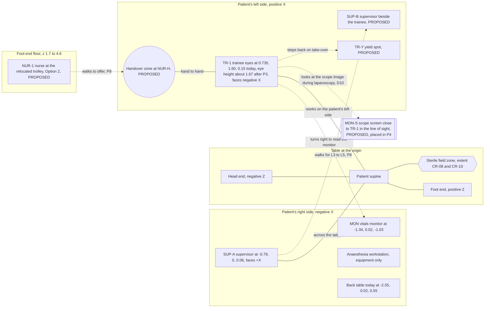
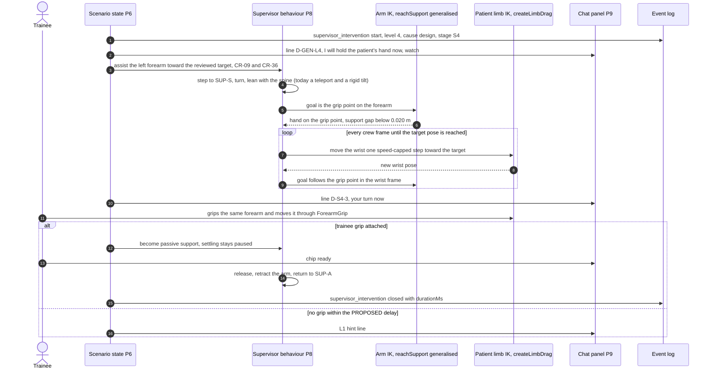
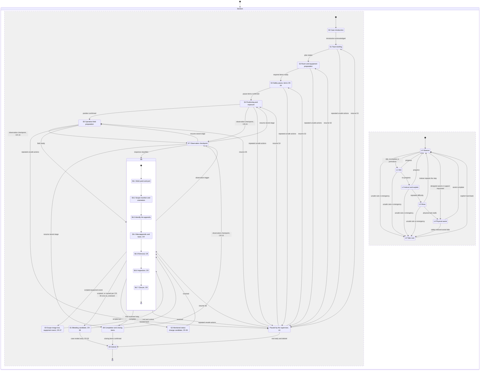

# 11 — Full Session Scenario: Appendicitis, Operative Session (Storyboard and Script)

**Purpose.** This document is the complete storyboard and script of Nabd's first training session: an appendicitis case followed through an operative session, from the case introduction to the debrief. It answers the owner's request of 14 November 2026 to design the whole scenario. It covers the cast (§1), stations (§2), communication by chat and by action (§3), the supervisor's intervention ladder (§4), the scene-by-scene script (§5), emergency branches (§6), equipment availability (§7), the state machine (§8), the event and admin-model contracts (§9), evaluation and debrief (§10), the mapping onto today's code and the roadmap (§11), review labels (§12) and new clinical review items (§13).

**Nothing in this document is implemented.** It is a planning document, and everything about the session is PLANNED. Statements about the current repository carry a status label and a `path:line` citation.

**Audiences:**
1. Engineers, who build it phase by phase ([07](07_PRIORITIZED_IMPROVEMENT_ROADMAP.md)).
2. The owner's admin model (D7), which reviews the case and fills in the clinical placeholders (§12).
3. Certified doctors named by the owner, who audit the clinical items and test the session before it is adopted as training. The owner confirmed this on 2026-11-14 (D7); until then the session is a prototype.

**Status labels used:** VERIFIED (the audit's browser run R1–R21 and build checks B1–B5) · TEST-VERIFIED (a named repository test that passed) · SOURCE-INSPECTED · PARTIALLY VERIFIED · PLANNED · UNKNOWN · DATA-DERIVED (audit analysis: read-only scripts over project files; never a test result). VERIFIED and TEST-VERIFIED describe software behaviour only; no label in this document states clinical correctness. Non-facts are marked **RECOMMENDATION**, **ASSUMPTION** or **PROPOSED** (a value for the owner to tune). Every clinical item is marked **DRAFT — CLINICAL REVIEW REQUIRED (CR-nn)**.

**Content policy.**
- **Non-clinical content is fully specified.** This covers people, positions, movements, beat order, team-communication lines, chat behaviour, UI, detection logic, branches, intervention mechanics, logging and evaluation mechanics.
- **Clinical content appears only as a DRAFT placeholder** in square brackets with its CR item, for example «[بنود التحقق — CR-04]» ("[check items]").
- **No clinical numbers.** The document states no vital-sign values, thresholds, doses, drug names, clinical durations, anatomical measurements, port sizes or energy settings, and nothing in it is clinically validated. Its only numbers are technical facts about the code and assets, and PROPOSED interface timers.
- **CR numbering.** CR-01–CR-33 are the original items of [06](06_APPENDICITIS_CASE_WORKFLOW.md) §8 and are cited wherever the item is the same. This document raised CR-34–CR-42 (§13); they are now also registered in 06 §8, which is the canonical register, and assigned to checkpoints in [09](09_ACCEPTANCE_AND_VALIDATION_PLAN.md) §6.

**Related documents:** [README](README.md) · [02](02_CURRENT_STATE_AUDIT.md) (F01–F35) · [03](03_REQUIREMENTS_GAP_ANALYSIS.md) (G01–G23) · [04](04_EXPERIENCE_AND_WORKFLOW_DESIGN.md) (roles, panel, events, questions Q1–Q18) · [05](05_HAND_CONTACT_AND_MOVEMENT_OPTIONS.md) · [06](06_APPENDICITIS_CASE_WORKFLOW.md) (stage skeleton, labels, CR register CR-01–CR-42) · [07](07_PRIORITIZED_IMPROVEMENT_ROADMAP.md) (P0–P11) · [08](08_TECHNICAL_DECISIONS_AND_OPEN_QUESTIONS.md) (decisions, unknowns) · [09](09_ACCEPTANCE_AND_VALIDATION_PLAN.md) (AC, CRC, INV) · [10](10_NEXT_IMPLEMENTATION_TASK.md)

**Source note.** The orientation document `Nabd_v1.5_Repository_Review.md` named in the owner's original instructions does not exist on disk. The repository and the audit evidence are the source of truth. In this document `NabdRuntime.js` means `src/app/NabdRuntime.js` and `CrewController.js` means `src/staff/CrewController.js`.

**The owner's request (14 November 2026):**
- «في عنا شات على الجانب التواصل يكون من خلالها» ("we have a chat on the side; communication goes through it")
- «التواصل يكون بأفعال» ("communication also happens through actions")
- «إذا في تدخلات عادي يتدخل» ("if interventions are needed, that's normal: he intervenes")
- «يمد إيده، يشيل إيد المريض» ("he reaches out and lifts or moves the patient's hand or arm")
- «هو يتصرف إذا صار عنا حالة طارئة» ("he acts if an emergency arises")
- «نرسم السيناريو بالكامل» ("let's design the full scenario")

**Decisions this document depends on** (14 November 2026; detail in [08](08_TECHNICAL_DECISIONS_AND_OPEN_QUESTIONS.md)):
1. **D1, decided (A+):** every person derives from the existing bodies: the staff from `assets/staff/supervisor.glb`, the patient from `assets/patient/patient.glb`. Roles differ by recoloured materials, phase-appropriate PPE and small in-house edits. The trainee is a full body and is the camera: «المتدرب بدي إياه جسم يكون، مش إيدين بس. ويكون هو الكاميرا بأبعاد مناسبة فيزيائياً» ("the trainee must be a body, not only hands, and is the camera, at physically correct dimensions"); a nurse joins the team: «رح يكون في عنا كمان ممرضة» ("we will also have a nurse").
2. **D2, decided (hybrid):** the conversation partner is the owner's own model, now being trained. P9 builds an adapter with validation and a deterministic fallback; the scenario state stays the single source of truth.
3. **D3, decided:** in-simulation text uses a middle register between Fusha and colloquial: «لا عامية كثير ولا فصحى كثير، بالنص بيناتهم» ("not too colloquial, not too formal, in between").
4. **D7, decided:** an admin model that supervises specialist models reviews the case, evaluates the session and fills in details. Content is labelled illustrative → AI-reviewed → clinician-validated.
5. **D9, decided:** desktop browsers. Chrome and Safari are required, Edge and Firefox expected; Unity is a separate future project.
6. **D4, delegated with consultation** (second message, 2026-11-14): the team chooses the most suitable control scheme and asks the owner, with a recommendation, where the choice matters. Controls stay written device-neutrally here; today's mouse-and-keyboard mapping is an example, and "hold-and-act" is the working default.

**Refinements and further decisions of the owner's second message (14 November 2026):**
- **D1 refined:** changing the features of the copied bodies is approved, and no new 3D human is built from scratch. The nurse is a woman of ordinary appearance with a hair cover and a mask: «نفس شكل الإنسان العادي، في غطاء على شعرها، في كمامة» ("the same look as an ordinary person, with a cover on her hair and a mask"); see §1.2 and §1.4.
- **D2 refined:** the model runs both locally and online, so the adapter has two endpoints with one contract (§3.1).
- **D5, decided:** movement is smooth and natural; no hand sinks into the bed or the patient, except an intentional entry through an opening the stage declares (a wound or incision, a port or the scope). It applies to every physical beat, including the L4 assist and the L5 take-over (§4.1).
- **D7 refined:** certified doctors audit the content and test the session before it is adopted as training; that sign-off is the gate for "clinician-validated" (§12).
- **D9 refined:** the web, in desktop browsers, for now.
- **D10, decided:** the yellow equipment colour changes and the equipment is redesigned toward realism. During laparoscopy a screen showing the procedure stands close to the trainee (slot MON-S, §2.3; S6).
- **D6** is approved and T1 is in progress; **D8** is option A. Neither changes this design.

**Conventions.**
- **Line IDs:** `D-` doctor, `N-` nurse, `T-` trainee chip or phrase, `SYS-` system; `-GEN-` lines are reusable (§3.3, §7). Every staff line shown maps to an ID with a review status, or to its `model_reply` entry (AC-P9-2).
- **Arabic:** lines appear in «…» with a short English gloss, and square brackets inside «…» mark a placeholder. Second-person forms are masculine by default ([04](04_EXPERIENCE_AND_WORKFLOW_DESIGN.md) Q6).
- **Response classes** ([06](06_APPENDICITIS_CASE_WORKFLOW.md) §5): **V** valid · **IN** incomplete · **NC** needs clarification · **PR** premature or out of sequence · **UN** unsafe (reviewed rules only, CR-17) · **US** unsupported. Nurse requests add **unavailable** and **inappropriate** (04 §8.2). Every V line is paired with SA-6 (nod) once P8 provides it.
- **Clinical markers:** every "(CR-nn)" reference and every bracketed placeholder «[… — CR-nn]» in this document means **DRAFT — CLINICAL REVIEW REQUIRED (CR-nn)**. The content is unreviewed (status `illustrative`) and is shown with its label (§12) until its review record exists.
- **"Reviewed" and "approved":** "reviewed" means filled in the scenario file under its CR item through the D7 pipeline. Such content carries its current label and never implies clinician validation. Applied to content, "approved" and the status `approved` are reserved for clinician-validated content (§12); the owner's approval of plan decisions is a separate use of the word.
- **Staff lines:** every doctor, nurse and system line written out here, including the core set of §3.3 and the nurse lines of §7, is DRAFT under **CR-22** (clinical content, wording, tone) with status `illustrative`. A line that touches a clinical topic also carries that topic's CR item.
- **Other IDs:** levels L0–L6 (§4); trainee actions A1–A8 and staff actions SA-1–SA-7 (§3.2); stations TR-1, TR-Y, SUP-A, SUP-B, SUP-S, NUR-1, NUR-H, MON and MON-S (§2.3; MON-S added 2026-11-14 for D10); emergency branches E0–E2 (§6).

---

## 1. Cast

### 1.1 Cast decisions

| Topic | Decision (PLANNED) and evidence |
|---|---|
| Nurse role | The **scrub nurse**, who prepares the instrument table and hands instruments over; a circulating role is a future option (CR-26, CR-30). No nurse exists today (F13; VERIFIED R13); a comment names the "scrub-nurse side" (`NabdRuntime.js:4366`) |
| Anaesthesia | Only the anaesthesia workstation and the vitals monitor represent it; there is no character. An anaesthetist character is a future option (CR-30). The patient's anaesthesia and consciousness state at each stage, and where induction and emergence fall relative to S3–S5 and S8, are not depicted and are DRAFT — CLINICAL REVIEW REQUIRED (CR-16, CR-28, CR-30) |
| Trainee camera | The camera is the trainee body's eyes. Today it sits at y = 1.60 m (`traineeDefault`, `NabdRuntime.js:4661`), and the work walk reuses that height (`positionAtWork`, 5134) (SOURCE-INSPECTED). In the rig's rest pose the eye joints sit at y ≈ 1.676 m and ≈ 0.13 m in front of the body axis, and the eyes primitive spans y 1.661–1.691 m (DATA-DERIVED). The eye height therefore becomes ≈ 1.67 m unless the body is scaled |
| Trainee body in view | The head-region meshes are hidden from the first-person camera only. The torso and both connected arms are visible when the trainee looks down, which the pitch clamp allows to −1.28 rad (`NabdRuntime.js:6073`); the arms use two-bone IK (P3). The rest-pose shoulder joints at (±0.204, 1.429, 0.019) (DATA-DERIVED) sit ≈ 0.09 m further back, ≈ 0.03 m wider and ≈ 0.02 m lower relative to the eyes than today's virtual shoulder (`shoulder()`, `CrewController.js:356-360`: camera + 0.17 m lateral + (0.02, −0.225, 0)) (DATA-DERIVED), so `canReach` (279-281) is re-measured in T2 |
| Patient | An adult male, consistent with the model: the licence notes credit a "Male base mesh, rigged A-pose" with textures derived from `middleage_asian_male` (`index.html:537-538`; SOURCE-INSPECTED). Age, history and findings are placeholders (CR-02, CR-03); the stated age should suit the model's appearance |

### 1.2 Cast table

| | Trainee «المتدرّب» | Supervising doctor «الطبيب المشرف» | Nurse «الممرضة» | Patient «المريض» |
|---|---|---|---|---|
| Role | Observes, asks, decides, acts; presents the case and plan; requests, receives and returns instruments; performs the steps assigned to the trainee (CR-34); yields on take-over | Briefs, instructs, asks, explains, corrects calmly, demonstrates, assists physically, takes over in emergencies, summarises the debrief (CR-27, CR-35, CR-36) | Prepares the table; answers requests; clarifies; declines with a reason; hands over and receives; leads the count if the reviewed case says so (CR-19, CR-26) | Pose, exposure and observations change only through the scenario state (CR-09, CR-16) |
| Body (D1) | `supervisor.glb` instance, trainee materials. Interaction hands: the body's own gloves primitive (27,362 triangles) or the glove GLBs rebound to the body; T2 decides ([05](05_HAND_CONTACT_AND_MOVEMENT_OPTIONS.md) §3(a); 07 P3). This script assumes the glove GLBs, with the body's gloves primitive hidden for the trainee only | `supervisor.glb` as today | `supervisor.glb` copy, nurse materials, in-house shape and feature edits: a woman of ordinary appearance with a hair cover (surgical cap) and a face mask (D1 refined 2026-11-14) | `patient.glb`: ≈ 109k triangles, 163 joints, A-pose made supine by rotating the group (`hd`, `NabdRuntime.js:4585@45443`) |
| Station and posture | TR-1, standing, facing −X | SUP-A, standing, facing +X | NUR-1, beside the trolley | Supine today (the case position is CR-09), head toward −Z |
| Behaviour states | 04 §2.1 states, including Yielding, plus **Assisting** during L5 | 04 §2.2: Observe, Instruct, Question, Explain, Correct, Demonstrate, Assist, TakeOver, Paused, Evaluate | 04 §2.3 states plus **Counting** (S8) | None autonomous |
| Today | Camera + two gloved forearms (F06; VERIFIED R4, R21) | Full body, procedural pose, teleports, no gaze or speech (F11; VERIFIED R4, R13) | Absent (F13) | No breathing, face or pain response (SOURCE-INSPECTED) |

### 1.3 Attire and colour proposal

**Facts** (DATA-DERIVED: a read-only parse of the GLB JSON, 14 November 2026):
- **One skinned body.** `supervisor.glb` is one skinned mesh of 11 primitives plus brow and eye meshes, all on the 163-joint `PatientRig`, with no clips or morph targets.
- **Garment materials.** The garments are separate primitives with named materials: `Patient scrub shirt • woven blue`, `Patient scrub shorts • woven blue`, `Surgical cap • spun fabric`, `Long sterile gown`, `Scrub trousers`, `Closed theatre footwear`, `Supervisor gloves`, `Surgical face mask` and two binding materials. They use flat colour factors with **no base-colour texture**, so a role colour is a material colour change. Each person needs its own material copies; otherwise all three recolour together (04 §2.5).
- **Today's colours** (sRGB equivalents of the factors, before lighting): shirt `#598c91`, trousers `#305c67`, cap `#6a969b`, gown `#3d7c81`, gloves `#6f9bb1`, mask `#c4ddde`. The trainee glove GLB: nitrile `#6c9eba`, sleeve stub `#355b65`.
- **Coverage.** The only skin primitive covers the head and neck. The gown covers the arms and the gloves primitive the hands (04 §2.5).

**PROPOSAL: colours by role.** The owner asked for this: «ويكون الألوان اللي هم لابسينها مختلفة حسب الاختصاص» ("the colours they wear should differ by specialty"). The values stay within the muted, cool identity (DN6) and are reviewed against the P0 baselines (04 Q17); a change to the overall palette is D10. Garments per stage and sterility are **CLINICAL REVIEW REQUIRED (CR-31, CR-08)**, including whether local theatres use role colours at all.

| Role | Shirt / trousers | Cap | Gown when scrubbed | Gloves | Mask |
|---|---|---|---|---|---|
| Supervising doctor | `#598c91` / `#305c67` (today's) | `#244f53` (`--teal-deep`, `src/styles.css:304`) | `#3d7c81` (today's) | `#6f9bb1` | `#c4ddde` |
| Trainee | `#6f8f7c` / `#4d665a` (muted sage) | `#6f8f7c` | `#3d7c81`, one colour for all scrubbed staff | `#6c9eba` (today's nitrile; on the glove GLBs, or on the body's gloves primitive if T2 keeps it) | `#c4ddde` |
| Nurse | `#6a83a1` / `#4b5f78` (muted slate blue) | `#6a83a1` | `#3d7c81` | `#6f9bb1` | `#c4ddde` |

**How the proposal reads in the room.**
- **Role identity.** The three shirts have similar lightness and differ in hue. Once the team is gowned, the cap, the station and the panel's speaker chip carry the role; the chip also serves colour-vision deficiencies (RECOMMENDATION).
- **Gowned phases.** From [stage — CR-31] only the cap carries the role colour. PROPOSED: also recolour the gown's edge binding per role if the `Garment edge binding` material belongs to the gown (which primitive it binds is UNKNOWN until inspected); owner decision OQ-4.
- **PPE by phase (DRAFT — CLINICAL REVIEW REQUIRED, CR-31, CR-08).** In the illustrative build, scrubs, cap and mask are shown for everyone from S0 [CR-31]; [the scrubbed roles — CR-31, CR-34] add a sterile gown and gloves from [stage — CR-31]. The scenario file lists the garments per person per stage, and the character layer shows or hides the matching primitives (P6, P8).
- **Gowning.** Physical gowning and gloving are not simulated ([06](06_APPENDICITIS_CASE_WORKFLOW.md) §10); they are confirmed in the panel or narrated (CR-08, CR-31).
- **Limit.** Hiding the gown or the gloves leaves arms or hands without a surface, so a "scrubs only" phase needs in-house bare-arm geometry, for example cut from `patient.glb`, which shares the skeleton (F14).

### 1.4 Limits of one shared body (D1 A+)

- **One base body and face** for all four people. Caps and masks hide much of the face.
- **The female nurse.** The owner wrote «ممرضة», a female nurse, and confirmed on 2026-11-14: «لو كانت الممرضة بنت عادي ما عندنا أي مشكلة» ("if the nurse is a woman, that's fine"). She looks like an ordinary person with a hair cover and a mask; the cap and mask primitives already exist on the body. Changing the features of the copy is approved («موافق على تغيير ملامح المجسمات الموجودة», "I agree to changing the features of the existing models"). Shape may need more than recolouring. Scaling the `breast.L/R` and `pelvis.L/R` joints (DATA-DERIVED) reshapes body and clothes together; the technique and result are UNKNOWN (U24; 04 Q2, answered). A Blender sculpt of the copy still counts as in-house. The owner's acceptance criterion: she reads as an ordinary woman wearing a hair cover and a mask (AC-P8-11).
- **Triangle budget (U22; DATA-DERIVED).**
  - One `supervisor.glb` copy is ≈ 112,480 triangles; the gloves primitive alone is 27,362 and the footwear 17,414.
  - The measured 378,534–387,848 (VERIFIED R6) already contains the patient, one supervisor copy and both glove GLBs. Adding a trainee body and a nurse (+2 × 112,480, less any hidden primitives) gives roughly 0.58–0.61M counted triangles in the bedside view (DATA-DERIVED arithmetic). The real load is higher still. The counters exclude the shadow pass, because `renderer.info` resets after shadow rendering (`NabdRuntime.js:3860`), and every skinned person casts key-light shadows (4066; `CrewController.js:112`) with frustum culling off (`CrewController.js:111`). Frame rate is U1; budget U22.
  - Measurement and in-house simplification are needed in P0, T2/P3 and P8, for example decimating gloves and footwear and hiding the trainee's head region. Frame rate is U1.
- **Cloning.** Three skinned instances need a skinned clone or one parse each (U13).

---

## 2. Room and stations

### 2.1 Frame and head end (facts)

- **Axes.** The table centre is the origin and +Y is up. **The patient's head points to −Z (the back wall), and +X is the patient's left.**
- **Code labels.** `positionAtWork` labels a stance with abs(x) < 0.61 «جهة الرأس» ("head end") when z < 0 and «جهة القدمين» ("foot end") otherwise. Any other stance is labelled «يسار المريض» ("patient's left") when x > 0 and «يمين المريض» ("patient's right") otherwise (`NabdRuntime.js:5142-5143`, SOURCE-INSPECTED). The head work region sits at z −0.815 (`workRegions.head`, 4956).
- **Patient asset.** The head top is at z ≈ −0.80 and the feet at z ≈ +0.98 (DATA-DERIVED).
- **The trainee's view.** The default view faces −X, so the trainee's right is the head end and the left is the foot end ([evidence/01](evidence/01-default-bedside-view.jpg)).
- **Free floor.** The −X side is crowded. Free floor exists in the +X head quadrant (x 1.1 to 3.2, z −2.9 to −0.7) and at the foot end (z 1.7 to 4.6) (DATA-DERIVED; not checked in a browser).

### 2.2 Base layout

A coordinate-accurate top-down sketch of today's room is in [04](04_EXPERIENCE_AND_WORKFLOW_DESIGN.md) §3.1. The schematic below adds the station slots of §2.3 (not to scale):



### 2.3 Station slots

Slots are named positions that each stage assigns in the scenario file; no behaviour code hard-codes a position. The coordinates of new slots are PROPOSED examples derived from the rest-pose joint positions (DATA-DERIVED arithmetic), to be measured in P4 (AC-P4-2). Team positions are **CLINICAL REVIEW REQUIRED (CR-32)**.

| Slot | Purpose | Position | Status |
|---|---|---|---|
| TR-1 | Trainee working position | Eyes at (0.735, 1.60, 0.15) today; after P3 the camera follows the body's eyes (≈1.67 m, §1.1). Facing −X (`NabdRuntime.js:4661`); the body root stands ≈ 0.13 m behind, toward +X. The drill and `nearArm()` assume this side (5371, always `leftArm`); `changeWorkSide` reaches the other side (5220) | Camera existing (SOURCE-INSPECTED); body P3 |
| TR-Y | Trainee yield spot during L5 | One step back toward +X: in work focus, eyes at most x = 1.01 (0.76 + 0.25 «ابتعد» offset, `src/core/WorkstationNavigation.js:38`, `NabdRuntime.js:4954`). PROPOSED eyes at (1.01, eye height, 0.30), or a P3/P8 extension of the cap. The free-walk clamp (`step`, 4931-4937; x 0.65–1.36, z −1.14–1.19) does not apply in work focus (4932); there the camera follows `workWalk.position()` (5131-5134) | PROPOSED |
| SUP-A | Supervisor across the table | (−0.79, 0, 0.06), facing +X (`CrewController.js:88-94`) | Position SOURCE-INSPECTED (`CrewController.js:88-94`), presence VERIFIED R4. In work focus (S4–S6) he is moved today to (−1.94, 0, 0.25) (`CrewController.js:462-463`, via `NabdRuntime.js:5181`) and the Mayo stand to x −1.61 (5183). P8 keeps him at SUP-A |
| SUP-S | Supervisor support stance (L4) | Today: x = −sign(trainee x)·0.55, z = support point z + 0.15, facing the bed (`CrewController.js:467-469`; side from `NabdRuntime.js:5511`) | Existing (VERIFIED R11). L4 from SUP-B is PLANNED and unverified until AC-P8-6/U9 |
| SUP-B | Supervisor beside the trainee for L3–L5 | Trainee's right (head side), for example root (0.95, 0, −0.55), at least about 0.6 m from the trainee's root. It lies on the work-walk band, so trainee walking is locked while it is occupied. The owner has allowed the doctor to come to the trainee's side (04 §12) | PROPOSED |
| NUR-1 | Nurse at the trolley | **Option 2 (foot end; recommended in 04 §3.2):** root ≈ (0.75, 0, 1.95), trolley relocated to about x −0.55…0.55, z 2.2…2.6. **Option 1 (+X head quadrant):** about (1.9, 0, −1.6). Both stay outside the work-walk loop band (abs(x) ≤ 1.01, abs(z) ≤ 1.63) | PROPOSED (04 Q1). The back table is at (−2.55, 0.02, 0.55) today (`NabdRuntime.js:4367`), ≈ 2.7 m from the trainee's virtual shoulder |
| NUR-H | Nurse handover stand and zone | Nurse root ≈ (1.30, 0, 0.95), facing the trainee. Zone centre ≈ (0.95, 1.05, 0.55), ≈ 0.44 m from the trainee's rest-pose left shoulder. Its position relative to the sterile field depends on who is scrubbed at each stage and is DRAFT — CLINICAL REVIEW REQUIRED (CR-08, CR-31, CR-32). It is re-measured after T2, because a real arm reaches less than today's 0.87 m gate (`canReach`, `CrewController.js:279-281`) | PROPOSED |
| MON | Monitor visible from TR-1 | (−1.34, 0.02, −1.03), rotation y 1.29 rad (`NabdRuntime.js:4264`), about 30° to the right of the trainee's view (04 §3.2) | Existing (SOURCE-INSPECTED) |
| MON-S | Scope screen near the operator (D10, decided 2026-11-14) | A screen showing the live scope image during laparoscopic stages, close to TR-1 and in the trainee's line of sight toward the work point, not blocked by the supervisor or the nurse at their stations, and outside the sterile field (CR-08). PROPOSED limits in AC-P4-7: centre at most 1.5 m horizontally from the trainee's eyes, within ±20° of the facing direction and between eye level and 25° below it. Today the feed reaches the tower screens and both field displays (`scopeFeed.attach`, `NabdRuntime.js:6028`; `src/instruments/EndoscopeFeed.js`). «انظر إلى الشاشة» turns to the field display across the table at (−1.38, 1.83, 0.12) (`setScopeMonitorLook`, 5269-5297), about 2.1 m from TR-1's eyes and above eye level (DATA-DERIVED). The tower (2.54, 0.02, 0.24) is behind the trainee. One MON-S per work side the trainee uses (`changeWorkSide`, 5220); its placement for the case is CR-06 and CR-32 | PROPOSED (P4) |

**Zones.**
- **Sterile field zone** (DRAFT; extent CR-08, CR-10): the prepared and draped table area plus the instrument surfaces of the trolley and the Mayo stand. It is data for rules, never a visible highlight. Today sterility exists only in comments and material names ([06](06_APPENDICITIS_CASE_WORKFLOW.md) §2.2).
- **Handover zone** (PROPOSED): a sphere of radius r_H (PROPOSED 0.12 m) at the NUR-H centre. The precedent is today's deposit test: a release within 0.10 m horizontally and 0.18 m vertically of `crew.offeringPoint()` counts as returned (`NabdRuntime.js:5632-5636`, SOURCE-INSPECTED).

---

## 3. Communication model

### 3.1 Side chat panel and model integration

**The panel (PLANNED, P9)** follows [04](04_EXPERIENCE_AND_WORKFLOW_DESIGN.md) §6:
- docked at the inline-end edge (screen-left in Arabic RTL) and never full-screen (at most about a quarter of the width; AC-P9-1);
- collapsed to a chip by default, and while a grip or a handover is in progress; while collapsed, the chip shows the start of the newest staff line, and UN, L5 and L6 lines also appear for a few seconds as one line in the stage pill (`.viewport-info`, `index.html:86-91`) without expanding the panel (PROPOSED);
- speaker chips «المشرف» ("the supervisor"), «الممرضة» ("the nurse") and «أنت» ("you"); the speaking character also turns in the room. Staff-to-staff lines show the addressee, for example «المشرف إلى الممرضة» ("the supervisor to the nurse");
- the last 3–5 messages, and at most 2–3 decision chips, never offered when the expected answer is an action;
- a one-line text input. `T` opens it; it is unused today, and the keydown handler already ignores typing (`NabdRuntime.js:5821`);
- an unread dot and one soft pulse, no sound (F22);
- the content's review label in the header (§12).

Today there is no panel and no text input (VERIFIED R5).

**On screen during the session (PLANNED, P2/P9; brief §9).** Only the 3D room; the chat chip or panel; the stage pill (`.viewport-info`, `index.html:86-91`) showing the Arabic stage name (§5); the depth controls (`#tool-depth-controls`) only while a depth-capable instrument is held; and the review label in the panel header. Everything else (the 21 `#trainee-hud` buttons, camera presets, pose and limb sliders, `#training-session`) is hidden in trainee mode behind the developer flag (P2; F25; [04](04_EXPERIENCE_AND_WORKFLOW_DESIGN.md) §10). Slices A–C (§11.2) run in trainee mode.

**Model integration (D2).** The conversation partner is the owner's model: «رح يكون عبارة عن موديل» ("it will be a model").
- **What P9 builds.** An adapter: a fixed request and response contract, a validator, and a deterministic fallback. The model itself is outside this plan. P9 tests the adapter against a scripted stand-in model ([08](08_TECHNICAL_DECISIONS_AND_OPEN_QUESTIONS.md) D2).
- **Hosting (decided 2026-11-14).** The model runs both locally and online: «رح يعمل على الاثنين» ("it will run on both"; 04 Q5, answered). The adapter therefore reaches a local endpoint and an online endpoint with the same request and response contract below, and falls back to the deterministic path when neither answers (V6; AC-P9-13). Each `model_reply` records which endpoint answered. Requests leave the app's origin only for the endpoints the owner configures (INV-10). The online endpoint is used only where he allows it, and its privacy notice and cost are TO CONFIRM.
- **Register reference.** The owner's model is being trained now («إحنا حالياً قاعدين مندرب الموديل»). RECOMMENDATION: give the line catalogue of this document (IDs, Arabic, glosses, each with its review label) to that training effort as the D3 register and intent-to-line reference. V4's register check is deterministic: free text is rejected if it contains an avoid-list word (§3.3), an exclamation mark or more than two sentences; the clinical screen of V4 (no digits or number words, no units, no CR-24 clinical term) applies in addition. The matching catalogue line is used instead.

Request (one per trainee message; illustrative values; P9 fixes the schema; `recentEvents` capped at 20 and `recentMessages` at 6, PROPOSED):

```json
{
  "contract": "nabd.dialogue.v0-draft",
  "requestId": "req-000123",
  "role": "nurse",
  "register": "middle",
  "stage": { "id": "S6", "sub": "S6.2" },
  "stateSummary": {
    "completedStages": ["S0", "S1", "S2", "S3", "S4", "S5"],
    "equipment": { "grasper": "available", "scope": "available", "scissors": "premature" },
    "hands": { "left": "empty", "right": "empty" },
    "interventionLevel": 0,
    "caseFacts": [ { "id": "fact-02-1", "text": "[case fact text — CR-02]", "reviewStatus": "illustrative", "cr": "CR-02" } ]
  },
  "allowedIntents": ["request_item", "ask_availability", "ask_case_question", "confirm", "ask_help", "ask_why"],
  "allowedActions": [
    { "type": "hand_over", "items": ["grasper", "scope"] },
    { "type": "decline", "reasons": ["unavailable", "premature", "inappropriate", "unsupported"] },
    { "type": "clarify" }
  ],
  "recentEvents": [ { "eventId": "[id]", "event": "handover_completed", "timestamp": "ISO-8601", "stage": "S6", "instrument": "grasper", "metadata": { "giver": "nurse", "receiver": "trainee" } } ],
  "recentMessages": [ { "speaker": "doctor", "lineId": "D-S62-1" } ],
  "traineeMessage": { "text": "[trainee text]", "channel": "typed" }
}
```

Response:

```json
{
  "requestId": "req-000123",
  "model": { "id": "owner-model", "version": "[version]" },
  "intent": "request_item",
  "slots": { "item": "scope" },
  "replyText": null,
  "lineIds": ["N-S62-1"],
  "action": { "type": "hand_over", "item": "scope" },
  "confidence": 0.92,
  "needsClarification": false
}
```

**Validation rules** (deterministic validator of P6/P9; AC-P9-8 to AC-P9-11):

| # | Rule | On failure |
|---|---|---|
| V1 | The response is well-formed and matches `requestId` | Discarded; fallback (V6) |
| V2 | `intent` is in `allowedIntents` | Clarification (NC) |
| V3 | `action` is in `allowedActions`, belongs to the addressed role, and fits the state: stage availability (§7), hands, intervention level | Rejected with a logged reason; the deterministic class line is used (for example premature) |
| V4 | No clinical facts, vital signs, patient state or transforms from the model (DN2); extra fields are ignored and logged (AC-P9-9). For intents flagged clinical in the intent catalogue (CR-42), only catalogue lines (`lineIds`) or `caseFacts` are shown, each with its current label. Free `replyText` is shown only for intents flagged non-clinical, and only if it passes the D3 register check and a deterministic screen: no digits or number words, no units, no term from the CR-24 clinical term list. Otherwise it is dropped | Text dropped; reviewed or fallback line used |
| V5 | `confidence` at or above the P9 threshold (PROPOSED; calibrated on the U20 test set) and `needsClarification` false | Clarification line with at most three catalogue chips |
| V6 | The model is reachable on the local or the online endpoint and answers within the P11 latency budget (D9) | Deterministic fallback: phrase matcher with Arabic normalisation, plus chips. Every stage stays completable without the model (AC-P9-3) |
| V7 | Every call is logged as `model_reply` (§9.2) | — |
| V8 | An accepted `action` is only a request to the scenario engine (P6), which runs the staff behaviour (P8) | — |

### 3.2 Communication through actions

The owner: «التواصل يكون بأفعال» ("communication happens through actions").
- **An action is a complete answer.** No chip duplicates a physical action (brief §4; 04 DP2).
- **Recognition is deterministic,** built from simulator events; no model interprets motion (DN2). It depends on the P2 always-on stream: today only whitelisted records inside a session reach the EventBus (`SimulationManager.js:16-19`; R16), and the `'reach'`/`'motion'` callbacks and stance changes are not emitted.
- **Logging.** Each recognised action emits `action_recognised` (§9.2) with its evidence events, and closes the pending request it answers (AC-P9-4).

In the table below, "How" is device-neutral (D4, delegated to the team with owner consultation), with today's default control as the example. Every physical action follows the D5 movement rules: smooth motion, natural joint limits, and no hand sinking into the bed or the patient except through an opening that the stage declares.

| ID | Action | How | Detection (event; code) | Meaning | Who responds |
|---|---|---|---|---|---|
| A1 | Receive an instrument | Bring the empty active hand into the handover zone while the item is held out; close it on the handle. Today: choose the hand with Q/E (`NabdRuntime.js:5831-5832`) or the hand buttons, then click the handle; click-to-hold keeps it (`BedsideInteraction.js:361-367`) | Today, supervisor only (SOURCE-INSPECTED; not exercised at runtime, R17): `resetTool` sets `offered` (`NabdRuntime.js:5531-5536`); the handle is pickable once `offerProgress > 0.92` (6064); the grip attaches when the palm is within 0.024 m (`BedsideInteraction.js:294`) and logs `instrument_picked` (`NabdRuntime.js:5541-5542`); the offered tool follows `offeringPoint()` (`CrewController.js:344-346`, 494-499). Outside work focus only: in work focus an `offered` tool is hidden (`CrewController.js:494-495`) and only a `placed` tool can be picked (`BedsideInteraction.js:57`). PLANNED: `handover_offered`, `handover_completed`, `action_recognised{A1}` | "I have it" | Nurse: «تمام.» ("fine"), back to NUR-1 |
| A2 | Return an instrument | Release it inside the handover zone, or on a declared surface (P7) | Today: a release within 0.10 m horizontally and 0.18 m vertically of `crew.offeringPoint()` in the deposit step sets `returned` (`NabdRuntime.js:5632-5636`); other releases teleport the tool (`resetTool`; F20). PLANNED: `handover_completed` | "Take it back" | Nurse takes it (P7) and counts it in S8 |
| A3 | Point at or identify | Aim the tool tip or the scope-view centre at the structure and hold still (`identifyDwellMs`, §4.1), or name it in the panel | Precedent: the aim step's tip check (`NabdRuntime.js:5614`). No picking inside the scope image exists. PLANNED: `identification_attempt` | "This is it" | Doctor confirms or corrects (acceptance rule CR-41) |
| A4 | Yield | Release the contested item and step back to TR-Y | `release` (`BedsideInteraction.js:137-153`) plus position at TR-Y. PLANNED: `action_recognised{A4}` | "Your control" | Doctor proceeds (L5) |
| A5 | Confirm by doing | Look at the monitor or open its close-up | Today: a tap on the 3D monitor opens it (`tap`, `NabdRuntime.js:6076-6080` → `openMonitor`, 5744-5748); quiz pattern `confirmOxygen` (5721-5734); opening is not logged. PLANNED: `observation_viewed` | "I've checked" | Doctor asks what was seen |
| A6 | Ask for help | Chip «ساعدني» ("help me"), «أرني» ("show me"), «لماذا؟» ("why?"), or typed | Analogue: «اطلب مساندة المشرف» toggles `station.support` (`index.html:148`; `NabdRuntime.js:5484-5491`); not logged. PLANNED: `chat_decision` | "Help me" | Doctor at L1–L4 by policy |
| A7 | Position the patient's arm | Grip the forearm near the wrist, lift, place, release | Drill: grip point within 0.062 m of the left wrist (`BedsideInteraction.js:44-55`); attach after pad gap ≤ 0.028 m, overlap ≤ 0.003 m and 130 ms (268-291); `createForearmGrip` moves the wrist ≤ 0.33 m/s through `limb.move` (`src/interaction/ForearmGrip.js:13-25`); logged as `patient_interaction` inside a session only (`NabdRuntime.js:5545-5548`; R16). Grip and lift VERIFIED R7–R10, left arm only. Today a released forearm returns to its rest pose unless support is on (`NabdRuntime.js:5497-5505`). The grip envelope is ±0.085 m across and −0.024…+0.15 m vertical from the grip start (`src/interaction/ForearmGrip.js:14-15`). Targets outside the swing/bend limits (`limits: dd[...]`, 5408) return null (5415-5416). A persistent placed pose needs a new 'accept pose as rest' state (P5/P7). The reviewed target (CR-09) must lie inside these limits or they must be extended | "Positioned" | Doctor checks the pose (target and tolerance CR-09, CR-36) |
| A8 | Prepare the field | Slide a held applicator across the region; technique CR-10 | Inside the calibrated abdominal patch a skin gesture is `press` or `abdomen` (pinch), per `#work-action` (`NabdRuntime.js:5039`; `index.html:131-134`), and deforms the skin. `touch` (skin-following, `BedsideInteraction.js:206-218`, F17 normal at 212-213) applies only outside the patch (`NabdRuntime.js:5040`). A non-deforming slide action is needed (P5). The logged region is the selected one (`NabdRuntime.js:5546`). PLANNED (P5): `contact_slide_summary`, CR-33 region map | "Prepared" | Doctor checks coverage |

**Staff actions** answer through the same channel. Each action and its panel line share one response ID, so the person who acts is the person named in the panel (04 §5).

| ID | Staff action | Meaning | Today | Phase |
|---|---|---|---|---|
| SA-1 | Nurse holds an instrument out, handle first, at NUR-H | "Take it" | Analogue: the supervisor's `offered` tool at `offeringPoint()` (`CrewController.js:494-499`) | P7, P8 |
| SA-2 | Nurse holds out an open hand | "Give it back here" | None | P8 |
| SA-3 | Doctor points at a site, the monitor or a structure | "Here" | `orientArm` aims only at fixed local targets (`CrewController.js:117-135`) | P8 |
| SA-4 | Staff look at the trainee or the work point | "Your turn" | No head or eye bone is driven (F11) | P8 |
| SA-5 | Doctor raises an open hand | "Stop" | None | P8 |
| SA-6 | Doctor nods | "Correct" | None | P8 |
| SA-7 | Doctor demonstrates or holds with his hands | "Watch" / "I have it" | Right-arm support IK (VERIFIED R11) | P8 |

### 3.3 Language register (D3)

The rules follow [04](04_EXPERIENCE_AND_WORKFLOW_DESIGN.md) §11 and [08](08_TECHNICAL_DECISIONS_AND_OPEN_QUESTIONS.md) D3:
- **Base.** Mostly Modern Standard Arabic grammar and vocabulary. The light connectors تمام، خلّينا، طيب، يعني، بدّك are allowed sparingly.
- **Avoid heavy dialect:** write «الآن» not «هسّا»، «يد» not «إيد»، «أفلِت» not «فلّت»، «السرير» not «التخت»، «قليلاً» not «شوي».
- **Clinical terms** are written in Arabic, with English in parentheses where useful. Each term is CR-24, for example «الزائدة الدودية» (appendix) and «الأعور» (cecum) (`src/patient/InternalAnatomy.js:9`).
- **Tone.** Calm and short; one idea per line; no exclamation marks, gamified praise or blame; corrections name the step, not the person.
- **Gender.** The doctor uses masculine forms and the nurse feminine forms («جاهزة», "ready"); how the trainee is addressed is 04 Q6.
- **Input.** Trainee input may be Fusha, colloquial or English terms; the register rule applies to output only.
- **Today's strings.** The partly colloquial status strings (32 `setTraineeStatus` and 13 `showFeedback` call sites, F25) are rewritten as a separate text-only change.

Core line set, reused in §5 (the first six are the owner-decision calibration examples):

| ID | Arabic | Gloss | Use |
|---|---|---|---|
| D-GEN-START | «تمام، خلّينا نبدأ. عرّفني على المريض باختصار.» | Fine, let's start. Introduce the patient briefly. | S0 |
| N-GEN-READY | «جاهزة. أي أداة بدّك أجهّزها لك أولاً؟» | Ready. Which instrument would you like me to prepare for you first? | S2 |
| D-GEN-PR | «لحظة، هذه الخطوة ما زال وقتها مبكراً. ما الذي يجب أن نتأكد منه قبلها؟» | One moment, it's too early for this step. What must we check first? | PR |
| D-GEN-V | «ممتاز، هذا هو المطلوب. ننتقل للخطوة التالية.» | Excellent, that's what's needed. On to the next step. | V that completes a step or sub-step |
| D-GEN-STERILE | «انتبه، يدك قريبة جداً من الحقل المعقّم. ارجع قليلاً.» | Careful, your hand is very close to the sterile field. Move back a little. | UN (CR-08, CR-31; only where the sterility rule applies to the person's scrubbed status) |
| D-GEN-L4 | «أنا سأمسك يد المريض الآن، راقب كيف أثبّتها.» | I'll hold the patient's hand now; watch how I steady it. | L4 |
| D-GEN-NC | «لم أفهم قصدك تماماً. هل تقصد [أ] أم [ب]؟» | I didn't quite follow. Do you mean [A] or [B]? | NC |
| D-GEN-NA | «هذه المعلومة غير متاحة في هذه الحالة.» | That information isn't available in this case. | US (questions) |
| D-GEN-US | «هذه المحاكاة لا تشمل [هذا الإجراء]. سأصفه لك ونكمل.» | This simulation doesn't include [this action]. I'll describe it and we'll continue. | US (actions) |
| D-GEN-UN | «[شرح السبب — CR-17]. خلّينا نرجع إلى [الخطوة].» | [Explanation of the reason.] Let's go back to [step]. | UN |
| D-GEN-OK | «صحيح.» / «جيد، هذا صحيح.» | Correct. / Good, that's right. | V inside a step (with SA-6) |
| T-GEN-REQ | «[اسم الأداة]، من فضلك.» | [Item], please. | Request chip (S2, S5, S6) |
| N-GEN-ACK | «حاضر.» | Right away. | The nurse acknowledges a staff request (`D-L5-4`) |

Rewrites of existing strings (originals in `NabdRuntime.js`, SOURCE-INSPECTED):

| Line | Today | Middle register |
|---|---|---|
| 5572 | «خارج مدى الإيد · غيّر وقفتك أو اقترب» | «الهدف خارج مدى يدك. اقترب قليلاً أو غيّر وقفتك.» (The target is out of reach. Move closer or change your stance.) |
| 5514 | «إيد المشرف بتقرب من الساعد» | «يد المشرف تقترب من الساعد.» (The supervisor's hand is approaching the forearm.) |
| 5514 (gap < 0.020) | «المشرف مسنّد الساعد» | «المشرف يُسند الساعد.» (The supervisor is supporting the forearm.) |
| 5563 | «الأداة بإيدك · انقر مرة ثانية للإفلات» | «الأداة في يدك. انقر مرة أخرى لإفلاتها.» (The instrument is in your hand. Click again to release it.) |
| 5573 | «الإيد بتقرب من نقطة التلامس» | «اليد تقترب من نقطة التلامس.» (The hand is approaching the contact point.) |
| 5591 | «الهدف خارج مدى إيدك. قرّب وقفتك من السرير.» | «الهدف خارج مدى يدك. اقترب قليلاً من السرير.» (The target is out of reach. Move a little closer to the bed.) |
| 5606 | «الأداة ثابتة بإيدك · حرّك المؤشر لتوجيهها» | «الأداة ثابتة في يدك. حرّك المؤشر لتوجيهها.» (The instrument is steady in your hand. Move the pointer to aim it.) |
| 5609 | «مسكت الرسغ · ارفعه وبعدين رجّعه بهدوء» | «أمسكتَ بالرسغ. ارفعه ثم أعِده بهدوء.» (You have the wrist. Lift it, then bring it back gently.) |
| 5515 | «الساعد عم يرجع للتخت» | «الساعد يعود إلى السرير.» (The forearm is returning to the bed.) |
| 5597 | «خليك ضاغط لحد ما الإيد تمسك» | «استمر بالضغط حتى تُمسك اليد.» (Keep pressing until the hand takes hold.) |
| 5733 | «… هسّا امسك مقبض الأداة.» | «… الآن أمسِك مقبض الأداة.» (… now hold the handle.) |

---

## 4. Supervisor intervention ladder

### 4.1 Principles and parameters

- **Intervening is normal, not a failure** («إذا في تدخلات عادي يتدخل»). The scenario engine (P6) chooses the level and the staff layer (P8) moves bodies. The model (D2) can only report that the trainee asked for help (DN2).
- **Natural movement (D5, decided 2026-11-14).** Every physical intervention (L3 showing, L4 assist, L5 take-over) moves like a person: smooth steps and reaches, joints within natural limits, and no hand sinking into the bed or the patient. The owner: «إيدي ما تغوص جوه جسم المريض» ("my hand doesn't sink into the patient's body"). Entry into the body happens only through an opening the stage declares (in v0 the port, for a port-capable instrument; INV-11, AC-P5-10).
- **One level per episode.** Escalation follows the triggers below; valid progress returns the doctor to L0.
- **Causes.** Every intervention has a cause: `design` (scripted), `request` (the trainee asked), `trainee` (the trainee's behaviour) or `scenario` (an emergency or equipment event). Only `trainee` can count against the trainee, and only under the reviewed rubric (CR-20; §10.2).
- **Logging.** L1–L6 are logged as `supervisor_intervention` (AC-P8-8). `stage` is the record field; `phase` (start, end), `level`, `reason`, `cause`, `ruleId`, `lineIds` and `durationMs` sit in `metadata`.
- **Timers pause** while the case card is open, while the chat input has focus or text is being composed, during staff lines and handover animations, and during L4–L6; idle time counts only in the 3D room (PROPOSED).

**Parameters.** All values are PROPOSED pedagogical defaults, tunable per stage. They are interface timings, not clinical durations (hint policy CR-21; demonstration, take-over and pause policy CR-27, CR-35).

| Parameter | Meaning | PROPOSED |
|---|---|---|
| `hintAfterMs` | No stage-relevant progress before L1 | 20,000 ms |
| `instructAfterMs` | No progress after L1 before L2 | 20,000 ms |
| `showAfterAttempts` | Failed attempts at one action before L3 | 3 |
| `assistAfterAttempts` | Failed attempts at a physical task before L4 | 2 |
| `pauseAfterUnsafe` | UN classifications before L6 (policy CR-35) | 2 per stage or 3 per session |
| `receiveWaitMs` | Hand in the handover zone without gripping, before the nurse's hint | 8,000 ms |
| `identifyDwellMs` | Steady aim for A3 | 1,500 ms |

### 4.2 Levels

| Level | Triggers (PROPOSED) | Choreography | Example lines | Trainee should | Control returns | Evaluation impact |
|---|---|---|---|---|---|---|
| **L0 Observe** | Default | At the slot; head and gaze follow the active hand or work point (P8); small weight shifts | Silent | Work | — | None |
| **L1 Hint** | `hintAfterMs`; first IN or PR in an action; chip «ساعدني» where the stage says "hint first" | Turns the head to the trainee; no step | `D-L1-1` «تذكّر ما اتفقنا عليه في الخطة.» (Remember what we agreed in the plan.) · `D-L1-2` «فكّر: ماذا نحتاج قبل هذه الخطوة؟» (Think: what do we need before this step?) | Act or reply | Trainee keeps control | Responsiveness measure; not a fault (CR-20, CR-21) |
| **L2 Instruct and explain** | `instructAfterMs`; second IN or PR in one action; «لماذا؟»; a low-severity reviewed rule (CR-17) | Faces the trainee; one open-hand gesture (SA-3) | `D-L2-1` «الآن [التعليمات]. والسبب: [شرح السبب — بند المرحلة، CR-21، CR-22].» (Now [instruction]. The reason: [explanation of the reason].) · D-GEN-PR | Follow | Trainee keeps control | Repeated L2 in one action is a finding (weight CR-20) |
| **L3 Show** | `showAfterAttempts`; chip «أرني»; the stage allows it (CR-27) | Steps to SUP-B if allowed; points, or performs the motion near the target without touching the trainee's work; at most one subtle marker (`#training-target`, `index.html:42`) | `D-L3-1` «راقب أولاً، ثم جرّب أنت.» (Watch first, then you try.) | Watch, then repeat | `D-L3-2` «دورك الآن.» (Your turn now.); back to SUP-A | Neutral when requested (CR-20) |
| **L4 Physical assist** | Stage design (S4, the owner's example); a support request (A6 or today's button); `assistAfterAttempts`; a reviewed rule (CR-36) | Steps to the assist position (today a teleport); leans with the spine (today a rigid tilt from the feet); arm IK; holds, lifts or repositions the limb, or steadies an instrument (P7, P8) | D-GEN-L4 · `D-L4-1` «الذراع معي الآن، أكمِل أنت.» (I have the arm now; you continue.) · `D-L4-2` «تمام، سأترك الذراع الآن.» (Fine, I'll let go now.) | Continue the main task | Released after the chip «جاهز» ("ready") or when the target pose is reached; always explicit | `design` and `request`: no fault; `trainee`: technique finding |
| **L5 Take over** | A UN classification (CR-17); a scripted emergency or equipment event (§6); repeated failure of an L4 task that a reviewed rule marks safety-relevant (CR-35) | SA-5; moves to SUP-B or TR-1; holds out a hand; receives the instrument; performs or narrates the critical action; the nurse fetches equipment. Route SUP-A → SUP-B around the head end, ≈ 4 m (DATA-DERIVED); walk-time budget PROPOSED in P8 and measured in Slice C | `D-L5-1` «سأتولّى هذه الخطوة الآن. أعطني [الأداة] وتراجع خطوة.» (I'll take over this step now. Give me [the instrument] and step back.) · `D-L5-2` «ساعدني من مكانك: [المهمة — CR-35].» (Help me from where you are: [task].) · `D-L5-4` «من فضلك، جهّزي [الأداة — CR-35].» (Please get [the instrument] ready.), addressed to the nurse; she answers `N-GEN-ACK` «حاضر.» (Right away.) | Yield (A4). Input is limited to stepping back, the named assist task and the panel (AC-P8-10) | Explicit hand-back, never a silent timeout: `D-L5-3` «تفضّل، أكمِل أنت من [الخطوة].» (Go ahead, continue from [step].), then offer and A1, or chip «جاهز» | `scenario`: no fault, but the response is evaluated (yield, communication, assistance); `trainee`: safety finding tied to the rule ID |
| **L6 Pause the case** | `pauseAfterUnsafe`; manual pause in developer mode (a trainee pause is 04 Q13) | SA-5; all staff stop; scene input paused (precedent `pauseManipulation`, `BedsideInteraction.js:170-174`); the panel shows a pause card | `D-L6-1` «لنتوقف هنا. [شرح السبب — CR-17، CR-35].» (Let's stop here. [explanation of the reason].) · `D-L6-2` «هل نراجع ما حدث الآن، أم نكمل؟» (Shall we review now, or continue?) with chips «نراجع الآن» / «نكمل» | Acknowledge and choose | The pausing stage resumes ([06](06_APPENDICITIS_CASE_WORKFLOW.md) §7), or a partial debrief (S9) | Safety finding; pause time excluded |

### 4.3 Technical mapping for L4 and L5

**L4: physical assist.**

| Need | Existing code (status) | Today's limit | Change (P8 unless stated) |
|---|---|---|---|
| Reach the limb | `reachSupport(goal)` (`CrewController.js:143-175`): analytic two-bone IK `upperarm01.R` → `lowerarm01.R` → `wrist.R`, end effector `finger3-1.R` (138). Called each crew update with the goal `pad.lerp(support.point, supportBlend)` (481-485); `supportGap` at 484. SOURCE-INSPECTED; the visible hold is VERIFIED R11 ([evidence/04](evidence/04-supervisor-support-hand.png)) | Right arm only; elbow pole `v(0, -1, -.18)` fixed in world space (155); no joint limits; unreachable goals are clamped to full extension (152); the pad sits on top of the forearm (+0.027 m, `NabdRuntime.js:5510`), so a lift needs an under-or-around grasp pose (P7); the right arm has no contact shapes (5433-5437; F15) | A shared two-bone IK for both arms, with a mirrored pole and limits, also used by the trainee in P3 ([05](05_HAND_CONTACT_AND_MOVEMENT_OPTIONS.md) §4) |
| Hold the limb up | `station.support` is toggled at `NabdRuntime.js:5484-5491`. While set, settling is skipped (5497). The support point is the wrist moved 53% toward the elbow plus 2.7 cm up (5510), on the side opposite the trainee (5511). The label needs a gap below 0.020 m (5513-5514); release keeps support only below that gap (5441-5447). Behaviour VERIFIED R11 ([evidence/05](evidence/05-after-release-forearm-supported.jpg)) | A logical flag: nothing physically holds the limb (F12). Only after the trainee grips (5512); drill and left arm only (`nearArm`, 5371) | A doctor-initiated hold with no trainee grip, on either arm, in any stage that declares it |
| Lift or reposition | `createLimbDrag` (`NabdRuntime.js:5395-5428`; `startLimb` at 6066); `move(desired)` (5414-5421) solves with `A0` and applies with `w0` within swing, bend and mattress limits. The trainee's `createForearmGrip` steps the wrist ≤ 0.33 m/s via `limb.move` (`ForearmGrip.js:19-25`). Trainee lift VERIFIED R9 | Only the trainee drives `limb.move` | The doctor's behaviour drives `limb.move` toward a reviewed target pose (CR-09, CR-36) at the same simulator speed cap; whether that cap is an appropriate handling speed is CR-36. `updateForearmPractice` recomputes the support point from the current wrist and elbow every frame (5508-5511), so the hand should follow the moving forearm (SOURCE-INSPECTED reasoning; confirmed in Slice A, §11.2). AC-P8-9 |
| One driver per limb | — | — | Arbitration (P6, P8): one `limb.move` driver at a time; if the trainee grips the held limb, the doctor becomes passive support |
| Body, position, gaze | `update` (`CrewController.js:457-486`): workstation teleport (462-463); under support a teleport to SUP-S (§2.3: x = ±0.55, z = point.z + 0.15, facing the bed), with a rigid tilt of `0.42 · supportBlend` rad about the feet (466-471). No gaze (F11) | Intersection with bed or patient UNKNOWN (U16); support from other stances UNKNOWN (U9) | Step and turn, spine lean, head look-at, no in-view teleport (AC-P8-2, AC-P8-4); support from every station (AC-P8-6) |

**L5: take over.**

| Need | Existing code (status) | Today's limit | Change |
|---|---|---|---|
| Ask for the instrument | Modes `returning` (`NabdRuntime.js:5617`) and `returned` (5636): release within 0.10 m / 0.18 m of `offeringPoint()` (5632-5635). SOURCE-INSPECTED | Drill only, and only outside work focus (`CrewController.js:495`; `BedsideInteraction.js:57`); the tool teleports to the supervisor's wrist (`CrewController.js:494-499`; F20) | A take-over request in any stage; animated handover (P7) |
| Doctor uses the instrument | Fixed aim while the supervisor holds it (`CrewController.js:496-499`); `aimInstrument` (264-274) drives trainee hands only | No staff instrument control | Staff instrument control on the shared IK (P7, P8); v0 may narrate (DL0) |
| Reach the position; limit trainee input | Teleports only (`CrewController.js:462-471`); `pauseManipulation` pauses holds (`BedsideInteraction.js:170-174`) | No scenario-level input lock | Walking (P8); a scenario lock on the contested object while L5 is active (P6, P7) |
| Hand control back | `resetTool` sets `offered` (`NabdRuntime.js:5531-5536`); pick allowed once `offerProgress > 0.92` (6064) | Drill only, and only outside work focus (`CrewController.js:495`; `BedsideInteraction.js:57`) | Hand-back line, offer, A1; `supervisor_intervention` closes with `durationMs` (AC-P8-10) |
| Placed scope | `placeInstrument` keeps an inserted tool in the port (`CrewController.js:537`); `leaveWorkstation` parks it (`NabdRuntime.js:5198`) | Leaving the workstation ends work silently (F31) | E0 never leaves the workstation; P2 adds the notice |

### 4.4 L4 sequence (S4, the owner's example)



---

## 5. Scene-by-scene script (S0–S9)

The stage IDs are those of [06](06_APPENDICITIS_CASE_WORKFLOW.md) §4. Their order is structural; which stages exist and in what order are CR-13 and CR-18. In the beat tables:
- **Channel** is chat, action, monitor or camera.
- **Branches** lists the response to each class that can occur; "—" means the class cannot occur at that beat.
- **Detection** uses the event names of §9; existing events are in `SUPPORTED_EVENTS` (`src/simulation/EventLogger.js:1-15`).

**Stage pill text** (PROPOSED; terms CR-24). The stage pill (`.viewport-info`, `index.html:86-91`) is the only persistent indicator in trainee mode (§3.1):

| Stage | Pill text | Gloss |
|---|---|---|
| S0 | «التعريف بالحالة» | Case introduction |
| S1 | «اجتماع الفريق» | Team briefing |
| S2 | «تجهيز الغرفة والأدوات» | Room and equipment |
| S3 | «وقفة السلامة» | Safety pause |
| S4 | «وضعية المريض» | Patient positioning |
| S5 | «تحضير منطقة العمل» | Field preparation |
| S6 | «العملية» | Procedure |
| S7 | «متابعة المؤشرات» | Observations |
| S8 | «إنهاء العملية» | Completion |
| S9 | «مراجعة الجلسة» | Debrief |

The pill never announces an emergency; it keeps the current stage name.

### S0 — Case introduction

- **Goal:** meet the team and the case. Learning intent: placeholder (CR-01).
- **Setting:** TR-1, SUP-A, NUR-1; patient supine (today's default; case position CR-09); scrubs, caps and masks (DRAFT, CR-31).
- **Entry:** session start.

| # | Who | Channel | Content | Expected response | Detection | Branches | Level | Implementation |
|---|---|---|---|---|---|---|---|---|
| 0 | System | camera | The view opens at TR-1 with the staff at their stations; only the collapsed chat chip and the stage pill «التعريف بالحالة» are visible; the greeting follows after a short PROPOSED pause | — | `simulation_started` (`SimulationManager.js:26`), `stage_entered` | — | L0 | P2, P6 |
| 1 | Doctor | action + chat | SA-4; `D-S0-1` «أهلاً بك. أنا المشرف على هذه الحالة اليوم.» (Welcome. I'm supervising this case today.) | Optional greeting | `chat_message` | — | L0 | P8 gaze (F11); P9 |
| 2 | Nurse | action + chat | Glances; `N-S0-1` «مرحباً، أنا الممرضة المسؤولة عن الأدوات اليوم.» (Hello, I'm the nurse in charge of instruments today.) | — | `chat_message` | — | L0 | P8 (F13) |
| 3 | System | chat | `SYS-S0-1` case card, labelled with the version's current review label (§12); in v0 «محتوى تدريبي توضيحي — لم تتم مراجعته سريرياً» (illustrative, not clinically reviewed; 06 §1.3); fields [age, presentation, findings — CR-02, CR-03] shown as «بانتظار المراجعة» ("pending review") | Read | `chat_message` (`lineId` SYS-S0-1) | — | L0 | P6, P9 |
| 4 | Doctor | chat | `D-S0-2` «معنا اليوم [وصف المريض — CR-02]. اقرأ البطاقة.» (Today we have [patient]. Read the card.) After the card: D-GEN-START. | Types a presentation | `chat_message`, `model_reply` (`present_case`; slots CR-02), `classification` | V: D-GEN-OK · IN: `D-S0-3` «جيد، لكن ينقصنا [العنصر — CR-02]. ماذا عنه؟» (Good, but [element] is missing. What about it?) · NC: D-GEN-NC · PR (asks for instruments): `D-S0-4` «سنصل إلى الأدوات لاحقاً. أولاً، عرّفني على المريض.» (Instruments later. First the patient.) · UN: — · US: D-GEN-NA | L0–L2 | P6, P9 |
| 5 | Trainee | chat | Questions about the case | Asks | `chat_message` (`ask_case_question`) | V: answer only from the reviewed question table [CR-02] · NC: D-GEN-NC · US: D-GEN-NA | L0 | P6 |
| 6 | Patient | — | Silent unless the reviewed case defines lines (CR-16; 04 Q15) | — | — | — | — | P10 if the reviewed case defines them |

- **Exit:** presentation V (or completed with L2), then the chip `T-S0-1` «جاهز» ("ready").
- **Evaluation hooks:** presentation elements (CR-02, CR-20); questions asked; clarifications.
- **CR items:** CR-01, CR-02, CR-03, CR-16, CR-20, CR-22, CR-24, CR-31.

### S1 — Team briefing

- **Goal:** agree the roles, the plan and the trainee's role (CR-05, CR-34).
- **Setting:** as S0; staff turn to the trainee.
- **Entry:** S0 exit.

| # | Who | Channel | Content | Expected response | Detection | Branches | Level | Implementation |
|---|---|---|---|---|---|---|---|---|
| 1 | Doctor | chat | `D-S1-1` «قبل أن نبدأ، خلّينا نتفق على الأدوار. أنا أشرف عليك وأتدخل عند الحاجة.» (Before we start, let's agree on roles. I supervise you and step in when needed.) | Listen | `chat_message` | — | L0 | P9 |
| 2 | Doctor | chat | `D-S1-2` «ودورك اليوم: [دور المتدرّب — CR-34].» (Your role today: [trainee role].) | Chip «مفهوم» ("understood") or `T-S1-1` «ما المطلوب مني بالضبط؟» (What exactly is expected of me?) | `chat_decision`, `chat_message` | V: continue · NC: restate `D-S1-2` | L0 | P9 |
| 3 | Nurse | chat | `N-S1-1` «وأنا أجهّز الأدوات وأناولك ما تطلبه. اطلبه بالاسم من فضلك.» (I prepare the instruments and hand you what you ask for. Ask by name, please.) | — | `chat_message` | — | L0 | P9 |
| 4 | Doctor | chat | `D-S1-3` «طيب، ما خطتك لهذه العملية؟ باختصار.» (OK, what's your plan? Briefly.) | States the plan; up to three chips only if the reviewed content defines discrete answers (CR-05) | `chat_message`, `model_reply` (`state_plan`; slots CR-05, CR-11), `classification` | V: `D-S1-4` «تمام، هذه خطتنا.» (Good, that's our plan.) · IN: `D-S1-5` «خطة جيدة، لكن ماذا عن [العنصر الناقص — CR-05]؟» (Good plan, but what about [missing element]?) · NC: D-GEN-NC · PR (picks up an instrument first): SA-5, `D-S1-6` «لحظة، لم نتفق على الخطة بعد.» (We haven't agreed the plan yet.) · UN: D-GEN-UN (L2) · US (an approach not simulated in v0): `D-S1-7` «هذه الطريقة غير متاحة في هذه المحاكاة. سنعمل بالطريقة [اسم الطريقة — CR-11].» (That approach isn't available in this simulation. We'll use the [approach name] approach.) The term «الطريقة» is CR-24; the class records a simulator limit only and is never a fault (CR-11, CR-20) | L0–L2 | P6, P9 |

[06](06_APPENDICITIS_CASE_WORKFLOW.md) places the approach decision at S6a. This script asks for it in the plan (S1) and confirms it at S6 entry; the final placement is CR-13 and CR-18.

- **Exit:** plan V (or summarised by the doctor after L2) and role acknowledged.
- **Evaluation hooks:** plan elements (CR-05, CR-20); approach choice (CR-11); clarifications.
- **CR items:** CR-05, CR-11, CR-13, CR-18, CR-20, CR-22, CR-26, CR-34.

### S2 — Room and equipment preparation

- **Goal:** prepare equipment; practise closed-loop requests, receiving and returning (CR-06, CR-07).
- **Setting:** nurse at NUR-1; trainee at TR-1; doctor at SUP-A. Who is scrubbed during S2, and so whether instruments may be handed to the trainee before gowning (S5), is DRAFT — CLINICAL REVIEW REQUIRED (CR-08, CR-31). Until reviewed, S2 handovers are labelled a non-sterile practice step (RECOMMENDATION).
- **Entry:** S1 exit; the S2 availability of §7 is active.

| # | Who | Channel | Content | Expected response | Detection | Branches | Level | Implementation |
|---|---|---|---|---|---|---|---|---|
| 1 | Nurse | action + chat | SA-4; `N-S2-1` = N-GEN-READY | Requests an item by name, typed or by up to three catalogue chips | `chat_message`, `model_reply`, `nurse_request` | V: retrieve, SA-1 at NUR-H, `N-S2-2` = N-GEN-GIVE · NC: N-GEN-WHICH · PR: N-GEN-LATER · unavailable: N-GEN-NONE · inappropriate: N-GEN-CHECK, then the doctor's [reviewed reason — CR-07] · US: N-GEN-NOTSIM | L0 | P6, P8, P9 |
| 2 | Trainee | action | A1: receive the item | Close the hand on the handle in the zone | `handover_completed`, `action_recognised{A1}` (today `instrument_picked`, `NabdRuntime.js:5541-5542`) | V: `N-S2-3` «تمام.» (Fine.) · IN (no grip within `receiveWaitMs`): `N-S2-4` «تفضّل، خذها من المقبض.» (Take it by the handle.) · NC: — · PR (reaches before the offer): nurse holds still · UN (a reviewed sterility rule fires for the trainee's scrubbed status at this stage, CR-08, CR-31): D-GEN-STERILE · US (takes from the trolley where CR-07/CR-26 forbid it): `N-S2-5` «أنا أناولك ما تحتاجه، فقط اطلبه.» (I'll pass you what you need; just ask.) | L1–L2 | P7, P8 |
| 3 | Trainee | chat | Optional `T-S2-1` «استلمت [الأداة].» (I've received [item].) | Confirm receipt | `chat_message` (`confirm_receipt`) | Informational | L0 | P9 |
| 4 | Trainee | action | Nurse shows SA-2 at NUR-H; A2: return or set down an item | Release in the zone or on a surface | `handover_completed` (today the deposit check, `NabdRuntime.js:5632-5636`) | V: `N-S2-3` · IN (released elsewhere): animated return (P7; teleport today, F20) and `N-S2-6` «سأعيدها إلى طاولة الأدوات.» (I'll put it back on the instrument table.) | L0 | P7 |
| 5 | Doctor | chat | Teaching flag (CR-07): `D-S2-1` «لماذا تحتاج هذه الأداة الآن؟» (Why do you need this instrument now?) | Gives a reason | `chat_message`, `classification` | V: D-GEN-OK · IN: `D-S0-3` pattern · NC: D-GEN-NC · US: D-GEN-NA | L0 | P6 (CR-07) |
| 6 | Trainee | chat | A6: chip «ساعدني» | — | `chat_decision`, `supervisor_intervention` (`request`) | `D-S2-2` «فكّر بما ستحتاجه في أول خطوة بعد التحضير.» (Think about what the first step after preparation needs.) | L1 | P6, P9 |
| 7 | Doctor | chat | When an instrument request is addressed to the doctor and the stage flag says "redirect" (04 §8.1): `D-S2-3` «اطلبها من الممرضة، هي تجهّز الأدوات.» (Ask the nurse; she prepares the instruments.) | Re-address the nurse | `chat_message` | — | L0 | P6, P9 |

- **Exit:** required items prepared (CR-06, CR-07); `N-S2-7` «كل ما طلبته جاهز.» (Everything you asked for is ready.)
- **Evaluation hooks:** requests against the reviewed list; premature and inappropriate requests; confirmations; handovers and drops; sterile-field events (CR-08).
- **CR items:** CR-06, CR-07, CR-08, CR-20, CR-22, CR-26, CR-31, CR-32.

### S3 — Safety pause (06: "Safety checks")

- **Goal:** a structured team pause before the procedure; items per the checklist set for this case (CR-04). Candidate source type: the Sign In / Time Out / Sign Out structure of the WHO Surgical Safety Checklist, to be verified against the checklist the reviewers select or the local one. Which part applies here, and who leads it, are CR-04. Whether S3 is one pause or several, and where each part falls relative to S4–S6, is CR-04 and CR-18. The state machine must allow a further pause stage before S6 if the review requires it.
- **Setting:** everyone at their station; no instrument in the trainee's hand (DRAFT, CR-04).
- **Entry:** S2 exit.

| # | Who | Channel | Content | Expected response | Detection | Branches | Level | Implementation |
|---|---|---|---|---|---|---|---|---|
| 1 | Doctor | action + chat | SA-5; `D-S3-1` «خلّينا نتوقف لحظة قبل أن نبدأ.» (Let's pause a moment before we begin.) | Stop; release held items | `action_recognised` (hands idle) | PR (keeps working): `D-S3-2` «لحظة، لم ننهِ وقفة السلامة بعد.» (One moment, we haven't finished the safety pause.) The term «وقفة السلامة» is CR-04, CR-24 | L0–L1 | P6 |
| 2 | Leader (CR-04) | chat | `D-S3-3…` «[البند — حسب قائمة التحقق المحددة للحالة، CR-04]» ([item, per the checklist set for this case]) | Confirm assigned items with chip «تم التأكيد» ("confirmed"), or by A5 where observable | `check_item_confirmed`, `chat_decision` | V: `D-S3-4` «تم.» (Done.) · IN: `D-S3-5` «بقي بند لم نؤكده: [البند]. هل تأكدت منه؟» (One item is unconfirmed: [item]. Did you check it?) · NC: `D-S3-6` «أي بند تقصد؟» (Which item?) · PR: `D-S3-2` · UN (contradicts case data, CR-04/CR-17): D-GEN-UN · US (a check the simulator cannot show): `D-S3-7` «هذا البند لا يظهر في المحاكاة؛ [الدور المسؤول — CR-04] يؤكّده شفهياً.» (This item isn't shown in the simulation; [responsible role] confirms it verbally.) Whether an unobservable item may be confirmed by narration, and by whom, is CR-04, CR-21 | L0–L2 | P6, P9 |
| 3 | Nurse | chat | `N-S3-1` «[بنود الممرضة — CR-04، CR-26]» ([the nurse's items]) | — | `check_item_confirmed` | — | L0 | P9 |
| 4 | Doctor | chat | `D-S3-8` «تمام، أنهينا وقفة السلامة. نبدأ.» (Good, we've finished the safety pause. Let's begin.) | — | `stage_completed` | — | L0 | P6 |

- **Exit:** every item confirmed by its role.
- **Evaluation hooks:** items confirmed, omitted or out of order (CR-04, CR-18, CR-20); interruptions.
- **CR items:** CR-04, CR-17, CR-18, CR-20, CR-21, CR-22, CR-26.

### S4 — Patient positioning and exposure

- **Goal:** confirm the reviewed position (CR-09) and exposure; the first L4, the owner's example.
- **Setting:** trainee at TR-1 on the patient's left, the side the drill supports (`NabdRuntime.js:5371`); doctor at SUP-A; nurse at NUR-1; privacy patch kept. The patient's anaesthesia and consciousness state during positioning is DRAFT — CLINICAL REVIEW REQUIRED (CR-16, CR-30).
- **Entry:** S3 exit.
- **Prerequisite (P6):** lift the free-practice guards for these stages: `selectWork` (`NabdRuntime.js:5156`, which `openForearmPractice` calls at 5431), `canPickTool` (6064) and the `setPhase` control locks (5683-5690). Today the drill cannot open while a session runs.

| # | Who | Channel | Content | Expected response | Detection | Branches | Level | Implementation |
|---|---|---|---|---|---|---|---|---|
| 1 | Doctor | chat | `D-S4-1` «الآن نتأكد من وضعية المريض. [الوضعية المطلوبة — CR-09].» (Now we check the patient's position.) | Listen | `chat_message` | — | L0 | P9 |
| 2 | Doctor | action + chat | L4 by design (§4.4): SA-7; D-GEN-L4. Reaches across, grips the left forearm near the wrist, lifts or repositions it toward [target — CR-09, CR-36], holds | Watch | `supervisor_intervention` (level 4, `design`) | — | L4 | Support IK and flag VERIFIED R11 ([evidence/04](evidence/04-supervisor-support-hand.png), [evidence/05](evidence/05-after-release-forearm-supported.jpg)); the doctor's lift is PLANNED (§4.3) |
| 3 | Doctor | chat | `D-S4-3` «دورك الآن. أمسِك الساعد قرب الرسغ، وضعه [في الموضع المطلوب — CR-09].» (Your turn. Hold the forearm near the wrist and place it [as required].) | A7 | `patient_interaction` (`NabdRuntime.js:5545-5548`); `action_recognised{A7}` with the final joint state (today only `__studioQA.getJoints`, 6104-6154) | V: D-GEN-V (needs the accept-pose state; until then V = lift within the envelope and controlled release) · IN (not placed, or released early): `D-S4-4` «جيد، بقي أن تضعه [في الموضع المطلوب — CR-09].» (Good; now place it [as required].) · NC (grip on a region boundary): `D-S4-5` «أمسِك الساعد نفسه، قرب الرسغ.» (Hold the forearm itself, near the wrist.) · PR (starts S5 first): `D-S4-6` «قبل ذلك، خلّينا نثبّت الوضعية.» (First, let's secure the position.) · UN (beyond a reviewed limit, CR-36): L4 with `D-S4-7` «توقّف، سأسند الذراع معك.» (Stop, I'll support the arm with you.) · US (right arm; the drill supports only the left): `D-S4-8` «في هذا التمرين نعمل على الذراع اليسرى فقط.» (In this exercise we use the left arm only.) | L1–L4 | Drill VERIFIED R7–R10; out of reach VERIFIED R8 (line rewritten as in §3.3); 'near the wrist' is the drill's technical grip zone (`BedsideInteraction.js:44-55`); whether it is appropriate handling is CR-36 |
| 4 | Trainee | chat or action | A6: chip «ساعدني في إسناد الذراع» ("help me support the arm") or today's request (`index.html:148`) | Ask for support | `chat_decision`, `supervisor_intervention` (`request`) | V: `D-L4-1`, later `D-L4-2` | L4 | Existing support; label at gap < 0.020 m (`NabdRuntime.js:5513-5514`) |
| 5 | Doctor | chat | `D-S4-10` «الآن نكشف منطقة العمل فقط. [حدود الكشف — CR-09، CR-23].» (Now we expose only the working area.) | Chip «تم» ("done"), or touch the cover (P5) | `patient_state_changed`, `chat_decision` | V: D-GEN-V · PR: `D-S4-6` · US (cloth handling): D-GEN-US | L0–L2 | Stage-toggled covers: P6 patient-state output (`exposed`, `draped`) + P10 content. The meshes are new in-house assets that no phase of [07](07_PRIORITIZED_IMPROVEMENT_ROADMAP.md) schedules yet (RECOMMENDATION: add them to P10; CR-10, CR-23) |

- **Exit:** position V; exposure flag set.
- **Evaluation hooks:** final pose against the reviewed target (CR-09); support requested (positive); the designed L4 is no fault; IK failures and early releases.
- **CR items:** CR-09, CR-16, CR-20, CR-22, CR-23, CR-27, CR-30, CR-32, CR-36.

### S5 — Operative field preparation

- **Goal:** placeholder (CR-10): preparation by sliding contact (P5), then draping.
- **Setting:** trainee at TR-1 [gowned and gloved per CR-31]; nurse moves between NUR-1 and NUR-H; doctor at SUP-A.
- **Entry:** S4 exit.
- **Prerequisite (P6):** lift the free-practice guards for these stages: `selectWork` (`NabdRuntime.js:5156`, which `openForearmPractice` calls at 5431), `canPickTool` (6064) and the `setPhase` control locks (5683-5690). Today neither the drill nor any work focus can open while a session runs. A handover inside work focus also needs P7/P8 (see the second S6 prerequisite).

| # | Who | Channel | Content | Expected response | Detection | Branches | Level | Implementation |
|---|---|---|---|---|---|---|---|---|
| 1 | Doctor | chat | `D-S5-1` «نحضّر الآن منطقة العمل. [المادة والطريقة والحدود — CR-10].» (Now we prepare the working area.) | Listen | `chat_message` | — | L0 | P9 |
| 2 | Trainee, nurse | chat + action | `T-S5-1` «أحتاج [مادة التحضير — CR-10].» (I need [preparation material].); the nurse hands it over (A1) | Request, receive | `nurse_request`, `handover_completed` | As S2 beats 1–2 | L0–L2 | P7, P8; a handover in work focus is not possible today (second S6 prerequisite) |
| 3 | Trainee | action | A8 over the region | Cover the reviewed region | `contact_slide_summary` | V: `D-S5-2` «تمام، حضّرت المنطقة كلها.» (Good, you've prepared the whole area.) · IN: `D-S5-3` «بقي جزء لم تحضّره: [الجزء — CR-10، CR-33].» (A part is still unprepared: [part].) · NC: — · PR: `D-S4-6` · UN (touches outside the field afterwards, CR-08): `D-S5-4` «انتبه، لمست منطقة خارج الحقل. [الإجراء التصحيحي — CR-08].» (Careful, you touched outside the field. [corrective action].) · US (an unmodelled technique detail): D-GEN-US | L1–L3 | Inside the abdominal patch today's skin gesture is `press` or `abdomen` (pinch) per `#work-action` and deforms the skin (`NabdRuntime.js:5039`; `index.html:131-134`); `touch` (`BedsideInteraction.js:206-218`, F17 normal) applies only outside the patch (`NabdRuntime.js:5040`). A non-deforming slide action is P5; the applicator needs P7; region map CR-33. Before P5: a region choice in the panel (06 §10) |
| 4 | Doctor, nurse | chat + action | `D-S5-6` «الآن نضع الأغطية. [الترتيب — CR-10].» (Now we place the drapes.) | Chip, or place a stage-toggled drape | `patient_state_changed` (`draped`) | V: D-GEN-OK · PR: D-GEN-PR · US (cloth handling): D-GEN-US | L0–L2 | Static meshes: P6 patient-state output (`exposed`, `draped`) + P10 content. The meshes are new in-house assets that no phase of [07](07_PRIORITIZED_IMPROVEMENT_ROADMAP.md) schedules yet (RECOMMENDATION: add them to P10; CR-10, CR-23) |
| 5 | Doctor | chat | `D-S5-7` «الحقل جاهز. ننتقل للخطوة التالية.» (The field is ready. Next step.) | — | `stage_completed` | — | L0 | P6 |

- **Exit:** `fieldPrepared` and `draped` set (06 §6; CR-10).
- **Evaluation hooks:** coverage of the reviewed region; sequence; sterility events (CR-08, CR-10, CR-20).
- **CR items:** CR-07, CR-08, CR-10, CR-20, CR-22, CR-23, CR-31, CR-33.

### S6 — Procedure (draft laparoscopic path; approach CR-11)

- **Goal:** placeholder (CR-11, CR-13). Practise port alignment, scope handling, identification and requests; clinical steps are narrated (DL0) unless the reviewed case says otherwise.
- **Why laparoscopic:** the existing assets support it, which is a simulator capability, not a clinical recommendation (the approach is CR-11). They are:
  - a remote-centre port (`createInstrumentDepth`, `src/instruments/InstrumentKinematics.js:3-153`; TEST-VERIFIED in `tests/instrument-depth.test.js`, "scope must align to the selected port before insertion" and "scope pivots around the selected port after insertion; roll is independent");
  - a scope feed that renders the atlas appendix, cecum and mesoappendix (`src/instruments/EndoscopeFeed.js:2-141`);
  - a grasper.
- **Sub-scenes (DRAFT — CLINICAL REVIEW REQUIRED, CR-13, CR-18, CR-34).** The list S6.1–S6.7, its names and order, and whether each sub-scene is performed by the trainee, demonstrated, performed by the supervisor or narrated, follow the simulator's capabilities. They do not state how the procedure is performed.
- **Mapping to [06](06_APPENDICITIS_CASE_WORKFLOW.md) §4:** S6a (approach choice) is asked in S1 and confirmed by `D-S6-0`. S6.1–S6.7 are an illustrative instance of 06's S6b…S6n (CR-13), so their number and order are data in the P6 file.
- **Setting:** TR-1 (working side CR-32); doctor at SUP-A, then SUP-B for L3–L5; nurse at NUR-1 or NUR-H. **Scope screen MON-S** (D10, decided 2026-11-14): close to the trainee and in the line of sight, showing the live scope image, so the trainee sees the procedure without turning away from the work point. The owner: «وهو قاعد بعمل عملية منظار، يكون الشاشة قريبة منه يبين فيها العملية اللي بده إياها» ("while he is performing a laparoscopic operation, the screen is close to him and shows the operation he needs"). P4 places it (AC-P4-7); until then beat 6.2b uses today's field display across the table.
- **Entry into the body (D5).** Only port-capable instruments enter, through the selected port and only while the stage declares it (`trainingPort`, `NabdRuntime.js:5257-5260`; AC-P5-10). Hands never enter, and no wound or incision is declared in v0.
- **Entry:** S5 exit and `D-S6-0` «نبدأ بالطريقة [اسم الطريقة — CR-11]. هل أنت جاهز؟» (We start with the [approach name] approach. Ready?) The term «الطريقة» is CR-24.
- **Prerequisite:** P6 lifts the `idle`/`complete` guard (`selectWork`, `NabdRuntime.js:5156`).
- **Second prerequisite (P7, P8): handover inside work focus.** Today, in work focus, a tool in the staff modes `offered` or `returned` is hidden (`CrewController.js:494-495`), only a `placed` tool can be picked (`BedsideInteraction.js:57`), the supervisor stands at (−1.94, 0, 0.25) (`CrewController.js:462-463`), and the instrument select is disabled in every active phase (`NabdRuntime.js:5683`) (SOURCE-INSPECTED). Beats 6.1b, 6.2a, 6.4, 6.7 and S5 beat 2 therefore need the P7/P8 handover in work focus. Until then a prototype can hand over only outside the work area and carry the tool in (`selectWork` carry, `NabdRuntime.js:5157`).
- **Simulator constants** (SOURCE-INSPECTED; simulator values, not clinical ones): `alignRadius` 0.046 m, pitch and yaw within ±`maxAngle` 0.62 rad, insertion up to `maxTravel` 0.135 m (`InstrumentKinematics.js:4-6`). They are never shown to trainees as clinical tolerances; any clinical tolerance for port position or depth is CR-12, CR-13.

| # | Who | Channel | Content | Expected response | Detection | Branches | Level | Implementation |
|---|---|---|---|---|---|---|---|---|
| 6.1a | Doctor | chat | `D-S61-1` «حدّد نقطة الدخول. [موقع المنفذ — CR-12].» (Choose the entry point.) | Pick the work point («تحديد نقطة العمل», "choose the work point") or accept the simulator's default work point (a technical default, not a clinical recommendation; CR-12) | `action_recognised{A3}` | V (acceptance rule CR-12): `D-S61-2` «تمام، سنعمل من هذه النقطة.» (Fine, we'll work from this point.) · NC (asks «أين بالضبط؟», "where exactly?"): L3 with SA-3 and `D-S61-3` «هنا.» (Here.) · UN (excluded by a reviewed rule, CR-12/CR-17): D-GEN-UN · US (a second port): `D-S61-4` «في هذه المحاكاة نعمل بمنفذ واحد في كل مرة.» (One port at a time in this simulation.) | L0–L3 | `setFocusPickMode` (`NabdRuntime.js:4974-4985`); `workRegions.abdomen` (4958); `workTarget` (5014-5022); one port (`trainingPort`, 5257-5260) |
| 6.1b | Trainee | chat + action | Request the instrument (S2 pattern), align, insert | Align, then insert | `handover_completed`, `instrument_picked`, `action_recognised` on `aligned`. For the grasper no movement event is recorded today (`NabdRuntime.js:6034` filters on the scope); P6 adds an instrument-movement event for every port-capable tool | V: `D-S61-5` «المحاذاة جيدة. الآن أدخِل الأداة. [توجيه الإدخال — CR-13].» (Good alignment. Now insert the instrument. [insertion guidance].) · PR (insert before aligning; `adjust` refuses, `InstrumentKinematics.js:107-117`): `D-S61-6` «اضبط المحاذاة أولاً، ثم أدخِل الأداة.» (Get the alignment right first, then insert.) · UN (CR-17): L2 or L5 | L0–L5 | Runtime not exercised (UNKNOWN) |
| 6.2a | Nurse | action + chat | SA-1; `N-S62-1` «تفضّل، المنظار.» (Here is the scope.) | A1 | `handover_completed` | As S2 beat 2 | L0–L1 | P7, P8 |
| 6.2b | Doctor | chat | `D-S62-1` «أدخِل المنظار، ثم انظر إلى الشاشة.» (Insert the scope, then look at the screen.) | Insert; press «انظر إلى الشاشة» (`#scope-view`, `index.html:76`) | `endoscope_moved` (`NabdRuntime.js:6033-6037`); `camera_changed` (5293-5295) | V: live view (`live`, `EndoscopeFeed.js:96`) · IN (not looking): `D-S62-2` «انظر إلى الشاشة لترى الصورة.» (Look at the screen to see the image.) · UN (CR-17): `D-S62-3` «[التصحيح — CR-17، CR-22].» ([correction].) · US (another viewing angle): `D-S62-4` «المنظار في هذه المحاكاة يرى باتجاه واحد فقط.» (The scope here views in one direction only.) | L1–L2 | `setScopeMonitorLook` (5269-5297) hides the hands (`CrewController.js:490`) and today turns to the field display across the table (5280-5281); after P4 it turns to MON-S, close to the trainee (D10, AC-P4-7). Live view at runtime UNKNOWN (scope insertion and tower feed were not exercised in the audit's browser run) |
| 6.3 | Doctor | chat | `D-S63-1` «أرني [البنية المطلوبة] على الشاشة. [البنى والمعالم — CR-41].» (Show me [the structure] on the screen.) | A3, or name it in chat | `identification_attempt` | V (only when CR-14 and CR-41 are at least `ai_reviewed`): `D-S63-2` «صحيح، هذه هي.» (Correct, that's it.) Before that: `D-S63-6` «تمام، سجّلتُ ما حدّدته.» (Noted; I've recorded what you identified.), and `identification_attempt.correct` stays null · IN: `D-S63-3` «اقترب قليلاً وثبّت الصورة.» (Move closer and hold steady.) · NC: D-GEN-NC · PR (grasps before identifying; prerequisite CR-18, CR-41): `D-S63-4` «قبل أن تمسك أي شيء، أرني [البنية].» (Before grasping anything, show me [it].) · US (touches tissue): `D-S63-5` «لمس الأنسجة غير مشمول في هذه المحاكاة.» (Touching tissue isn't included in this simulation.) | L1–L3 | Atlas key `appendix` (`InternalAnatomy.js:9`; R14, the appendix PARTIALLY VERIFIED); scope layer is an atlas clone (29-36); fitness CR-14 |
| 6.4 | Doctor, nurse, trainee | chat + action | `D-S64-1` «الخطوة التالية: [وصف الخطوة — CR-13]. اطلب ما تحتاجه من الممرضة.» (Next step: [description]. Ask the nurse for what you need.) Request [instrument — CR-07], receive; the action is narrated: `D-S64-2` «سنعتبر أن هذه الخطوة تمّت كما أصفها لك: [نص السرد — CR-13].» (We'll treat this step as done, as I describe it to you.) | Request, receive | `nurse_request`, `handover_completed`; a tip-to-target check (pattern of `NabdRuntime.js:5614`, with the reviewed target) only after P7 and CR-12 | V: D-GEN-V · IN: `D-S63-3` · PR: D-GEN-PR · UN (CR-17; may trigger E1 only under a CR-40 rule that is at least `ai_reviewed`): L5 · US (cut or grasp tissue): D-GEN-US | L0–L5 | Scissors only after the F19 fix (VERIFIED R20; `CrewController.js:232-233`); static grasper jaws (206-213). One instrument exists at a time (`CrewController.js:185-200`, 240-248; F20), and the scope image is live only while the scope is the selected tool (`NabdRuntime.js:5265-5268`). Scissors and needle holder are not port-capable (`supportsDepth: false`, TEST-VERIFIED `tests/instrument-config.test.js`). In v0, 6.4 and 6.7 are request → receive → narrate (DL0), with no tip check and no live image. A tip check needs per-instrument instances (P7) and a port-capable instrument (CR-12) |
| 6.5 | Doctor, nurse | chat | `D-S65-1` «[خطوة الإزالة — CR-13].» ([removal step]); `N-S65-1` «[استلام العيّنة إن وُجدت — CR-19].» ([specimen receipt, if any]) | Listen | `stage_completed` (outcome `narrated`) | US (attempted manipulation): D-GEN-US | L0 | DL0 (06 §9) |
| 6.6 | Doctor | chat | `D-S66-1` «ماذا ترى الآن؟ [ما يجب التحقق منه — CR-13].» (What do you see now?) | Sweep the view; answer | `endoscope_moved` (view coverage, PLANNED), `chat_message` | V: D-GEN-V · IN: `D-S63-3` · NC: D-GEN-NC | L1–L2 | P6 |
| 6.7 | Doctor, nurse | chat + action | `D-S67-1` «[خطوات الإغلاق — CR-12، CR-13].» ([closure steps]); `N-S67-1` «تفضّل، [الأداة — CR-07، CR-13].» (Here is [the instrument].) | A1; closure narrated | `handover_completed`, `stage_completed` | US (suturing): `D-S67-2` «الخياطة غير مشمولة في هذه المحاكاة.» (Suturing isn't included in this simulation.) | L0 | Needle holder needs the same F19 fix (SOURCE-INSPECTED); whether closure uses it is CR-07, CR-13 |

- **Exit:** the final reviewed step is complete.
- **Evaluation hooks:** alignment attempts; insertion; `endoscope_moved` motion metrics (CR-20); identification (CR-41); requests and handovers; UN classifications.
- **CR items:** CR-07, CR-11, CR-12, CR-13, CR-14, CR-17, CR-18, CR-19, CR-20, CR-22, CR-27, CR-29, CR-32, CR-34, CR-35, CR-40, CR-41.

### S7 — Intra-procedure observations and emergencies

- **Goal:** placeholder (CR-15); notice and report observations; respond to emergencies (§6).
- **Setting:** as S6, with MON.
- **Entry:** a checkpoint set by the reviewed case anywhere between S4 and S8 (CR-15), or an emergency trigger.

| # | Who | Channel | Content | Expected response | Detection | Branches | Level | Implementation |
|---|---|---|---|---|---|---|---|---|
| 1 | Doctor | action + chat | SA-3 at the monitor; `D-S7-1` «ألقِ نظرة على شاشة المراقبة. ماذا تلاحظ؟» (Look at the patient monitor. What do you notice?) | A5, then answer | `observation_viewed`, `chat_message`, `classification` | V: `D-S7-2` «صحيح. [الاستجابة المتوقعة — CR-15].» (Correct. [expected response].) · IN: `D-S7-3` «انظر مرة أخرى إلى [القراءة المعنية — CR-15].» (Look again at [the reading].) · NC: D-GEN-NC · UN: D-GEN-UN · US: D-GEN-NA | L1–L2 | Monitor opens via `tap` (`NabdRuntime.js:6076-6080`). Values only from the reviewed model (P10; CR-03, CR-15, CR-16); "DEMO SIGNALS" (`src/ui/MonitorUI.js:109`) is never shown as case data (CR-25, INV-6) |
| 2 | System | monitor + chat | Emergency trigger, see §6 | — | `emergency_triggered` | §6 | L5 | P6 |

- **Exit:** response classified; return to the stored sub-step.
- **Evaluation hooks:** observation noticed; response class (CR-20).
- **CR items:** CR-03, CR-15, CR-16, CR-20, CR-22, CR-25, CR-28.

### S8 — Completion

- **Goal:** placeholder (CR-19); return and account for items; closing structure.
- **Setting:** as S6; the nurse uses NUR-H for returns.
- **Entry:** S6 exit.

| # | Who | Channel | Content | Expected response | Detection | Branches | Level | Implementation |
|---|---|---|---|---|---|---|---|---|
| 1 | Nurse (or the role set by CR-19, CR-26) | chat | SA-2 at NUR-H; `N-S8-1` «خلّينا نعدّ الأدوات. [بنود العدّ — CR-19].» (Let's count the instruments.) | A2 for each item | `handover_completed`; generalises the deposit check (`NabdRuntime.js:5631-5641`) | V: `N-S2-3` · IN: `N-S8-2` «بقيت [الأداة] معك. أعِدها من فضلك.» ([Item] is still with you. Please return it.) · NC: N-GEN-WHICH · US: narrated | L1 | P6 catalogue (no inventory today); counting several held items needs per-item instances (P7) |
| 2 | Leader (CR-19) | chat | `D-S8-1` «قبل أن ننهي، نراجع بنود الختام. [البنود — CR-19].» (Before we finish, we review the closing items.) Candidate source type: the Sign Out part of the WHO checklist structure, verified against the checklist the reviewers select or the local one | Confirm by chip | `check_item_confirmed` | As S3 beat 2 | L0–L2 | P6, P9 |
| 3 | Doctor | chat | `D-S8-2` «انتهت العملية. شكراً للجميع.» (The operation is over. Thank you, everyone.) | — | `simulation_completed` (`SimulationManager.js:48`), `stage_completed` | — | L0 | P6 |

- **Exit:** all items returned; closing items confirmed.
- **Evaluation hooks:** completion items done or omitted (CR-19, CR-20).
- **CR items:** CR-19, CR-20, CR-22, CR-26.

### S9 — Debrief

- **Goal:** placeholder (CR-21); reflection and evidence-linked feedback.
- **Setting:** the scene stays with the staff facing the trainee; the panel expands into the debrief (§10.3).
- **Entry:** S8 exit, or «نراجع الآن» chosen at L6.

| # | Who | Channel | Content | Expected response | Detection | Branches | Level | Implementation |
|---|---|---|---|---|---|---|---|---|
| 1 | System | — | Export the session record (§9.3) before anything can reset it; today a reset wipes the log (`NabdRuntime.js:5700`, 5952; F24) | — | `exportJSON` (`EventLogger.js:76`) | — | — | P10 |
| 2 | Doctor | chat | `D-S9-1` «خلّينا نراجع ما حدث اليوم.» (Let's review what happened today.) | Read | `debrief_viewed` | — | L0 | P10 |
| 3 | Doctor | chat | From the admin model, with its label: `D-S9-2` «أحسنت في [نقطة قوة].» (Well done on [strength].) · `D-S9-3` «في المرة القادمة ركّز على [نقطة للتحسين].» (Next time, focus on [point].) | Read; open evidence links | `chat_message` | — | L0 | P10, D7 |
| 4 | Doctor | chat | `D-S9-4` «ما الذي ستفعله بشكل مختلف في المرة القادمة؟» (What would you do differently next time?) | Typed reflection | `chat_message` | V: `D-S9-5` «فكرة جيدة. سنتدرّب عليها في المرة القادمة.» (Good idea. We'll practise it next time.) · US: D-GEN-NA | L0 | P9, P10 |

- **Exit:** debrief viewed; record stored or exported as the owner decides (04 Q10).
- **CR items:** CR-20, CR-21, CR-22.

---

## 6. Emergency branches

**Common mechanics.**
- **Trigger.** A branch is either scripted at a stage by a definition field, or caused by a trainee action that a reviewed rule links to it (CR-40). Caused triggers stay disabled in every build until CR-40 reaches at least `ai_reviewed`. Until then E1 and E2 are scripted only (cause `scenario`).
- **On trigger.** `emergency_triggered` is logged, the stage machine stores the sub-step it left, and the ladder goes to L5.
- **Restraint.** Depiction stays at DL0–DL2 (06 §9; brief §8), with no blood, fluid or smoke in v0 (CR-23). There is no audio (F22).
- **Resolution.** Scripted or by team action; `emergency_resolved` is logged; control comes back by an explicit hand-back.
- **Attribution.** A scripted branch has cause `scenario` and is never a trainee fault. A caused branch has cause `trainee` and carries its rule ID. In both cases yielding, communication and assistance are evaluated. A caused branch's finding carries the label of CR-40 and is practice feedback, not a fault, while CR-40 is `illustrative`.

| | E0 Scope image lost (equipment event; mechanics non-clinical, expected behaviour CR-37) | E1 Bleeding in the operative field (candidate) | E2 Change in monitored patient status (candidate) |
|---|---|---|---|
| Trigger | Scripted during S6.2–S6.6 (PROPOSED: S6.3) by a flag that marks the scope signal lost, only while the scope is the selected tool. PLANNED: the flag is ANDed into `inserted` at `NabdRuntime.js:5998` and sets the render flag `I` (5992) | Scripted at [sub-step — CR-38], or caused per CR-40 | Scripted at [stage — CR-39]; needs the P10 observation model with reviewed values |
| Cues | All scope screens show the existing no-signal image: `render` with `active = false` applies `noSignalTexture` (`src/instruments/EndoscopeFeed.js:94-99`; image drawn at 7-22). TEST-VERIFIED for the proxy path with mocks (`tests/scope-feed.test.js`, "both tower displays share a live render target and camera follows the scope tip"). Panel: `D-E0-1` «فقدنا الصورة على الشاشة.» (We've lost the image.) The canvas also prints «حاذِ فتحة التدريب ثم أدخل المنظار» ("align with the port, then insert the scope", line 19), which would mislead here, so E0 needs its own caption (PLANNED). E0 also replaces the station label «بانتظار إدخال المنظار» ("waiting for scope insertion", 5307). While the trainee walks, the field displays hide (5303), so only the tower screens show the image | No visual depiction of bleeding in v0: team lines «[مؤشرات الحدث — CR-38]» ([event cues]) and narration only (DL0). Monitor changes come only from reviewed values through the P10 observation model [CR-38, CR-39]. Any scope-view depiction would be DL3 and needs a reviewed learning objective and CR-23 sign-off (06 §9); it is not planned for v0 | Monitor changes (no values here); a panel notification; SA-3 at MON. No audio alarm without approval (04 Q7) |
| L5 choreography | SA-5; the doctor steps to SUP-B: `D-E0-2` «سأتولّى المنظار حتى تعود الصورة. [التصرّف الآمن — CR-37].» (I'll take the scope until the image returns. [safe behaviour].) He takes the scope. No staff hold on an inserted instrument exists today. When the trainee releases the inserted scope it stays in the port (`toolReleased` → `crew.placeInstrument()`, `NabdRuntime.js:6051-6054`; `CrewController.js:537`). P8 adds the doctor's hand on the placed scope's handle with the shared arm IK. The drill modes `returning`/`returned` are not usable here: they move the tool to the supervisor's wrist (`CrewController.js:494-499`), hide it in work focus (495) and change the drill phase (`NabdRuntime.js:5636-5638`) | `D-E1-1` «سأتولّى الأمر الآن.» (I'm taking over now.) + «[الإجراء — CR-38]» ([action]); narrated in v0 unless reviewed and simulatable | The doctor coordinates; whether the procedure pauses, and the anaesthesia response without a character, are [CR-39, CR-30, CR-28] |
| Nurse | `N-E0-1` «سأتحقق من الجهاز.» (I'll check the device.) Who attends the tower is CR-26/CR-30; in the prototype the fault clears on a scripted cue | `D-L5-4` with [equipment — CR-38]; `N-E1-1` «[المعدات المطلوبة — CR-38، CR-07، CR-28].» ([required equipment]); fetches and hands over (P7, P8) | [CR-39, CR-26] |
| Trainee | A4 with `T-E0-1` «حاضر.» ("right away"); steps back to TR-Y; an assist task if named [CR-35, CR-37] | A4, or an assist task [CR-35, CR-38] | A5: read the monitor and report; [response — CR-39] |
| Resolution | The flag clears; the live view resumes (`live` is recomputed every render, `EndoscopeFeed.js:96`): `D-E0-3` «عادت الصورة.» (The image is back.) | [Criteria — CR-38]; scripted end in v0 | [Criteria — CR-39]; values return by the reviewed script |
| Return of control | `D-L5-3`, then the scope is offered and taken (A1) | As E0, or the case ends at S8 or S9 [CR-35] | As E0 |
| Debrief points | Time to yield; communication; resuming at the right step; the safe-behaviour rule, illustrative until CR-37 is reviewed | [Points — CR-38]; yielding, communication, assistance | Noticing and reporting; [points — CR-39] |

E0 is the first branch to prototype because it exercises the take-over without clinical event content (its expected safe behaviour is still CR-37) (Slice C, §11.2).

E0 is a technical stand-in, not the emergency the owner described («هو يتصرف إذا صار عنا حالة طارئة»): it proves take-over, handover and hand-back without clinical content. Patient emergencies in which the supervisor acts (E1, E2) need reviewed content (CR-38, CR-39) and run labelled illustrative until then; which ones the first session includes is 04 Q16.

---

## 7. Equipment availability by stage

**Nurse response lines** (classes of 04 §8.2):

| Class | ID | Arabic | Gloss |
|---|---|---|---|
| Available | N-GEN-GIVE | «تفضّل، [اسم الأداة].» | Here you are, [item]. |
| Unavailable | N-GEN-NONE | «هذه الأداة غير موجودة في هذه الغرفة.» | That instrument isn't in this room. |
| Premature | N-GEN-LATER | «هذه نحتاجها بعد [المرحلة]. هل تريد شيئاً آخر الآن؟» | We need that after [stage]. Anything else now? |
| Ambiguous | N-GEN-WHICH | «أي واحدة تقصد: [أ] أم [ب]؟» | Which one: [A] or [B]? |
| Inappropriate | N-GEN-CHECK | «لحظة، سأتأكد من ذلك مع الدكتور.» | One moment, I'll check that with the doctor (who gives the reason from the case file, CR-07). |
| Unsupported | N-GEN-NOTSIM | «هذه الأداة ليست جزءاً من هذه المحاكاة.» | That item isn't part of this simulation. |

**Availability (DRAFT — CLINICAL REVIEW REQUIRED, CR-06, CR-07).** Until reviewed, every item defaults to `restricted` (06 S0); the stages below apply to the illustrative build only. Arabic names are today's option labels (`index.html:209-212`); the terms are CR-24. 'From' means handed to the trainee for use. In S2 the trainee may request any catalogue item for preparation and receive or return it as practice (A1/A2) without using it; the nurse then places it on the table (CR-06, CR-07).

| Item | Simulator representation today | From (DRAFT) | Provided by | Restrictions |
|---|---|---|---|---|
| Grasper «ملقط المنظار» (`grasper`) | Procedural, port-capable (`supportsDepth`; config TEST-VERIFIED, `tests/instrument-config.test.js`); static jaws (`CrewController.js:206-213`) | S6.1 | Nurse at NUR-H | Before S6.1: premature. «ملقط» ("forceps") alone: ambiguous with the decorative forceps on the trolley. Inappropriate per CR-07 |
| Scope «منظار تدريبي» (`scope`) | Port-capable; straight view along the shaft; feed renders the atlas (`EndoscopeFeed.js:94-120`) | S6.2 | Nurse | Before the port: premature. Another scope type: unsupported |
| Scissors «المقص الجراحي» (`scissors`) | Carry only; NaN blades until the F19 fix (VERIFIED R20; [evidence/10](evidence/10-scissors-without-blades.jpg)); no cutting (06 §10) | S6.4 | Nurse | Before S6.4: premature; out of the catalogue until the P1 fix; not port-capable (`supportsDepth: false`) |
| Needle holder «ماسك الإبرة» (`needleHolder`) | Same code path (SOURCE-INSPECTED); no suturing | S6.7 | Nurse | As scissors |
| Skin-preparation material [CR-10] | Not modelled; catalogue placeholder held as an applicator (P7) | S5 | Nurse | Before S4 exit: premature; product names only from reviewed content |
| Drapes [CR-10] | Stage-toggled static meshes: P6 patient-state output (`exposed`, `draped`) + P10 content. The meshes are new in-house assets that no phase of [07](07_PRIORITIZED_IMPROVEMENT_ROADMAP.md) schedules yet (RECOMMENDATION: add them to P10; CR-10, CR-23) | S5 | Nurse (doctor if CR-26 says so) | — |
| Port or trocar [CR-12] | No mesh; the port is the abdominal work point with a 2D ring (`#training-target`) | S6.1 | Nurse | Details only from reviewed content |
| Specimen retrieval item; closure material [CR-13, CR-19] | Not modelled | S6.5; S6.7 | Nurse | Narrated |
| Gauze and countable items [CR-19] | Decorative on the back table (`NabdRuntime.js:4481-4482`) | S2, S8 | Nurse | Counted in S8 |
| Outside the catalogue / recognised but not modelled | — | — | — | N-GEN-NONE / N-GEN-NOTSIM |

---

## 8. Scenario state machine

Two concurrent regions: the stages, with S6 sub-states, emergencies and the pause (L6 = `Paused`), and the intervention overlay. An emergency returns to S6 and resumes the stored sub-step. The correction loops inside each stage follow 06 §7. A return arrow to S6 means 'resume the stored sub-step' (a history pointer kept by P6); S7 and `Paused` can interrupt any stage S1–S8 and return to it.



S7 can be entered from S4, S5, S6 or S8 when the reviewed definition says so (CR-15); the diagram draws these four entries, and `Paused` returns are drawn for S1–S6 only for readability (S7 and S8 return the same way).

---

## 9. Event and data contracts

### 9.1 Existing events

`SUPPORTED_EVENTS` (`src/simulation/EventLogger.js:1-15`) lists 13 types: `instrument_selected`, `instrument_picked`, `instrument_released`, `instrument_pick_failed`, `hand_changed`, `camera_changed`, `patient_interaction`, `endoscope_moved`, `simulation_stage_changed`, `checklist_item_completed`, `simulation_started`, `simulation_completed`, `interaction_error`.
- **Record shape.** `{eventId, event, timestamp, sessionId, stage, success, metadata, instrument?, hand?, target?}` (`record`, 51-68).
- **Tested behaviour.** An unknown type throws a `RangeError` (52), and the log trims its oldest entries beyond `maxEvents` (66). Both are TEST-VERIFIED (`tests/event-logger.test.js`, 'EventLogger rejects unknown events and trims to the configured event limit', run with `maxEvents: 2`). The default cap of 10,000 (37) is SOURCE-INSPECTED.
- **Today's gap.** Nothing is recorded before «ابدأ التدريب» ("start training") is pressed (VERIFIED R16).
- **Capacity risk.** Scope steering can log about 11 `endoscope_moved` events per second (90 ms throttle; forced insertion and roll events bypass it, `src/instruments/InstrumentKinematics.js:23-29`). Trimming (`EventLogger.js:66`) would silently drop early-stage evidence, such as the S0–S3 evidence that AC-P10-4 needs. P6/P10 summarise motion per sub-step or raise the per-session cap, and the session record reports `trimmedEvents` (M12).

### 9.2 New events

New fields go into `metadata`, and `stage` stays the record field. **Every new type must be added to `SUPPORTED_EVENTS`, or `record` throws a `RangeError`** (line 52; AC-P2-5, AC-P8-8; metric M12). Where 04 §7.2 uses another name for the same event, that name is listed as an alias; the P2/P6 whitelist extension fixes one name per event. `hand`, `target` and `instrument` use the record's own optional fields (`EventLogger.js:62-64`), not `metadata`. `class` ∈ {`valid`, `incomplete`, `needs_clarification`, `premature`, `unsafe`, `unsupported`}. `nurse_request.class` adds {`unavailable`, `ambiguous`, `inappropriate`}. `stages[].classifications` (§9.3) uses the same keys.

| Event | Alias in 04 §7.2 | Fields in `metadata` | Emitted by | Phase |
|---|---|---|---|---|
| `chat_message` | `message_sent`; `staff_line_delivered` | `messageId`, `speaker`, `addressee`, `channel` (typed, chip, line), `text` (trainee only), `lineId` and `reviewStatus` (staff only) | Panel, scenario state | P9 |
| `chat_decision` | `decision_selected` | `chipId`, `label`, `promptLineId` | Panel | P9 |
| `model_reply` | — | `requestId`, `role`, `modelId`, `modelVersion`, `latencyMs`, `intent`, `confidence`, `outcome` (accepted, rejected, fallback), `rejectReason` | Adapter | P9 (AC-P9-11) |
| `action_recognised` | — | `actionId` (A1–A8), `hand`, `target`, `region`, `evidenceEventIds` | Action recogniser | P6 |
| `nurse_request` | `equipment_requested` + `equipment_request_declined` | `requestId`, `item` or `rawText`, `class` | Scenario state | P6, P9 |
| `handover_offered` / `handover_completed` / `handover_declined` (offer not taken within `receiveWaitMs`) | same | `item`, `giver`, `receiver`, `zone` / `durationMs`, `dropped` | Staff behaviour, grasp layer | P7, P8 |
| `supervisor_intervention` | same | `phase`, `level`, `reason`, `cause`, `ruleId`, `lineIds`, `durationMs` | Scenario state | P6, P8 |
| `emergency_triggered` / `emergency_resolved` | same | `branch`, `trigger` (scripted, caused), `ruleId`, `subStage` / `resolution`, `durationMs`, `controlReturned` | Scenario state | P6 |
| `stage_completed` | same (with `stage_entered`) | `subStage`, `outcome` (completed, completed_with_help, narrated, ended_by_pause), `durationMs`, `maxInterventionLevel` | Scenario state | P6 |
| `identification_attempt` | same | `expected`, `observed`, `method`, `dwellMs`, `correct` (null until CR-41) | Action recogniser | P6, P10 |
| `classification` | `response_classified` | `expectedActionId`, `ruleId`, `class`, `evidenceEventIds` | Scenario state | P6 |

Also used unchanged from 04 §7.2: `stage_entered`, `check_item_confirmed`, `observation_viewed`, `contact_slide_summary`, `patient_state_changed`, `debrief_viewed`, `mode_changed`.

### 9.3 Admin-model contracts (D7)

**Session record.** It is exported at S9 or on request, before any reset (AC-P10-9). The shape below is illustrative; P10 fixes the schema.

```json
{
  "recordVersion": "0.1-draft",
  "exportedAt": "ISO-8601",
  "session": { "sessionId": "uuid", "startedAt": "ISO-8601", "completedAt": "ISO-8601", "endedBy": "completed",
               "build": { "commit": null, "browser": "[name and version]", "inputDevices": ["mouse", "keyboard"] } },
  "scenario": { "scenarioId": "appendicitis-case-v0", "version": "0.1.0", "contentSha256": "[hash]", "reviewStatus": "illustrative",
                "itemLabels": { "CR-02": "illustrative", "CR-13": "ai_reviewed" } },
  "trainee": { "pseudonym": "T-001", "addressForm": "masculine" },
  "stages": [ { "id": "S2", "outcome": "completed", "durationMs": 0, "classifications": { "valid": 3, "premature": 1 } } ],
  "events": [],
  "trimmedEvents": 0,
  "transcript": [ { "t": "ISO-8601", "speaker": "nurse", "lineId": "N-S2-1", "reviewStatus": "illustrative" } ],
  "interventions": [ { "level": 4, "cause": "design", "stage": "S4", "durationMs": 0 } ],
  "equipmentRequests": [ { "item": "scissors", "class": "premature", "stage": "S6", "subStage": "S6.2" } ],
  "modelCalls": { "count": 0, "accepted": 0, "rejected": 0, "fallbacks": 0 },
  "limitations": ["Contact feedback is geometric, not tissue mechanics.", "Clinical steps in S6 are narrated."]
}
```

**Evaluation returned by the admin model:**

```json
{
  "evaluationVersion": "0.1-draft",
  "sessionId": "uuid",
  "evaluator": { "type": "admin-model", "modelId": "[id]", "modelVersion": "[version]", "specialists": ["communication", "procedure", "safety"] },
  "reviewStatus": "ai_reviewed",
  "rubric": [ { "dimension": "communication", "score": null, "scale": "CR-20", "evidenceEventIds": ["[event id]"] } ],
  "findings": [ { "id": "FND-1", "kind": "strength", "stage": "S2", "text": { "ar": "[text]", "en": "[text]" },
                  "evidenceEventIds": ["[event id]"], "clinical": false, "crRefs": [] } ],
  "debrief": { "ar": "[text]", "en": "[text]" },
  "contentSuggestions": [ { "crRef": "CR-02", "proposal": "[text]", "status": "proposed" } ]
}
```

**Rules for the returned evaluation.**
- Every finding cites event IDs (AC-P10-4).
- Every finding carries the lowest of the evaluation's own label and the labels of the CR items and rules it cites. A finding that rests on an `illustrative` item is shown as illustrative practice feedback, never as a fault.
- Scores use CR-20 scales, stay `null` until CR-20 reaches at least `ai_reviewed`, and are always shown with CR-20's current label.
- `contentSuggestions` enter the review pipeline as `illustrative` drafts and never change the scenario automatically.
- The admin model works after the session on the exported record. It never changes scenario state (DN2; 06 §1.4).

---

## 10. Evaluation and debrief (D7)

### 10.1 Rubric dimensions

The indicators are computed deterministically from events and handed to the admin model with the session record. The clinical criteria are **CLINICAL REVIEW REQUIRED (CR-20)**.

| Dimension | Non-clinical indicators | Evidence events | Clinical part |
|---|---|---|---|
| Communication | Requests by name; closed-loop confirmations; clarifications needed; replies; addressing the right person | `chat_message`, `chat_decision`, `nurse_request` | Answer content (CR-20, CR-22) |
| Sequence adherence | Premature and out-of-sequence counts; omissions | `classification`, `stage_completed`, `check_item_confirmed` | Prerequisite graph (CR-18) |
| Safety behaviours | UN under reviewed rules; pause participation; yield latency at L5; sterile-field events | `classification`, `supervisor_intervention`, `action_recognised` | Rules (CR-08, CR-17, CR-37) |
| Instrument handling | Handovers completed and dropped; returns; alignment attempts; insertion; motion smoothness. For the grasper no movement event is recorded today (`NabdRuntime.js:6034` filters on the scope); P6 adds an instrument-movement event for every port-capable tool | `handover_*`, `instrument_*`, `endoscope_moved` | What is assessed (CR-20) |
| Responsiveness to guidance and interventions | Hints before progress; time from hint to progress; L2 followed; help asked appropriately | `supervisor_intervention`, `stage_completed` | Hint policy (CR-21) |
| Time | Stage durations, informational | `stage_completed` | Pacing (CR-29); no clinical durations |

### 10.2 Attribution rules

1. Cause `scenario` is never a fault; only the response is evaluated.
2. Cause `design`, such as the S4 demonstration, is never a fault.
3. Cause `request` counts as help-seeking, neutral or positive (CR-20).
4. Cause `trainee` gives a finding tied to its rule ID, weighted per CR-20; a rule still `illustrative` yields practice feedback, not a fault.
5. No total or arcade-style score appears on screen (brief §9). Showing per-dimension results is 04 Q9.

### 10.3 Debrief layout

The debrief is a minimal panel view titled «ملاحظات تدريبية» ("practice feedback"), with the review label and the version in its header (06 §1.3). It is not a scoreboard.

| Order | Heading | Content |
|---|---|---|
| 1 | «نقاط القوة» (Strengths) | Two or three items, each linked to its events |
| 2 | «ما يحتاج إلى تحسين» (To improve) | Two or three items |
| 3 | «تدخلات المشرف» (Supervisor interventions) | Level, stage, cause; scenario-caused ones shown as team support |
| 4 | «الخط الزمني» (Timeline) | One thin stage bar, S0–S9, with intervention and emergency markers; no scores |
| 5 | «التمرين التالي» (Next practice) | One suggestion |

The supervisor's chat summary is at most three lines: `D-S9-2`, `D-S9-3` and `D-S9-4`.

---

## 11. Implementation mapping and build order

### 11.1 Mapping

| Scenario element | Existing code (status) | Phase | Missing |
|---|---|---|---|
| Trainee body, eye camera, connected arms | `traineeDefault` (`NabdRuntime.js:4661`); gloves (`CrewController.js:21-87`); stretched sleeve (437-453; VERIFIED R10, [evidence/03](evidence/03-forearm-lift-stretched-sleeve.png)) | P3 (T2) | Body, arm IK, head hiding, eye-driven camera incl. `positionAtWork` (5134); AC-P3-10 to AC-P3-12 |
| Doctor behaviour | Pose code (`CrewController.js:457-486`); support IK (VERIFIED R11) | P8 | Locomotion, look-at, spine lean, both-arm IK, gestures |
| Nurse | None (F13; VERIFIED R13) | P8 | Instance, materials, shape edits, behaviours (AC-P8-5, AC-P8-11) |
| Role colours, PPE by phase | Flat-colour garment materials (DATA-DERIVED) | P3, P8 | Per-instance materials; visibility per stage (CR-31) |
| Stations and zones | `nd()` (`NabdRuntime.js:3860-4583`); `CrewController.js:88-94` | P4 | Station data, trolley relocation (AC-P4-1, AC-P4-2) |
| Panel and adapter | None (VERIFIED R5; F22) | P9 | Panel, adapter, validator, fallback (AC-P9-1 to AC-P9-12) |
| Actions A1–A8 | Tool modes; monitor dialog; drill (VERIFIED R7–R10); `touch` follow | P2, P5, P6, P7 | Recogniser, `action_recognised` |
| Intervention ladder | Support flag and IK (VERIFIED R11); tool modes | P6, P8, P9 | Levels L1–L6 (AC-P8-8 to AC-P8-10) |
| Stages S0–S9 | `setPhase` drill (`NabdRuntime.js:5665-5743`) | P6 | Definition file; the drill migrates first (AC-P6-2) |
| Port and scope | `createInstrumentDepth` (TEST-VERIFIED); scope station (5261-5313); guard (5156) | P6, P7 | In-stage port work; staff instrument control |
| Identification | Atlas labels (VERIFIED R14) | P6, P10 | `identification_attempt`, CR-41 rule |
| Scissors, needle holder | NaN blades (VERIFIED R20) | P1 (T1) | The F19 fix |
| Observations (S7, E2) | Demo values (`src/ui/MonitorUI.js:36-45`; F23) | P10 | Reviewed values and a setter (AC-P10-2) |
| E0 | No-signal texture (TEST-VERIFIED, mocks) | P6, P8, P9 | Flag, caption, L5 |
| Events, export, debrief | `EventLogger` (TEST-VERIFIED); `exportJSON` (76); reset wipes the log (F24) | P2, P6, P10 | Whitelist (AC-P2-5); session record and debrief (AC-P10-9) |
| Review labels | None (F21) | P6 | Label fields and loader rules (AC-P10-8) |

### 11.2 Prototype slices (PROPOSED)

Three early slices build on P0–P2 and pull forward small, time-boxed pieces of later phases: A (P6 stage wrapper, P8 doctor-driven `limb.move`), B (P6 minimal scenario file, P9 panel and stand-in adapter), C (P6 flag, P8 staff hand on the placed scope). Like T2, each is a branch-only spike that needs the owner's approval. The phase order of [07](07_PRIORITIZED_IMPROVEMENT_ROADMAP.md) is unchanged; each slice is reviewed at the next checkpoint and stays labelled illustrative.

| Slice | Scope | Reuses | Adds | Limits still visible | Evidence |
|---|---|---|---|---|---|
| **A, "Hand on the patient"** (S4, L4) | The doctor's designed hold and lift, then the trainee repositions the arm | Forearm drill and support (VERIFIED R7–R11); `limb.move`; the status pill for lines until the panel exists | Guard lifted for S4 (5156, via 5431); stage wrapper; doctor-initiated hold; doctor-driven `limb.move`; `supervisor_intervention` with its whitelist entry | Teleport and rigid tilt (F11); stretched sleeve until P3 (F07); left arm only | Screenshots, event dump, owner review |
| **B, "Talk to the team"** (S0–S2) | Case card, briefing, nurse requests in all classes | The supervisor `offered` hand-off as a stand-in; `EventBus` | Minimal panel; scripted stand-in model behind the D2 contract; minimal scenario file. The nurse is chat-only, or a recoloured clone at NUR-1 (U13) | No walking or nurse choreography | Identical transcripts across two runs; `nurse_request` classes |
| **C, "Lost image"** (E0) | Signal loss, take-over, hand-back | Scope station, no-signal texture, the `placed` port retention | Guard lifted on a branch (5156); scripted flag; E0 caption; `emergency_*` events; staff hand on the placed scope (P8 IK) | The doctor's hand reaches the placed scope from a teleported stance (P8 IK); no walking | Recording, event dump, zero console errors |

**RECOMMENDATION:** after T1 and P2, build A first (the most existing mechanics, and the owner's own example), then B, then C.

---

## 12. Review pipeline and labels (D7, DN5)

The statuses and label texts are those of [06](06_APPENDICITIS_CASE_WORKFLOW.md) §1.3; the review route is 06 §1.4.

| Label | `review.status` | Display text | Who may set it | Reset |
|---|---|---|---|---|
| Illustrative | `illustrative`, `in_review` | «محتوى تدريبي توضيحي — لم تتم مراجعته سريرياً» | Default; the loader on any content change | — |
| AI-reviewed (admin model), not clinician-validated | `ai_reviewed` | «مراجعة آلية (admin model) — لم يُعتمد سريرياً بعد» | The pipeline, through an admin-model review record (model, version, date, items, sources checked, findings) accepted as in 06 §1.4 | Any edit to the item |
| Clinician-validated | `approved` | «معتمد سريرياً لهذا الإصدار» | Only a signed human record in the [09](09_ACCEPTANCE_AND_VALIDATION_PLAN.md) §6 format from certified doctors named by the owner, after their audit and test of that exact version | Any edit to the item or a dependency |
| Retired | `retired` | Not shown | The owner | — |

- **Neither model changes labels at run time.** The dialogue model and the admin model only produce records; the loader enforces the labels.
- **Admin-model content.** Details that the admin model fills in reach `ai_reviewed` at most without a human sign-off.
- **Honesty note (D7).** AI review can draft, cross-check and evaluate. It does not equal validation by a qualified clinician for medical-education claims. Content labelled «مراجعة آلية (admin model) — لم يُعتمد سريرياً بعد» is never described as clinically accurate, validated or approved: not in the app, not in exports, not in presentations.
- **PROPOSED label wording.** «مراجعة آلية» can read as "mechanical or automatic review". A clearer AI-reviewed text is «راجعه نموذج ذكاء اصطناعي (admin model) — لم يُعتمد سريرياً بعد» ("reviewed by an AI model (admin model) — not yet clinically validated"). The display text stays identical to [06](06_APPENDICITIS_CASE_WORKFLOW.md) §1.3 until both documents change together, because the loader needs one label text (owner decision; the honesty note applies to whichever wording is chosen).
- **Human sign-off (D7, CONFIRMED by the owner on 2026-11-14).** «رح يتم أخذ الترخيص اللازمة وتجريبه من قبل أطباء قبل اعتماده كتدريب» ("the necessary approvals will be obtained, and it will be tested by doctors before it is adopted as training"). The certified doctors' sign-off is required before use with real trainees and RECOMMENDED before external presentation or any claim of clinical accuracy. Until then the session is a prototype.

---

## 13. New clinical review items (CR-34+) and open questions

### 13.1 New clinical review items CR-34+

These items follow the rules of the [06](06_APPENDICITIS_CASE_WORKFLOW.md) §8 register and are now registered there (2026-11-14), which is canonical. The CRC column matches the assignments in [09](09_ACCEPTANCE_AND_VALIDATION_PLAN.md) §6, where each item sits in exactly one checkpoint: CR-38 is reviewed at CRC-4, and any CR-28 content it includes at CRC-5.

| ID | Item | Why review is needed | Proposed source type | Reviewer role | Blocking phase | CRC |
|---|---|---|---|---|---|---|
| CR-34 | The trainee's operative role per stage and S6 sub-step (observer, assistant, scope holder or operator under supervision), and which sub-steps are performed by the trainee, performed by the supervisor, or narrated | It sets the S1 role line, the S6 beats and what is evaluated | Curriculum documents; faculty policy | Clinical education lead + general surgeon | P6 case file, P10 | CRC-1 |
| CR-35 | Take-over and pause policy beyond CR-27 (which keeps when the doctor may take over): what justifies L6, the trainee's task during a take-over, and the criteria for handing control back or ending the case | Safety and teaching policy beyond CR-27 | Faculty policy; simulation-education guidance | General surgeon + simulation educator | P8 behaviour content, P10 | CRC-2 |
| CR-36 | The supervisor's physical assistance to the patient (L4): which lifts, holds and repositionings are appropriate, safe ranges and support, and who performs them | The owner's example «يمد إيده، يشيل إيد المريض» is patient handling with clinical target poses | Positioning protocols; perioperative standards | General surgeon + anaesthesia clinician + perioperative nurse educator | P8 behaviour content, P10 (Slice A runs labelled illustrative) | CRC-4 |
| CR-37 | Expected safe trainee behaviour, and the team's recovery steps, when the scope image is lost (E0) | E0's mechanics are non-clinical, but the expected behaviour is a safety rule | Surgical texts; institutional practice | General surgeon + perioperative nurse educator | P10 (Slice C runs labelled illustrative) | CRC-4 |
| CR-38 | Emergency branch E1 (bleeding): inclusion in v0, triggers, cues and depiction level (with CR-23), expected responses of the trainee, nurse and doctor, equipment, resolution, debrief points; any medication, fluid or blood-product content (CR-28) | Clinical event content; visual restraint | Surgical texts; peer-reviewed references chosen by reviewers | General surgeon + anaesthesia clinician + simulation educator + pharmacist where CR-28 content is included | P10 | CRC-4 (its CR-28 content at CRC-5) |
| CR-39 | Emergency branch E2 (change in monitored status): inclusion, which observations change (values via CR-03, CR-15, CR-16), cues, team roles without an anaesthesia character (CR-30), responses, resolution; any medication, fluid or anaesthesia event (CR-28) | Patient-response content; no invented values | Peer-reviewed references and institutional protocols | Anaesthesia clinician + general surgeon + pharmacist where CR-28 content is included | P10 | CRC-5 |
| CR-40 | Causal links from trainee actions to E1 or E2: whether any unsafe action may trigger one, which, and whether that suits the learner level (CR-01) | Encodes clinical cause and effect; affects fairness | Faculty consensus; simulation-education guidance | General surgeon + simulation educator | P6 rule content, P10 | CRC-4 |
| CR-41 | The identification task (S6.3, A3): target structures and landmarks, the acceptance rule (view centre, dwell, naming), and whether the BodyParts3D atlas depiction suffices (with CR-14) | Anatomical teaching content and its acceptance rule | Anatomy references; surgical texts | Anatomist or general surgeon | P10 | CRC-6 |
| CR-42 | Clinical flag of each dialogue intent (which intents may show free model text, which must use catalogue lines or case facts only) and the clinical term list used by the V4 screen | A wrongly flagged intent lets the model's free text reach the trainee as clinical content (D2) | Faculty policy; CR-22 and CR-24 sources | Clinical education lead + general surgeon + language reviewer (D3) | P9 adapter content, P10 | CRC-6 |

### 13.2 Open questions for the owner

Questions numbered in [04](04_EXPERIENCE_AND_WORKFLOW_DESIGN.md) §12 keep their numbers; OQ-1 to OQ-4 are new. The owner's second message of 2026-11-14 answered 04 Q14, Q2 and Q5 and OQ-3; they stay in the table, marked ANSWERED. Further questions are raised under the working agreement ([08](08_TECHNICAL_DECISIONS_AND_OPEN_QUESTIONS.md) decision log), each explained and with a recommendation.

| # | Question | Where |
|---|---|---|
| 04 Q14 (D4) | **ANSWERED (delegated):** the team chooses the most suitable control scheme, for example how the trainee keeps hold of the arm while the other hand acts, and brings each choice that matters to the owner with a recommendation | §3.2, P7 |
| 04 Q2 | **ANSWERED:** a woman of ordinary appearance with a hair cover and a mask; changing features is approved. The technique (bone scaling or an in-house sculpt of the copy) is the team's, checked at visual review (U24) | §1.4, P8 |
| 04 Q17 | Approve the role colours of §1.3 after a visual review? | §1.3 |
| 04 Q5 | **ANSWERED:** both locally and online. Still open for the online path: privacy and cost (INV-10) | §3.1, P9 |
| 04 Q16 | Which emergency branches belong in the first session: E0 only, E0 + E1, E0 + E2, or all three? Linked to CR-40 | §6 |
| 04 Q1 | Nurse zone: foot end (Option 2, recommended) or +X head quadrant (Option 1)? | §2.3, P4 |
| OQ-1 | Accept the PROPOSED ladder parameters of §4.1 as starting defaults? | §4.1, AC-P8-8 |
| OQ-2 | Which prototype slice comes first: A, B or C? | §11.2 |
| OQ-3 | **ANSWERED 2026-11-14 (D7 refined):** no. Certified doctors audit and test the simulator before it is adopted as training; until then "AI-reviewed (admin model)" content is used only in the prototype | §12 |
| OQ-4 | During gowned phases, should each role keep a visible colour accent (cap plus gown binding), or should all sterile gowns look identical? Local practice is CR-31 | §1.3, P8 |
| OQ-5 | Accept the PROPOSED limits for the scope screen MON-S (centre at most 1.5 m from the trainee's eyes, within ±20° of the facing direction, between eye level and 25° below; AC-P4-7) as starting values for P4? **RECOMMENDATION:** yes, tuned at the checkpoint-5 visual review | §2.3, S6, P4 |
