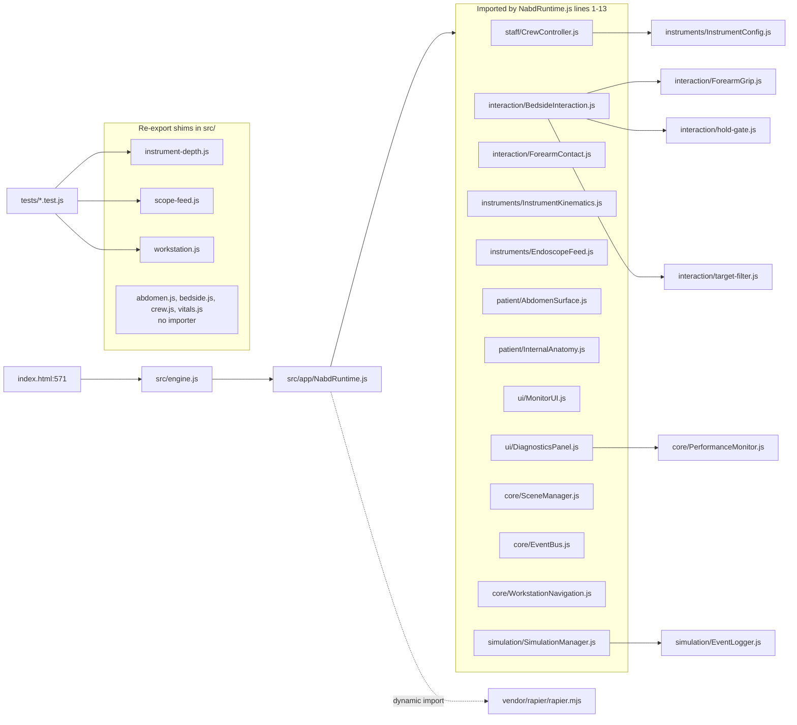

# Repository Evidence Index

This is the reference map for the improvement plan. It lists every source file, the important functions inside `src/app/NabdRuntime.js`, every asset, every test, the audit's runtime and build checks, and the repository documents. Each entry names the findings (F01–F35) it supports, so any claim in the plan can be traced to a file, line range, test or screenshot. The orientation document `Nabd_v1.5_Repository_Review.md` named in the owner's request was not found anywhere on disk, so this index treats the repository as the only source of truth. Line numbers were checked with `wc -l` and `grep` against the unchanged v1.5 tree on 13 November 2026. The folder is not under version control (F05), so they are tied to that snapshot. *Since T1 (14 November 2026) that snapshot is the git baseline commit `acdab52` (tag `v1.5-baseline`). The only application change since then is the F19 fix in commit `006881f` (`src/staff/CrewController.js:232-233`, edited in place, so every line number here still holds); T1 also added `tests/browser/` and a dev dependency (§2.4) and the evidence listed in §6.*

**Status labels used:** VERIFIED, TEST-VERIFIED, SOURCE-INSPECTED, PARTIALLY VERIFIED, PLANNED, UNKNOWN, DATA-DERIVED (audit analysis). Results of the T1 run of 14 November 2026 are cited as "T1 run"; BLOCKED marks a check that could not run in that environment.

**Related documents:** [README](README.md) · [01](01_PROJECT_UNDERSTANDING.md) · [02](02_CURRENT_STATE_AUDIT.md) (owns the full text of F01–F35) · [03](03_REQUIREMENTS_GAP_ANALYSIS.md) (owns G01–G23) · [05](05_HAND_CONTACT_AND_MOVEMENT_OPTIONS.md) · [07](07_PRIORITIZED_IMPROVEMENT_ROADMAP.md) · [08](08_TECHNICAL_DECISIONS_AND_OPEN_QUESTIONS.md) · [09](09_ACCEPTANCE_AND_VALIDATION_PLAN.md) · [10](10_NEXT_IMPLEMENTATION_TASK.md)

---

## 1. How to use this index

- **Facts, not advice.** This index records where things are and what evidence exists. It makes no recommendations. Recommendations live in [07](07_PRIORITIZED_IMPROVEMENT_ROADMAP.md) and [10](10_NEXT_IMPLEMENTATION_TASK.md).
- **Default label.** A location, line range or code behaviour in sections 2–4 is **SOURCE-INSPECTED** unless a cell says otherwise.
  - VERIFIED always cites a runtime check (R1–R21) or a build check (B1–B5) from section 6, or the T1 run (its evidence is listed at the end of section 6).
  - TEST-VERIFIED always names a test that passed in this audit.
- **Citation format.** Paths are repository-relative. Several `NabdRuntime.js` lines are minified and very long, so they are cited as `line@byte`. For example, `3860@71276` means line 3860, byte 71276.
- **"Connected?"** means the running app actually loads and calls the file. It is not enough for a file to exist (owner rule: "Do not assume a file is active just because it exists").
- **IDs.**
  - F01–F35 are findings; their full text is in [02](02_CURRENT_STATE_AUDIT.md).
  - G01–G23 are gaps, canonical in [03](03_REQUIREMENTS_GAP_ANALYSIS.md).
  - P0–P11 are roadmap phases, canonical in [07](07_PRIORITIZED_IMPROVEMENT_ROADMAP.md).
  - Section 8 maps each finding to its primary locations and main gaps. Where that mapping and [03](03_REQUIREMENTS_GAP_ANALYSIS.md) differ, [03](03_REQUIREMENTS_GAP_ANALYSIS.md) is canonical.

---

## 2. Source files

### 2.1 Module wiring

The running app loads 21 JavaScript modules (VERIFIED, R3): `src/engine.js`, `src/app/NabdRuntime.js` and 19 domain modules. Rapier is a separate dynamic import. The diagram shows who imports whom (SOURCE-INSPECTED).

### 2.2 Application modules

| Path | Lines / bytes | Key functions and classes (lines) | Role | Connected? | Tests | Findings |
|---|---|---|---|---|---|---|
| `index.html` | 573 / 36,758 | header 24-32; `#viewport` 36-92; `#forearm-practice` 46; `#anatomy-controls` 97-115 (attribution 114); `#work-controls` 116-153 (`#forearm-assist` 148); `#tool-depth-controls` 154-166; `#trainee-hud` 167-193 (hand buttons 185-186, `#trainee-reset` 190); `#training-session` 203-235 (`#training-tool` 208, `#training-source` 217); pose buttons 239-241; limb and hand-curl sliders 245-284; `#toggle-handles` 305; licence comment 310-557 (list 311-315; patient model source 531-544, URLs 537-538); `#vitals-dialog` 558-570; module script 571 | Arabic RTL page shell and every DOM control | Yes | None | F22, F25, F30 |
| `src/styles.css` | 643 / 215,805 | base64 WOFF2 `@font-face` 2-4; `:root` tokens 6, 139, 298; loading overlay 75; `.trainee-hud` 480; `.training-target` 492; sibling rule 591-593; port marker 601; diagnostics 623 | Layout and palette; fonts embedded | Yes | None | F25, F30 |
| `src/engine.js` | 7 / 284 | `import './app/NabdRuntime.js'` (7) | Entry point (not a shim) | Yes | None | F01 |
| `src/app/NabdRuntime.js` | 6,160 / 748,239 | See section 3 | Composition root, one IIFE with inline minified three.js r180 | Yes | None | F01, F02, and most others |
| `src/staff/CrewController.js` | 574 / 27,084 | `loadCrew` 2-574; `getBone` 11-19; `buildHand` 21-85 (sleeve 69-76, `contactProbes` 80); `hands` 87; supervisor group 88-94; `orientArm` 117-135; `reachSupport` 143-175; `staffGrip` 176-183; `tool` group 185-200; `ringInstrument` 215-230; **NaN call 232-233** (fixed in `006881f`); `selectTool` 240-248; `parkTool` 257-262; `aimInstrument` 264-274; `getPalm` 275-278; `canReach` 279-281; `driveHand` 282-286; `contactRotation` 293-304; `surfaceContact` 310-320; `driveSurface` 321-331; `offeringPoint` 344-347; `shoulder` 356-360; `updateHand` 362-435 (`poseFingers` 386-391, sweep/resolve 411-421, height-field lift 425-434); `updateSleeve` 437-453; `update` 457-505; `setVisible` 507-514; returned API 535-573 | Trainee gloves, supervisor body and pose, the four instruments, tool modes | Yes, if staff GLBs load (NabdRuntime 6023) | None | F06–F12, F14, F17–F20 |
| `src/interaction/BedsideInteraction.js` | 420 / 19,126 | `createBedside` 4-420; single `gesture`/`pointer` 13-15; `pick` 39-102 (forearm branch 44-55); `begin` 104-130; `release` 137-153 (stale contact 142-144); `move` 155-168; `pauseManipulation` 170-174; `updateBeforeHands` 176-249 (`toolField` 205, touch follow 206-218, normal 212-213); `updateAfterHands` 250-306; pointer listeners 308-389 (primary-only 309, `begin` gate 334); `keyboardGrip` 393-400 | Pointer gestures, grip, contact attach, release | Yes (created NabdRuntime 6040-6082) | Only its helpers (hold-gate, target-filter) | F15, F17, F18 |
| `src/interaction/ForearmContact.js` | 82 / 3,531 | `createForearmContact` 2-82; capsules, mattress, pad balls 14-18; `refresh` 25-29; `sweep` 31-44; `resolve` 46-65; `measure` 67-75 | Rapier shape queries (no World, bodies or gravity) | Forearm drill only (NabdRuntime 5434-5437) | `forearm-contact.test.js` fails at import (2 cases pass since T1, TEST-VERIFIED) | F15, F16 |
| `src/interaction/ForearmGrip.js` | 42 / 1,734 | `createForearmGrip` 2-42: `movePointer` 13, `update` 19, `freeze` 26, `sample` 33 | Wrist-frame grip and pointer-to-lift mapping | Forearm drill only (BedsideInteraction.js:284) | None | F15, F17 |
| `src/interaction/hold-gate.js` | 9 / 259 | `createHoldGate` 2-9 | Pause/resume flag for look-while-holding | Yes | `hold-gate.test.js` (flag only) | — |
| `src/interaction/target-filter.js` | 12 / 647 | `isPrivacySurfaceHit` 3-12 | Excludes the privacy material from targeting | Yes (BedsideInteraction 45, 81, 98, 209, 329) | `target-filter.test.js` (mock objects) | F17 |
| `src/patient/AbdomenSurface.js` | 191 / 7,758 | deformable bounds 16; `rebuild` 24-57 (whole-body max-Y grid); `height` 77-88; `contains` 90-94; `start` 96-126; `update` 142-164; `restore` 166 | Height field and abdominal press/pinch deformation | Workstation only, after crew load (NabdRuntime 6030) | None | F17, F21 |
| `src/patient/InternalAnatomy.js` | 82 / 4,118 | `anatomyLabels` 1-12 (35 entries); scope-layer sets 14-15; `loadInternalAnatomy` 17-82 (`scopeLayer` clone 29-36, `patient.root.add(atlas)` 55, `setVisible` 57-64, `show` 66-71) | 35-structure atlas, anatomy view and scope layer | Yes (NabdRuntime 6013-6016) | None | F29 |
| `src/instruments/InstrumentConfig.js` | 39 / 1,918 | `INSTRUMENT_CONFIG` 2-32; `getInstrumentConfig` 33-38; `listInstrumentConfigs` 39 (tests only) | Metadata for the four tools | Yes (CrewController 1, 194-199, 241) | `instrument-config.test.js` | F19 |
| `src/instruments/InstrumentKinematics.js` | 153 / 5,517 | `createInstrumentDepth` 3-153; constants 4-6; `emitMovement` 23-33; `drive` 53-105 (walking fallback 56-59); `adjust` 107-117; `adjustRoll` 119-129; `reset` 131 | Remote-centre port kinematics for grasper and scope | Yes (NabdRuntime 6031, via `toolField` 6048-6050) | `instrument-depth.test.js` (mocked crew) | F09, F20 |
| `src/instruments/EndoscopeFeed.js` | 141 / 6,320 | `createScopeFeed` 2-141; proxies `ellipsoid` 45; `setAnatomy` 72-81; `setScreenTexture` 83; `render` 94-119 (live test 96; off-screen render 112-116); `attach` 121-130; `dispose` 132 | 960×540 scope render target on the tower and field screens | Yes (NabdRuntime 6026-6028, render 5999) | `scope-feed.test.js` (proxy path, mocks) | F20, F29 |
| `src/ui/MonitorUI.js` | 160 / 5,606 | waveforms 8-34; `dataAt` 36-45; `paint` 47-110; `createVitals` 112-159 (`update` 130-148; paints once under `prefers-reduced-motion` 132; 82 ms throttle 133; no setter) | Vitals canvas and dialog | Yes (NabdRuntime 4634, update 5983) | None | F23 |
| `src/ui/DiagnosticsPanel.js` | 33 / 1,881 | `createDiagnosticsPanel` 4-33 (markup 10, no heap field; subscriber 14) | `?debug=1` overlay | Only with `?debug=1` (NabdRuntime 4633, 5959) | None | F33, F35 |
| `src/core/SceneManager.js` | 23 / 874 | `createSceneManager` 2-22 (`render` 7, `resize` 12) | Thin render/resize wrapper | Yes (render 6002; scope render bypasses it) | `scene-manager.test.js` | F01, F35 |
| `src/core/EventBus.js` | 40 / 1,172 | `createEventBus` 2-40 (`on` 5, `once` 13, `off` 22, `emit` 30, `clear` 37) | Synchronous bus; one channel `simulation:event` | Yes; only subscriber is DiagnosticsPanel | via `simulation-manager.test.js` (`on`/`emit`) | F24 |
| `src/core/PerformanceMonitor.js` | 38 / 1,473 | `PerformanceMonitor` 2-38 (`sample` 13) | FPS and renderer counters | Only inside an enabled DiagnosticsPanel | `performance-monitor.test.js` | F33 |
| `src/core/WorkstationNavigation.js` | 52 / 2,051 | `createWorkWalk` 2-52 (`goTo` 19, `walk` 31, `approach` 34, `update` 40) | Bed-perimeter walk loop | Yes (NabdRuntime 4954) | `workstation.test.js` (via shim) | — |
| `src/simulation/SimulationManager.js` | 59 / 2,695 | `SimulationManager` 8-59 (`emit` 16-21, `startSession` 22-28, `setStage` 30-38, `complete` 40-50, `reset` 53-56) | Session and stage mirror; never ticked per frame | Yes (NabdRuntime 15-27, 5667, 5714) | `simulation-manager.test.js` | F21, F24 |
| `src/simulation/EventLogger.js` | 78 / 2,602 | `SUPPORTED_EVENTS` 1-15; `EventLogger` 36-78 (`record` 51-68, 10,000 cap 66, `exportJSON` 76) | In-memory event log | Yes | `event-logger.test.js` | F24 |

### 2.3 Compatibility re-export shims

There are **seven** two-line shims in `src/`. Each starts with "Backward-compatible export". Nothing in the running app imports any of them; the app imports the domain modules directly (NabdRuntime.js:1-13). Three are imported only by tests; four are imported by nothing (grep of `src/`, `tests/`, `scripts/`, `index.html` and `vite.config.mjs`). `src/engine.js` sits in the same folder but is the app entry point, not a shim.

| Shim | Lines / bytes | Re-exports | Imported by |
|---|---|---|---|
| `src/instrument-depth.js` | 2 / 173 | `createInstrumentDepth` | `tests/instrument-depth.test.js:3` only |
| `src/scope-feed.js` | 2 / 153 | `createScopeFeed` | `tests/scope-feed.test.js:3` only |
| `src/workstation.js` | 2 / 154 | `createWorkWalk` | `tests/workstation.test.js:3` only |
| `src/abdomen.js` | 2 / 152 | `createAbdomenSurface` | nothing |
| `src/bedside.js` | 2 / 161 | `createBedside` | nothing |
| `src/crew.js` | 2 / 136 | `loadCrew` | nothing |
| `src/vitals.js` | 2 / 124 | `createVitals` | nothing |

### 2.4 Build, delivery and tooling

| Path | Lines / bytes | Key content (lines) | Role | Status in this audit | Findings |
|---|---|---|---|---|---|
| `scripts/serve.mjs` | 48 / 2,196 | MIME map 9-15; path-traversal guard 21-25; listens on 127.0.0.1:4173 (HOST/PORT env) | Dependency-free static server | VERIFIED (B5, PORT=4190) | F04 |
| `scripts/build-preview.mjs` | 95 / 5,124 | output name 8; regex mini-bundler; HTML rewrite 66-71; 9 embedded GLB IDs 73-83; `forearm-physics` Rapier tag 89-90 | Single-file standalone preview | VERIFIED (B4: PASS, 34.70 MiB; `dist/` deleted afterwards). T1 run: rebuilt after the Vite build; works over `file://` in Chrome, Edge and WebKit on Windows (U11) | F04, F30 |
| `scripts/generate-asset-manifest.mjs` | 33 / 1,450 | walks `assets/`, excludes the manifest; writes path, bytes, sha256 | Regenerates `assets/asset-manifest.json` | Not run (it would rewrite the manifest) | F30 |
| `scripts/build-internal-atlas.py` | 141 / 5,893 | `import bpy` 7; usage 12; `height_anchors` 18; `register` 23-43; loaders 45-71 | Blender build of the atlas from raw BodyParts3D files (raw files not in repo) | Not run (needs Blender and external data) | F29, F30 |
| `vite.config.mjs` | 16 / 458 | `base:'./'`; `writeBundle` copies `assets/` and `vendor/rapier/` (9-13) | Vite build configuration | Not run (B3; vite not installed). T1 run: `npm run build` OK in ≈1.0 s; one bundle of 763.67 kB with a chunk-size warning; empties `dist/` (U17) | F04 |
| `package.json` | 22 / 585 | version 1.5.0; scripts `dev`, `build`, `preview`, `test`, `serve`, `assets:manifest`, `preview:standalone`; dependency `three` 0.180.0; devDependency `vite ^6.0.0` | npm metadata | `npm test` = `node --test` run (B1). T1 (commit `06e2c65`): script `smoke` and devDependency `@playwright/test` 1.64.1 added; now 24 lines / 690 bytes | F03, F04 |
| `package-lock.json` | 1,128 / 35,131 | lockfile v3 | Pinned dependency tree; no `node_modules` present | Not installed. T1 run: `npm ci` left it byte-identical (SHA-256 `8a8b7c54…216344b`); commit `06e2c65` added the `@playwright/test` 1.64.1 entries (now 1,174 lines / 36,597 bytes) | F04 |
| `start-dev.bat` | 9 / 131 | `node --version`, then `npm run serve` | Windows launcher | Not run | — |
| `.vscode/extensions.json`, `.gitignore` | 5 / 88; 4 / 37 | Live Server and Prettier recommendations; ignores `node_modules/`, `dist/`, `.vite/`, `.DS_Store` | Editor and ignore settings | `.gitignore` exists, but the folder is not a git repository. T1: git repository since baseline `acdab52`; Live Server runs the app correctly (U23) | F05 |
| `tests/browser/playwright.config.mjs` | 89 / 4,098 | `webServer` starts `scripts/serve.mjs` (port 4301) or `vite preview` (4302, `NABD_SMOKE_SERVER=vite`); projects `chrome` (installed Chrome), `webkit` (Playwright WebKit, one retry), `edge` (installed Edge), `firefox` (skipped with a recorded reason when it cannot launch); `NABD_SMOKE_HEADED=1` for a visible window | Playwright configuration for `npm run smoke` (added in T1, commit `06e2c65`) | VERIFIED (T1 run) | F02, F32, F33, F34 |
| `tests/browser/smoke.spec.mjs` | 807 / 40,261 | S1 boot 195; S2 forearm drill 246; S3 support and release 317; S4 training session (golden trace) 366; S5 per tool 462 and staff handover 496; S6 room and presets 529; S7 anatomy 573; S8 hands and locomotion 621; S9 port and scope 693; V1–V4 captures 766-796 | Automated smoke protocol S1–S9 and visual baselines V1–V4 on `window.__studioQA` (added in `06e2c65`; F19 known-failure markers removed in `006881f`) | VERIFIED (T1 run): post-fix on `serve.mjs` in Chrome, WebKit on Windows and Edge, 48 passed, 2 flaky (WebKit), 1 failed (WebKit S2 R8 check, pre-existing) | F19, F32, F34 |
| `tests/browser/SMOKE_PROTOCOL.md` | 68 / 11,320 | How to run 8; common rules 24; flows S1–S9 33; visual baselines V1–V4 47; performance capture 58; manual equivalent without Playwright 62 | Written protocol behind the spec (09 §2.2–§2.4) | — | F32 |
| `tests/browser/perf-capture.mjs` | 333 / 17,796 | Plain Node script, not a test; headed Chrome with timing flags or WebKit; per view 10 s settle, 30 s idle, 30 s active; rAF intervals, render rate (WebGL `clear()` count), overlay counters, load to ready | Performance capture for 09 §2.4 (M7–M10) | VERIFIED (T1 run; [evidence/baseline-p0/perf/](evidence/baseline-p0/perf/)) | F33 |

---

## 3. Key locations inside `src/app/NabdRuntime.js`

The whole file after line 28 is one IIFE that opens on line 29 and closes at the end of line 6154. Variables inside `C0`: `s` = renderer, `e` = scene, `t` = camera, `g` = patient rig, `o` = room API, `I` = render flag (38 write sites).

| Region or function | Location | What it does | Findings |
|---|---|---|---|
| Static imports | 1-13 | 13 relative domain modules; no bare `three` import | F01 |
| `window.NabdSimulation` | 15-27 | Event bus, `SimulationManager`, frozen console API | F24 |
| three.js r180 core (inline) | 29 → 3860@71275 | Minified bundle; `WebGLRenderer` `va` 3860@18771, `OrbitControls` `Ea` @50770, `RoundedBoxGeometry` `Ta` @69824 | F01 |
| Raycast normal (inside bundle) | 29@118166 | Raycast normal is interpolated in object space (`getInterpolatedAttribute`) | F17 |
| **App code starts** | 3860@71276 (`var Hi=`) | Shared materials and helpers (`jn`, `vt`, `ll`, `u0`) | F01 |
| Table constants `Un`, `Cr` | 3860@72814 (`var Un=`) | Deck half-width 0.47, half-length 1.06, high 0.9; pillow zone | F27 |
| `nd` room builder | 3860@72918 → 4583 | Procedural room; front wall 3880-3882; lamp heads 4017-4035 (spot = DirectionalLight 4033); key and fill lights 4063-4070; screen canvases 4073-4163 (unreachable monitor branch 4088-4098, anesthesia 4099-4108); `casing` #ebf641 4164; "scrub-nurse side" comment 4366; `loadEmbeddedAsset` 4523-4544; GLB swaps 4546-4581 (`fixtures.visible=false` 4563); return 4582 | F13, F23, F26, F27, F28 |
| three.js addons | 4585@0 → @44086 | BufferGeometryUtils and GLTFLoader `Ra` (@995) | F01 |
| Patient rig | 4585@44087 (`var Qn=`) → 4632 | Pose presets `Pr`; `async function hd` @45443; finger curl 4586-4631; rig API returned on 4632 | F14, F27 |
| Limb IK and helpers | 4632@475 `T0`; @2019 `A0`; @2317 `md`; @6884 `Da`; @7097 `R0` | Analytic two-bone IK, drag manipulator, error overlay, patient source | — |
| `C0` init | 4632@7404 → 6154 | Renderer, camera, `sceneManager`; diagnostics 4633; `createVitals` 4634; `await nd` 4635; `assetBuffer` 4636-4646 | F01 |
| `traineeDefault` camera preset | 4661 (applied in `enterTraineeMode` 4744-4747; height reused at 4907 and 5134) | First-person stance (0.735, 1.60, 0.15), yaw π/2, pitch −0.60, fov 62; the fixed 1.60 m eye height discussed under D1 and P3 | F06 |
| Crew load starts | 4688-4696 | `loadCrew({T:{Vector3:L,…}, loadAsset})`, not awaited | F14 |
| Trainee mode | `setTraineeStatus` 4707; `animateCrew` 4709; `enterTraineeMode` 4731; `exitTraineeMode` 4755-4769 | Mode switch; both enter (4734) and exit (4757) call `leaveWorkstation` | F25, F31 |
| Anatomy UI | 4771-4893 (`openAnatomy` 4812, exit trainee mode 4821; `closeAnatomy` 4838) | Atlas view, organ pick | F29, F31 |
| `workRegions` | 4955-4964 (`workWalk` 4954) | Fixed supine region table; four limb chains | F15 |
| `selectWork` | 5155-5192 | Only in phase idle/complete (5156) | F20, F21 |
| `leaveWorkstation` | 5193-5219 | Closes forearm drill 5195, parks placed tool 5198 | F31 |
| `changeWorkSide` | 5220-5226 | Walks the camera to the other bed side | F08 |
| `chooseHand` | 5241-5248 | Sets `activeHand`, logs `hand_changed` | F08 |
| Scope station | 5257-5313 (`trainingPort` 5257, `scopeStationReady` 5265, `setScopeMonitorLook` 5269, `syncScopeStation` 5298) | Free-practice port and monitor view | F20 |
| Practice constants | 5365-5375 (`nearArm` = `leftArm` 5371) | Drill is hard-wired to the left arm | F15 |
| `createLimbDrag` | 5395-5428 | Bedside limb grip through IK | F15 |
| `openForearmPractice` | 5430-5456 | `selectWork('leftArm')`; `createForearmContact` 5434-5437 | F15 |
| `resetForearmPractice` / `closeForearmPractice` | 5457-5471 / 5472-5478 | Clears contact and support (5467-5468) | F31 |
| Support toggle | 5484-5491 | `station.support` flag | F12 |
| `updateForearmPractice` | 5492-5517 | Settling (5497-5507), support point 5509-5511, label gap < 0.020 5513-5514 | F12 |
| `interactionEvent` | 5537-5663 | Step detection and event recording | F21, F24 |
| `showFeedback` | 5527-5530 | Writes feedback and status (13 call sites) | F25 |
| `setPhase` | 5665-5697 | 5-step table 5669-5677; UI locks 5682-5690; result line 5695 | F21, F24 |
| `clearScenario` / `startScenario` | 5699-5711 / 5712-5720 | Reset wipes the log (5700); session `'clinical-skills-practice'` (5714) | F21, F24 |
| `confirmOxygen` / `handleAction` | 5721-5734 / 5735-5743 | Fixed three-button quiz; step dispatch | F22 |
| `keyboardGrip` | 5774 | F key grip | F18 |
| Wheel and keydown handlers | 5806-5818; 5820-5851 (Q/E 5831-5832) | Depth, zoom, hand selection, shortcuts | F08 |
| Pose and camera state; `G`/`V`/`$` | 5854; 5916 (`$` limb min-Y @1501) | Camera presets, pose tween, mattress floor | F27 |
| Hand buttons; reset | 5947-5949; 5952 | `chooseHand`; "إعادة وضع اليدين" → `clearScenario` | F08, F24 |
| **Frame loop `ee`** | 5954-6007 (started 6008) | Order: diagnostics → pose → camera → abdomen → forearm drill → vitals (5983) → gated crew block (5984-5991) → render (5992-6006) | F01, F23, F33 |
| Patient and atlas load | 6009; 6012-6021 | `g=await hd(e,R0())`; `loadInternalAnatomy` | F29, F34 |
| **Crew wiring** | 6022-6087 | `await crewReady` 6022; `selectTool` 6025; scope feed 6026-6028; abdomen 6030; tool depth 6031; `createBedside` 6040-6082 (`getSide` 6042, `toolField` 6048-6050, `surfaceHit` 6067) | F15, F20 |
| **Rapier import** | 6088-6099 | Base64 `#forearm-physics` or `vendor/rapier/rapier.mjs`; `physics.init()` | F15, F30 |
| Staff failure branch | 6100-6103 | Hands, supervisor, bedside and Rapier all unavailable | F34 |
| **`window.__studioQA`** | 6104-6154 (`?qa` only) | `getTargets`, `getAssetStatus`, `getSimulationState`, `getScopePixels`, `getState`, `getCamera`, `workMoving`, `getJoints`, `setPose`; `supervisorVisible` 6136 | F32 |
| `C0().catch` | 6154@328 | Records `interaction_error`, shows overlay | — |
| three.js licence block | 6155-6159 | `@license` MIT | F30 |

---

## 4. Assets

Triangle counts and skeleton facts come from read-only parsing of the GLB JSON during the audit (DATA-DERIVED). Bytes come from the file system. All nine GLBs loaded with HTTP 200 in the browser run (VERIFIED, R3).

| Path | Bytes | Triangles | Skeleton | Used by (code) | Embedded vs fetched | Provenance / licence | Findings |
|---|---:|---:|---|---|---|---|---|
| `assets/patient/patient.glb` | 8,097,160 | 109,248 | `PatientRig`, 163 joints; standing A-pose; no clips or morphs | `R0` 4632@7097 → `hd` 4585@45443, called 6009 | Fetched in served mode; `embedded-patient` in the preview | The `index.html` licence comment (531-544) names the sources with URLs (537-538): Innerscene "Male base mesh, rigged A-pose", "adapted from MakeHuman", CC0 1.0, and the MakeHuman System Assets pack, CC0 1.0. `assets/patient/ASSET-PROVENANCE.md` is second-hand (carried from v0.15 notes) and gives no URL. These licence claims were not independently checked | F14, F27, F30 |
| `assets/staff/supervisor.glb` | 7,907,564 | 112,480 | Byte-identical skeleton to the patient | `loadCrew` (CrewController.js:7-9) via `assetBuffer` (NabdRuntime 4692) | Fetched; `asset-supervisor` | `assets/staff/ASSET-PROVENANCE.md` names only gown, cap, gloves and mask | F11, F14, F30 |
| `assets/staff/glove-left.glb` | 628,380 | 14,338 | `GloveRig_left`, same 163 joint names, different inverse-bind matrices | `buildHand` (CrewController.js:21-87) | Fetched; `asset-glove-left` | As above | F06, F07, F10, F14 |
| `assets/staff/glove-right.glb` | 628,552 | 14,338 | `GloveRig_right` | As above | Fetched; `asset-glove-right` | As above | F06, F08, F10 |
| `assets/operating-table/base.glb` | 36,400 | 2,776 | None; POSITION only | `loadEmbeddedAsset` (NabdRuntime 4548) | Path map 4526; `asset-operating-table-base` | None stated; trimesh-generated; no generator script | F27, F28, F30 |
| `assets/operating-table/top.glb` | 51,224 | 3,608 | None; pad tops at y ≈ 0.953 | 4549; placed at `Un.high` (4553) | Path map 4527 | As above | F27, F28, F30 |
| `assets/surgical-system/light-pendant-system.glb` | 135,072 | 17,224 | None; no glTF lights | 4560; hides procedural `fixtures` 4563 | Path map 4528 | As above | F26, F28, F30 |
| `assets/anesthesia/workstation.glb` | 117,648 | 10,564 | None; screen mesh has no UVs | 4568-4580 | Path map 4529 | As above | F28, F30 |
| `assets/anatomy/internal-atlas.glb` | 4,525,104 | 187,605 | None (vertex colours); 35 nodes | NabdRuntime 6013-6016 → InternalAnatomy.js:17-82; scope layer 6027 | Fetched; `embedded-internal-atlas` | BodyParts3D © DBCLS, CC BY 4.0 (`assets/anatomy/PROVENANCE.md`); share-alike note on FMA lung and liver sources (line 10) | F29, F30 |
| `vendor/rapier/rapier.mjs` | 4,340,292 | — | — | Dynamic import 6088-6099; `tests/forearm-contact.test.js:4` | URL fetch, or `forearm-physics` base64 in the preview | Apache-2.0 (`vendor/rapier/LICENSE`, 11,343 B). Not listed in `index.html` 311-315; licence text not embedded in the preview. The file has no version string. The version 0.21.0 is stated in `README.md:10`; loading the module in Node during the audit returned `version()` = `0.21.0` (DATA-DERIVED (audit analysis)) | F15, F30 |
| `vendor/three/LICENSE` | 1,081 | — | — | Licence for the inline bundle | — | MIT | F30 |
| `vendor/fonts/IBM-Plex-OFL.txt`, `Inter-OFL.txt` | 256 each | — | — | Fonts themselves are base64 in `src/styles.css` 2-4 | Embedded in CSS | SIL OFL 1.1; files are 5-line stubs with no copyright line | F30 |
| `assets/asset-manifest.json` | 2,319 | — | — | Not read at runtime | — | 13 entries, 22,134,700 B total | F30 |
| Provenance notes | 403–4,467 | — | — | Not read at runtime | — | `anatomy/PROVENANCE.md`, `anatomy/structure-sources.json`, `patient/ASSET-PROVENANCE.md`, `staff/ASSET-PROVENANCE.md` | F30 |

The nine GLBs total 22,127,104 bytes (≈ 22.1 MB). No GLB carries animation clips or morph targets (DATA-DERIVED). Three textures, about 2.25 MB, are byte-identical between `patient.glb` and `supervisor.glb` (DATA-DERIVED).

---

## 5. Tests

`node --test` (Node v26.13.1) reports 20 results across 13 files: 19 pass and 1 fails (VERIFIED, B1). The failing result is the whole `forearm-contact.test.js` file, which fails at import. Its 2 cases never run, so the 13 files hold 21 declared cases. All tests use fakes or mocks, except that `asset-manifest.test.js` and `module-graph.test.js` read real files without executing them. None loads `NabdRuntime.js`, the bundled three.js, WebGL or the DOM, and none parses a GLB (`asset-manifest.test.js` only hashes the files). A re-run of `node --test` during this review gave the same 19 pass / 1 fail.

*Status after T1 (14 November 2026):* after `npm ci`, `npm test` reports 21 tests, 21 pass, 0 fail (TEST-VERIFIED, T1 run; also after the F19 fix and with `tests/browser/` present, whose files `node --test` does not collect). The browser smoke suite in `tests/browser/` (§2.4) is the first automated check that loads `NabdRuntime.js`, WebGL, the DOM and the GLBs; it is run with `npm run smoke`, not `npm test`.

| File | Cases | Imports | What it asserts | Result |
|---|---:|---|---|---|
| `asset-manifest.test.js` | 1 | Node built-ins | Size and SHA-256 of every listed asset; `assetCount >= 8` (line 13) | TEST-VERIFIED (pass). Does not detect unlisted files; Rapier is not in the manifest |
| `event-logger.test.js` | 3 | `src/simulation/EventLogger.js` | Unique IDs and ISO timestamps; unknown events rejected; trimming; frozen snapshots | TEST-VERIFIED (3 pass) |
| `forearm-contact.test.js` | 2 | bare `'three'` (line 3), `vendor/rapier/rapier.mjs`, `ForearmContact.js` | Sweep stops a probe at the forearm and mattress (`stops === 2`); overlap is resolved along the normal | **Fails at import** (`ERR_MODULE_NOT_FOUND: 'three'`); 0 cases ran. An audit harness with a vector shim reproduced the assertions: DATA-DERIVED (audit analysis), not TEST-VERIFIED. *Since T1: 2 pass after `npm ci` (TEST-VERIFIED, T1 run)* |
| `hold-gate.test.js` | 1 | `hold-gate.js` | `pause()`/`resume()` flip `paused` | TEST-VERIFIED (flag only, not the BedsideInteraction wiring) |
| `instrument-config.test.js` | 2 | `InstrumentConfig.js` | Four IDs, lengths, `supportsDepth`, unknown ID throws; grip offsets | TEST-VERIFIED (2 pass). Does not load CrewController, so it misses F19 (the F19 regression check is smoke S5) |
| `instrument-depth.test.js` | 2 | shim `src/instrument-depth.js`, fake vectors and crew | Alignment before insertion; pivot about the port; roll does not move the tip | TEST-VERIFIED (2 pass; target maths only) |
| `module-graph.test.js` | 1 | fs | Every relative static import in `src/` resolves | TEST-VERIFIED (does not check dynamic `import()`) |
| `performance-monitor.test.js` | 1 | `PerformanceMonitor.js` | FPS and counter sampling; heap null without memory API | TEST-VERIFIED |
| `scene-manager.test.js` | 1 | `SceneManager.js`, fake renderer | `render`, `resize`, aspect, `dispose` | TEST-VERIFIED |
| `scope-feed.test.js` | 1 | shim `src/scope-feed.js`, fakes | No-signal and live texture swap; camera follows the tip; render target restored | TEST-VERIFIED (proxy path only; `setAnatomy` untested) |
| `simulation-manager.test.js` | 3 | SimulationManager, EventLogger, EventBus | Lifecycle sequence and 6 bus publications; idempotence; reset detaches | TEST-VERIFIED (3 pass) |
| `target-filter.test.js` | 2 | `target-filter.js` | Per-face privacy filter; single-material exclusion | TEST-VERIFIED (mock objects) |
| `workstation.test.js` | 1 | shim `src/workstation.js` | Walk moves along the bed, and `goTo(-1, …)` reaches the opposite side near the same z. The title says "all four sides"; the assertions cover only these two | TEST-VERIFIED (via the shim) |

**No test covers** `NabdRuntime.js`, `CrewController.js`, `BedsideInteraction.js` (only its two helpers), `ForearmGrip.js`, `AbdomenSurface.js`, `InternalAnatomy.js`, `MonitorUI.js`, `DiagnosticsPanel.js`, `window.__studioQA`, or any script in `scripts/` (F02).

---

## 6. Runtime and build evidence

Environment for R1–R21:
- Chromium 152 (Electron built-in browser) on Windows 11, Intel Iris Xe (ANGLE D3D11), WebGL2.
- Viewport 1440×900.
- Served with `scripts/serve.mjs` on port 4190.
- The pane was hidden for most of the session, so `requestAnimationFrame` was throttled. **FPS values are not valid.** Renderer counters are valid.

| # | Check | Result | Status | Evidence |
|---|---|---|---|---|
| R1 | App boots and renders | Loading text, then the scene | VERIFIED | [01](evidence/01-default-bedside-view.jpg) |
| R2 | Console | No messages in the default flows | VERIFIED | — |
| R3 | Network | 21 modules, 9 GLBs and Rapier return HTTP 200 | VERIFIED | — |
| R4 | Default bedside view | Supine patient; full-body supervisor; trainee = two gloves and forearm sleeves only | VERIFIED | [01](evidence/01-default-bedside-view.jpg) |
| R5 | UI density | 39 visible buttons (76 in DOM), 8 visible form controls, 0 textareas | VERIFIED | [01](evidence/01-default-bedside-view.jpg), [09](evidence/09-training-step-1-of-5.jpg) |
| R6 | `?debug=1` counters | Draw calls and triangles per view, as in F33 | VERIFIED (FPS invalid) | — |
| R7 | Forearm drill entry | Moves to the patient's left arm; drill panel shown | VERIFIED | [02](evidence/02-forearm-drill-grip.jpg) |
| R8 | Reach gating | Out of reach first; grips after "اقترب" | VERIFIED | — |
| R9 | Grip and lift | Left forearm lifted off the arm board | VERIFIED | [02](evidence/02-forearm-drill-grip.jpg), [03](evidence/03-forearm-lift-stretched-sleeve.png) |
| R10 | Hand-arm continuity | **Defect:** a large stretched dark-teal sleeve volume runs to the wrist | VERIFIED | [03](evidence/03-forearm-lift-stretched-sleeve.png) |
| R11 | Supervisor support | Support label shown; the forearm stays raised after release | VERIFIED | [04](evidence/04-supervisor-support-hand.png), [05](evidence/05-after-release-forearm-supported.jpg) |
| R12 | Supervisor after leaving the drill | **Corrected:** support had already ended. Room view runs `exitTraineeMode` → `closeForearmPractice` (4755-4757, 5193-5195, 5468-5472); the support hand is the supervisor's own right arm (CrewController.js:143-175) | SOURCE-INSPECTED correction | [04](evidence/04-supervisor-support-hand.png), [05](evidence/05-after-release-forearm-supported.jpg), [07](evidence/07-left-side-preset-supervisor.jpg) |
| R13 | Room overview | Lights, anesthesia, tower, trolleys; one supervisor; no nurse; no trainee body | VERIFIED | [06](evidence/06-room-overview.jpg) |
| R14 | Internal anatomy | "35 بنية معروضة"; BodyParts3D attribution; appendix, cecum and mesoappendix listed; appendix not clearly visible | VERIFIED (appendix PARTIALLY VERIFIED) | [08](evidence/08-internal-anatomy-atlas.jpg) |
| R15 | Training session | `clinical-skills-practice`, step 1/5, four events logged | VERIFIED | [09](evidence/09-training-step-1-of-5.jpg) |
| R16 | Logging outside a session | Forearm actions before a session produced no events | VERIFIED | — |
| R17 | Instrument selects | `#training-source` and `#training-tool` options exist; handover not exercised | VERIFIED (exists only) | — |
| R18 | Hand selection | Buttons toggle `aria-pressed`; no visible rest-pose change; Q/E not tried | PARTIALLY VERIFIED | — |
| R19 | WASD walk | No movement seen while the pane was throttled. *T1 run: WASD works in a visible window (U14)* | UNKNOWN | — |
| R20 | Scissors | **Defect:** 4 `computeBoundingSphere(): Computed radius is NaN` errors; no blades. *T1 run: reproduced for scissors and needle holder; fixed in `006881f`* | VERIFIED | [10](evidence/10-scissors-without-blades.jpg), [11](evidence/11-scissors-with-blades-after-f19-fix.jpg) |
| R21 | Trainee forearm outside the workstation | Long blue forearm entering from the screen corner; no body | VERIFIED | [10](evidence/10-scissors-without-blades.jpg) |
| B1 | `node --test` | 13 files, 20 reported results: 19 pass, 1 fails at import. The lead's note "20 test files" means 20 reported results. *T1 run: 21 of 21 after `npm ci`* | VERIFIED | — |
| B2 | `node --check` on all JS in `src/`, `scripts/`, `tests/` | Pass | VERIFIED | — |
| B3 | `npm run build` (Vite) | Not run; vite not installed. *T1 run: PASS in ≈1.0 s; empties `dist/` (U17)* | UNKNOWN | — |
| B4 | `npm run preview:standalone` | PASS; 34.70 MiB; renders over http with no console messages; `file://` not tested. *T1 run: `file://` works in Chrome, Edge and WebKit on Windows (U11)* | VERIFIED | — |
| B5 | `node scripts/serve.mjs` | PASS | VERIFIED | — |

Not exercised at runtime:
- training steps 2–5;
- scope insertion and the tower feed;
- abdominal press and pinch;
- surface touch outside the drill;
- pose presets and limb sliders;
- patient finger curl;
- supervisor handover;
- two-hand use;
- opposite-side work;
- the needle holder (it shares the scissors' NaN code path);
- touch devices, Firefox and Safari;
- sustained FPS.

*Since T1 (14 November 2026; T1 run):* training steps 2–5 (S4), scope insertion and the tower feed (S9), the supervisor's tool offer (S5; the hand-to-hand pickup was not exercised), the needle holder (S5), walking to the opposite side (S8), WASD (U14), Edge and WebKit on Windows, emulated touch (U2) and sustained FPS in a visible window were exercised. Still unexercised: abdominal press and pinch attach, surface touch outside the drill, pose presets and limb sliders, patient finger curl, the hand-to-hand pickup, two-hand use, Firefox (BLOCKED), Safari on macOS and real touch devices.

**T1 run evidence (14 November 2026).** Paths are relative to `docs/improvement-plan/`. Screenshots are committed only for the canonical runs; every JSON readout, log and Playwright report is kept, and `npm run smoke` regenerates the rest.

| Path | What it holds | Status | Findings / unknowns |
|---|---|---|---|
| [evidence/baseline-p0/RESULTS.md](evidence/baseline-p0/RESULTS.md) | Smoke, visual and performance results on the unmodified code (F19 not applied): machine and browser identification, run list, pass/fail matrix, the F19 known failure, readouts against R1–R21, V1–V4 counters, M7/M10 tables, what did not work | VERIFIED (T1 run) | F03, F04, F19, F33, F34; U1, U3, U8, U14, U21 |
| `evidence/baseline-p0/smoke/` | QA JSON per flow for each server, browser and mode (`serve-*`, `vite-preview-*`; `serve-firefox-headless/firefox-launch.json` holds the launch error); `logs/` holds the list output and Playwright JSON reports of the five runs. JPEGs: all flows in `serve-chrome-headed/` (28), the S5 images in `serve-webkit-headless/` (5: four tool trays and the staff handover) | VERIFIED (T1 run); Firefox BLOCKED | F19, F32, F34 |
| `evidence/baseline-p0/visual/` | V1–V4 JSON (camera pose, FOV, overlay counters) per configuration; JPEGs for `serve-chrome-headed/` (the official set) and `serve-webkit-headless/` (a Safari-engine comparison, which U21 shows is blank after a resize) | VERIFIED (T1 run) | F33; U21 |
| `evidence/baseline-p0/perf/` | `chrome-headed.json` and `chrome-headed-raf-intervals.json` (3 runs × V1–V4, idle and active segments, loads), `webkit-on-windows-headless*.json` (one run), `perf-run.log` | VERIFIED (T1 run; no threshold applied) | F33; U1, U8 |
| `evidence/baseline-p0/npm-test-with-browser-files.txt` | `npm test` with `tests/browser/` present: 21 tests, 21 pass | TEST-VERIFIED (T1 run) | F03 |
| `evidence/p0-post-fix/post-fix-run.log` | After `006881f`: `npm test` 21/21; build in 995 ms; smoke on `serve.mjs` (Chrome, WebKit, Edge) 48 passed, 2 flaky, 1 failed (WebKit S2 R8 check) | VERIFIED (T1 run) | F03, F04, F19 |
| `evidence/p0-post-fix/smoke/serve-{chrome,edge,webkit}-headless/` | QA JSON per flow after the fix; `S5-summary.json` gives 0 console errors and 0 NaN errors for all four tools in each browser; JPEGs of the S5 tool trays and the staff handover in Chrome only (5) | VERIFIED (T1 run) | F19, F34 |
| `evidence/p0-post-fix/visual/serve-{chrome,edge,webkit}-headless/` | V1–V4 JSON after the fix | VERIFIED (T1 run) | F33 |
| [evidence/11-scissors-with-blades-after-f19-fix.jpg](evidence/11-scissors-with-blades-after-f19-fix.jpg) | Built-in browser after the fix: the scissors show their blades, zero console errors; pair with [evidence/10](evidence/10-scissors-without-blades.jpg) | VERIFIED (T1 run) | F19 |
| [phase-reports/P0-unknowns.md](phase-reports/P0-unknowns.md) | Probe results for U1–U3, U6–U12, U14–U18, U21 and U23: method, observation and verdict per unknown (summarised in [08](08_TECHNICAL_DECISIONS_AND_OPEN_QUESTIONS.md) §3). The probe scripts ran from outside the repository and are not committed | VERIFIED (T1 run) unless marked | F09, F28, F29, F33; U1–U3, U6–U12, U14–U18, U21, U23 |
| [phase-reports/P0-completion.md](phase-reports/P0-completion.md) | The T1 phase completion report ([09](09_ACCEPTANCE_AND_VALIDATION_PLAN.md) §7 template): AC-P0-1 to AC-P0-10, AC-P1-1, invariants, downloads, open items | — | F03–F05, F19, F32–F34 |

---

## 7. Repository documents versus code (F35)

| Document (lines) | Claim (line) | What the code shows | Status |
|---|---|---|---|
| `README.md` (167) | Rapier forearm checks; Rapier 0.21.0 bundled with the preview (8, 10) | Consistent (ForearmContact.js; build-preview.mjs:89-90). The licence is missing from the `index.html` list | Consistent; F30 |
| | 35 atlas structures (16) | Consistent: InternalAnatomy.js:1-12 (35 labels); R14 | VERIFIED (R14) |
| | Empty heading "محطة المنظار v1.1" (22); "Baseline v0.22 / Release v1.0 Foundation" inside the v1.5 README (35-36) | Stale structure | SOURCE-INSPECTED |
| | Rendering and resize pass through `SceneManager`; heap shown where supported (82) | The scope render bypasses it (EndoscopeFeed.js:112-116); no heap field (DiagnosticsPanel.js:10) | Contradicted |
| | Preview output `…-v1.5-Preview.html` (121) | Matches build-preview.mjs:8 | Consistent |
| | One active grip at a time (158); not a rigid-body solver (159) | Consistent (F18; Rapier used for shape queries only) | Consistent |
| | "tested Chromium configurations" (165) | No tested configuration is documented in the repo; R1–R21 is the first recorded browser run | Unsupported |
| `docs/Nabd-v1.0-Change-Log.md` (26) | Appendectomy/laparoscopic and neck scenario entry points preserved (21) | No such scenario; only `clinical-skills-practice` (NabdRuntime 5714) | Contradicted (F21) |
| | Instrument config centralised (10) | Present, but CrewController.js:232-233 reads `.length` on `{model, config}` | Regression (F19) |
| | Compatibility re-exports kept (7) | Seven shims; unused by the app; three are imported by tests, four by nothing (§2.3) | Consistent |
| `docs/Nabd-v1.0-Foundation-Report.md` (84) | 7/7, then 19/19 tests pass (31-32) | Now 13 files, 21 cases, 19/20 results pass | Outdated (F03) |
| | All 8 expected GLB IDs embedded (35) | 9 GLB IDs plus `forearm-physics` (build-preview.mjs:73-90) | Outdated |
| | Vite build not run (37); interactive WebGL test not completed (38) | Still true for Vite (B3); browser now run (R1–R21) | Partly superseded |
| | Preview file `…-v1.0-Preview.html` (78) | Code writes `…-v1.5-Preview.html` | Outdated |
| | `SceneManager` owns render and resize; heap included (18-19) | As for README:82 | Contradicted |
| `docs/Nabd-v1.0-Architecture.md` (76) | Module tree (9-36) | Omits `InternalAnatomy.js`, `ForearmContact.js`, `ForearmGrip.js` and Rapier | Outdated |
| `docs/Nabd-v1.0-Functionality-Audit.md` (33) | 19 tests passed (5); endoscope anatomy is proxies only (29); one grip at a time (31) | Tests outdated; the atlas replaces the proxies when it loads (EndoscopeFeed.js:72-81); grip claim consistent | Partly outdated |
| `docs/Nabd-v0.22-Implementation-Report.md` (68) | Both surgical task lights aim at the work point (16) | Only in the procedural fallback. The default GLB path hides those lights (NabdRuntime 4033, 4563) | Contradicted (F26) |
| | Hand orientation uses the surface normal (28) | Touch follow uses an object-local normal as a world normal (BedsideInteraction.js:212-213) | Partly true (F17) |
| `docs/Nabd-v0.22-Review-Board.md` (56) | Chief architecture decision: the simulator owns input, hand pose and contact; AI never drives per-frame transforms (54-56) | Consistent; no AI exists (F22). Basis for DN2 | Consistent |
| `docs/architecture-decision.md` (23) | Stay on Three.js r180 (4); "Current v0.16 scope" (22-23) | Choice consistent with DN1; scope section stale | Partly stale |
| `docs/v0.16-change-log.md` (22) | Camera-attached trainee hands (12); supervisor placeholder hidden (17) | Hands are scene children placed from the camera (CrewController.js:23-26, 365-371); supervisor always visible (88-94; R4) | Outdated |
| `docs/v0.22-interaction-notes.md` (32) | Task lights follow the work point (8); seven Node tests (28) | As for the Implementation Report line 16; tests outdated | Outdated |
| `docs/patient-hand-rig.md` (31) | Local-axis finger flexion is provisional and must be visually validated | Still true; the trainee gloves use the same approach (CrewController.js:386-391) | Consistent (F10) |

---

## 8. Finding → evidence quick map

| ID | Primary locations | Status and evidence | Gaps (as mapped in the 02 register) |
|---|---|---|---|
| F01 | `src/app/NabdRuntime.js` (6,160 lines / 748 KB; app code from 3860@71276; `I` set in 38 places) | SOURCE-INSPECTED | G19, G23 |
| F02 | `tests/*` imports; untested modules listed in §5 | SOURCE-INSPECTED | G08, G12, G23 |
| F03 | `tests/forearm-contact.test.js:3` | VERIFIED (B1). *RESOLVED by T1: 21 of 21 (TEST-VERIFIED, T1 run)* | G23 |
| F04 | `package.json`, `vite.config.mjs`, `scripts/build-preview.mjs` | Vite build UNKNOWN (B3 not run; no `node_modules`, repository state); standalone preview VERIFIED (B4). *RESOLVED by T1: Vite build VERIFIED (T1 run); it deletes the preview from `dist/` (U17)* | G23 |
| F05 | Repository root (no `.git`; `git rev-parse` fails) | SOURCE-INSPECTED (repository state). *RESOLVED by T1: baseline `acdab52`, tag `v1.5-baseline`* | G23 |
| F06 | CrewController.js:21-87, 356-371 | VERIFIED (R4, R21) | G03, G06, G09 |
| F07 | CrewController.js:69-76, 356-360, 437-453 | VERIFIED (R10) | G03, G09 |
| F08 | CrewController.js:87, 279-281; NabdRuntime 5241-5248, 5831-5832, 5947-5949; BedsideInteraction.js:105, 120 | SOURCE-INSPECTED; R18 PARTIALLY VERIFIED | G08, G14 |
| F09 | CrewController.js:238, 282, 293-304, 321-331; InstrumentKinematics.js:56-59, 119-129 | SOURCE-INSPECTED; visual UNKNOWN | G08, G09, G13 |
| F10 | CrewController.js:39-43, 381-391 | SOURCE-INSPECTED; axis UNKNOWN | G07, G10 |
| F11 | CrewController.js:88-183, 457-478, 507-514; NabdRuntime 6136 | SOURCE-INSPECTED; VERIFIED visible (R4, R13) | G04, G06, G16 |
| F12 | CrewController.js:143-175, 481-485; NabdRuntime 5484-5517 | VERIFIED (R11); mechanism SOURCE-INSPECTED | G04, G10, G12 |
| F13 | NabdRuntime 4366; `assets/staff/` | SOURCE-INSPECTED; VERIFIED absent (R13) | G05, G17 |
| F14 | `patient.glb`, `supervisor.glb`, glove GLBs; `index.html:537` (base mesh and rig "adapted from MakeHuman") | Shared skeleton DATA-DERIVED. The MakeHuman origin is the repository's own claim (`index.html:537`), not independently verified: UNKNOWN until confirmed | G03, G04, G05 |
| F15 | ForearmContact.js:14-75; NabdRuntime 5371, 5430-5437, 6088-6099; CrewController.js:80, 411-421 | SOURCE-INSPECTED; drill VERIFIED (R7–R11); module logic DATA-DERIVED | G11, G12 |
| F16 | ForearmContact.js:14-15 vs patient skin | DATA-DERIVED | G12 |
| F17 | BedsideInteraction.js:49-51, 206-218; AbdomenSurface.js:24-57; CrewController.js:425-434; bundle 29@118166 | SOURCE-INSPECTED | G11, G12, G13 |
| F18 | BedsideInteraction.js:13-15, 309, 334, 395; CrewController.js:185, 255 | SOURCE-INSPECTED | G10, G14 |
| F19 | CrewController.js:194-199, 232-233; `tests/browser/smoke.spec.mjs` S5 | VERIFIED (R20, scissors); needle holder SOURCE-INSPECTED. *FIXED in `006881f`; VERIFIED (T1 run): S5 0 console errors for all four tools; evidence 11* | G15 |
| F20 | CrewController.js:185-273, 494-503; InstrumentKinematics.js:3-153; EndoscopeFeed.js:94-118; NabdRuntime 5156, 5996-6002 | SOURCE-INSPECTED; TEST-VERIFIED in part (`instrument-depth`, `scope-feed`, mocks) | G15, G10 |
| F21 | NabdRuntime 5665-5743; `docs/Nabd-v1.0-Change-Log.md:21` | SOURCE-INSPECTED; R15 VERIFIED | G19, G21 |
| F22 | `index.html` (no text input); CrewController.js:535-573 | SOURCE-INSPECTED; R5 VERIFIED (0 textareas) | G16, G17, G18 |
| F23 | MonitorUI.js:36-45, 130-148; NabdRuntime 4088-4108, 5983 | SOURCE-INSPECTED. Values are code literals: CLINICAL REVIEW REQUIRED before any clinical use | G20, G23 |
| F24 | EventLogger.js; NabdRuntime 5695, 5700, 5952 | SOURCE-INSPECTED; R16 VERIFIED; logger TEST-VERIFIED | G19, G22 |
| F25 | `index.html` 239-307; NabdRuntime 4707, 5527 | SOURCE-INSPECTED; R5 VERIFIED | G01, G18 |
| F26 | NabdRuntime 4017-4035, 4563 | SOURCE-INSPECTED; visual UNKNOWN | G01 |
| F27 | NabdRuntime 3860@72814, 4553, 5916; ForearmContact.js:16; `top.glb` | DATA-DERIVED and SOURCE-INSPECTED; interpenetration UNKNOWN | G01, G02, G12 |
| F28 | NabdRuntime 3880-3882, 4164; room GLBs | DATA-DERIVED and SOURCE-INSPECTED; yellow tower VERIFIED (R13); other visual effects UNKNOWN | G01 |
| F29 | InternalAnatomy.js:1-82; `internal-atlas.glb`; `index.html:114` | VERIFIED (R14); appendix PARTIALLY VERIFIED | G02, G21 |
| F30 | `index.html` 311-315; build-preview.mjs:89-90; `vendor/fonts/*.txt`; `assets/anatomy/PROVENANCE.md:10` | SOURCE-INSPECTED | G02, G23 |
| F31 | NabdRuntime 4734, 4755-4757, 4821, 5193-5198, 5457-5478 (also reached by Escape at a workstation 5845-5848 and "إعادة وضع اليدين" 5952) | SOURCE-INSPECTED (explains the R12 correction) | G11, G19 |
| F32 | NabdRuntime 6104-6154 | SOURCE-INSPECTED. *Used since T1 by `tests/browser/smoke.spec.mjs` and `perf-capture.mjs`* | G23 |
| F33 | Renderer counters (draw calls 479–1,520; triangles 299k–464k) | VERIFIED (R6); FPS UNKNOWN. *T1 run: first valid frame times, one machine ([evidence/baseline-p0/RESULTS.md](evidence/baseline-p0/RESULTS.md) §6); budget not applied* | G23 |
| F34 | Network and console in default flows | VERIFIED (R2, R3, R20). *T1 run: reproduced in Chrome, Edge and WebKit on Windows; scissors errors gone after `006881f`* | G23 |
| F35 | §7 of this index | SOURCE-INSPECTED | G21, G23 |
